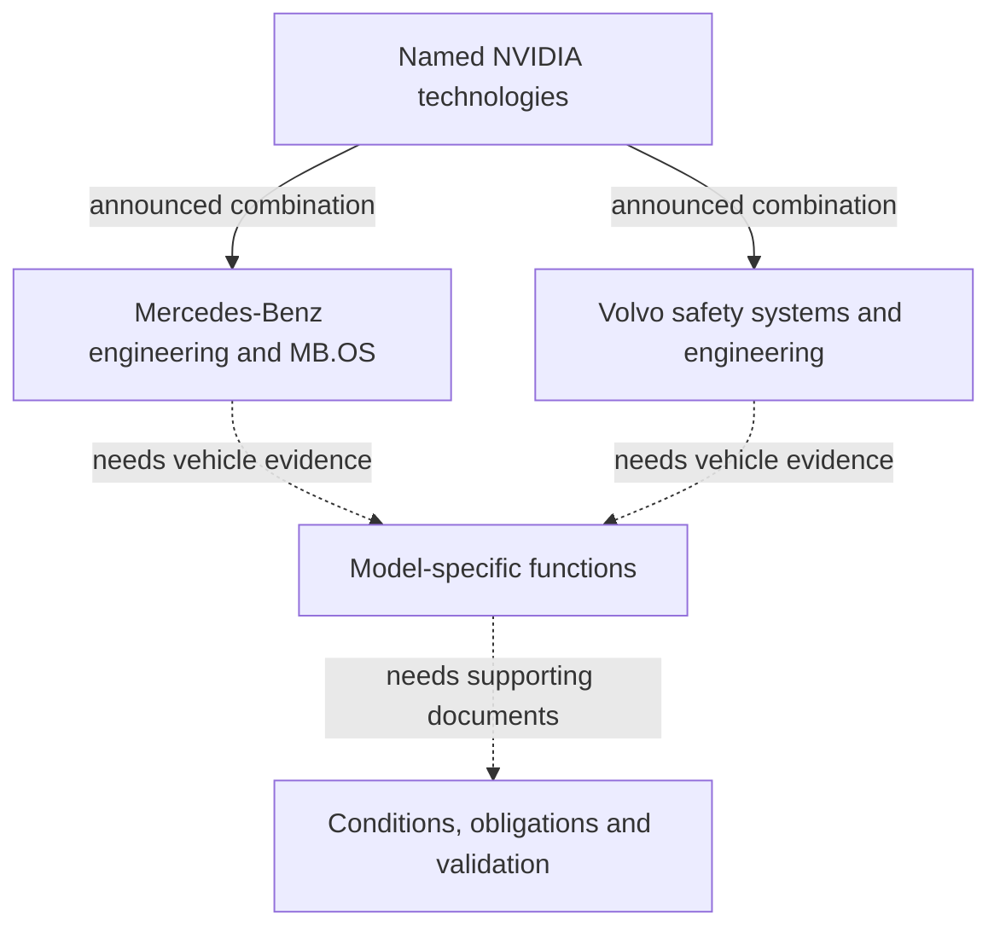
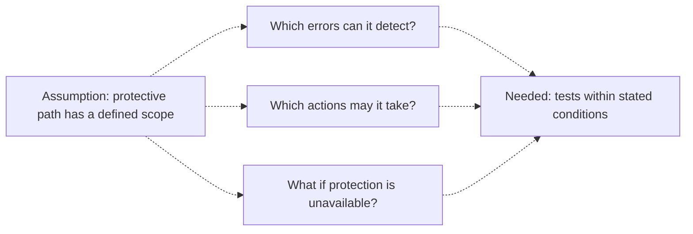

Archive date: 2026-10-18; published on 2026-10-19. This article uses the material saved for the archive date and retains its original reporting cutoffs.

## Which driving capability are you buying?

A car buyer needs to know which tasks the offered vehicle can perform, under which conditions, and what the person behind the wheel must continue to do. Partnership announcements can explain the technology being developed. Their usefulness to a purchase depends on how clearly they connect that development to the vehicle being offered.

According to their respective NVIDIA Newsroom announcements, [Volvo Cars announced an expanded partnership on October 15, 2026](https://nvidianews.nvidia.com/news/volvo-cars-and-nvidia-expand-partnership-to-advance-safe-automated-driving), followed by [Mercedes-Benz on October 16, 2026](https://nvidianews.nvidia.com/news/mercedes-benz-and-nvidia-expand-strategic-partnership-to-advance-safe-highly-automated-driving-in-the-next-decade). Both name Hyperion, Alpamayo Stack and Halos technologies. Those shared names invite comparison, although the accounts describe separate plans to combine supplier technologies with each automaker's engineering and future applications.

The [Mercedes-Benz announcement](https://nvidianews.nvidia.com/news/mercedes-benz-and-nvidia-expand-strategic-partnership-to-advance-safe-highly-automated-driving-in-the-next-decade) describes urban point-to-point assistance, active safety and automated parking, alongside development of future SAE-Level 4 applications, including robolimousines. The [Volvo announcement](https://nvidianews.nvidia.com/news/volvo-cars-and-nvidia-expand-partnership-to-advance-safe-automated-driving) describes intended future door-to-door navigation across highways, busy urban streets and parking scenarios, with a gradual introduction of "eyes-off and mind-off driving." These statements cover different tasks and development stages. Neither provides a complete specification for a customer vehicle.

Someone seeking supervised assistance needs to establish the delivered functions and continuing obligations. Someone buying chiefly because they expect eventually to redirect their attention also needs documentation connecting that future capability to the vehicle being ordered. Volvo's expressions alone establish neither an approved automation level nor permission to stop supervising. Occupant duties and responsibility arrangements remain unresolved in these materials.

The question running through this comparison is what the announced shared architecture establishes, and what further evidence connects it to a vehicle a customer can depend on. The announcements support a comparison of development directions. They do not support a model recommendation, safety ranking or delivery forecast. Company statements retain their attribution here, and possible benefits remain conditional.

One useful purchasing test is whether the documented delivery vehicle would meet the buyer's needs if the hoped-for function remained unavailable. That identifies how much of the decision depends on future development reaching the purchased vehicle. A partnership may have value while the capability attracting a buyer remains a future application.

## Reading the announcements: shared components and different commitments

Both accounts appeared on NVIDIA Newsroom and describe partnerships involving NVIDIA and the respective automaker. They are two partnership accounts on the same commercially interested publishing platform, so they cannot count as two independent confirmations of vehicle safety. The [Mercedes-Benz account](https://nvidianews.nvidia.com/news/mercedes-benz-and-nvidia-expand-strategic-partnership-to-advance-safe-highly-automated-driving-in-the-next-decade) and [Volvo account](https://nvidianews.nvidia.com/news/volvo-cars-and-nvidia-expand-partnership-to-advance-safe-automated-driving) establish what the companies announced; claims about future benefits still require attribution to them.

Mercedes-Benz describes combining its automotive engineering, safety expertise and MB.OS operating system with NVIDIA Hyperion compute and sensor architecture, Alpamayo Stack software and the Halos safety system. It says MB.OS supports new driving functions and over-the-air updates. The announcement describes Alpamayo Stack as full-stack driving software with AI reasoning capabilities, and explicitly says Halos includes a parallel safety stack adding redundancy and guardrails. These descriptions identify intended architecture and functions without measuring delivered performance.

Volvo describes combining its vehicle safety systems and engineering expertise with Hyperion, Halos OS and Alpamayo Stack. It says the technology will debut in a next-generation Volvo car as part of its recently announced largest-ever product push. The account dates the collaboration's beginning to 2017 and presents Volvo's nearly century-long safety background as a contribution to development. The unspecified next-generation car remains a future application; the account does not establish that a currently offered vehicle has these capabilities.

The factual columns below summarize the [Mercedes-Benz announcement](https://nvidianews.nvidia.com/news/mercedes-benz-and-nvidia-expand-strategic-partnership-to-advance-safe-highly-automated-driving-in-the-next-decade) and [Volvo announcement](https://nvidianews.nvidia.com/news/volvo-cars-and-nvidia-expand-partnership-to-advance-safe-automated-driving). The last column identifies questions left open by these texts.

| Dimension | Mercedes-Benz announcement | Volvo Cars announcement | What remains unresolved |
| :--- | :--- | :--- | :--- |
| Publication date | October 16, 2026 | October 15, 2026 | Publication order does not establish readiness. |
| Automaker contribution | Automotive engineering, safety expertise and MB.OS | Vehicle safety systems and engineering expertise | Detailed integration responsibilities. |
| Architecture | Hyperion compute and sensor architecture | Hyperion sensor and compute architecture | Production hardware and sensor configurations. |
| Driving software | Alpamayo Stack; urban assistance, active safety and automated parking named | Alpamayo Stack driving software | Functions available on a particular vehicle. |
| Safety wording | Halos safety system, including a parallel safety stack | Halos OS, combined with Volvo safety systems | Whether implementations are equivalent. |
| Future direction | Development of future SAE-Level 4 applications, including robolimousines | Gradual introduction of eyes-off and mind-off driving | Availability, conditions and occupant obligations. |
| Vehicle and timing | No specific production model or delivery date supplied | A next-generation Volvo car; no exact delivery date supplied | A complete purchase specification. |

Historical statements need attribution too. In the [Mercedes-Benz announcement](https://nvidianews.nvidia.com/news/mercedes-benz-and-nvidia-expand-strategic-partnership-to-advance-safe-highly-automated-driving-in-the-next-decade), executive Jörg Burzer says the partners previously developed the first Mercedes-Benz urban point-to-point assistance system for the western world. This is his account of earlier work. The announcement does not independently establish the comparative "first" claim or document availability across every relevant market.

Company figures have distinct statistical scopes. The [Mercedes-Benz profile](https://nvidianews.nvidia.com/news/mercedes-benz-and-nvidia-expand-strategic-partnership-to-advance-safe-highly-automated-driving-in-the-next-decade) reports more than 2.1 million passenger-car and van sales in 2025, around 164,000 employees and around 30 production sites on four continents. The [Volvo profile](https://nvidianews.nvidia.com/news/volvo-cars-and-nvidia-expand-partnership-to-advance-safe-automated-driving) reports over 710,000 car sales in 2025, an electrified share of 46%, average employment of 42,600 full-time employees, and founding in 1927. These figures establish neither resources devoted to a particular driving function nor its safety. "Electrified" must retain its supplied scope; it cannot be relabeled as fully electric.

[Mercedes-Benz also describes NVIDIA technology in vehicle engineering simulation and its MO360 digital production ecosystem](https://nvidianews.nvidia.com/news/mercedes-benz-and-nvidia-expand-strategic-partnership-to-advance-safe-highly-automated-driving-in-the-next-decade). This extends the announced relationship into engineering and production without showing that manufacturing tools belong to the on-road control path or demonstrating a driving safety result. An omitted detail, meanwhile, does not establish that a manufacturer lacks the corresponding design or documents. It leaves the question unanswered by these announcements and cannot justify assuming the desired capability exists.

## How does a shared platform become a vehicle feature?

The [Mercedes-Benz](https://nvidianews.nvidia.com/news/mercedes-benz-and-nvidia-expand-strategic-partnership-to-advance-safe-highly-automated-driving-in-the-next-decade) and [Volvo](https://nvidianews.nvidia.com/news/volvo-cars-and-nvidia-expand-partnership-to-advance-safe-automated-driving) announcements identify intended combinations of supplier technologies and automaker capabilities. They do not describe a finished system transferred unchanged between vehicles. To assess a purchase, buyers need to distinguish the shared components from vehicle integration and the function ultimately offered, then find evidence connecting them.

Hyperion names the compute and sensor architecture; Alpamayo Stack names driving software. Mercedes-Benz identifies MB.OS and automotive engineering, while Volvo identifies its safety systems and engineering expertise. The accounts do not reveal complete internal data flows, control interfaces or every engineering responsibility. Assigning undisclosed tasks to individual components would go beyond the evidence.

This conceptual diagram summarizes the disclosed combinations. Solid lines represent announcement relationships from the two sources linked above. Dashed lines identify evidence still needed. The arrows show relationships, not event order or a verified production architecture.

Start with configuration. Which hardware and sensors will the production vehicle contain, and which software version enables which functions? Neither announcement supplies a complete vehicle configuration. Configuration documents would need to identify what the offered vehicle actually contains and connect any described capability to the vehicle on the order. Without that connection, comparing platform names cannot resolve differences between purchase offers.

Integration raises another set of questions. If shared software is combined with different vehicle systems, which validation results can transfer, and what additional evidence does each implementation require? The announcements retain explicit automaker engineering roles but do not explain how either implementation handles particular control conflicts or faults. Those answers require design and validation evidence. A plausible account of undisclosed controls would make the uncertainty harder to see.

Feature definitions need checking too. Does "urban point-to-point assistance" cover the buyer's route, conditions and version? What limits qualify the future "door-to-door" ambition? Those phrases appear in the Mercedes-Benz and Volvo announcements, respectively. Neither promises unrestricted use on every journey. The scope of a task description depends on its conditions, which broad wording cannot supply.

Availability is a separate issue. A development program can name a component without specifying which customer functions will be enabled at delivery. What the vehicle contains and how the customer is permitted to use it require separate answers. Configuration evidence cannot substitute for operating instructions or establish that every hardware capability is available as a customer function. The usable scope must apply to the purchased model, configuration and version.

For capabilities expected later, examine the commitment. [Mercedes-Benz mentions over-the-air updates](https://nvidianews.nvidia.com/news/mercedes-benz-and-nvidia-expand-strategic-partnership-to-advance-safe-highly-automated-driving-in-the-next-decade). Which future capability, if any, is committed to a particular vehicle through that mechanism? An update channel establishes a way to distribute software. The announcement does not establish a delivery commitment for every future application it names. A useful commitment would connect the specified capability to the buyer's vehicle and identify applicable conditions.

Common interfaces, tools or validation work might reduce duplicated development if that work can be reused. Assessing this possibility requires knowing which work transfers and how much integration remains. Neither announcement supplies comparative cost or schedule measurements. They therefore cannot support claims of demonstrated reuse benefits, cost savings, earlier release or lower customer prices. Even a measured reduction in development work would need a further connection before establishing a customer benefit.

Different integrations do not themselves prove materially different delivered functions either. Equivalence and superiority remain unproved until evidence addresses the actual vehicle functions being compared. This leaves room for several outcomes without treating any of them as established by a component name.

## What must a parallel safety stack demonstrate?

The [Mercedes-Benz announcement explicitly says](https://nvidianews.nvidia.com/news/mercedes-benz-and-nvidia-expand-strategic-partnership-to-advance-safe-highly-automated-driving-in-the-next-decade) that Halos includes a parallel safety stack adding redundancy and guardrails. That gives the safety inquiry a specific subject. The account does not provide the detailed design or tests needed to establish effectiveness across a vehicle's operating conditions. The questions below concern evidence that would support that judgment; they describe no verified product behavior.

Begin with error detection. If an additional path is intended to catch mistakes, what information can it observe, and how does that allow it to recognize the relevant problem? Which dangerous outputs or conditions fall within its stated scope? Could it detect errors missed by the main driving path? An explanation would need to answer these questions without assuming that one mechanism catches every kind of error.

Two conditional possibilities help define the inquiry. If both paths depend on the same incorrect information in a situation, would the additional assessment detect the problem? If the protective path has a relevant additional check, would that check remain effective under the fault being tested? Neither possibility is a finding about a defect or capability in either manufacturer's product. Technical evidence would need to distinguish them and identify the conditions its conclusion covers.

Detection also raises a question of authority. Once a problem is recognized, what may the protective mechanism do? Can it constrain an output, request a different response or initiate a defined fallback, and under which conditions? "Guardrails" in the Mercedes-Benz text does not specify those permissions. It cannot justify adding a particular braking, steering or emergency-stop claim.

Recognition and response need separate evidence. Showing that a mechanism detects a selected problem does not establish that every permitted response is suitable. Describing an intervention leaves open whether the mechanism recognizes when to use it. Asking about each makes the scope of a supporting demonstration easier to examine, without treating a partial demonstration as a complete safety guarantee.

Testing should address inappropriate intervention as well as missed problems. If selected failures are detected, what records show that the responses are suitable? What happens close to the tested scenario's boundary? These are proposed evaluation questions, not reports of tests the companies performed. Any demonstration must be interpreted within the conditions it covered; a narrow result cannot establish performance beyond that scope.

Loss of protection introduces another question. If the protective mechanism or a required input becomes unavailable, what response is defined? Is operation restricted, is another action requested, or does another procedure apply? The announcements establish no particular fallback procedure, response time or success rate. Those details cannot be inferred from an additional stack or supplied by assumptions about familiar designs.

"Parallel" leaves independence unresolved. Which dependencies matter for the failures under consideration? Could a shared dependency defeat the intended protection in a relevant case, and what evidence would rule that out? The wording establishes no complete separation of hardware, software, sensors or power. It also supports no numerical reliability calculation or percentage safety improvement: neither measured failure probabilities nor demonstrated independence are supplied.

The diagram below is a proposed inquiry. Dashed connections mark conditional evidence relationships, with the assumption stated explicitly. They show neither execution order nor verified protection.

[Volvo uses "Halos OS"](https://nvidianews.nvidia.com/news/volvo-cars-and-nvidia-expand-partnership-to-advance-safe-automated-driving), without the same explicit parallel-stack description. The supplied text cannot establish whether this reflects a different implementation or a different announcement emphasis. Less detail does not demonstrate weaker protection, and a shared name does not demonstrate identical design. Resolving that comparison requires the failure scope, permitted actions and tests for the respective implementations.

## How shared platforms might build reliability

Reuse offers a substantive reason for these partnerships. If a common platform concentrates development, testing and corrections, participating vehicle programs might benefit from accumulated work. If automaker engineering also addresses the remaining integration requirements, the combination could support dependable functions. These possibilities can be examined as testable hypotheses; the announcements do not establish the outcomes.

Both companies identify their contributions: [Mercedes-Benz names engineering, safety expertise and MB.OS](https://nvidianews.nvidia.com/news/mercedes-benz-and-nvidia-expand-strategic-partnership-to-advance-safe-highly-automated-driving-in-the-next-decade), while [Volvo names vehicle safety systems and engineering expertise](https://nvidianews.nvidia.com/news/volvo-cars-and-nvidia-expand-partnership-to-advance-safe-automated-driving). That stated division of work explains why they are collaborating. Limited product evidence in these texts does not establish that the collaboration lacks value or that automakers have abandoned vehicle engineering. Those negative conclusions would require support too.

The documents' purpose matters. Partnership announcements can explain intended combinations without settling every question required for customer reliance. Requiring more evidence for a purchase judgment does not make every omission a design defect. Both the [Mercedes-Benz release](https://nvidianews.nvidia.com/news/mercedes-benz-and-nvidia-expand-strategic-partnership-to-advance-safe-highly-automated-driving-in-the-next-decade) and the [Volvo release](https://nvidianews.nvidia.com/news/volvo-cars-and-nvidia-expand-partnership-to-advance-safe-automated-driving) identify forward-looking statements as subject to risks and uncertainties and say they are not guarantees of future performance. This qualification preserves the future boundary; it does not prove that a plan will succeed or fail, or determine liability for a particular vehicle.

A stronger reliability claim would require examining what transfers. If a shared component receives a correction, is it relevant to another configuration? Which tests establish suitability there, and how is the remaining integration evaluated? The existence of a correction, its applicability to another vehicle and its beneficial delivery to a customer are separate claims. A correction in one place does not establish that every related vehicle has received the same benefit.

Cross-brand learning needs its own evidence. Neither the [Mercedes-Benz announcement](https://nvidianews.nvidia.com/news/mercedes-benz-and-nvidia-expand-strategic-partnership-to-advance-safe-highly-automated-driving-in-the-next-decade) nor the [Volvo announcement](https://nvidianews.nvidia.com/news/volvo-cars-and-nvidia-expand-partnership-to-advance-safe-automated-driving) describes a Mercedes-Benz and Volvo fleet-data sharing mechanism. A combined learning fleet remains unsupported, rather than merely unquantified. Any supplier improvement would still need evidence connecting it to evaluation, adoption and delivery in each vehicle. Sharing a supplier cannot stand in for those relationships.

The table proposes ways to test these arguments; it reports no completed evaluation. Its announcement baseline is the two sources linked above.

| Proposed benefit | Evidence that could strengthen it | Evidence that could weaken it | Present evidentiary position |
| :--- | :--- | :--- | :--- |
| Reuse reduces duplicated work | Comparable records identifying reused work and remaining integration | Relevant records showing claimed transfer required repeated rework | No measured reuse benefit supplied. |
| A safety path adds protection | Defined failure scope and detection, intervention and fallback tests | Relevant failures defeating protection within its claimed scope | Mercedes-Benz describes the mechanism; effectiveness is not measured here. |
| Future functions reach customers | Model, region, version, conditions and delivery records | Recorded differences between a specific commitment and delivered capability | Future directions lack a complete delivery specification. |
| Safety outcomes improve | Comparable exposure, outcome definitions, baseline and failure records | Suitable comparative evidence failing to support the claimed improvement | No outcome comparison supplied. |

Missing evidence, insufficient evidence and contradictory evidence call for different judgments. An absent operating record does not prove poor performance. A narrow demonstration may support a narrow claim while leaving a broader one unresolved. A relevant failure could challenge a claimed protection if it falls within that protection's stated scope. These distinctions prevent unknowns from becoming either reassurance or disproof.

Before interpreting safety outcomes, ask whether exposure and operating conditions are comparable. Neither announcement supplies enough information to calculate a safety rate or rank a system against human driving. A component test would also need an explanation of how it supports the proposed vehicle-level conclusion. Confidence in the positive interpretation should change with relevant records of reuse, validation and delivered benefits.

## Turning the announcements into questions buyers can check

Consider two hypothetical purchases. One buyer wants useful assistance available at delivery. Another is attracted chiefly by future eyes-off or mind-off capability. These examples make no claim about actual customer behavior or its frequency. Both buyers need vehicle-specific evidence, but the second purchase depends more heavily on future capability becoming available.

For the first buyer, begin with the delivery specification. Which functions belong to the current model, configuration, sales region and software version? Which descriptions concern future development? The [Mercedes-Benz announcement names assistance functions and future SAE-Level 4 development](https://nvidianews.nvidia.com/news/mercedes-benz-and-nvidia-expand-strategic-partnership-to-advance-safe-highly-automated-driving-in-the-next-decade), without supplying that distinction for the offered vehicle. Written feature information should connect the descriptions to the purchase.

Then examine use conditions. Where may each function operate? What must the driver monitor? How are limitations or requests to resume a task communicated? Answers should come from applicable vehicle documents and concern the same model and version as the offer. If an answer cannot be located there, keep the gap visible. An architectural term or a description of another configuration cannot fill it. Even a matching function name does not establish matching conditions.

For an update-dependent function, request the exact commitment. Does the document connect the specified capability to the vehicle being purchased and identify conditions on availability? Mercedes-Benz's stated support for over-the-air updates does not answer those questions. Being satisfied with the documented delivery vehicle is a different purchasing position from needing a later release to make the purchase worthwhile. Recording those assumptions separately prevents an expectation from being counted as a present benefit.

The second buyer needs to scrutinize what reduced supervision means in applicable documents. [Volvo describes a gradual introduction of eyes-off and mind-off driving in future development](https://nvidianews.nvidia.com/news/volvo-cars-and-nvidia-expand-partnership-to-advance-safe-automated-driving). Does subsequent product documentation specify when continuous road supervision is no longer required? What obligations remain, and what procedure applies when permitted conditions end? Until those answers apply to the ordered vehicle, the purchasing assumption remains unresolved.

Task coverage and supervision requirements need separate checks. Which journeys and maneuvers are covered? What must occupants continue to do? A broad navigation ambition cannot answer the attention question. A documented reduction in supervision would still need to cover the buyer's intended conditions. If those conditions exclude the use motivating the purchase, the capability's relevance needs reconsideration.

Responsibility requires applicable documents too. Neither the [Mercedes-Benz announcement](https://nvidianews.nvidia.com/news/mercedes-benz-and-nvidia-expand-strategic-partnership-to-advance-safe-highly-automated-driving-in-the-next-decade) nor the [Volvo announcement](https://nvidianews.nvidia.com/news/volvo-cars-and-nvidia-expand-partnership-to-advance-safe-automated-driving) establishes universal incident liability, insurance arrangements or contractual remedies. Request answers tied to the actual product and jurisdiction. These announcements also do not establish prices, option fees, refund rights or legal remedies. Their architecture descriptions cannot determine favorable or unfavorable consumer terms.

A practical comparison can record four entries for each vehicle: delivered functions, stated conditions, occupant obligations and future uncertainties. Add the supporting document to each entry. Unknown information should remain unknown rather than be scored as an assured benefit. A demonstration explains what was shown under particular conditions; relying on other conditions requires relevant evidence. Relying on a later release requires checking the written commitment. Future capability can remain part of the decision if its uncertainty remains part of it too.

## What evidence would answer the remaining questions?

The [Volvo announcement of October 15, 2026](https://nvidianews.nvidia.com/news/volvo-cars-and-nvidia-expand-partnership-to-advance-safe-automated-driving) and [Mercedes-Benz announcement of October 16, 2026](https://nvidianews.nvidia.com/news/mercedes-benz-and-nvidia-expand-strategic-partnership-to-advance-safe-highly-automated-driving-in-the-next-decade), both published on NVIDIA Newsroom, provide attributed development plans. Moving from those plans to a judgment about a purchase requires evidence matched to the vehicle and claim under discussion.

Vehicle function documents would need to connect a model and version to tasks, conditions and occupant obligations. System validation material would need to address protective mechanisms' scope and tested effectiveness. Delivery and operating records would need to establish availability and performance within the stated scope.

Each answers a different question. A function document alone cannot establish a safety improvement, and a validation claim alone cannot establish customer availability. A document resolving operating limits would leave other questions open unless it also supplied the relevant evidence. Later material should change the assessment only to the extent that it supports the particular claim being evaluated.

## References

1. NVIDIA Newsroom. [Mercedes-Benz and NVIDIA Expand Strategic Partnership to Advance Safe Highly Automated Driving in the Next Decade | NVIDIA Newsroom](https://nvidianews.nvidia.com/news/mercedes-benz-and-nvidia-expand-strategic-partnership-to-advance-safe-highly-automated-driving-in-the-next-decade).
2. NVIDIA Newsroom. [Volvo Cars and NVIDIA Expand Partnership to Advance Safe Automated Driving | NVIDIA Newsroom](https://nvidianews.nvidia.com/news/volvo-cars-and-nvidia-expand-partnership-to-advance-safe-automated-driving).
