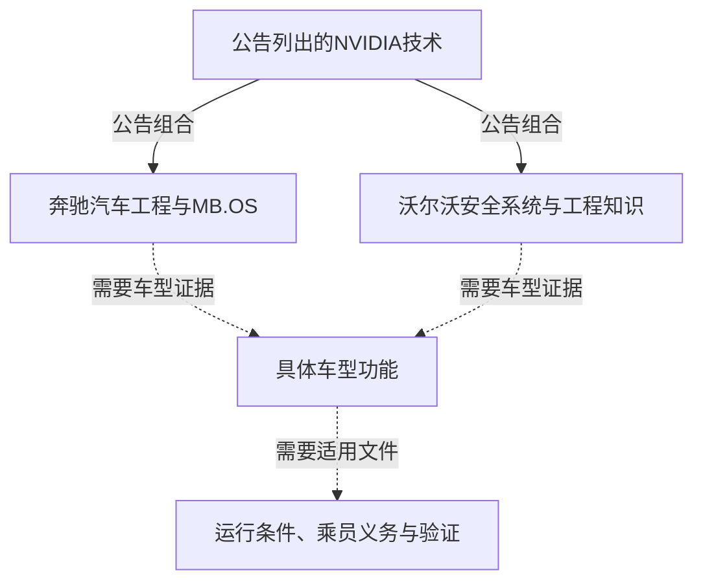
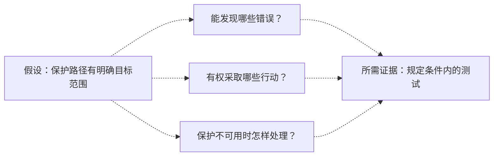

归档日期：2026-10-18；补发于 2026-10-19。本文使用原归档日保存的资料，资料中的经营截止日保持不变。

## 购车时，你买到的是哪一种驾驶能力？

购车者需要知道，所售车辆能执行哪些任务，适用于哪些条件，驾驶员必须继续做什么。合作公告可以说明正在开发哪些技术。它对购买的参考价值，取决于这些研发工作与所售车辆之间有多明确的联系。

依据NVIDIA Newsroom发布的两份公告，[沃尔沃汽车于2026年10月15日宣布扩大合作](https://nvidianews.nvidia.com/news/volvo-cars-and-nvidia-expand-partnership-to-advance-safe-automated-driving)，[奔驰于10月16日宣布延长并深化合作](https://nvidianews.nvidia.com/news/mercedes-benz-and-nvidia-expand-strategic-partnership-to-advance-safe-highly-automated-driving-in-the-next-decade)。两份材料都提到Hyperion、Alpamayo Stack与Halos技术。这些共同名称提供了比较起点，各家计划中的供应商技术、整车工程及未来应用仍需分别阅读。

[奔驰公告](https://nvidianews.nvidia.com/news/mercedes-benz-and-nvidia-expand-strategic-partnership-to-advance-safe-highly-automated-driving-in-the-next-decade)谈到城市点到点辅助、主动安全、自动泊车，以及未来SAE Level 4应用的开发，包括robolimousines。[沃尔沃公告](https://nvidianews.nvidia.com/news/volvo-cars-and-nvidia-expand-partnership-to-advance-safe-automated-driving)描述未来车辆覆盖高速公路、繁忙城市街道及泊车场景的门到门导航，并称将逐步引入"eyes-off"和"mind-off"驾驶。这些表述涉及不同任务和发展阶段，都没有提供完整的客户车辆规格。

需要监督式辅助功能的买家，应核对交付内容和持续义务；主要因期待未来能够转移注意力而购车的人，还需找到文件，确认那项能力适用于所订车辆。沃尔沃的这些表达本身不能确定使用许可、乘员义务或责任安排，也不能直接换算为已经获准的自动驾驶等级，或当作停止监督车辆的许可。

本文围绕一个问题展开：公告中的共同架构提供了什么信息，还缺少哪些连接到具体车辆的证据？两份材料支持研发方向的比较，却不足以推荐车型、排列安全名次或预测交付日期。企业陈述保留归属，可能的收益保留条件。

如果期待的未来能力没有开放，当前书面交付内容是否仍满足需求？这能帮助买家看清，购买决定有多依赖后续开发兑现。合作可能具有价值，同时，吸引买家的那项能力仍可能属于未来应用。

## 逐项读两份公告：共同组件与不同承诺

两份材料都刊于NVIDIA Newsroom，分别说明NVIDIA与相应车企的合作。它们来自同一商业利益相关平台，不能累计成两次独立安全验证。[奔驰材料](https://nvidianews.nvidia.com/news/mercedes-benz-and-nvidia-expand-strategic-partnership-to-advance-safe-highly-automated-driving-in-the-next-decade)和[沃尔沃材料](https://nvidianews.nvidia.com/news/volvo-cars-and-nvidia-expand-partnership-to-advance-safe-automated-driving)能够确认企业宣布了什么；未来效果的主张仍需归属于发布者。

奔驰公告称，将自身汽车工程、安全经验及MB.OS操作系统，与Hyperion计算和传感器架构、Alpamayo Stack软件及Halos安全系统结合。公告称MB.OS支持新驾驶功能和OTA更新，将Alpamayo Stack描述为具备AI推理能力的全栈驾驶软件，并明确说明Halos包含增加冗余与防护栏的并行安全栈。这些是计划中的架构和功能描述，尚非交付表现的测量结果。

沃尔沃公告称，将整车安全系统和工程知识，与Hyperion、Halos OS及Alpamayo Stack结合。技术将在下一代沃尔沃车型首次应用，属于其近期宣布的最大规模产品攻势。公告将合作起点追溯至2017年，并把近百年的安全经验列为开发基础。未明确型号的下一代车型仍是未来应用，不能据此推定某款在售车辆已经获得这些能力。

下表事实分别来自[奔驰公告](https://nvidianews.nvidia.com/news/mercedes-benz-and-nvidia-expand-strategic-partnership-to-advance-safe-highly-automated-driving-in-the-next-decade)和[沃尔沃公告](https://nvidianews.nvidia.com/news/volvo-cars-and-nvidia-expand-partnership-to-advance-safe-automated-driving)，最后一列列出文本尚未回答的问题。

| 比较维度 | 奔驰公告 | 沃尔沃公告 | 尚待回答 |
| :--- | :--- | :--- | :--- |
| 发布日期 | 2026年10月16日 | 2026年10月15日 | 发布先后不能说明成熟程度。 |
| 车企贡献 | 汽车工程、安全经验与MB.OS | 整车安全系统及工程知识 | 具体集成职责如何分配。 |
| 架构 | Hyperion计算与传感器架构 | Hyperion传感器与计算架构 | 量产硬件及传感器配置。 |
| 驾驶软件 | Alpamayo Stack；列出城市辅助、主动安全与自动泊车 | Alpamayo Stack驾驶软件 | 每台车辆实际开放哪些功能。 |
| 安全措辞 | Halos安全系统，包括并行安全栈 | Halos OS，与沃尔沃安全系统结合 | 实现是否相同或等价。 |
| 未来方向 | 开发未来SAE Level 4应用，包括robolimousines | 逐步引入eyes-off与mind-off驾驶 | 可用时间、条件和乘员义务。 |
| 车型与时间 | 未提供具体量产车型及交付日期 | 下一代车型，未提供确切交付日期 | 完整订车规格与交付承诺。 |

历史表述也需要归属。[奔驰公告中的高管Jörg Burzer称](https://nvidianews.nvidia.com/news/mercedes-benz-and-nvidia-expand-strategic-partnership-to-advance-safe-highly-automated-driving-in-the-next-decade)，双方此前为西方世界开发了首个奔驰城市点到点辅助系统。这是他对既有工作的陈述，公告没有独立验证"首个"的比较判断，也没有证明该系统已在所有相关市场可用。

企业规模数字必须保留各自口径。[奔驰简介披露](https://nvidianews.nvidia.com/news/mercedes-benz-and-nvidia-expand-strategic-partnership-to-advance-safe-highly-automated-driving-in-the-next-decade)，2025年乘用车及厢式车销量超过210万辆，员工约16.4万人，在四大洲拥有约30处生产基地。[沃尔沃简介披露](https://nvidianews.nvidia.com/news/volvo-cars-and-nvidia-expand-partnership-to-advance-safe-automated-driving)，2025年汽车销量超过71万辆，电气化份额为46%，平均全职员工4.26万人，公司成立于1927年。这些数字不能确定某项驾驶功能的研发投入或安全水平；电气化份额不能改写为纯电份额。

[奔驰还提到，NVIDIA技术用于车辆工程仿真和MO360数字生产生态](https://nvidianews.nvidia.com/news/mercedes-benz-and-nvidia-expand-strategic-partnership-to-advance-safe-highly-automated-driving-in-the-next-decade)。这说明合作涉及工程与生产，却没有证明制造工具位于道路驾驶控制链，也没有提供驾驶安全结果。公告缺少某项细节，不等于企业没有相应设计或文件；问题只是未获这些材料回答，也不能据此假定期待的能力已经存在。

## 共同平台怎样转化为整车功能？

[奔驰](https://nvidianews.nvidia.com/news/mercedes-benz-and-nvidia-expand-strategic-partnership-to-advance-safe-highly-automated-driving-in-the-next-decade)与[沃尔沃](https://nvidianews.nvidia.com/news/volvo-cars-and-nvidia-expand-partnership-to-advance-safe-automated-driving)描述了供应商技术与车企能力的拟议组合，没有证明存在一套可在不同车辆之间原样移植的成品系统。购车判断需要区分共同组件、整车集成和最终提供给用户的功能，再寻找各层之间的对应证据。

Hyperion对应计算及传感器架构，Alpamayo Stack对应驾驶软件；奔驰列出MB.OS和汽车工程，沃尔沃列出安全系统和工程知识。公告没有揭示完整内部数据流、控制接口或每项任务的工程分工。指定某组件负责某个未披露动作，就超出了材料提供的信息。

下图概括上述公告关系。实线表示两份已链接公告披露的组合，虚线表示仍需证据连接。箭头不代表事件顺序，也不表示已经验证的量产结构。

先核对配置。量产车辆使用什么硬件和传感器，哪个软件版本开放哪些功能？两份公告均未提供完整车型配置。配置文件应说明所售车辆具体装有什么，并将介绍中的能力连接到订单对应的车辆。缺少这层连接，平台名称的比较无法解决两份购车方案之间的差别。

集成需要另一组答案。如果共同软件与不同车辆系统结合，哪些验证结果能够迁移，哪些部分需要补充确认？公告保留了车企工程角色，但没有说明特定控制冲突或故障如何处理。这需要设计与验证材料。用看似合理的控制过程填补空白，会让读者难以分清披露内容和推测。

功能定义也要核对。"城市点到点辅助"是否适用于买家的路线、环境和软件版本？未来"门到门"导航受到哪些限制？这些措辞分别出现在奔驰及沃尔沃公告中，却没有承诺任意旅程都能无限制使用。任务描述必须与适用条件一起阅读，表达覆盖面宽不能补足未给出的边界。

可用性还需单独确认。研发计划列出某种组件，不等于已经说明客户交付时开放哪些功能。车辆装有什么，与允许怎样使用，需要分别回答。配置材料不能代替使用说明，也不能证明全部硬件能力已经作为客户功能开放。实际可用范围必须对应所购车型、配置与版本。

对于期待日后获得的能力，还要核对承诺。[奔驰提到OTA更新](https://nvidianews.nvidia.com/news/mercedes-benz-and-nvidia-expand-strategic-partnership-to-advance-safe-highly-automated-driving-in-the-next-decade)，但哪项未来能力明确承诺适用于哪台车辆？更新渠道说明软件分发路径，公告没有为所有未来应用提供车型交付承诺。买家需要找到连接具体能力与所购车辆、并说明适用条件的文件。

如果相关工作确实能够复用，共同接口、工具或验证成果可能减少重复开发。判断这一点，需要知道实际复用了什么，还剩多少整车集成。两份公告没有提供可比较的成本或周期测量，因此不能宣称复用收益已经得到证明，也不能写成已经节省成本、提前发布或降低售价。即使后续证实减少了开发工作，要确定消费者获得什么收益，仍需进一步证据。

集成不同也不必然证明交付功能明显不同。整车等价与品牌领先的判断，都需要对应实际车辆功能的材料。现有信息容许不同结果存在，不能仅凭组件名称就把其中一种结果当作事实。

## 并行安全栈需要证明什么？

[奔驰公告明确称](https://nvidianews.nvidia.com/news/mercedes-benz-and-nvidia-expand-strategic-partnership-to-advance-safe-highly-automated-driving-in-the-next-decade)，Halos包含增加冗余和防护栏的并行安全栈。这使安全问题有了具体讨论对象，但公告没有提供足以确认其在车辆运行条件下有效的详细设计和测试。以下问题讨论所需证据，不描述已经验证的产品行为。

先问错误发现。如果附加路径旨在捕捉错误，它能观察哪些信息，怎样识别相关问题？哪些危险输出或条件属于目标范围？它能否发现主驾驶路径遗漏的错误？技术解释需要回答这些问题，不能预设某种未披露的实现，或假定同一机制能够发现所有错误。

可以考虑两个条件分支。如果两条路径在某个场景中依赖同一份错误信息，附加判断还能识别问题吗？如果保护路径具有相关补充检查，这项检查在所测试故障下是否仍有效？两者都不是对任何一家产品缺陷或能力的认定。技术证据需要区分这些可能，并说明结论覆盖哪些条件。

发现问题之后，保护机制有何权限？它能限制输出、要求重新处理，还是启动某项已定义处置？这些权限适用于哪些条件？奔驰原文中的"防护栏"没有写出这些细节，不能据此补充特定制动、转向或紧急停车能力。

识别与响应各自需要证据。证明能发现某类问题，尚未证明所有允许采取的行动都恰当；列出某种干预动作，也尚未回答系统能否正确判断使用时机。分别询问这两层关系，有助于判断演示究竟支持哪项主张，避免将局部展示理解为完整安全保证。

测试应覆盖漏检与不适当干预。如果机制发现了选定故障，哪些记录支持响应恰当？接近测试场景边界时又如何处理？这些是建议的评价问题，并非两家公司已经执行相关测试的报道。演示所支持的结论必须对应其覆盖条件，不能延伸到未经展示的范围。

保护能力本身失效时，也需要明确处置。如果保护机制或必要输入不可用，系统是限制运行、请求其他行动，还是采用另一种安排？现有公告没有建立具体处置程序、响应时延或成功率的证据。这些细节不能从附加安全栈的存在中推导，也不能用对常见设计的想象替代。

"并行"没有解决独立性问题。哪些共享依赖会影响所讨论的故障？共同依赖是否可能破坏保护目标，哪些证据能够排除该情况？架构措辞没有证明硬件、软件、传感器或供电完全隔离。公告也没有测量失效概率或证明独立性，因此不能进行数值可靠性计算，或给出安全提升比例。

下图是建议的询问框架，假设已明确标出。虚线表示条件性的证据关系，既不表示执行顺序，也不代表保护已经有效。

[沃尔沃使用"Halos OS"的表述](https://nvidianews.nvidia.com/news/volvo-cars-and-nvidia-expand-partnership-to-advance-safe-automated-driving)，没有同样明确地展开并行安全栈。现有材料无法判断，这反映的是实现不同，还是公告重点不同。细节较少不能证明保护较弱，同名技术也不能证明设计一致。要解决这项比较，需要分别了解两种实现的失效范围、干预权限及测试结果。

## 共同平台可能怎样积累可靠性？

复用为这些合作提供了一个有实质内容的理由。如果共同平台能够集中开发、验证与修正工作，参与项目可能从积累中受益；如果车企工程也解决了剩余集成要求，这种组合可能支持可靠功能。可以把这些可能作为可检验的假设，讨论合作价值；公告尚未建立实际结果的证据。

两家公司都列出了自身贡献。[奔驰列出汽车工程、安全经验及MB.OS](https://nvidianews.nvidia.com/news/mercedes-benz-and-nvidia-expand-strategic-partnership-to-advance-safe-highly-automated-driving-in-the-next-decade)，[沃尔沃列出车辆安全系统及工程知识](https://nvidianews.nvidia.com/news/volvo-cars-and-nvidia-expand-partnership-to-advance-safe-automated-driving)。这些分工解释了合作理由。产品证据有限，不能直接推导合作没有价值，或车企放弃整车工程职责；负面结论同样需要支持。

评价也应考虑文件用途。合作公告可以说明拟议组合，同时留下消费者依赖功能之前必须解决的问题。购买判断要求更多证据，并不意味着每项缺失都是设计缺陷。[奔驰公告](https://nvidianews.nvidia.com/news/mercedes-benz-and-nvidia-expand-strategic-partnership-to-advance-safe-highly-automated-driving-in-the-next-decade)和[沃尔沃公告](https://nvidianews.nvidia.com/news/volvo-cars-and-nvidia-expand-partnership-to-advance-safe-automated-driving)均说明，前瞻性声明受到风险与不确定性影响，不是未来表现的保证。这一限定要求保留未来边界，却不能证明计划将会成功或失败，也不能确定具体车型的法律责任。

进一步判断可靠性是否提高，必须检查什么能够迁移。一项共同组件修正是否适用于另一种配置？哪些测试支持它在那里使用？剩余集成如何评估？修正存在、适用于另一车辆，以及最终让客户受益，是需要分别连接的主张。某处完成修正，不能自动证明所有相关车辆已经获得相同收益。

跨品牌学习也需要单独证明。[奔驰公告](https://nvidianews.nvidia.com/news/mercedes-benz-and-nvidia-expand-strategic-partnership-to-advance-safe-highly-automated-driving-in-the-next-decade)与[沃尔沃公告](https://nvidianews.nvidia.com/news/volvo-cars-and-nvidia-expand-partnership-to-advance-safe-automated-driving)均未描述两家共享车队数据的机制。因此，"已经形成联合学习车队"本身缺少支持，不能仅表述为其规模或收益尚未量化。供应商即使改进共同组件，也仍需核对各家怎样评估、采用和交付；共用供应商没有补足这些关系。

下表提出检验方法，不报告已完成的评价；公告基线为上文链接的两份材料。

| 机制假设 | 可增强判断的证据 | 会削弱判断的证据 | 现有证据位置 |
| :--- | :--- | :--- | :--- |
| 复用减少重复开发 | 可比较记录，列出复用工作及剩余集成 | 相关记录显示所宣称迁移需要反复重做 | 未提供复用收益测量。 |
| 安全路径增加保护 | 明确故障范围及发现、干预、失效处置测试 | 相关故障在宣称范围内使保护失效 | 奔驰描述机制，未在此测量效果。 |
| 未来功能交付用户 | 车型、地区、版本、条件及交付记录 | 具体承诺与交付能力存在已记录差距 | 未来方向没有完整交付规格。 |
| 安全结果改善 | 可比较暴露量、结果定义、基线及失败记录 | 合适比较未支持所宣称改善 | 未提供结果比较。 |

没有证据、证据不足和证据反驳，需要分别判断。缺少运行记录不能证明表现差；有限演示可能支持有限结论，同时留下更广主张未决；某次失败是否挑战保护承诺，必须与承诺范围对应。这样才能避免把未知当成安全保证，或一律当成失败证据。

比较安全结果之前，应先确认暴露量与运行条件是否可比。两份公告没有提供计算安全率或与人类驾驶排名所需的信息。组件测试如何支持整车结论，也需要解释。对共同平台的积极判断，应随后续复用、验证和实际交付记录调整。

## 把公告转换成购车时能核对的问题

设想两种购买情境：一位买家需要交付时就能使用的辅助功能，另一位主要被未来脱眼、脱脑能力吸引。这是决策示例，没有对真实用户行为或发生频率作判断。两者都需要车型证据，但第二种购买更依赖未来能力兑现。

第一位买家应从交付规格开始。当前车型、配置、销售地区及软件版本究竟开放什么？哪些介绍仍属于未来研发？[奔驰公告同时列出辅助功能和未来SAE Level 4开发方向](https://nvidianews.nvidia.com/news/mercedes-benz-and-nvidia-expand-strategic-partnership-to-advance-safe-highly-automated-driving-in-the-next-decade)，却没有提供所售车辆的逐项区分。需要索取与该车对应的书面功能说明，确认介绍与订单之间的连接。

接着核对使用条件。允许在哪些道路与环境中使用？驾驶员必须监控什么？限制或重新承担任务的要求怎样提示？答案应来自适用车辆文件，并对应购车方案中的同一车型和版本。找不到答案就保留空白，架构术语或另一种配置的介绍都不能代替。功能名称相同，也不足以确认适用条件相同。

对于依赖更新的能力，要求明确承诺。文件是否把具体功能连接到准备购买的车辆，是否列出可用条件？奔驰所述OTA支持没有回答这些问题。满意于当前书面交付内容，与必须等某项更新才认为购买值得，是不同的购买前提。分开记录，可以避免把未来期待计作现有收益。

第二位买家应核对减少监督的具体含义。[沃尔沃公告将eyes-off和mind-off置于未来逐步引入的语境](https://nvidianews.nvidia.com/news/volvo-cars-and-nvidia-expand-partnership-to-advance-safe-automated-driving)。后续文件是否说明何时不再要求持续注视道路？仍保留什么义务？允许条件结束时如何处理？这些答案尚未适用于所订车辆之前，购买前提就仍未解决。

任务覆盖与监督要求必须分别核对。哪些旅程和动作在功能范围内？乘员需要继续做什么？宽广的导航愿景不能补足注意义务的答案。即使文件允许减少监督，也要判断规定条件是否覆盖实际用途。如果不覆盖促使买家购车的用途，这项能力对该笔购买的意义就需要重新评估。

责任安排另需适用文件。[奔驰公告](https://nvidianews.nvidia.com/news/mercedes-benz-and-nvidia-expand-strategic-partnership-to-advance-safe-highly-automated-driving-in-the-next-decade)和[沃尔沃公告](https://nvidianews.nvidia.com/news/volvo-cars-and-nvidia-expand-partnership-to-advance-safe-automated-driving)均未建立普遍事故责任、保险安排或合同救济规则，应索取对应实际产品及所在地的答案。这些公告也不能确定售价、选装费、退款权或法律救济，架构描述不能推导出对消费者有利或不利的具体条款。

实际比较时，可为每台候选车辆记录四项：当前交付功能、规定使用条件、乘员义务、未来未知项，并附上每项依据。没有答案的项目保持未知，不应作为确定收益计入。演示能说明特定条件下展示了什么；依赖其他场景需要相应证据，依赖后续发布则需要核对书面承诺。未来能力可以纳入购买考虑，其不确定性也应同时保留。

## 哪些证据能回答剩余问题？

NVIDIA Newsroom于[2026年10月15日发布的沃尔沃公告](https://nvidianews.nvidia.com/news/volvo-cars-and-nvidia-expand-partnership-to-advance-safe-automated-driving)和[10月16日发布的奔驰公告](https://nvidianews.nvidia.com/news/mercedes-benz-and-nvidia-expand-strategic-partnership-to-advance-safe-highly-automated-driving-in-the-next-decade)，提供了具有企业归属的研发计划。要从这些计划走向购买判断，后续材料必须对应所讨论的车辆和具体主张。

车型功能文件需要连接具体车型、版本、任务、条件和乘员义务。系统验证材料需要说明保护机制的范围与经测试效果。交付及运行记录则需要确认能力是否开放，以及在规定范围内表现如何。

这些材料回答不同问题。功能文件本身不能建立安全改善，验证主张本身也不能确认客户已经获得功能。即使一份文件解决了运行边界问题，其他问题仍需各自的证据。后续材料能使判断推进多远，应取决于它具体支持了哪项主张。

## 参考资料

1. NVIDIA Newsroom. [Mercedes-Benz and NVIDIA Expand Strategic Partnership to Advance Safe Highly Automated Driving in the Next Decade | NVIDIA Newsroom](https://nvidianews.nvidia.com/news/mercedes-benz-and-nvidia-expand-strategic-partnership-to-advance-safe-highly-automated-driving-in-the-next-decade).
2. NVIDIA Newsroom. [Volvo Cars and NVIDIA Expand Partnership to Advance Safe Automated Driving | NVIDIA Newsroom](https://nvidianews.nvidia.com/news/volvo-cars-and-nvidia-expand-partnership-to-advance-safe-automated-driving).
