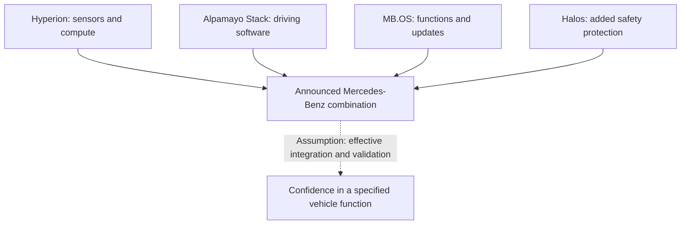
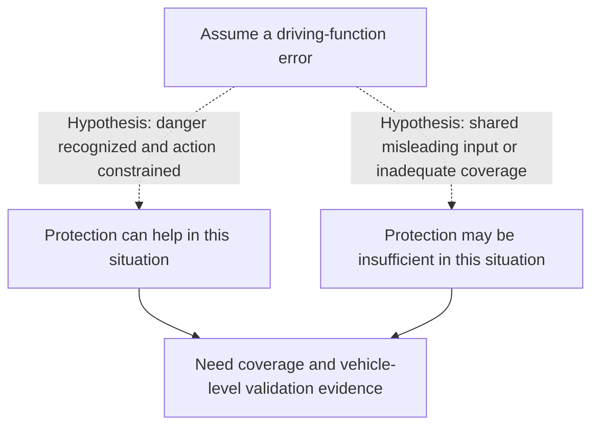

## Which driving task would the buyer hand over?

Suppose you are choosing a car partly because its promised driving functions could make a demanding journey easier. You would need to know what work the car would take over, what you would still have to do, and when that division of tasks would apply. A function that assists with an urban journey raises different purchasing questions from a future function that might allow you to redirect your attention. This is a hypothetical buying situation, not a description of a vehicle already delivered under either announcement.

The two releases discuss several stages of development. In its [October 16, 2026 Mercedes-Benz release](https://nvidianews.nvidia.com/news/mercedes-benz-and-nvidia-expand-strategic-partnership-to-advance-safe-highly-automated-driving-in-the-next-decade), NVIDIA describes software supporting urban point-to-point assistance, active safety and automated parking. It also discusses development of future SAE-Level 4 applications, including robolimousines. Its [October 15, 2026 Volvo Cars release](https://nvidianews.nvidia.com/news/volvo-cars-and-nvidia-expand-partnership-to-advance-safe-automated-driving) concerns future cars and a gradual introduction of "eyes-off" and "mind-off" driving. The texts do not establish a common product boundary for these terms or an identical allocation of driver responsibility. They also do not justify assigning eyes-off or mind-off to a particular SAE level.

The question is what the shared architecture helps explain about safety, and what further evidence would justify a particular driver handing over a particular task. A component description can explain a proposed mechanism. A purchasing decision needs that mechanism connected to a vehicle, software version, operating conditions and driver duties.

Both releases were published by NVIDIA Newsroom. They record attributable statements by the announcing parties, without independently confirming road performance. They do not supply a complete vehicle-specific safety case, deployment schedule, applicable approval material or allocation of legal responsibility. Their omissions do not establish that such material is absent elsewhere.

Within those limits, buyers can still distinguish development commitments from delivered functions and examine what each architectural layer is said to contribute. That helps identify disclosures that would change confidence in a claim. The relevant judgment concerns a function on a specified car under specified conditions; a partnership name alone cannot answer it.

## Two announcements with different claims

The Mercedes-Benz announcement describes an extension of the partnership to jointly develop next-generation driver assistance and automated driving systems. It combines Mercedes-Benz engineering, safety expertise and MB.OS with NVIDIA technologies. The Volvo announcement describes an expanded partnership for automated driving technology in future cars, with a debut planned in a next-generation Volvo car. Neither release identifies a delivery vehicle and date sufficiently for a buyer to establish availability.

Hyperion, Alpamayo Stack and Halos appear in both announcements, with different amounts of detail. The comparison below follows the [Mercedes-Benz release](https://nvidianews.nvidia.com/news/mercedes-benz-and-nvidia-expand-strategic-partnership-to-advance-safe-highly-automated-driving-in-the-next-decade) and [Volvo release](https://nvidianews.nvidia.com/news/volvo-cars-and-nvidia-expand-partnership-to-advance-safe-automated-driving). "Not disclosed" means absent from these releases.

| Disclosure | Mercedes-Benz | Volvo Cars |
|---|---|---|
| Publication date | October 16, 2026 | October 15, 2026 |
| Automaker contribution | Automotive engineering, safety expertise and MB.OS | Vehicle safety systems and engineering expertise |
| Sensor and compute architecture | NVIDIA Hyperion | NVIDIA Hyperion |
| Driving software | Alpamayo Stack; AI reasoning capabilities described | Alpamayo Stack named |
| Safety component wording | Halos safety system; a parallel safety stack adds redundancy and guardrails | Halos OS named; equivalent parallel-stack detail not disclosed |
| Function wording | Urban point-to-point assistance, active safety and automated parking | Future door-to-door navigation across highways, busy urban streets and parking scenarios |
| Future direction | Development of future SAE-Level 4 applications, including robolimousines | Next-generation vehicle debut and gradual introduction of eyes-off and mind-off driving |
| Product boundaries | Specific vehicle, delivery date, operating conditions and driver duties not disclosed | Specific vehicle, delivery date, operating conditions and driver duties not disclosed |

The difference between "Halos" and "Halos OS" needs to remain visible. It proves neither that the implementations differ nor that they are identical. In particular, the more detailed Mercedes-Benz description of a parallel safety stack cannot be transferred to Volvo as a confirmed implementation fact. The uneven disclosure is part of the comparison.

The function descriptions also have different scopes. Active safety and automated parking identify functions the software is intended to support, without establishing their availability or conditions on every future model. Volvo's door-to-door ambition spans several environments. It does not show that one delivered function already covers all of them continuously. "Gradual introduction" leaves the stages unspecified, so readers cannot supply dates or assign stages to particular vehicles.

There is a maturity distinction within the Mercedes-Benz release too. A quoted executive says the partners developed an urban point-to-point assistance system. The architecture paragraph separately describes assistance support and development of future Level 4 applications. The attributed claim about prior development must be retained, while remaining separate from evidence of availability on a named vehicle. It cannot establish that the future applications have already been implemented.

A partnership announcement can explain engineering priorities without providing a complete product specification. That is a reasonable purpose for it. For a buyer, however, an unspecified product boundary leaves questions about practical availability unanswered. The information can be useful even when it does not settle an immediate purchase.

The releases also offer no basis for a numerical safety comparison or ranking. They do not provide matched road exposure, accident records or independent assessments. The separate URLs make each announcement traceable, but their common publisher means they do not provide independent cross-validation. Repeated component names support the observation that a common platform participates in both development directions. They add no measured road-safety outcome.

## What each layer contributes to the safety claim

The Mercedes-Benz text gives the clearer account of component roles. Hyperion supplies the in-vehicle computing and sensor architecture. Alpamayo Stack supplies full-stack driving software with AI reasoning capabilities. MB.OS supports new driving functions and over-the-air updates, working with Hyperion. Halos adds to Mercedes-Benz's safety foundation, including the parallel safety stack described as adding redundancy and guardrails. These are the publisher's architectural claims in the [October 16 release](https://nvidianews.nvidia.com/news/mercedes-benz-and-nvidia-expand-strategic-partnership-to-advance-safe-highly-automated-driving-in-the-next-decade).

Each role addresses a different part of the problem. Sensors and computing concern the resources through which a vehicle obtains and processes information. Driving software concerns how that information supports driving functions. An operating system supporting functions and updates concerns their integration and evolution. The safety layer concerns added constraints or protection. The releases do not give enough detail to reconstruct interfaces, execution order or fault handling, or to specify sensor models, algorithms or control cycles.

These roles explain why the combination could be useful. If the layers exchange the necessary information correctly, respect their intended constraints and handle relevant failures effectively, they could support a more complete driving function. Each condition needs examination in the integrated vehicle. A list of components cannot show whether the interfaces work as intended, whether constraints hold or whether the resulting function meets its goals.

Solid arrows summarize relationships described in the Mercedes-Benz announcement. The dashed arrow is an analytical hypothesis requiring evidence. The diagram maps claims and inference; it does not describe event order, software execution order or a verified system topology.

Over-the-air updates illustrate the difference between an architectural capability and a product commitment. The release says MB.OS supports updates, giving functions a way to evolve. It does not promise that a car bought today will receive every announced future capability. If an update changes behavior relevant to driver duties, useful documentation would connect that software version to its applicable instructions and validation. The releases provide neither that version history nor an entitlement to future functions.

AI reasoning also needs to be read within its stated scope. It is the publisher's description of a software capability, without a disclosed reliability measure for particular road judgments. If that capability helps resolve a difficult driving situation, evidence would need to address the situation and claimed use. The label cannot establish how often the system makes an acceptable decision or how well it recognizes its limits.

The [Volvo release](https://nvidianews.nvidia.com/news/volvo-cars-and-nvidia-expand-partnership-to-advance-safe-automated-driving) describes combining the NVIDIA components with Volvo's vehicle safety systems and engineering expertise. Shared platform elements can therefore coexist with different automaker contributions. If those contributions change integration, constraints or verification, vehicles using common components could have different usable boundaries. The releases establish neither whether that happens here nor the size of any difference.

That leaves two comparisons with different evidence requirements. The releases support comparing the building blocks named by the development programs. Comparing how well the resulting cars perform a specified task requires evidence about the integrated functions. The vehicle configurations and examined conditions must also be relevant to the same question before their results can be compared.

Both collaborations describe work across several relevant parts of a driving system and place the software in an automotive engineering context. The effectiveness of the resulting combination remains unresolved. Interface descriptions, treatment of capability boundaries and vehicle-level validation would help connect the architecture to an outcome. Those are specific places where further disclosure could advance the assessment.

## When a parallel safety stack could provide a second line of defense

Mercedes-Benz's parallel safety stack offers a possible mechanism for added protection: the publisher says it adds redundancy and guardrails. Assessing that claim requires knowing what danger the protection can recognize, what action it can constrain and whether it can intervene while the constraint can still affect the outcome. The release does not disclose hardware independence, software independence, sensor dependencies or coverage of hazardous situations.

Consider a thought experiment involving an automaker, a supplier and a driver. Assume the automaker wants to offer a convenient function with an acceptable safety boundary, the supplier provides driving and safety components, and the driver relies on the product description. Their information differs. The driver cannot inspect the effectiveness of an internal architecture merely by reading that it includes redundancy. The engineering claim eventually needs to connect to understandable conditions of use and a division of tasks.

Suppose the driving function proposes an unsuitable action. In one hypothetical branch, the additional protection recognizes the relevant danger and effectively constrains the action while that intervention can still matter. It then provides a meaningful second line of defense. In another branch, the protection receives the same misleading input, does not cover that danger, or cannot effectively constrain the action. It could then offer less protection against that problem. Neither branch describes an observed success or failure of these products.

The dashed branches express alternative assumptions. Solid arrows connect each hypothesis to the evidence needed to assess it. This is a reasoning diagram, not an event record or a verified account of either vehicle's response sequence.

A probability identity can express the distinction without supplying an invented failure rate. For a hypothetical hazardous situation, let <math xmlns="http://www.w3.org/1998/Math/MathML"><mi>A</mi></math> mean that the driving function makes a relevant error. Let <math xmlns="http://www.w3.org/1998/Math/MathML"><mi>B</mi></math> mean that the additional protection fails to prevent that error from proceeding. The joint event satisfies:

<math xmlns="http://www.w3.org/1998/Math/MathML" display="block"><mrow><mi>P</mi><mo>(</mo><mi>A</mi><mo>∩</mo><mi>B</mi><mo>)</mo><mo>=</mo><mi>P</mi><mo>(</mo><mi>A</mi><mo>)</mo><mo>·</mo><mi>P</mi><mo>(</mo><mi>B</mi><mo>∣</mo><mi>A</mi><mo>)</mo></mrow></math>

This is not an accident-risk estimate or a complete model of vehicle safety. The conditional term asks how likely the protection is to fail when the driving function has made the relevant error. Neither release provides a value for either probability. Multiplying separate failure probabilities as though the mechanisms were independent would add an assumption unsupported by the materials.

In the shared-input hypothesis, the circumstances producing the first error might also make protective failure more likely. With effective protection, the second mechanism might still recognize and constrain the problem. The word "parallel" cannot determine which account fits the actual system. Independence, coverage and effective intervention are separate properties requiring evidence appropriate to each claim.

Useful disclosures would include shared dependencies, the safety stack's stated coverage, tests deliberately introducing relevant faults, and vehicle-level results showing the protection's behavior. Their conclusions would remain limited to the tested conditions. Evidence of protection against one class of introduced fault would not establish protection against every hazardous situation.

The missing records also limit negative judgments. Their absence from the release is no evidence of a particular manufacturing, software or design defect. It means readers cannot assess the redundancy claim at that depth from this material. The potential benefit has an intelligible mechanism; its demonstrated scope remains unresolved.

## What an announcement can leave out

Automakers and suppliers may have substantial validation work that a short public announcement does not describe. A joint engineering program could contain more extensive integration and testing than readers can infer from its summary. Requiring every technical detail in that summary would confuse the announcement's purpose with the work required to develop a vehicle. This is a reasonable counterargument, although the releases do not establish that any particular undisclosed validation program exists or has passed testing.

The [Mercedes-Benz release](https://nvidianews.nvidia.com/news/mercedes-benz-and-nvidia-expand-strategic-partnership-to-advance-safe-highly-automated-driving-in-the-next-decade) stresses automotive engineering and safety expertise. The [Volvo release](https://nvidianews.nvidia.com/news/volvo-cars-and-nvidia-expand-partnership-to-advance-safe-automated-driving) stresses vehicle safety systems, engineering knowledge and an established collaboration. These contributions form part of the announced approach. The releases still do not disclose the validation evidence needed to assess the resulting functions.

The same evidential standard applies to favorable and unfavorable conclusions. Missing public test data do not prove that a product is unsafe. An account of engineering strengths does not establish safety for a particular product and use. Buyers can recognize that the engineering work may be valuable while treating unspecified future capability as a conditional expectation.

Two kinds of later evidence could revise the assessment. Clear vehicle documentation identifying operating conditions and driver tasks, supported by relevant validation, should increase confidence in the specified function. It would answer questions these releases leave open. Continuing to express the same uncertainty after receiving evidence that directly resolves it would be unreasonable.

Vehicle-specific disclosures could also change the comparison between the brands. Materially different boundaries or results would weaken an assumption of equivalent capability based on shared components. Conditions would need to be compared before judging performance. Conversely, closely matched vehicle-level evidence could support a limited conclusion about comparable capability for the covered functions.

Any test report would still need to be read against the advertised scope. If a function is described across several environments but the evidence covers only a restricted subset, confidence should attach to that subset. If the report concerns a different configuration from the vehicle under consideration, its relevance needs explanation. These are conditional checks, without alleging that either company omitted actual testing.

Technical support and legal responsibility require separate judgments. Protection shown to work under tested conditions answers an engineering question. It does not by itself allocate responsibility among the driver, automaker and supplier. The releases do not supply the contractual or jurisdiction-specific material needed for that assessment. Task allocation, demonstrated capability and legal responsibility must each be established when interpreting a promise to take over driving work.

The forward-looking statements warn that expected benefits are not guarantees. Their legal disclaimers cannot settle whether a technical claim is true. That judgment depends on what was implemented, the conditions examined and the results supported. A brand's safety history can explain development priorities, but cannot substitute for validation of the new functions.

## Questions a buyer can verify

The gaps in the announcements suggest four groups of purchasing questions. These are evidence checks, without implying that every jurisdiction legally requires the same disclosures. They provide no driving or takeover instructions. Actual use must follow the applicable documentation for the vehicle and function.

| Purchasing question | Material that could help answer it | Decision affected |
|---|---|---|
| Which vehicle and software version provides the function? | A product description identifying the model, configuration, version and availability | Whether the claim concerns something the buyer can obtain |
| Under which conditions is it available? | Applicable instructions defining the supported environments and limits | Whether it covers the buyer's intended use |
| What tasks remain with the driver? | Function-specific instructions describing continuing duties and capability boundaries | What driving work the buyer can reasonably expect to hand over |
| What supports that arrangement? | Relevant validation and applicable approval material, read within their stated scope | How much confidence the claimed use warrants |

The table proposes material to check; these are not documents supplied by the announcements. The rows address separate questions. A delivery description can establish availability, while validation supports a capability only within its examined scope. One cannot answer the other's question.

Start with the product's identity: the model, configuration and software version carrying the function. Establish whether the description concerns delivery equipment, a capability in development or a later plan. Mercedes-Benz's urban assistance and future Level 4 applications need separate answers. Volvo's next-generation debut and gradual introduction need a specific delivery description before a buyer can assess their practical value.

Then establish the conditions of availability. The announcements mention urban assistance, parking, highways and door-to-door ambitions in different contexts. Which environments and other conditions does the actual product documentation cover? If the intended journey depends on a particular setting, the function must be checked against that setting. A broad future description cannot supply a missing product-specific condition.

Driver documentation must explain continuing tasks and capability boundaries. What does the driver have to keep doing while the function is available? How does the documentation describe situations outside its supported range? What explains the division of tasks between driver and system? "Eyes-off," "mind-off" and "assistance" should prompt those questions. The releases alone do not answer them sufficiently to authorize a change in driving behavior.

Supporting evidence could include product instructions, test descriptions with stated coverage, and approval documents applicable to the product and claimed use. Buyers need not reproduce an engineering validation program themselves. They do need to check whether the material addresses the vehicle, version, conditions and responsibilities on which their decision depends. A document's presence alone says little about its relevance to that decision.

The answers also need to agree. A sales description promising broad convenience and instructions specifying a narrower function leave a discrepancy to resolve. A test result for another configuration needs an explanation of its relevance. For functionality still in development, assume no delivery date, price, compatibility with existing hardware or availability to earlier buyers. None of those details is supplied here.

A defensible buying approach values verifiable delivered functions and keeps future benefits conditional. It requires neither dismissing the partnerships nor choosing one brand over the other. The purchasing question remains whether the proposed transfer of driving work has a specific, supported product boundary.

## What the next disclosure should establish

The releases support a limited conclusion: Mercedes-Benz and Volvo publicly describe development directions combining NVIDIA sensor and compute architecture, driving software and safety technologies with their own engineering contributions. Mercedes-Benz gives more explicit detail about a parallel safety stack. Volvo describes future door-to-door capability and gradual changes in the driving experience. Neither establishes equivalent delivered functions, that road safety has already improved, or the size of any improvement.

Further disclosure would be useful if it connected the architecture to a vehicle and its use. A function description could establish scope, and driver documentation could establish continuing tasks. Validation material could identify the situations and failure conditions examined. Actual-use evidence, if disclosed with an interpretable scope, could help assess whether the intended boundary holds beyond the development description. Each addresses a different unresolved question.

Another partnership statement might add information about development commitments without changing confidence in a particular function. Evidence concerning the relevant vehicle, operating conditions, treatment of limits or effectiveness of the additional protection would bear more directly on that judgment. Narrowing an advertised scope can also help by making the claim testable. A lack of product evidence does not establish a lack of technical progress.

For the next announcement, the purchasing questions remain specific: which car does the safety claim describe, under which conditions, with what continuing driver tasks, and supported by what evidence? The present material describes potentially useful mechanisms and their development aims. Decisions about handing over attention or control require those product-level answers.

## References

1. NVIDIA Newsroom. [Mercedes-Benz and NVIDIA Expand Strategic Partnership to Advance Safe Highly Automated Driving in the Next Decade | NVIDIA Newsroom](https://nvidianews.nvidia.com/news/mercedes-benz-and-nvidia-expand-strategic-partnership-to-advance-safe-highly-automated-driving-in-the-next-decade).
2. NVIDIA Newsroom. [Volvo Cars and NVIDIA Expand Partnership to Advance Safe Automated Driving | NVIDIA Newsroom](https://nvidianews.nvidia.com/news/volvo-cars-and-nvidia-expand-partnership-to-advance-safe-automated-driving).
