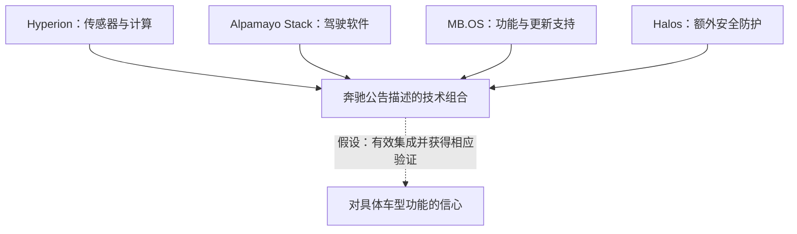
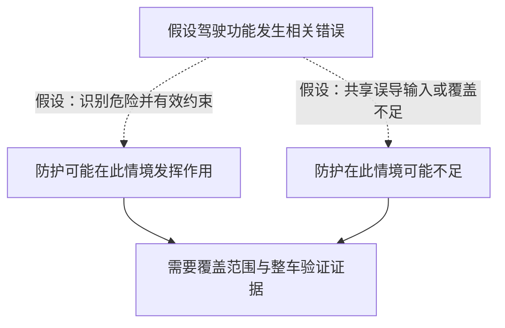

## 购车者会交出哪一项驾驶任务？

设想你在选车，希望新车能减轻复杂路段的驾驶负担。介绍中提到城市点到点辅助、自动泊车，以及未来可以转移注意力的驾驶体验。影响选择的具体问题是：车辆会承担什么任务，你仍须做什么，这种分工又在哪些条件下成立？城市行程中的辅助功能，与未来可能允许转移注意力的功能，需要分别核验。这是用于分析的假设购车情境，不是两家车企已经交付相关功能的描述。

两份公告涉及不同开发阶段。[2026年10月16日的奔驰合作公告](https://nvidianews.nvidia.com/news/mercedes-benz-and-nvidia-expand-strategic-partnership-to-advance-safe-highly-automated-driving-in-the-next-decade)介绍了支持城市点到点辅助、主动安全与自动泊车的驾驶软件，也提到未来SAE-Level 4应用的开发，包括robolimousines。[2026年10月15日的沃尔沃合作公告](https://nvidianews.nvidia.com/news/volvo-cars-and-nvidia-expand-partnership-to-advance-safe-automated-driving)面向未来车辆，提出逐步引入eyes-off、mind-off驾驶。两篇文字没有为这些词建立共同的产品边界，也不足以确定相同的驾驶员责任安排。eyes-off和mind-off同样不能据此自行对应到某个SAE等级。

本文要回答的是，共享架构为安全提供了哪些可解释的机制，还需要什么证据，才能判断某款车允许驾驶员交出哪项任务。组件描述可以说明一种设计思路；购买判断则需要把它落实到车型、软件版本、运行条件和驾驶员职责。

两篇材料都由NVIDIA Newsroom发布，记录的是合作方可以归属的公开主张，没有独立确认道路表现。它们未提供完整的车型安全论证、部署时间安排、适用批准材料或法律责任分配。这些内容未在公告中披露，不代表企业在其他地方一定没有相应材料。

在此范围内，读者仍可区分开发承诺与交付功能，查看各层架构声称承担的作用，并据此判断哪些新披露会改变信心。需要评估的是一款车在特定条件下的一项功能，合作关系本身无法替代这个对象。

## 两份公告中的不同主张

奔驰公告称，双方将延长战略合作，共同开发下一代驾驶辅助和自动驾驶系统，把奔驰的汽车工程、安全经验及MB.OS与NVIDIA技术结合。沃尔沃公告描述的是面向未来车辆的合作扩展，计划让相关技术在下一代沃尔沃车型中首发。两篇材料都没有给出足以让买家确定可用状态的交付车型与日期。

Hyperion、Alpamayo Stack和Halos出现在两份公告中，但披露细节不同。下表依据[奔驰公告](https://nvidianews.nvidia.com/news/mercedes-benz-and-nvidia-expand-strategic-partnership-to-advance-safe-highly-automated-driving-in-the-next-decade)与[沃尔沃公告](https://nvidianews.nvidia.com/news/volvo-cars-and-nvidia-expand-partnership-to-advance-safe-automated-driving)整理；“未披露”仅指这两篇正文没有提供。

| 对照项目 | 奔驰 | 沃尔沃 |
|---|---|---|
| 发布日期 | 2026年10月16日 | 2026年10月15日 |
| 车企贡献 | 汽车工程、安全经验及MB.OS | 车辆安全系统及工程经验 |
| 传感器与计算架构 | NVIDIA Hyperion | NVIDIA Hyperion |
| 驾驶软件 | Alpamayo Stack，并描述AI推理能力 | 列出Alpamayo Stack |
| 安全组件措辞 | Halos安全系统，并明确提及增加冗余与防护的平行安全栈 | 列出Halos OS，未展开相同的平行安全栈细节 |
| 功能表述 | 城市点到点辅助、主动安全、自动泊车 | 未来门到门行驶，涉及高速公路、繁忙城市街道和停车场景 |
| 未来方向 | 开发未来SAE-Level 4应用，包括robolimousines | 下一代车型首发，逐步引入eyes-off及mind-off驾驶 |
| 产品边界 | 未明确具体车型、交付日期、运行条件和驾驶员任务 | 未明确具体车型、交付日期、运行条件和驾驶员任务 |

Halos与Halos OS的名称差异需要保留。它既不能证明两家的实现不同，也不能证明实现完全相同。尤其不能把奔驰较详细的平行安全栈描述，移植成沃尔沃已经确认的实现。披露详略不一，本身就是比较的一部分。

功能表述也有各自的范围。主动安全和自动泊车说明软件所支持的功能方向，没有确定每款未来车型的可用状态与条件。沃尔沃的门到门愿景涉及几类环境，却不证明一项已经交付的功能能够连贯覆盖全部环境。“逐步引入”没有明确阶段，读者不能补出日期，也不能自行把阶段分配给具体车型。

奔驰公告内部同样有成熟度差别。被引述的高管称，双方已开发城市点到点辅助系统；架构段落另行描述辅助功能支持与未来Level 4应用开发。关于既有开发的主张应保留归属，但不能用来证明某款车已经可购，也不能延伸为未来应用已经实现的证据。

合作公告可以用于介绍工程方向，无须容纳完整产品说明。不过，对买家而言，未明确的产品边界仍会留下实际可用性问题。信息有助于理解合作，并不等于它足以解决眼前的购买决定。

两篇材料也不支持安全排名或数值比较。它们没有提供相互匹配的道路暴露量、事故记录或独立评估。不同URL让公告各自可追溯，共同发布渠道却不能构成独立交叉验证。组件名称反复出现，支持共同平台参与两项开发方向的观察，没有增加经过测量的道路安全效果证据。

## 各层架构为安全主张提供什么依据？

奔驰正文对组件分工的描述更清楚。Hyperion提供车内计算与传感器架构；Alpamayo Stack提供具备AI推理能力的全栈驾驶软件；MB.OS支持新驾驶功能和空中更新，并与Hyperion协同；Halos补充奔驰的安全基础，包括公告所称增加冗余与防护约束的平行安全栈。这些均为[发布方的架构主张](https://nvidianews.nvidia.com/news/mercedes-benz-and-nvidia-expand-strategic-partnership-to-advance-safe-highly-automated-driving-in-the-next-decade)。

这些角色分别对应不同问题。传感器与计算涉及车辆获取、处理信息所依赖的资源；驾驶软件涉及信息怎样支持驾驶功能；支持功能与更新的操作系统涉及集成和演进；安全层涉及额外约束与保护。公告的细节不足以复原实际接口、执行顺序或故障处理，也没有据此确定传感器型号、算法或控制周期的依据。

这种分工说明了组合可能有用的原因。如果各层能正确交换所需信息、遵守预定约束，并有效处理相关故障，就可能支持更完整的驾驶功能。每个条件都需要在集成后的车辆中检验。组件名单无法说明接口是否有效、约束是否落实，或整车功能是否达到目标。

实线概括奔驰公告中的组合关系，虚线表示仍需证据支持的分析假设。图中箭头不代表事件时间线、软件执行顺序或经过核实的真实系统拓扑。

空中更新可以说明架构能力与产品承诺的区别。MB.OS支持更新，意味着功能有演进渠道，没有承诺今天购买的车辆会获得所有未来能力。如果更新改变了与驾驶员职责有关的行为，有用的文档应把软件版本、适用说明和相应验证联系起来。两篇公告既未提供这种版本记录，也未给予既有车辆取得未来功能的权利。

AI推理能力也应按其表述范围理解。这是发布方对软件能力的描述，没有附带特定道路判断的可靠性指标。如果这种能力有助于处理复杂情境，证据就应覆盖对应情境和宣称用途。名称不能说明系统作出可接受判断的频率，也不能说明它识别自身边界的效果。

[沃尔沃公告](https://nvidianews.nvidia.com/news/volvo-cars-and-nvidia-expand-partnership-to-advance-safe-automated-driving)描述了将NVIDIA组件与自身车辆安全系统、工程经验结合。共享平台因而可以与不同车企的工程贡献并存。如果这些贡献改变了集成、约束或验证方式，采用共同组件的车辆仍可能有不同的适用边界。公告没有说明这里是否存在这种差异，也没有说明差异大小。

比较开发项目列出了哪些相关组件，与比较整车是否同样胜任一项任务，需要不同证据。公告支持前一种比较。后一种需要集成功能的材料，还要确认车辆配置与考察条件确实对应同一个问题，才能比较结果。

两项合作都描述了驾驶系统多个相关部分的工作，并把软件放在汽车工程背景中讨论。组合最终发挥什么效果，仍未解决。接口说明、能力边界处理与整车验证，是进一步把架构连接到结果的具体材料。

## 平行安全栈何时能提供第二道防线？

奔驰公告提出了一种额外保护机制：平行安全栈增加冗余与防护约束。要评估这个主张，需要知道防护能识别什么危险、限制什么行动，以及限制发生时是否仍能影响结果。公告未披露硬件独立性、软件独立性、传感器依赖关系或危险情境覆盖范围。

可以用一个思想实验来分析。假设车企希望提供便利且具有适当安全边界的功能，供应商提供驾驶与安全组件，驾驶员依据产品说明使用。各方掌握的信息不同。驾驶员无法从“具有冗余”的描述中检查内部架构的有效性，工程主张最终需要对应到可理解的使用条件和任务分工。

再假设驾驶功能提出不合适的行动。一个分支中，额外防护识别相关危险，并在干预仍能改变结果时有效限制行动，于是构成有意义的第二道防线。另一个分支中，防护收到相同的误导输入，没有覆盖这种危险，或无法有效限制行动，对该问题的保护就可能较弱。两个分支都没有描述这些产品已经发生的成功或故障。

虚线分支表示不同假设，实线把假设连接到评估所需的证据。这是分析关系图，不是事件记录，也没有确认任一车辆的实际响应顺序。

概率恒等式能表达这一差别，无须编造失效率。在一个假设危险情境中，令<math xmlns="http://www.w3.org/1998/Math/MathML"><mi>A</mi></math>表示驾驶功能发生相关错误，令<math xmlns="http://www.w3.org/1998/Math/MathML"><mi>B</mi></math>表示额外防护未能阻止该错误继续传递。联合事件的概率满足：

<math xmlns="http://www.w3.org/1998/Math/MathML" display="block"><mrow><mi>P</mi><mo>(</mo><mi>A</mi><mo>∩</mo><mi>B</mi><mo>)</mo><mo>=</mo><mi>P</mi><mo>(</mo><mi>A</mi><mo>)</mo><mo>·</mo><mi>P</mi><mo>(</mo><mi>B</mi><mo>∣</mo><mi>A</mi><mo>)</mo></mrow></math>

这不是事故风险估计，也不是完整的整车安全模型。条件概率所问的是：驾驶功能发生相关错误时，保护机制失效的可能性有多大？公告没有提供其中任何概率。如果把两套机制各自的失效概率直接相乘，就加入了相互独立的假设，材料并不支持。

在共享误导输入的假设中，造成第一次错误的条件，也可能使保护机制更容易失效。有效防护则可能仍能识别并限制问题。“平行”这个词无法判定哪种描述符合实际系统。独立性、覆盖范围与干预有效性是不同属性，需要各自对应的证据。

有用的新披露包括共享依赖说明、安全栈覆盖范围、主动引入相关故障的测试，以及显示防护行为的整车结果。结论仍须限定在测试条件内。某类故障受到保护，不等于所有危险情境都受到保护。

这些记录缺席，也限制了负面判断。公告未披露记录，不能证明架构存在某种制造、软件或设计缺陷。它只说明读者无法凭这些材料检验到这一深度。潜在收益有可解释的机制，已经证明的作用范围则仍未明确。

## 公告可能省略哪些验证工作？

车企和供应商可能开展了简短公告没有描述的验证。联合工程项目也可能包含比公开摘要所显示的更完整的集成和测试。要求摘要提供全部技术细节，会混淆对外介绍的目的与车辆开发所需的工作。这是合理的反论证，但公告并未证明某个未披露验证体系确实存在或已通过测试。

[奔驰公告](https://nvidianews.nvidia.com/news/mercedes-benz-and-nvidia-expand-strategic-partnership-to-advance-safe-highly-automated-driving-in-the-next-decade)强调汽车工程和安全经验，[沃尔沃公告](https://nvidianews.nvidia.com/news/volvo-cars-and-nvidia-expand-partnership-to-advance-safe-automated-driving)强调车辆安全系统、工程知识与既有合作。车企贡献是所宣布方案的一部分，正文仍未披露足以评估具体功能的验证证据。

正面与负面结论应遵守相同标准。缺少公开测试数据，不能证明产品不安全；工程优势的介绍，也不能证明某款产品在特定用途下安全。购车者可以认可工程工作可能有价值，同时对尚未明确的未来能力保留条件性预期。

后续证据可以从两个方向更新判断。首先，如果车型文档明确运行条件、驾驶员任务，并有相关验证支持，就应提高对这项具体功能的信心。它会回答公告留下的问题。收到直接解决问题的材料后，仍维持原有不确定性并不合理。

其次，车型材料可能改变品牌间的比较。产品边界或结果明显不同，会削弱由共同组件推定相同能力的假设。判断性能前仍须比较条件；反过来，条件匹配的整车证据，也可能支持所覆盖功能能力接近的有限结论。

测试报告还须对照宣称范围阅读。如果功能介绍横跨几类环境，证据仅覆盖其中一部分，信心就应限定在这一部分。如果报告对应的配置不同于所考虑的车辆，需要解释它的适用性。这些是条件性检查，没有指称任何一家公司实际漏做测试。

技术支持与法律责任需要分别判断。防护在测试条件下有效，回答了工程问题，不能独自确定驾驶员、车企和供应商如何分配责任。公告没有提供所需合同或特定司法辖区材料。理解接手驾驶工作的承诺时，任务分工、已证明能力与法律责任都须各自核实。

前瞻性声明提醒读者，预期收益不是保证。法律免责声明本身不能决定技术主张真假，判断仍取决于实现内容、考察条件与结果支持的范围。品牌安全历史可以解释开发优先级，也不能替代新一代功能的验证。

## 购车时可以核验的问题

公告留下的空白，可以整理为四组购车问题。这些是证据检查方法，不意味着各地法律都要求相同披露，也不提供驾驶或接管指令。实际使用必须遵循对应车辆与功能的适用文档。

| 购车问题 | 可能有助于回答的材料 | 影响什么判断 |
|---|---|---|
| 哪款车、哪个软件版本提供功能？ | 标明车型、配置、版本和可用状态的产品说明 | 主张是否对应买家能够取得的产品 |
| 功能在哪些条件下可用？ | 说明适用环境与限制的使用文档 | 是否覆盖买家的预期用途 |
| 驾驶员仍须承担什么任务？ | 说明持续职责与能力边界的功能文档 | 可以合理期待交出哪些驾驶工作 |
| 什么证据支持这些安排？ | 具有明确范围的验证及适用批准材料 | 对所宣称用途应有多大信心 |

表中提出的是待核验材料，并非公告已提供的文件。各行回答不同问题：交付说明可以确定可用状态，验证则只在考察范围内支持能力判断，彼此不能替代。

先确定产品身份，包括提供功能的车型、配置和软件版本。介绍说的是交付内容、开发中的能力，还是后续计划？奔驰的城市辅助与未来Level 4应用需要分别回答。沃尔沃的下一代车型首发和逐步引入，也需要具体交付说明，买家才能判断实际价值。

再确定可用条件。两篇公告在不同语境中提到城市辅助、停车、高速公路及门到门愿景。实际产品文档覆盖哪些环境和其他条件？如果预期行程依赖某个场景，就须核验功能是否覆盖该场景，不能用宽泛的未来描述补足产品条件。

驾驶员文档应说明持续任务与能力边界。功能可用时，驾驶员必须继续做什么？超出支持范围的情况如何描述？什么材料解释人与系统的分工？eyes-off、mind-off和“辅助”应引出这些问题。仅凭两篇公告，不足以据此改变驾驶行为。

支持材料可以包括产品说明、列明覆盖范围的测试介绍，以及适用于该产品和宣称用途的批准文件。买家不必亲自复现工程验证，但须检查材料是否对应决策所依赖的车辆、版本、条件和责任。文件存在，本身不能说明它与眼前的决定有关。

各项答案还应一致。如果销售介绍承诺较宽的便利，使用说明却限定较窄的功能，差异就需要澄清。其他配置的测试结果需要解释关联。对于仍在开发中的功能，不能假定交付日期、价格、既有硬件兼容性或老用户可用性；现有材料没有提供这些细节。

可行的购车方式，是按能够核验的交付功能评估车辆，对未来收益保留条件。这既不要求否定合作，也不构成选择某个品牌的建议。判断仍落在所宣称的驾驶任务转移是否具有具体、受证据支持的产品边界上。

## 下一份披露应当解决什么？

两篇公告支持一个有限结论：奔驰与沃尔沃公开描述了将NVIDIA传感器与计算架构、驾驶软件、安全技术同各自工程贡献结合的开发方向。奔驰更明确地介绍平行安全栈，沃尔沃描述未来门到门能力和逐步变化的驾驶体验。它们既没有证明两家已交付相同功能，也没有证明道路安全已经改善，更没有证明改善幅度。

进一步披露若能把架构落实到车辆和用途，就有助于判断。功能说明可以确定范围，驾驶员文档可以确定持续任务，验证材料可以交代考察过的情境与故障条件。如果实际使用证据具有可解释的范围，也可帮助检验预定边界是否在开发描述之外成立。各类材料回答不同的未决问题。

另一份合作声明可能增加开发承诺的信息，未必改变对具体功能的信心。涉及相关车辆、运行条件、边界处理或额外防护有效性的证据，更直接关系到这个判断。缩小宣称范围也可能有用，因为它让主张能够核验。缺少产品证据，同样不能概括为技术没有进展。

下一份公告仍可按具体问题阅读：安全主张对应哪款车、哪些条件，驾驶员须继续做什么，又有什么证据支持？现有材料描述了可能有用的机制及其开发目标。交出注意力或控制任务的决定，需要这些产品层面的答案。

## 参考资料

1. NVIDIA Newsroom. [Mercedes-Benz and NVIDIA Expand Strategic Partnership to Advance Safe Highly Automated Driving in the Next Decade | NVIDIA Newsroom](https://nvidianews.nvidia.com/news/mercedes-benz-and-nvidia-expand-strategic-partnership-to-advance-safe-highly-automated-driving-in-the-next-decade).
2. NVIDIA Newsroom. [Volvo Cars and NVIDIA Expand Partnership to Advance Safe Automated Driving | NVIDIA Newsroom](https://nvidianews.nvidia.com/news/volvo-cars-and-nvidia-expand-partnership-to-advance-safe-automated-driving).
