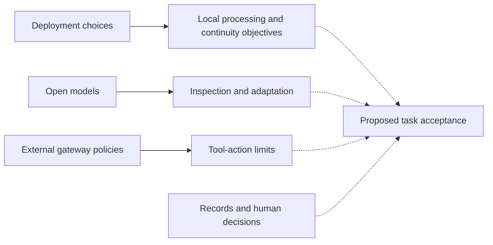
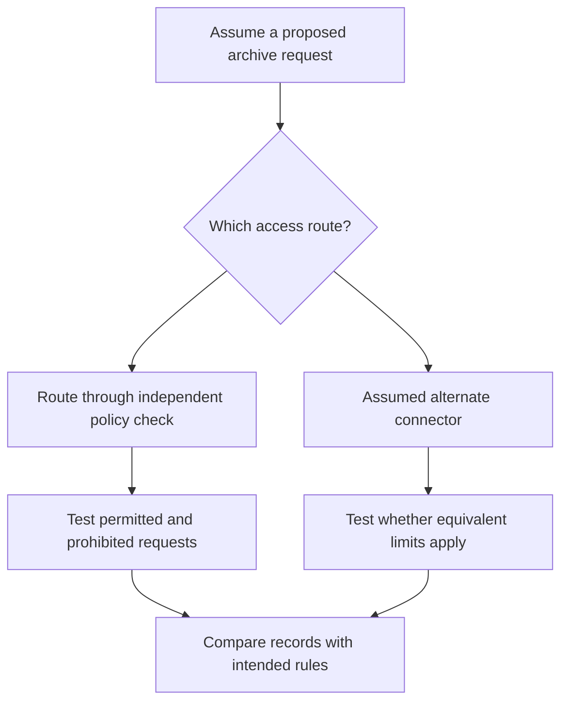

## Which responsibilities come with a footage search?

An editor looking for an old reaction shot needs to know which archive the search covered, whether they may access the material, what its approval status permits and where the result may go next. An organization should settle these questions before expanding a search assistant's authority. The answers define the delegated task and the evidence the institution needs to retain about its results.

According to [NVIDIA](https://blogs.nvidia.com/blog/media-agentic-security-european-public-service-broadcasting-global-content-production/) on October 19, 2026, German film and television producer UFA delivers more than 3,500 hours of programming annually, including the daily drama *Gute Zeiten, schlechte Zeiten*. Editors building recaps or flashbacks may need a particular reaction or unresolved exchange from as far back as 15 years. NVIDIA describes a retrieval problem that file names and folders cannot adequately address. The task considered here is finding that historical footage for editorial review.

[NVIDIA describes](https://blogs.nvidia.com/blog/media-agentic-security-european-public-service-broadcasting-global-content-production/) Frame.io semantic search as finding moments by concept, action or setting. Hybrid search adds notes, transcripts and approval status. In its example, an editor searches for "a character looking concerned," narrows by character name, filters to approved footage and proceeds to review. This supplier's workflow description includes no independent observation of editors' performance. It establishes neither that every result is appropriate nor that the search system has authority to publish anything.

Relevance and permission need separate acceptance questions. Does the clip match the requested scene, and is it available for this use? What does "approved" cover, and who maintains that status? An approval filter must not count as evidence of a complete copyright or authorization check. A label that helps identify candidates may leave a particular reuse unresolved. Editors need that distinction to judge whether a result can proceed.

If the institution considers allowing an agent to retrieve files or invoke downstream tools, it should decide whether search, export and modification require separate permissions. A single conversational interface need not imply a single authorization decision. Identifying a candidate and moving it into a shared production destination are different actions, each requiring an explicit scope even when the user requests both together.

The [AWS roundup](https://aws.amazon.com/blogs/aws/aws-weekly-roundup-aws-lambda-web-functions-amazon-s3-on-the-vercel-marketplace-and-more-october-19-2026/) dated October 19, 2026 discusses agent autonomy and external controls. Read alongside NVIDIA's account, it raises this article's central question: when agents search internal material and call tools, what do deployment location, model visibility, external authorization and human review each control? The aim is to define a task the institution can authorize and inspect, with unresolved decisions still visible.

## What do the two announcements establish?

The sources describe different control mechanisms. Neither independently evaluates a complete governance system. Their claims need to remain attached to their publishers, the activities described and the maturity of the work. Shared components or related objectives establish neither identical implementations nor a delivered combination of capabilities. The accounts address different parts of the proposed task.

[NVIDIA reports](https://blogs.nvidia.com/blog/media-agentic-security-european-public-service-broadcasting-global-content-production/) that the European Broadcasting Union and NVIDIA are expanding their sovereign framework for European public service media. It describes the EBU as having over 115 member organizations in more than 55 countries, reaching over one billion people. The initiative brings together cloud providers, open-model developers and systems integrators. It will define requirements and reference architectures for workload location, data governance, model selection and security throughout the lifecycle. This prospective work does not document completed deployment or acceptance across EBU members.

The [partners have different roles](https://blogs.nvidia.com/blog/media-agentic-security-european-public-service-broadcasting-global-content-production/). Microsoft will contribute expertise from Microsoft Sovereign Cloud, including Azure Local and Foundry Local, to support local processing of sensitive editorial material and critical services during external connectivity failures. Nebius offers European infrastructure for training, fine-tuning and running broadcasters' own models. NVIDIA Nemotron open models provide a foundation for inspection, evaluation and adaptation. Qvest and other integrators are described as supporting practical, interoperable reference architectures. Available components and intended integration work remain distinct.

Separately, [NVIDIA describes](https://blogs.nvidia.com/blog/media-agentic-security-european-public-service-broadcasting-global-content-production/) Adobe's search pipeline: NVDEC for decoding, TensorRT for optimized inference, and CUDA for preprocessing and embedding generation. It reports about 5x faster embedding generation, up to 4x higher throughput and up to 5x lower search-processing latency. A two-frame-per-second proxy is about 80% smaller than the 360p version it replaces. These supplier-reported pipeline figures lack full comparison conditions and an end-to-end retrieval-accuracy evaluation. They cannot be combined into a production-wide productivity or safety result.

[AWS describes](https://aws.amazon.com/blogs/aws/aws-weekly-roundup-aws-lambda-web-functions-amazon-s3-on-the-vercel-marketplace-and-more-october-19-2026/) Lambda Web Functions as running standard HTTP applications on Firecracker isolation, supporting up to 128 concurrent requests per execution environment and billing for actual CPU time. Its stated availability is five Regions, with Node.js 24 on Arm64 and VPC connectivity. These specifications concern execution and resource consumption; they do not establish authority over internal material.

For authorization, [AWS summarizes](https://aws.amazon.com/blogs/aws/aws-weekly-roundup-aws-lambda-web-functions-amazon-s3-on-the-vercel-marketplace-and-more-october-19-2026/) *Trust in Depth*: agent limits should sit outside the agent's reasoning, in Amazon Bedrock AgentCore policies enforced at the gateway. AWS cites more than a decade of production automated reasoning, including IAM at more than 2.1 billion requests per second. That history does not evaluate a particular newsroom policy's correctness, coverage or resistance to bypass.

A [separate S3 integration](https://aws.amazon.com/blogs/aws/aws-weekly-roundup-aws-lambda-web-functions-amazon-s3-on-the-vercel-marketplace-and-more-october-19-2026/) with Vercel Marketplace and v0 exchanges a short-lived OIDC token at runtime through AWS STS for resource-scoped credentials, avoiding stored static keys. The roundup also describes [CloudWatch](https://aws.amazon.com/blogs/aws/aws-weekly-roundup-aws-lambda-web-functions-amazon-s3-on-the-vercel-marketplace-and-more-october-19-2026/) routing events by processed fields and running parsers in sequence. These are separate announcements; the source does not demonstrate an integrated broadcast control system.

| Control layer | Publisher's description | Maturity and missing verification |
| :--- | :--- | :--- |
| Deployment and continuity | [NVIDIA, October 19](https://blogs.nvidia.com/blog/media-agentic-security-european-public-service-broadcasting-global-content-production/): EBU framework and local-processing objectives | Requirements and reference architectures include future work; member deployment is unestablished |
| Model visibility | [NVIDIA](https://blogs.nvidia.com/blog/media-agentic-security-european-public-service-broadcasting-global-content-production/): Nemotron inspection and adaptation | An evaluation opportunity, without demonstrated tool safety |
| Action authorization | [AWS, October 19](https://aws.amazon.com/blogs/aws/aws-weekly-roundup-aws-lambda-web-functions-amazon-s3-on-the-vercel-marketplace-and-more-october-19-2026/): AgentCore gateway policies | An architectural argument summarized without policy definitions or bypass tests |
| Credential scope | [AWS](https://aws.amazon.com/blogs/aws/aws-weekly-roundup-aws-lambda-web-functions-amazon-s3-on-the-vercel-marketplace-and-more-october-19-2026/): S3 integration's OIDC-to-STS exchange | A specific integration, without universal agent credential coverage |
| Processing performance | [NVIDIA](https://blogs.nvidia.com/blog/media-agentic-security-european-public-service-broadcasting-global-content-production/): accelerated search and smaller proxies | Pipeline measurements, without production-wide productivity or safety validation |

Finally, [AWS reports](https://aws.amazon.com/blogs/aws/aws-weekly-roundup-aws-lambda-web-functions-amazon-s3-on-the-vercel-marketplace-and-more-october-19-2026/) a containerized penetration-testing evaluation. Its autonomous agent captured 35 flags across 37 recently disclosed CVE targets. An audit against canonical proofs of concept confirmed 33 genuine end-to-end exploits, or 89.2%. The roundup separately describes two misses in which the agent exploited the bug but took down the target before reading the flag. These observations must remain separate: subtracting 33 from 35 does not establish a destruction rate or a production incident rate.

## What can deployment location and model visibility control?

Procurement needs to distinguish where work runs from what an institution can inspect and adapt. Can it exercise the advertised choices, and what access, staffing, dependencies and procedures would that require? A component's capability does not establish that the institution can use it throughout an agreed task. Acceptance should identify both the offered choice and the operational conditions needed to exercise it.

[NVIDIA's EBU account](https://blogs.nvidia.com/blog/media-agentic-security-european-public-service-broadcasting-global-content-production/) describes local processing of sensitive editorial material as an objective of Microsoft's contribution. A broadcaster should ask which processing remains local, who administers it and which services receive data. Would any part of the agreed task still require an external connection? The announcement does not establish that all proposed local deployments exclude external traffic, telemetry or third-party access.

Continuity requires a service-specific test. [Microsoft's prospective role](https://blogs.nvidia.com/blog/media-agentic-security-european-public-service-broadcasting-global-content-production/) includes keeping critical services running when external connectivity is down. Which services would that cover? If local inference continued, would storage, search indexes, identity checks and editorial review also remain available? Evidence should cover the complete agreed task; a local model demonstration alone cannot establish retrieval continuity.

The [European infrastructure](https://blogs.nvidia.com/blog/media-agentic-security-european-public-service-broadcasting-global-content-production/) described for Nebius addresses workload location, while the continuity objective calls for tests under failure conditions. Neither description answers both questions. An acceptance statement should name the necessary functions and the particular connectivity failure under which they must continue. Sovereign, open and local describe different properties; none alone establishes legal compliance or that EBU members already hold every relevant control.

Open models offer another opportunity for evaluation. [NVIDIA says](https://blogs.nvidia.com/blog/media-agentic-security-european-public-service-broadcasting-global-content-production/) broadcasters can inspect, evaluate and adapt models for local languages, archives and editorial policies. Does the proposed access permit the evaluation the institution needs? Could it compare outputs on representative scenes, local terminology and editorial distinctions, preserve the evaluated version and document later changes?

That review needs an accountable owner and an agreed definition of success. What would count as an unacceptable scene description, and who would resolve disagreement about a retrieved clip? Would access to model weights help answer those questions in this workflow? The described scope for inspection and adaptation does not establish an exhaustive explanation of model behavior, freedom from weaknesses or deterministic execution.

Authorization needs its own test. Suppose a locally hosted, inspectable model proposes retrieving material outside the editor's permitted collection. Where would the request be evaluated, and what would prevent execution? Computation location and access to weights leave that implementation question unanswered. A procurement response should identify the separate mechanism and explain how its coverage of the proposed task would be checked.

The diagram expresses evidence relationships, not an event sequence or deployment result. Solid arrows summarize relationships described by [NVIDIA](https://blogs.nvidia.com/blog/media-agentic-security-european-public-service-broadcasting-global-content-production/) and [AWS](https://aws.amazon.com/blogs/aws/aws-weekly-roundup-aws-lambda-web-functions-amazon-s3-on-the-vercel-marketplace-and-more-october-19-2026/). Dotted arrows mark proposed evaluation relationships, conditional on implementation and available records. The diagram does not assert interoperability among the named products.

For each component, procurement should record the additional choice it provides, whether the institution can exercise it and what remains outside its scope. Local infrastructure and open models can then be assessed against their stated purposes, with authorization supported by separate evidence. Decisions left unresolved by a component's evaluation should remain in the task's acceptance record.

## Why does tool authorization need its own enforcement point?

[AWS's argument](https://aws.amazon.com/blogs/aws/aws-weekly-roundup-aws-lambda-web-functions-amazon-s3-on-the-vercel-marketplace-and-more-october-19-2026/) for gateway-enforced policies separates an agent's reasoning from the mechanism limiting its actions. An institution needs to know where its decisions about permitted resources and actions would be enforced, and whether the agent could alter or avoid that enforcement point.

Three proposed acceptance conditions make this testable: relevant calls reach an enforcement point; the policy accurately expresses the intended boundary using reliable information; and the execution identity and credentials match that boundary. The roundup does not establish these conditions for an unspecified deployment. Passing one leaves the others open, so evidence for each should concern the same proposed task.

The [S3 and Vercel integration](https://aws.amazon.com/blogs/aws/aws-weekly-roundup-aws-lambda-web-functions-amazon-s3-on-the-vercel-marketplace-and-more-october-19-2026/) provides a credential example: temporary, resource-scoped credentials obtained through an OIDC-to-STS exchange. In a proposed implementation, what scope would be issued, to which identity, and for how long? The roundup specifies no universal duration, newsroom folder structure or automatic connection to AgentCore. Those details require implementation evidence.

Consider a *thought experiment*, not a reported UFA event. An editor asks an assistant to find historical footage and place selected candidates in a private review workspace. Assume the archive contains approved clips, material requiring further review and material the editor cannot access. The organization permits retrieval of approved material but has not delegated broader access or publication. These assumptions define the example; they describe no verified product configuration.

In the first branch, suppose the assistant proposes retrieving a broad set of candidates and an independent enforcement point evaluates the request. Does it use the editor's actual identity, permitted resources and intended destination? If the configured policy accurately represents the rules, does a controlled test show that it refuses the prohibited portion while allowing permitted work? The test must supply the answer; the example demonstrates no capability.

In the second branch, suppose an alternate connector holds broader credentials. Can it reach the archive without the same evaluation? Could material then be obtained despite a refusal at the principal gateway? This is a conditional question to test, without alleging a discovered flaw in Frame.io, AgentCore or another named product. It makes the coverage question specific enough to investigate.

This diagram shows branches of the hypothetical test, not an observed incident or product integration. Both routes are assumptions to investigate. Reaching the final comparison means collecting evidence; it does not mean obtaining authorization or passing acceptance. The comparison requires the intended rule and records of what actually happened.

A successful refusal needs interpretation. Which route produced it, what other routes remain available, and does storage independently restrict the execution identity? Policy text, denied-request records and direct access tests answer different parts of the review. A conversational refusal alone must not satisfy acceptance for underlying resource access. Reviewers should be able to identify the actual restriction behind the assistant's statement.

Coverage and correctness also need separate tests. Even if every relevant request reaches a gateway, do the rules authorize only intended actions? Many harmless calls might be mediated while a consequential operation remains outside coverage. Enumerating action types, reachable resources and destinations within the proposed task gives each test a scope that a single aggregate coverage percentage would obscure.

[AWS's CloudWatch announcement](https://aws.amazon.com/blogs/aws/aws-weekly-roundup-aws-lambda-web-functions-amazon-s3-on-the-vercel-marketplace-and-more-october-19-2026/) describes routing events to different log groups using processed fields and chaining parsers. Could a deployment use these capabilities to organize review records? Would it produce and retain every necessary event, associate each with the correct identity and assign someone to investigate discrepancies? The source does not establish those deployment-specific outcomes.

A procurement response should connect calls, identities, resources and rules through a named policy and tested routes. Its records must distinguish a model's statement from an enforced restriction. AWS's summary supports examining external enforcement; it does not certify those connections for the institution's system. Any acceptance decision should specify the routes and operations its evidence covers.

## When might human review and managed services suffice?

A low-frequency, read-only task within a narrow collection may justify a simpler process. Could an editor inspect relevant results with enough context, and could the institution sustain that review at the intended workload? An organization with limited operational capacity should also consider a managed service. Neither account offers a comparative cost study that settles these choices; each option needs assessment against the same task and responsibilities.

[AWS argues](https://aws.amazon.com/blogs/aws/aws-weekly-roundup-aws-lambda-web-functions-amazon-s3-on-the-vercel-marketplace-and-more-october-19-2026/) that approval for every agent action works at small scale and then stops working as reviewers miss what matters. The roundup supplies no user study establishing a universal workload threshold or anomaly detection rate. Its argument raises a testable question about review performance as activity increases in this task. It does not determine which activities the institution should automate.

The comparison should specify whether reviewers examine a final candidate list, every intermediate resource request or an exception selected by a rule. What information makes an error visible, and can they inspect how material was obtained? If the task stays narrow and the evidence is clear, does the measured burden remain sustainable? Final-result review and access-request review need assessment against their respective responsibilities.

An external policy boundary does not necessarily require the institution to operate every component itself. Before choosing local operation over a managed service, it should identify who will maintain the environment, investigate failures and validate changes, and whether it has that capacity. Neither announcement quantifies the resulting costs or reliability trade-offs. A preference for local control still requires an operational plan and an owner for continuing verification.

The [AWS penetration-testing report](https://aws.amazon.com/blogs/aws/aws-weekly-roundup-aws-lambda-web-functions-amazon-s3-on-the-vercel-marketplace-and-more-october-19-2026/) raises a separate issue. Its 33 verified exploits out of 37 targets describe performance on a specific offensive task. Its two reported target takedowns before flag retrieval describe side effects in that test. They establish neither that an archive assistant will damage files nor how often production agents cause harm. Task outcomes and side effects need to remain separately visible.

For the newsroom example, the question is whether an action could reach an unintended resource or destination before final editorial review. If controlled testing supports a tightly scoped, read-only boundary, could lighter review suffice? If earlier access remains uncertain, approving selected clips cannot answer that unobserved access question. Each review step should identify the issue it can actually decide.

Future observations should change the design. A demonstrated bypass would require reconsidering the affected route or permission. If essential editorial distinctions could not be represented reliably in policy, the corresponding decision should remain with a person. Sustainable, informative human review would support retaining it for the measured task. Repeated failure of an agreed continuity test would call for reconsidering deployment. The sources do not establish whether these conditions have occurred.

Each finding needs interpretation within its tested scope. A faulty rule calls for reviewing that rule and affected permissions; a successful review exercise supports the workload and task examined. Neither settles every architecture or future task. The criterion is evidence appropriate to the authority being delegated, including the institution's capacity to maintain the controls. A simpler process can be defensible when its evidence supports the intended responsibility.

## Turn control claims into task acceptance criteria

The immediate procurement decision should concern a defined task. "Deploy an autonomous media agent" leaves permissions implicit. A reviewable proposal states which collection may be searched, which actions may be requested, where results may go and who handles exceptions. The recommendations below derive from this comparison; they are neither formal EBU standards nor AWS commitments.

An initial read-only search pilot could use material already permitted for the intended purpose. Can result generation reach other collections? Does proxy access also open other assets? Can users distinguish relevance from approval status? Evidence should include resource-scope configuration, controlled allowed and denied access tests, and editorial assessment of retrieval quality. Permission tests and quality assessments cannot substitute for each other.

Export needs a separate decision. Would a clip permitted for private review also be permitted at the proposed destination? Do identity, resource, action and destination remain aligned? A successful search demonstration does not establish the export boundary. The institution should request a demonstration of the exact operation without assuming the announced products support every desired workflow.

Modification and distribution require their own examination. Who permits changes to shared material or makes it available to an audience, and under what conditions? Where a decision depends on editorial or legal interpretation that the implementation cannot reliably represent, the institution should retain an appropriate human decision step. This proposes an allocation of responsibility; it does not describe a delivered product capability.

| Proposed decision | Acceptance question | Evidence to request |
| :--- | :--- | :--- |
| Search a permitted collection | Can the task reach material outside that collection? | Resource configuration and controlled allowed/denied access records |
| Stage or export a clip | Is this destination permitted for this identity and use? | Tests of the exact resource, action and destination |
| Rely on model evaluation | Which version and editorial distinctions were evaluated? | Version record and representative task assessments |
| Require offline continuity | Can the agreed task finish under the specified connection failure? | Dependency list and task-level failure test |
| Retain human approval | Can the reviewer see and decide the relevant issue? | Review examples, workload observations and exception ownership |

This proposed framework needs adaptation to institutional rules and professional judgments. Its rows do not establish that any named product supplies the evidence or that the announcements describe a connected implementation. Unresolved rows should remain recorded; a successful demonstration elsewhere in the table cannot answer them.

Acceptance should distinguish model behavior from system enforcement. If the assistant says "I cannot access that," can a direct controlled test confirm the underlying restriction? If a permitted request fails, what prevents completion? Both refusal and successful execution belong in the review, within a controlled scope appropriate to the task and with outcomes tied to the relevant rule.

For promised offline operation, specify which functions continue, which stop and how incomplete work appears. Include the dependencies needed for the agreed retrieval task. A local answer cannot satisfy continuity acceptance if the task cannot finish. The demonstration and acceptance decision should use the same task definition, including the intended review destination.

A pilot may support broader search while leaving export undecided; private staging may pass while publication remains outside delegated scope. Each increase in authority needs an owner, a test and a record. The sources supply neither prices nor the operational costs and task-quality measurements needed to calculate return on investment. They cannot support a numerical business case for the proposed deployment.

## Does control hold in operation?

[NVIDIA's account](https://blogs.nvidia.com/blog/media-agentic-security-european-public-service-broadcasting-global-content-production/) emphasizes infrastructure choices, model inspection and adaptation. [AWS's roundup](https://aws.amazon.com/blogs/aws/aws-weekly-roundup-aws-lambda-web-functions-amazon-s3-on-the-vercel-marketplace-and-more-october-19-2026/) emphasizes external action limits and describes a separate resource-scoped credential integration. These descriptions identify what to evaluate without establishing operational effectiveness for a complete institutional deployment. They support conditional decisions about authority, not a product safety ranking.

The next evidence request should seek EBU requirements and deployment acceptance records, actual gateway policies and bypass tests, task-level allowed and denied access records, and observations of human review under the intended workload. The accounts cannot establish that a complete architecture has preserved editorial independence in operation. Each requested record should answer a defined uncertainty in the proposed task.

The institution also needs conditions for reopening acceptance. Adding a collection, connector, model or destination may change the tested boundary. The proposal should identify which checks to repeat after each relevant change and who decides whether existing evidence still applies. A successful pilot supports its tested scope; further delegation requires further evidence and an identified decision owner before authority expands.

One permitted action and one refused action provide a starting point for that review. Who set the rule, where was it enforced independently of the agent, and which record shows the actual outcome? Who would handle a discrepancy? Any unanswered question identifies work to complete before extending the agent's authority.

## References

1. AWS News Blog. [AWS Weekly Roundup: AWS Lambda Web Functions, Amazon S3 on the Vercel Marketplace, and more (October 19, 2026) | AWS News Blog](https://aws.amazon.com/blogs/aws/aws-weekly-roundup-aws-lambda-web-functions-amazon-s3-on-the-vercel-marketplace-and-more-october-19-2026/).
2. NVIDIA Newsroom. [NVIDIA Advances Agentic Security for Media, From European Public Service Broadcasting to Global Content Production | NVIDIA Blog](https://blogs.nvidia.com/blog/media-agentic-security-european-public-service-broadcasting-global-content-production/).
