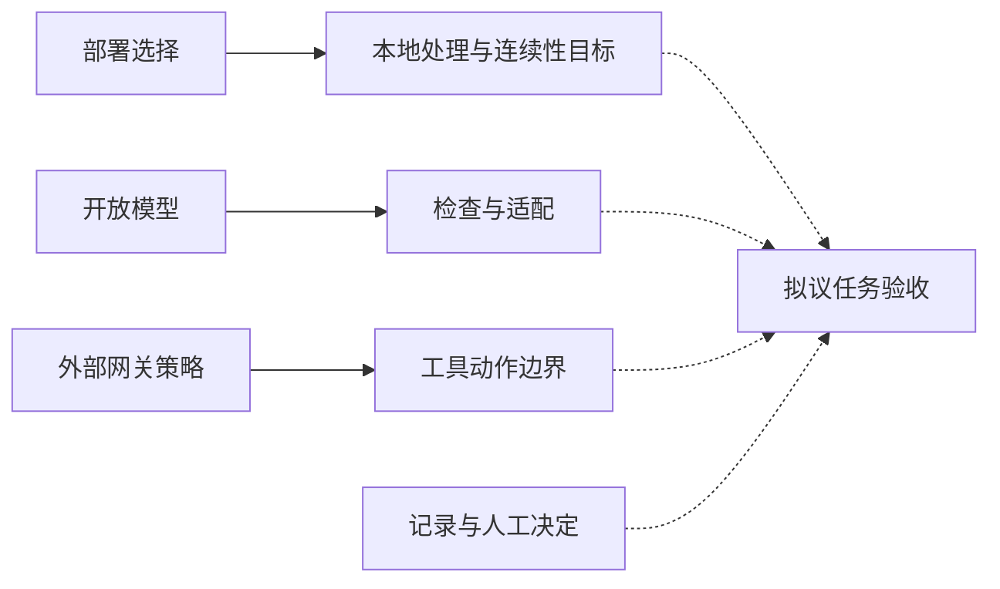
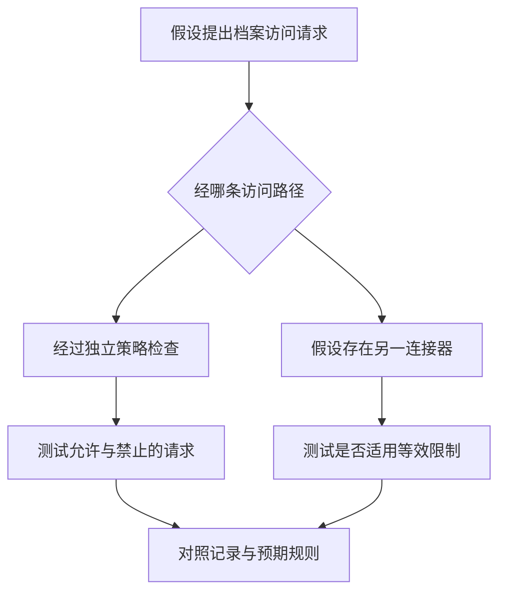

## 一次素材搜索，牵涉哪些组织责任？

编辑寻找一段历史反应镜头，需要知道搜索覆盖哪个档案库，自己是否有权访问，批准状态允许什么用途，以及结果接下来可以送往哪里。组织应在扩大搜索助手权限之前明确这些责任。答案决定机构委托什么任务，以及需要保留哪些记录来解释结果。

据[英伟达](https://blogs.nvidia.com/blog/media-agentic-security-european-public-service-broadcasting-global-content-production/)2026年10月19日的介绍，德国影视制作机构UFA每年提供超过3,500小时节目，包括日播剧《好时光，坏时光》（*Gute Zeiten, schlechte Zeiten*）。编辑制作回顾或闪回时，可能需要寻找长达15年前的特定反应或尚未化解的对话。英伟达将其描述为文件名和文件夹难以解决的检索需求。本文讨论的任务，就是寻找这些历史镜头，供编辑审查。

[英伟达称](https://blogs.nvidia.com/blog/media-agentic-security-european-public-service-broadcasting-global-content-production/)，Frame.io语义搜索按概念、动作或场景寻找视频片段，混合搜索加入笔记、文字记录和批准状态。其例子是：编辑搜索“某角色显出担忧神色”，按角色姓名收窄，筛选已批准素材，随后进入审查。这是供应商对流程的介绍，没有独立观察编辑的实际表现，也未证明每个结果均适用，或搜索系统拥有发布权限。

相关性与权限需要分别验收。镜头是否符合所需场景，是否允许用于当前目的？“已批准”涵盖什么，由谁维护？不能仅凭状态筛选就认定完整版权或授权审查已经完成。便于寻找候选素材的标签，仍可能留下具体再利用决定。编辑需要知道这个区别，才能判断结果是否足以进入下一步。

如果机构考虑让智能体提取文件或调用下游工具，还应分别决定搜索、导出与修改的权限。同一个对话窗口不必对应同一次授权。识别候选镜头与把素材移入共享制作区，是需要分别明确范围的动作，即使用户把它们放在一个请求中。

[2026年10月19日的AWS周报](https://aws.amazon.com/blogs/aws/aws-weekly-roundup-aws-lambda-web-functions-amazon-s3-on-the-vercel-marketplace-and-more-october-19-2026/)讨论了智能体自主性与外部控制。结合两篇文章，本文追问：面对能够检索内部资料并调用工具的智能体，部署地点、模型可检查性、外部权限与人工审核分别控制什么？判断应落实到机构能够授权和检验的具体任务，并保留尚未解决的决定。

## 两篇公告实际提供了什么证据？

两篇来源描述不同控制机制，都没有独立评估完整治理系统的效果。分析须保留发布者归属、所述活动与工作成熟度。共享组件或相近目标，不能证明实现相同，也不能证明相关能力已经联合交付。两篇文章回答的是任务中的不同问题。

[英伟达介绍](https://blogs.nvidia.com/blog/media-agentic-security-european-public-service-broadcasting-global-content-production/)，欧洲广播联盟EBU正与其扩展面向欧洲公共服务媒体的主权框架。文章称EBU拥有超过115个成员机构，分布在超过55个国家，覆盖超过10亿人。倡议引入云提供商、开放模型开发者和系统集成商，将定义要求和参考架构，涉及工作负载运行地点、数据治理、模型选择与全生命周期安全。这些待开展的工作，不证明成员机构已经完成部署或验收。

[伙伴承担不同角色](https://blogs.nvidia.com/blog/media-agentic-security-european-public-service-broadcasting-global-content-production/)。微软将贡献Microsoft Sovereign Cloud的经验，包括Azure Local与Foundry Local，以支持敏感采编资料的本地处理，以及外部连接中断时的关键服务运行。Nebius提供欧洲基础设施，供广播机构训练、微调和运行自有模型。NVIDIA Nemotron开放模型为检查、评估与适配提供基础；Qvest等集成商被描述为支持实用、可互操作的参考架构。现有组件与拟开展的集成工作仍需分开理解。

另据[英伟达](https://blogs.nvidia.com/blog/media-agentic-security-european-public-service-broadcasting-global-content-production/)，Adobe搜索流水线使用NVDEC解码、TensorRT优化推理，并以CUDA进行预处理与嵌入生成；报告约5倍嵌入生成加速、最高4倍吞吐量，以及最高5倍更低的搜索处理延迟。每秒两帧的新代理文件，比其替代的360p版本小约80%。这些是供应商报告的流水线指标，缺少完整对照条件与端到端检索准确率评估，不能合并为整体制作效率或安全效果。

[AWS称](https://aws.amazon.com/blogs/aws/aws-weekly-roundup-aws-lambda-web-functions-amazon-s3-on-the-vercel-marketplace-and-more-october-19-2026/)，Lambda Web Functions在Firecracker隔离基础上运行标准HTTP应用，单个执行环境支持最高128个并发请求，按实际CPU时间计量。公告所述可用范围是五个区域，运行Node.js 24，采用Arm64并支持VPC连接。这些规格涉及执行与资源消耗，不能证明智能体有权读取内部资料。

权限方面，[AWS概述《Trust in Depth》](https://aws.amazon.com/blogs/aws/aws-weekly-roundup-aws-lambda-web-functions-amazon-s3-on-the-vercel-marketplace-and-more-october-19-2026/)的主张：限制应位于智能体推理之外，由Amazon Bedrock AgentCore网关策略执行。AWS援引十余年生产自动推理经验，包括IAM每秒超过21亿次请求的规模。这段历史不能验证某个新闻编辑室策略的正确性、覆盖范围或不可绕过性。

[独立的S3集成](https://aws.amazon.com/blogs/aws/aws-weekly-roundup-aws-lambda-web-functions-amazon-s3-on-the-vercel-marketplace-and-more-october-19-2026/)面向Vercel Marketplace和v0，在运行时通过短期OIDC令牌向AWS STS换取限定资源的凭证，避免存储静态密钥。周报还介绍[CloudWatch](https://aws.amazon.com/blogs/aws/aws-weekly-roundup-aws-lambda-web-functions-amazon-s3-on-the-vercel-marketplace-and-more-october-19-2026/)按处理后的字段路由事件、依次运行解析器。这些仍是独立公告，未展示一个已经连通的广播控制系统。

| 控制层 | 发布者描述 | 成熟度与缺失验证 |
| :--- | :--- | :--- |
| 部署与连续性 | [英伟达，10月19日](https://blogs.nvidia.com/blog/media-agentic-security-european-public-service-broadcasting-global-content-production/)：EBU框架及本地处理目标 | 要求和参考架构含未来工作，未证明成员部署情况 |
| 模型可检查性 | [英伟达](https://blogs.nvidia.com/blog/media-agentic-security-european-public-service-broadcasting-global-content-production/)：Nemotron检查与适配 | 提供评估空间，未展示工具安全结果 |
| 动作授权 | [AWS，10月19日](https://aws.amazon.com/blogs/aws/aws-weekly-roundup-aws-lambda-web-functions-amazon-s3-on-the-vercel-marketplace-and-more-october-19-2026/)：AgentCore网关策略 | 架构主张概述，缺少底层策略与绕过测试 |
| 凭证范围 | [AWS](https://aws.amazon.com/blogs/aws/aws-weekly-roundup-aws-lambda-web-functions-amazon-s3-on-the-vercel-marketplace-and-more-october-19-2026/)：S3集成中的OIDC与STS交换 | 特定集成，不证明覆盖所有智能体凭证 |
| 处理性能 | [英伟达](https://blogs.nvidia.com/blog/media-agentic-security-european-public-service-broadcasting-global-content-production/)：搜索加速与代理文件缩小 | 流水线指标，不代表整体生产效率或安全效果 |

[AWS还报告](https://aws.amazon.com/blogs/aws/aws-weekly-roundup-aws-lambda-web-functions-amazon-s3-on-the-vercel-marketplace-and-more-october-19-2026/)了一项容器化渗透测试：自主智能体面对37个近期披露的CVE目标，捕获35个标志；依据标准概念验证审计后，确认33个为真实端到端利用，占89.2%。周报另描述两次未达标情况：智能体利用漏洞后，在读取标志前使目标停机。这些观察必须分别保留，不能用35减去33计算破坏率，也不能推导生产事故率。

## 部署地点与模型可检查性，能控制到哪里？

采购需要区分工作在哪里运行，以及机构能检查和调整什么。机构能否实际行使公告所述选择，需要哪些访问条件、人员、依赖和操作程序？组件具备某项能力，不等于机构能在完整约定任务中使用它。验收既要说明增加了什么选择，也要说明行使选择所需的条件。

[英伟达的EBU文章](https://blogs.nvidia.com/blog/media-agentic-security-european-public-service-broadcasting-global-content-production/)把敏感采编资料的本地处理列入微软贡献的目标。广播机构应追问：哪些处理留在本地，谁管理设施，哪些服务接收数据？约定任务是否仍有环节依赖外部连接？公告没有证明所有拟议本地部署均排除了外部流量、遥测或第三方访问。

连续性需要落实到服务测试。[微软的拟议角色](https://blogs.nvidia.com/blog/media-agentic-security-european-public-service-broadcasting-global-content-production/)包括外部连接中断时维持关键服务。这具体指哪些服务？即使本地推理继续，存储、搜索索引、身份检查和编辑审查是否也可用？证据应覆盖完整约定任务，不能只以本地模型演示验收检索连续性。

[Nebius所述欧洲基础设施](https://blogs.nvidia.com/blog/media-agentic-security-european-public-service-broadcasting-global-content-production/)对应工作负载位置，连续性目标则需要故障条件下的测试。任何一项描述都不能独自回答两组问题。验收条款应点明必要功能，以及它们必须继续运行的具体连接故障。主权、开放和本地描述不同属性，任何一项都不能单独证明法律合规，或EBU成员已获得全部相关控制权。

开放模型提供另一项评估机会。[英伟达称](https://blogs.nvidia.com/blog/media-agentic-security-european-public-service-broadcasting-global-content-production/)，广播机构可以检查、评估并适配模型，用于本土语言、档案和编辑政策。拟议访问是否足以开展所需评估？能否用代表性场景、地方用语与编辑区别比较输出，保存被评估版本，并记录后续变化？

评估仍需责任人与成功标准。怎样的场景描述不能接受，对候选镜头有分歧时由谁判断？在这个流程中，获得模型权重能帮助回答哪些问题？来源所述检查和适配空间，不证明模型行为均可得到完整解释，也不证明模型没有弱点或执行过程完全确定。

权限需要另测。假设本地运行、可检查的模型提出读取编辑许可集合以外的资料，请求在哪里接受判断，什么机制会阻止执行？计算地点与权重可用性都没有回答这个实现问题。采购答复需要指出独立机制，并说明如何检查它是否覆盖拟议任务。

这张图表达证据关系，不表示事件先后或部署结果。实线概括[英伟达](https://blogs.nvidia.com/blog/media-agentic-security-european-public-service-broadcasting-global-content-production/)与[AWS](https://aws.amazon.com/blogs/aws/aws-weekly-roundup-aws-lambda-web-functions-amazon-s3-on-the-vercel-marketplace-and-more-october-19-2026/)描述的关系；虚线表示本文建议的评估关系，以实现条件和可用记录为前提。图中不主张相关产品已完成互操作。

采购应逐项记录组件增加哪项选择，机构能否行使，还有什么在范围之外。本地设施与开放模型可以按声明用途评估，权限主张则需要独立证据。组件评估结束后仍未解决的决定，应继续保留在任务验收记录中。

## 工具权限为什么需要独立的执行位置？

[AWS关于网关执行策略的论点](https://aws.amazon.com/blogs/aws/aws-weekly-roundup-aws-lambda-web-functions-amazon-s3-on-the-vercel-marketplace-and-more-october-19-2026/)，把智能体推理与限制动作的机制分开。机构需要知道资源和动作规则在哪里执行，以及智能体能否改变或避开该位置。

可以提出三个验收条件：相关调用经过执行点；策略利用可靠信息准确表达预期边界；执行身份和凭证符合该边界。周报不能证明某个未指明部署已经具备这些条件。一个条件成立，另外两个仍需验证，因此各项证据应围绕同一个拟议任务。

[S3与Vercel集成](https://aws.amazon.com/blogs/aws/aws-weekly-roundup-aws-lambda-web-functions-amazon-s3-on-the-vercel-marketplace-and-more-october-19-2026/)提供具体凭证例子：通过OIDC与STS交换，获得临时、限定资源的凭证。在拟议实现中，实际签发给哪个身份，范围是什么，有效多久？周报没有给出通用时长、新闻素材目录结构或与AgentCore的自动连接。这些细节需要实现证据。

以下是*思想实验*，并非UFA已发生事件。假设编辑要求助手寻找历史镜头，将选中候选素材放入私人审查工作区。档案包含已批准素材、需要进一步审查的素材，以及编辑无权访问的素材。组织允许提取已批准资料，尚未授权更广访问或发布。这些假设限定例子，不描述经过验证的产品配置。

第一条分支假设助手提出读取较大范围候选素材，由独立执行点判断。它是否依据编辑真实身份、许可资源和目的地评估？如果策略准确表达机构规则，受控测试能否显示它拒绝禁止部分、允许其余工作？答案必须来自测试，例子本身不展示产品能力。

第二条分支假设另一个连接器持有更宽凭证。它能否不经相同评估访问档案？即使主要网关拒绝，资料是否仍能经这条路径取得？这是待测条件，不能写成已经发现Frame.io、AgentCore或其他产品存在漏洞。设置分支，是为了让覆盖问题足够具体，能够安排检查。

这张图表示假设测试的分支，不是已观察事件或产品集成。两条路径都是待调查假设；进入最终对照意味着收集证据，不代表获得授权或通过验收。对照既需要预期规则，也需要实际结果记录。

成功拒绝一次请求也需要解释：拒绝由哪条路径产生，还有哪些路径可用，存储端是否独立限制执行身份？策略文本、拒绝记录和直接访问测试回答不同问题。对话中的拒绝不能独自满足底层资源访问的验收要求，审核者应能指出助手表态背后实际生效的限制。

覆盖与正确性要分开测试。即使所有相关请求经过网关，规则是否只允许预期动作？大量无害调用受检查时，仍可能有重要操作未被覆盖。列出任务内的动作类别、可达资源与目的地，可以明确每次测试的范围，避免一个总体覆盖比例掩盖差别。

[AWS的CloudWatch公告](https://aws.amazon.com/blogs/aws/aws-weekly-roundup-aws-lambda-web-functions-amazon-s3-on-the-vercel-marketplace-and-more-october-19-2026/)描述按处理后字段将事件路由至不同日志组，并串联解析器。拟议部署能否用这些能力整理验收记录？它是否实际产生并保留所有必要事件，关联正确身份，并安排人调查偏差？来源没有证明这些部署层面的结果。

采购答复应通过具名策略与测试路径，说明调用、身份、资源和规则如何实际连接，记录须足以区分模型表态与实际限制。AWS概述支持检查外部执行架构，没有认证机构系统中的这些连接。验收决定应明确证据覆盖了哪些路径和操作。

## 人工审核与托管服务何时可能足够？

低频、只读、资料集合有限的任务，可能适合较简单的流程。编辑能否带着足够语境检查结果，机构能否在目标工作量下持续审核？运维能力有限的组织还应比较托管服务。两篇来源都没有提供足以决定这些选择的成本对照研究，各方案仍需围绕相同任务与责任评估。

[AWS认为](https://aws.amazon.com/blogs/aws/aws-weekly-roundup-aws-lambda-web-functions-amazon-s3-on-the-vercel-marketplace-and-more-october-19-2026/)，逐项人工批准在小规模时有效，扩大后审核者会漏掉重点。周报没有提供建立通用工作量阈值或异常检出率的用户研究。这个论点提出了可测试的问题：在具体任务中，活动增加时审核表现如何变化？它不能替机构决定哪些活动应当自动化。

比较应明确审核者检查的是最终候选素材清单、每个中间资源请求，还是规则筛选出的例外。哪些信息能让错误可见，审核者能否检查资料如何取得？如果任务保持狭窄、证据呈现清楚，测得的负担是否可持续？最终结果审核与访问请求审核，需要按各自责任评估。

外部策略边界不一定要求机构自营所有组件。选择本地运行而非托管服务前，应明确谁维护环境、调查故障、验证变更，以及机构是否具备能力。两篇公告均未量化相关成本或可靠性权衡。保留本地控制的偏好，仍需运维安排和持续验证的责任人支持。

[AWS渗透测试报告](https://aws.amazon.com/blogs/aws/aws-weekly-roundup-aws-lambda-web-functions-amazon-s3-on-the-vercel-marketplace-and-more-october-19-2026/)提出另一类问题。37个目标中33个确认利用，描述特定攻击任务的表现；两次读取标志前使目标停机，描述该测试中的副作用。它们既不能证明档案助手会损坏文件，也不能估计生产智能体造成损害的频率。任务结果与副作用需要分别呈现。

回到素材检索例子，应问最终编辑审核之前，动作能否触及非预期资源或目的地。如果受控测试支持严格限定的只读边界，较轻审核是否足够？如果早先访问过程仍不清楚，批准选片不能回答未被观察的访问问题。每个审核步骤都应说明自己能够决定哪件事。

后续观察应改变方案。发现绕过，需要重新考虑受影响路径或权限；关键编辑区别无法可靠写入规则，相应决定应留给人。人工审核若在目标负荷下持续有效，就支持为被测任务保留它。约定连续性测试若反复失败，则需要重新考虑部署。现有来源没有确定这些条件是否出现。

每项发现都应限于测试范围解释。错误规则需要复查对应规则与权限；成功审核支持被测工作量和任务。两者都不能决定所有架构或未来任务。判断标准是证据是否与准备授予的权限相匹配，也包括机构能否维护所选控制。只要证据支持预期责任，较简单的流程也可以是合理选择。

## 把控制主张写进任务验收

采购首先应围绕明确任务。“部署自主媒体智能体”留下太多隐含权限。可审查提案应写清许可集合、可请求动作、结果目的地和例外负责人。以下建议来自本文比较，既非EBU正式标准，也非AWS承诺。

只读搜索试点可先选择已允许用于目标用途的素材。结果生成能否访问其他集合？代理文件权限是否连带开放其他资产？用户能否区分相关性与批准状态？应索取资源范围配置、受控允许及拒绝访问测试，以及编辑对检索质量的判断。权限测试和质量评估不能替代彼此。

导出需要单独决定。允许私人审查的片段，是否允许进入拟议目的地？身份、资源、动作与目的地是否一致？搜索演示成功不能证明导出边界。机构应要求展示准确操作，不能假设公告产品支持全部预期流程。

修改与分发也需另行检查。谁许可共享素材变更或向受众开放，须满足什么条件？如果决定依赖拟议实现无法可靠表达的编辑或法律解释，机构应保留适当人工决策步骤。这是在建议如何分配责任，并未声称产品已交付对应能力。

| 拟作决定 | 验收问题 | 应索取的证据 |
| :--- | :--- | :--- |
| 搜索许可集合 | 任务能否触及集合外资料？ | 资源配置及受控允许、拒绝访问记录 |
| 暂存或导出片段 | 当前身份与用途是否允许该目的地？ | 对准确资源、动作和目的地的测试 |
| 依赖模型评估 | 评估了哪个版本、哪些编辑区别？ | 版本记录与代表性任务判断 |
| 要求离线连续性 | 指定断网条件下，约定任务能否完成？ | 依赖清单与任务级故障测试 |
| 保留人工批准 | 审核者能否看见并决定相关问题？ | 审核实例、负荷观察与例外责任人 |

这套建议性框架需要结合机构制度与专业判断调整。表格不证明任何具名产品已提供相应证据，也不表示独立公告已经连成一个实现。尚未解决的项目应继续记录，不能把表格其他位置的成功演示当作答案。

验收应区分模型表现与系统执行。助手说“不能访问”时，直接受控测试能否确认底层限制？许可请求失败时，什么阻碍完成？拒绝与成功执行都应检查，测试范围须适合拟议任务，结果须对应具体规则。

承诺离线运行时，应说明哪些功能继续、哪些停止，以及未完成工作如何呈现，并纳入约定检索任务所需依赖。如果任务无法完成，仅有本地回答不能满足连续性验收。演示与验收决定应使用同一任务定义，包括预期审查目的地。

试点可以支持扩大搜索，同时保留导出决定；私人暂存可以通过，发布仍在授权之外。每次增加权限都应有责任人、测试与记录。现有来源没有提供计算投资回报所需的价格、运维成本与任务质量测量，不能据此给出拟议部署的回报数字。

## 控制是否在运行中持续有效？

[英伟达文章](https://blogs.nvidia.com/blog/media-agentic-security-european-public-service-broadcasting-global-content-production/)强调基础设施选择、模型检查与适配；[AWS周报](https://aws.amazon.com/blogs/aws/aws-weekly-roundup-aws-lambda-web-functions-amazon-s3-on-the-vercel-marketplace-and-more-october-19-2026/)强调外部动作限制，并介绍独立的资源限定凭证集成。这些描述确定了评估对象，尚未证明完整机构部署的实际运行效果。它们支持有条件的授权判断，不能支持产品安全排名。

下一批证据应包括EBU要求与部署验收记录、实际网关策略与绕过测试、任务层面的允许及拒绝访问记录，以及目标负荷下的人工审核观察。这两篇来源不能证明完整架构已经在运行中保护编辑独立性。每项记录都应回答拟议任务中的具体不确定性。

机构还需规定重新验收的条件。新增集合、连接器、模型或目的地，可能改变被测边界。提案应说明每类相关变化后重做哪些检查，由谁判断原有证据是否适用。试点成功支持其测试范围，进一步委托需要进一步证据，并应在扩大权限之前明确决策责任人。

一次获准动作和一次被拒动作，可以作为审查起点。谁设定规则，规则在哪里独立于智能体执行，哪份记录说明实际结果？出现偏差由谁处理？任何缺失的答案，都对应扩大权限之前仍需完成的工作。

## 参考资料

1. AWS News Blog. [AWS Weekly Roundup: AWS Lambda Web Functions, Amazon S3 on the Vercel Marketplace, and more (October 19, 2026) | AWS News Blog](https://aws.amazon.com/blogs/aws/aws-weekly-roundup-aws-lambda-web-functions-amazon-s3-on-the-vercel-marketplace-and-more-october-19-2026/).
2. NVIDIA Newsroom. [NVIDIA Advances Agentic Security for Media, From European Public Service Broadcasting to Global Content Production | NVIDIA Blog](https://blogs.nvidia.com/blog/media-agentic-security-european-public-service-broadcasting-global-content-production/).
