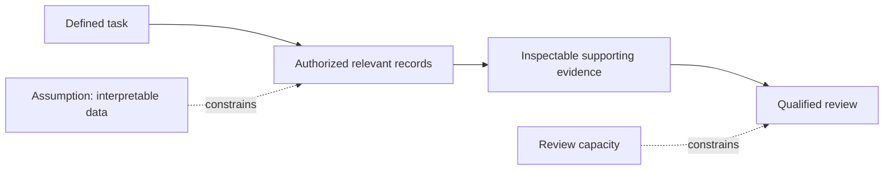
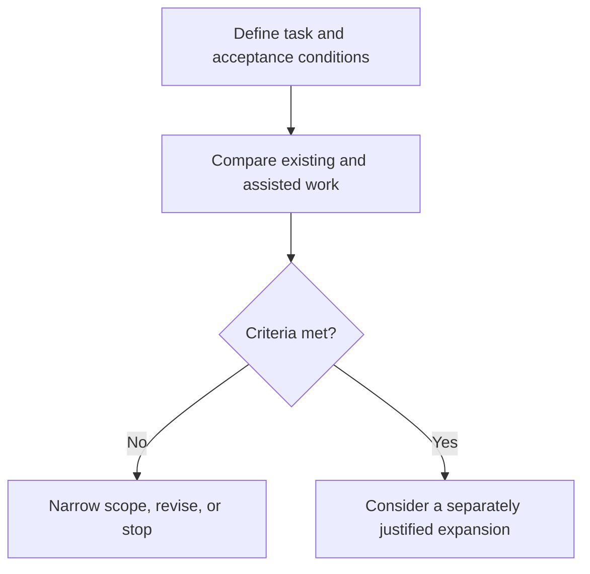

## Define the work before opening the data

Healthcare and research institutions considering AI partnerships need to identify which additional records could improve a specific task and who would check the output. A useful pilot needs a defined question, authorized inputs, inspectable evidence, and a responsible reviewer. It should test whether broader access improves the work while preserving institutional control and keeping verification manageable.

On October 27, 2026, [NVIDIA described C-BRAIN](https://blogs.nvidia.com/blog/open-source-ai-tools-cbrain-dementia/), a consortium working with unpublished findings and governed research data. On October 29, 2026, [Google announced Singapore healthcare initiatives](https://blog.google/innovation-and-ai/technology/health/google-for-health-summit-singapore/), including an evaluation with the National University Health System, or NUHS, of an AI co-clinician that helps doctors synthesize medical guidelines and literature.

These tasks require different judgments. A research reviewer asks whether the evidence warrants further investigation of a hypothesis. A clinician assessing an information summary checks accuracy, applicability, and material omissions. The tasks need separate acceptance rules; their results cannot be combined into a single success rate.

Both announcements come from participating companies. Neither the [NVIDIA disclosure](https://blogs.nvidia.com/blog/open-source-ai-tools-cbrain-dementia/) nor the [Google disclosure](https://blog.google/innovation-and-ai/technology/health/google-for-health-summit-singapore/) establishes independently verified patient benefit or net savings after expert review. They describe tasks around which institutions can design pilots. Data access, output checkability, and practical benefit each need a separate assessment.

## What the two projects give AI access to

According to [NVIDIA](https://blogs.nvidia.com/blog/open-source-ai-tools-cbrain-dementia/), C-BRAIN launched in November 2025 under Dr. Randall Bateman, with 18 member institutions spanning academic, philanthropic, pharmaceutical, and research organizations. Its "dark data" includes unpublished findings, negative results, and governed proprietary data previously unavailable publicly to AI tools or researchers.

[NVIDIA describes](https://blogs.nvidia.com/blog/open-source-ai-tools-cbrain-dementia/) a hybrid centralized and federated approach. Some data are deposited into secure systems; models can also learn at institutions without those data having to leave. At the October 27 announcement, C-BRAIN ran 64 on-premises NVIDIA data center GPUs alongside Microsoft Azure cloud nodes. This is a snapshot for that project and date, not a configuration to assume elsewhere. Further capacity, including Blackwell systems, was planned. C-BRAIN was working with NVIDIA to incorporate BioNeMo and MONAI into its research pipelines; the announcement does not establish that both were already in use there.

Two tools were already built, according to [NVIDIA](https://blogs.nvidia.com/blog/open-source-ai-tools-cbrain-dementia/). OpenScientist, developed with Lawrence Berkeley National Laboratory in work led by Justin Reese, takes a research question and dataset, semi-autonomously generates hypotheses, runs analyses, and produces outputs described as verifiable and auditable. InsightEngine, built with 387 Labs, checks hypotheses and claims using literature, user datasets, and a biomedical knowledge graph. These are the publisher's capability descriptions, without independent evaluation in the supplied material.

[NVIDIA reports](https://blogs.nvidia.com/blog/open-source-ai-tools-cbrain-dementia/) that published OpenScientist case studies completed analyses in minutes that domain scientists estimated would require weeks to months, for under $10 per run. It describes a current reach of more than 200 research groups and potential capacity exceeding one million hours annually at scale. The case-study papers are absent from the supplied evidence. The time comparison remains a reported estimate, the annual figure a projection, and the run price an incomplete measure of workflow cost. These figures do not establish performance for NUHS's clinical information task.

[Google's announcement](https://blog.google/innovation-and-ai/technology/health/google-for-health-summit-singapore/) separates several initiatives. It is establishing a Singapore Research hub focused on foundational models and academic partnerships, including NUS and NTU. It also describes bringing open models such as MedGemma to frontline care settings to enable customized solutions while maintaining data sovereignty. Separately, DeepMind is working with NUHS to evaluate its AI co-clinician, including assistance with clinical queries. The disclosure does not establish that the NUHS tool uses MedGemma or the same data arrangement.

The table summarizes the disclosures. Missing results refer only to the supplied material.

| Question | [C-BRAIN: NVIDIA](https://blogs.nvidia.com/blog/open-source-ai-tools-cbrain-dementia/) | [Singapore initiatives: Google](https://blog.google/innovation-and-ai/technology/health/google-for-health-summit-singapore/) |
| :--- | :--- | :--- |
| Task examined here | Research analysis and hypothesis checking | NUHS guideline and literature synthesis |
| Relevant inputs | Unpublished findings, negative results, governed datasets | Medical guidelines and literature |
| Access arrangement | Hybrid centralized and federated approach | NUHS architecture unspecified; MedGemma statement separate |
| Disclosed stage | Tools built; broader system in development; technology incorporation ongoing | AI co-clinician under evaluation |
| Results absent here | Complete costs, review burden, experimental replication | Error and omission rates, physician time, clinical outcomes |

Other [Google announcements](https://blog.google/innovation-and-ai/technology/health/google-for-health-summit-singapore/) include an NHG Health population-health program using predictive insights and an NHG HealthBot coach through Gemini Enterprise for Customer Experience. Google.org and DeepMind are contributing $7 million to the Health for Human Potential Coalition, including $1 million for PathGen. These separate initiatives provide no outcome evidence for the NUHS evaluation in this excerpt.

## How access affects verification

Additional records might expand the questions a team can investigate if they are relevant and interpretable. An unpublished negative finding might change a hypothesis assessment if reviewers can recover its experimental conditions. Both possibilities need testing; neither disclosure demonstrates these mechanisms of improvement.

The diagram proposes dependencies to examine. Its arrows express requirements, not event order or either project's architecture.

At each connection, the institution should distinguish model access from reviewer access and evidential support. A model may be able to retrieve a record while the responsible specialist cannot open it. Even when both can inspect it, the record may fail to support the output in context. Evidence links and auditability alone do not establish correctness.

Federated execution also needs an assessment for the intended use. Does it satisfy the relevant restriction on moving records? Does its implementation provide the required privacy and security protections? Data residency or a federated arrangement alone cannot establish those outcomes. The [NVIDIA account](https://blogs.nvidia.com/blog/open-source-ai-tools-cbrain-dementia/) does not provide enough implementation detail to settle these questions. [Google's data-sovereignty statement](https://blog.google/innovation-and-ai/technology/health/google-for-health-summit-singapore/) does not specify the NUHS data arrangement.

A pilot should test whether the specialist can open the supporting passage, understand its context, and judge its relevance. If another permission request is necessary, record the added time. If an accessible record is ambiguous, identify who resolves the ambiguity. Recording permissions for both the system and its reviewers makes it possible to test whether the intended review can take place.

## More data may add more work

Faster generation could shift enough authorization, preparation, interpretation, and correction work to specialists to erase the apparent saving. Neither [NVIDIA](https://blogs.nvidia.com/blog/open-source-ai-tools-cbrain-dementia/) nor [Google](https://blog.google/innovation-and-ai/technology/health/google-for-health-summit-singapore/) provides a complete comparison that resolves this possibility. The supplied material does not establish that either project has encountered these problems or quantify their burden.

Consider a hypothetical research output that cites a negative result but omits its experimental conditions. Reviewers might need to reconstruct those conditions before judging the hypothesis. Excluding the record could instead leave a relevant gap. The comparison should assess particular records for the task; publication status alone does not determine their value.

A hypothetical clinical summary could quote a source accurately while omitting a qualification relevant to the query. The evaluation would need to count the clinician's work to detect and repair that omission. Reference counts and generation speed cannot answer that question.

A smaller curated collection and the existing manual search process should remain candidate baselines. Compare them with the broader system on comparable questions, using the same required standard of review. The supplied [research disclosure](https://blogs.nvidia.com/blog/open-source-ai-tools-cbrain-dementia/) and [clinical disclosure](https://blog.google/innovation-and-ai/technology/health/google-for-health-summit-singapore/) contain no direct comparison of all three approaches.

One proposed efficiency criterion is total preparation, generation, verification, and correction time against the existing workflow. This is an evaluation suggestion, not a validated project metric. Error severity needs its own acceptance criterion: a time advantage cannot justify an omission that responsible specialists have designated unacceptable.

A failed comparison could warrant narrowing the corpus, changing output requirements, or stopping expansion. A successful comparison supports only the task and conditions tested. Another record collection or a move into clinical use requires a separate justification.

## Evaluate one task with checkable results

A research pilot could ask whether assisted analysis improves expert assessment of a bounded hypothesis against approved records. A clinical pilot could ask whether guideline synthesis improves a defined category of information queries. These are proposed evaluations inspired by [C-BRAIN](https://blogs.nvidia.com/blog/open-source-ai-tools-cbrain-dementia/) and [NUHS](https://blog.google/innovation-and-ai/technology/health/google-for-health-summit-singapore/). They are not reported project procedures.

Before comparing methods, obtain the necessary authorization and specify what the existing method must deliver and who judges it. Record time spent, remaining uncertainties, and reasons for rejecting answers. Apply comparable scrutiny to assisted outputs, including those requiring substantial correction or rejection.

The proposed checklist keeps the tasks' criteria separate.

| Evaluation question | Research workflow | Clinical information workflow |
| :--- | :--- | :--- |
| Are inputs suitable? | Relevant records and interpretable experimental context | Current references applicable to the query |
| Can support be inspected? | Supporting records and analyses available to reviewers | Relevant guideline or literature passages available to clinicians |
| What needs correction? | Unsupported relationships or missing conditions | Unsupported statements or material omissions |
| What burden is counted? | Preparation, analysis, expert review, rework | Search, synthesis, clinician review, correction |
| What could stop expansion? | Unverifiable support or excessive review burden | Unacceptable errors, omissions, or review burden |

Set acceptance and stopping conditions before assessing results. The sources provide no universal passing percentage. Responsible specialists should define which errors matter for their task and document why outputs are accepted, revised, or rejected.

The diagram proposes a pilot decision process. It does not describe the sequence followed by either announced project.

Count reusable setup effort alongside recurring review. Permissions and record preparation may support later tasks; verification and correction may need to be counted for every output. Neither category should disappear from the comparison. A pilot report should explain which additional records were necessary, what reviewers could inspect, what they changed, and why the result met the agreed conditions. These details give institutions a basis for questioning the next access decision.

## What evidence should come next?

The separate [NVIDIA](https://blogs.nvidia.com/blog/open-source-ai-tools-cbrain-dementia/) and [Google](https://blog.google/innovation-and-ai/technology/health/google-for-health-summit-singapore/) disclosures do not validate each other's systems. Missing results indicate an evidence gap without establishing project failure.

For C-BRAIN, useful next evidence would include access conditions, independent examination of the reported case studies, complete workflow costs, and replication of findings taken into experimental work. Its [year-three ambition to discover new causal mechanisms of brain aging and Alzheimer's disease](https://blogs.nvidia.com/blog/open-source-ai-tools-cbrain-dementia/) remains a future goal.

For the [NUHS evaluation](https://blog.google/innovation-and-ai/technology/health/google-for-health-summit-singapore/), useful results would cover errors, omissions, clinician review time, corrections, and safety and effectiveness appropriate to the evaluated use. Any claimed protection also needs assessment against the actual data arrangement.

## References

1. NVIDIA Newsroom. [How AI Is Changing the Pace of Discovery for Millions Living With Dementia](https://blogs.nvidia.com/blog/open-source-ai-tools-cbrain-dementia/).
2. Google 官方博客. [Google opens new AI research hub in Singapore](https://blog.google/innovation-and-ai/technology/health/google-for-health-summit-singapore/).
