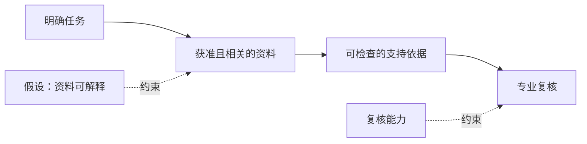
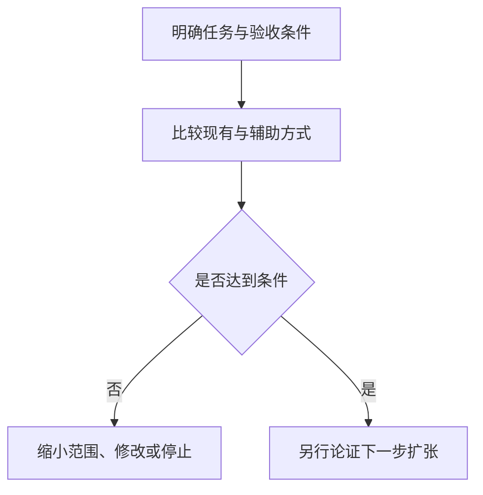

## 开放资料之前，先确定要改善哪项工作

医疗与科研机构考虑AI合作时，应先确定哪些新增资料可能改善具体任务，以及由谁核查结果。试点需要明确的问题、获准使用的输入、可检查的依据和责任专家，再检验扩大访问能否改善工作，同时保留机构控制权，让核查负担保持可承受。

2026年10月27日，[NVIDIA介绍C-BRAIN](https://blogs.nvidia.com/blog/open-source-ai-tools-cbrain-dementia/)，涉及未发表发现与受治理科研资料。10月29日，[Google公布新加坡医疗合作](https://blog.google/innovation-and-ai/technology/health/google-for-health-summit-singapore/)，包括与新加坡国立大学卫生系统（NUHS）评估AI co-clinician，帮助医生综合医学指南和文献。

科研专家要判断假说是否值得继续探索，医生则要检查信息摘要的准确性、适用性和关键遗漏。两类任务需要各自的验收规则，结果不能合并为一个成功率。两篇均为参与厂商的披露；[NVIDIA材料](https://blogs.nvidia.com/blog/open-source-ai-tools-cbrain-dementia/)与[Google材料](https://blog.google/innovation-and-ai/technology/health/google-for-health-summit-singapore/)未建立经独立核验的患者获益或复核后净节省。数据能否访问、输出能否核查、工作是否受益，需要分别判断。

## 两个案例让AI接触什么、产出什么

据[NVIDIA](https://blogs.nvidia.com/blog/open-source-ai-tools-cbrain-dementia/)，C-BRAIN于2025年11月启动，由Randall Bateman博士牵头，包含18家学术、慈善、制药与研究机构。其“暗数据”包括此前未公开供AI工具或研究人员访问的未发表发现、阴性结果和受治理专有资料。

[NVIDIA描述](https://blogs.nvidia.com/blog/open-source-ai-tools-cbrain-dementia/)的安排结合集中式与联邦式访问：部分资料存入安全计算系统，模型也可在成员机构内部学习，无需移出相应数据。10月27日公告时，C-BRAIN运行64块本地NVIDIA数据中心GPU，配合Microsoft Azure云节点。这是该项目在该日的快照，不能外推至其他机构或日期。包括Blackwell系统在内的新增容量仍属未来安排。C-BRAIN正与NVIDIA合作，将BioNeMo与MONAI纳入研究管线；这不证明两者均已在管线中运行。

据[NVIDIA](https://blogs.nvidia.com/blog/open-source-ai-tools-cbrain-dementia/)，两个工具已构建。OpenScientist与劳伦斯伯克利国家实验室合作开发，相关工作由Justin Reese领导，可接收研究问题和数据集，半自主生成假说、执行分析，产出被描述为可验证、可审计的结果。与387 Labs构建的InsightEngine利用文献、用户数据和生物医学知识图谱检查假说与陈述。这些是发布者的功能描述，所提供材料没有独立评估。

[NVIDIA转述](https://blogs.nvidia.com/blog/open-source-ai-tools-cbrain-dementia/)称，已发表OpenScientist案例中的分析耗时数分钟，领域科学家估计人工需要数周至数月，单次运行低于10美元。其当前触达200多个研究组，规模化后潜在释放工时可能超过每年100万小时。资料包未含案例论文；时间比较仍是转述估计，年度数字是预测，运行价格不足以衡量完整成本。这些数字也不能证明NUHS临床信息任务的表现。

[Google公告](https://blog.google/innovation-and-ai/technology/health/google-for-health-summit-singapore/)分别介绍：正在设立的新加坡Research中心将研究基础模型，并与NUS、NTU等高校合作；MedGemma等开放模型将进入一线医疗场景，支持保持数据主权的定制方案开发。DeepMind与NUHS的AI co-clinician评估单独列出，也包括协助回答临床问询，未说明使用MedGemma或相同数据安排。

下表中的缺失项仅指所提供材料未给出的结果。

| 比较问题 | [C-BRAIN：NVIDIA](https://blogs.nvidia.com/blog/open-source-ai-tools-cbrain-dementia/) | [新加坡合作：Google](https://blog.google/innovation-and-ai/technology/health/google-for-health-summit-singapore/) |
| :--- | :--- | :--- |
| 本文关注任务 | 科研分析、假说核查 | NUHS指南与文献综合 |
| 相关输入 | 未发表发现、阴性结果、受治理资料 | 医学指南与文献 |
| 访问安排 | 集中与联邦结合 | NUHS架构未说明；MedGemma另列 |
| 披露阶段 | 工具已构建；整体系统仍在开发；技术纳入进行中 | 临床助手评估中 |
| 缺失结果 | 完整成本、复核负担、实验复现 | 错误遗漏率、医生工时、临床结果 |

[Google还宣布](https://blog.google/innovation-and-ai/technology/health/google-for-health-summit-singapore/)与NHG Health开展使用预测信息的人群健康计划，以及通过Gemini Enterprise for Customer Experience提供的NHG HealthBot健康教练。Google.org与DeepMind向Health for Human Potential Coalition出资700万美元，其中100万美元用于PathGen。这些独立举措未在该摘录中提供NUHS评估的成效证据。

## 数据访问怎样影响核查

新增资料若相关且可解释，可能扩大可研究的问题；未发表阴性结果若能还原实验条件，可能改变假说判断。这些可能性需要试点检验，两篇披露均未证明相应改善机制。

下图提出待检查的依赖关系，连线不代表事件顺序或两个项目的实际架构。

模型能够访问记录，责任专家仍可能无法打开；即使双方都能查看，记录也未必在原有语境中支持输出。证据链接与可审计性本身不能证明结论正确。

联邦执行是否满足具体的数据移动限制，实际实现是否具备该用途要求的隐私和安全保护，也须分别检查。联邦安排或数据驻留本身不能证明这些结果。[NVIDIA材料](https://blogs.nvidia.com/blog/open-source-ai-tools-cbrain-dementia/)未提供足以判断的实现细节；[Google的数据主权表述](https://blog.google/innovation-and-ai/technology/health/google-for-health-summit-singapore/)也未说明NUHS的数据安排。

试点应检查专家能否定位支持段落、理解上下文并判断适用性。若需另行申请权限，应记录增加的时间；记录可访问但含义不明时，应明确由谁处理。同时记录系统与核查者的权限，才能检验预定复核是否可行。

## 更多资料可能增加工作

生成提速后，新增的授权、整理、解释与纠错工作可能抵消节省。[NVIDIA](https://blogs.nvidia.com/blog/open-source-ai-tools-cbrain-dementia/)与[Google](https://blog.google/innovation-and-ai/technology/health/google-for-health-summit-singapore/)均未提供完整对照来解决这一问题。材料既未证明这些问题已在项目中发生，也未量化其负担。

假设科研输出引用阴性结果，却省略实验条件，专家可能需要重建条件才能判断假说；排除记录又可能遗漏相关依据。因此，应评估具体资料是否适合任务，不能仅凭发表状态判断价值。

假设临床摘要引用准确，却遗漏与问询有关的限制条件，评估就须计入医生发现和修正遗漏的工作。仅统计引文或生成时间无法回答这一问题。

较小的整理后资料集与现有人工检索应保留为候选基线，在可比较的问题上，以同等复核标准与更大系统对照。所提供的[科研披露](https://blogs.nvidia.com/blog/open-source-ai-tools-cbrain-dementia/)与[临床披露](https://blog.google/innovation-and-ai/technology/health/google-for-health-summit-singapore/)没有三者的直接比较。

一种建议是将准备、生成、核查和纠错总时间与现有流程比较。这不是经过验证的项目指标。错误严重性应独立验收，时间优势不能抵消责任专家认定不可接受的遗漏。比较失败可支持缩小资料范围、修改输出要求或停止扩张；成功也只支持已测试任务和条件，换用资料集或转向临床用途须另行论证。

## 用一个任务和可检查结果验收试点

科研试点可检验辅助分析能否帮助专家依据获准记录评估一项限定假说；临床试点可检验指南综合能否改善某类信息问询。这些是受[C-BRAIN](https://blogs.nvidia.com/blog/open-source-ai-tools-cbrain-dementia/)与[NUHS](https://blog.google/innovation-and-ai/technology/health/google-for-health-summit-singapore/)启发的建议，并非项目已报告执行的流程。

比较前，应取得必要授权，明确现有方法必须交付什么、由谁判断，并记录耗时、剩余不确定性及拒绝答案的理由。辅助输出也应接受可比较的检查，包括需要大量修改或被拒绝的结果。

下表为建议的验收清单，两类任务分别判断。

| 验收问题 | 科研工作流 | 临床信息工作流 |
| :--- | :--- | :--- |
| 输入是否适合 | 记录相关、实验语境可解释 | 文献现行且适用 |
| 支持依据能否检查 | 专家可查看记录与分析 | 医生可查看对应指南或文献段落 |
| 哪些内容需修改 | 无依据关系、条件缺失 | 无依据陈述、关键遗漏 |
| 计入哪些负担 | 准备、分析、复核、返工 | 检索、综合、复核、纠错 |
| 什么结果限制扩张 | 依据不可核验或复核负担过高 | 不可接受的错误、遗漏或复核负担 |

应在查看结果前设定验收与停止条件。来源没有通用合格百分比，责任专家须明确哪些错误影响任务，并记录接受、修改或拒绝的原因。

下图为建议的决策流程，不代表两个项目的实际执行顺序。

可复用准备投入与反复发生的复核都应计入。授权和资料整理可能服务后续任务，核查与纠错可能须逐次计算，不能排除任何一类。报告应说明哪些新增记录不可少、专家能检查什么、修改了什么，以及结果为何达到条件，让下一次访问决定有据可质询。

## 下一步需要哪些证据

[NVIDIA](https://blogs.nvidia.com/blog/open-source-ai-tools-cbrain-dementia/)与[Google](https://blog.google/innovation-and-ai/technology/health/google-for-health-summit-singapore/)的披露不能相互验证系统。结果缺失表示证据缺口，不表示项目失败。

对C-BRAIN，应继续观察访问条件、转述案例的独立核验、完整工作成本，以及进入实验阶段的发现能否复现。其[第三年发现脑衰老与阿尔茨海默病新因果机制的目标](https://blogs.nvidia.com/blog/open-source-ai-tools-cbrain-dementia/)仍属未来目标。

对[NUHS评估](https://blog.google/innovation-and-ai/technology/health/google-for-health-summit-singapore/)，需要错误、遗漏、医生复核工时、修改负担，以及适用于被评估用途的安全和有效性结果。任何保护主张也须依据实际数据安排检查。

## 参考资料

1. NVIDIA Newsroom. [How AI Is Changing the Pace of Discovery for Millions Living With Dementia](https://blogs.nvidia.com/blog/open-source-ai-tools-cbrain-dementia/).
2. Google 官方博客. [Google opens new AI research hub in Singapore](https://blog.google/innovation-and-ai/technology/health/google-for-health-summit-singapore/).
