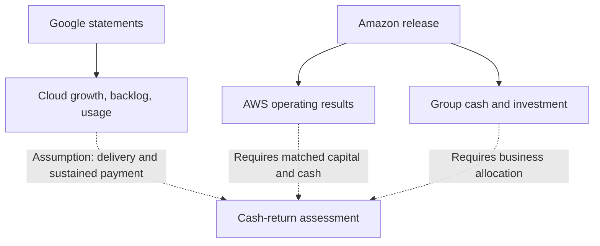
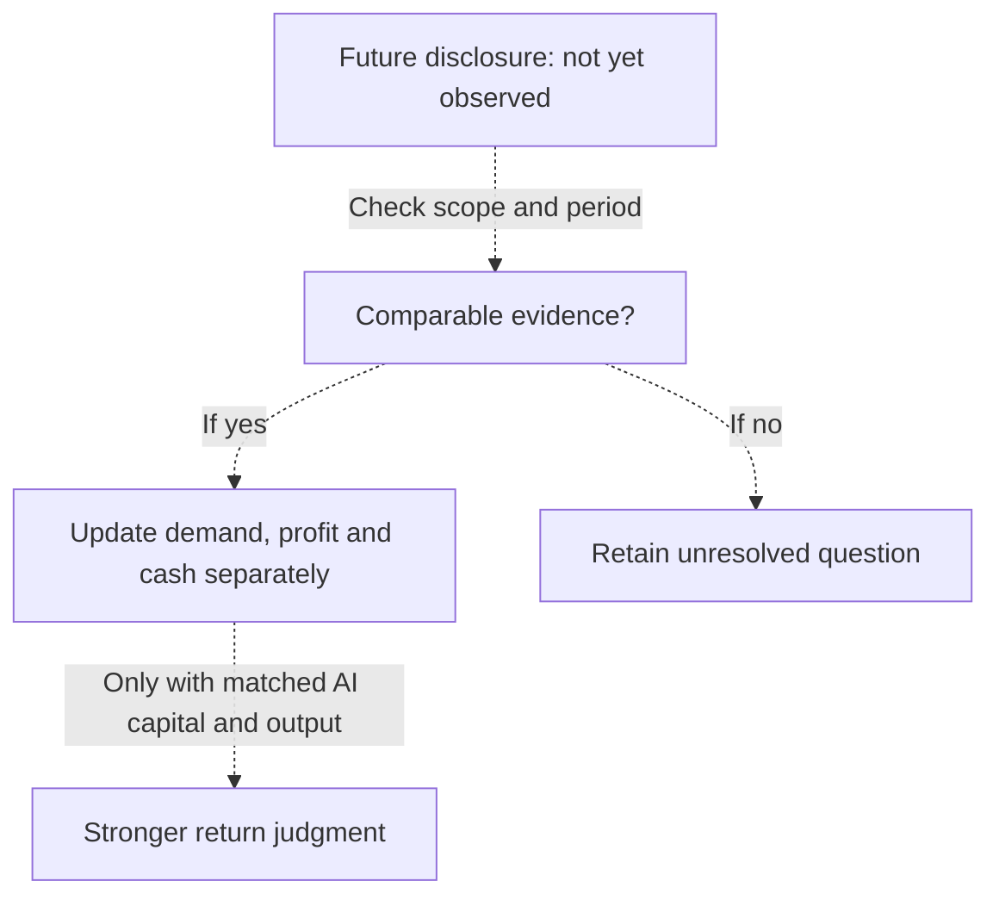

## Cloud profit rises while cash flows out: what should shareholders ask?

Cloud growth and negative free cash flow can coexist without either number being wrong. For shareholders, the task is to establish what each measures before deciding what the combination says about investment returns. Amazon’s and Google’s Q2 2026 disclosures offer useful cases, although their reporting scopes differ. The question is how much evidence they provide about the cash eventually earned on the infrastructure being financed.

In its July 30, 2026 release, Amazon reported AWS quarterly sales of $42.2 billion, up 37% year-over-year, and operating income of $16.6 billion, compared with $10.2 billion a year earlier. AWS reached a $169 billion annualized revenue run rate. The same release reported consolidated free cash flow of negative $7.6 billion for the trailing twelve months ended June 30, 2026, compared with positive $18.2 billion in the comparable prior-year period ([Amazon release](https://ir.aboutamazon.com/news-release/news-release-details/2026/Amazon-com-Announces-Second-Quarter-Results/default.aspx)).

Google and Alphabet CEO Sundar Pichai supplied different indicators in remarks published July 22, 2026: Cloud revenue grew 82% year-over-year and Cloud backlog reached $514 billion. His edited remarks described expanding customer usage and continuing constraints on model supply. They did not supply a matching account of Cloud capital spending or cash returns ([Google CEO remarks](https://blog.google/company-news/inside-google/message-ceo/alphabet-earnings-q2-2026/)).

Three boundaries govern the comparison. AWS is a segment, while Amazon’s cash figures are consolidated; its segment results cover a quarter, while those cash figures cover twelve months. Google’s document is an edited CEO statement, so information absent from it cannot be presumed absent from every Alphabet disclosure ([Amazon release](https://ir.aboutamazon.com/news-release/news-release-details/2026/Amazon-com-Announces-Second-Quarter-Results/default.aspx); [Google CEO remarks](https://blog.google/company-news/inside-google/message-ceo/alphabet-earnings-q2-2026/)). A comparison must preserve those differences rather than hide them behind a common label such as “AI performance.”

The supplied packet’s capture metadata dates both snapshots to October 14, 2026. Their texts retain July 22 and July 30 publication dates ([Google source address](https://blog.google/company-news/inside-google/message-ceo/alphabet-earnings-q2-2026/); [Amazon source address](https://ir.aboutamazon.com/news-release/news-release-details/2026/Amazon-com-Announces-Second-Quarter-Results/default.aspx)). This analysis uses those cached texts without rechecking live pages. They contain issuer-attributed Q2 statements, not new October operating results or independently verified findings, and the two cases cannot represent industry returns.

How much do demand, revenue and operating income tell us about sustainable AI infrastructure cash returns? To judge those returns, investors need to match the capital deployed with the cash it produces. The disclosures show commercial progress, but leave parts of that calculation unresolved.

## Amazon’s operating profit, cash investment and investment gains

Amazon’s release contains three accounts that should remain distinct: AWS operating performance, consolidated cash investment, and non-operating investment income. Each addresses a different part of the return question. Combining them into a single claim that AI investment is profitable would erase the reporting boundaries in the release ([Amazon release](https://ir.aboutamazon.com/news-release/news-release-details/2026/Amazon-com-Announces-Second-Quarter-Results/default.aspx)).

Dividing AWS operating income of $16.6 billion by sales of $42.2 billion gives an approximate operating margin of 39.3%. Back-calculating prior-year sales from the rounded 37% growth figure gives about $30.8 billion; using Jassy’s 36.7% statement gives about $30.87 billion. Against prior-year operating income of $10.2 billion, the implied earlier margin is about 33.1%. These are calculations from rounded disclosed inputs, not separately reported precise margin measurements ([Amazon release](https://ir.aboutamazon.com/news-release/news-release-details/2026/Amazon-com-Announces-Second-Quarter-Results/default.aspx)).

The calculation supports a limited conclusion: reported segment operating income grew faster than revenue. The release does not allocate that improvement among workloads, or separately disclose AI operating income, depreciation and invested capital. It therefore cannot establish that AI or a particular custom chip caused the entire margin change ([Amazon release](https://ir.aboutamazon.com/news-release/news-release-details/2026/Amazon-com-Announces-Second-Quarter-Results/default.aspx)). The relevant follow-up question is whether future disclosures connect a specific business’s improvement to the assets supporting it.

Operating income and cash remaining after investment also answer different questions. Could cash purchases occur before the associated assets generate their expected output? Could expense recognition and cash expenditure fall in different periods? Those are conditions to investigate when interpreting the gap. This release supplies no project-level asset lives, depreciation schedules or equipment replacement cycle from which to establish a specific explanation ([Amazon release](https://ir.aboutamazon.com/news-release/news-release-details/2026/Amazon-com-Announces-Second-Quarter-Results/default.aspx)). An assumed hardware life would create apparent precision without resolving the missing connection.

Amazon’s consolidated cash figures show how spending outpaced cash generation. TTM operating cash flow rose from $121.1 billion to $161.4 billion, an increase of $40.3 billion. Purchases of property and equipment, net of proceeds from sales and incentives, increased by $66.1 billion. The net-purchase increase exceeded operating cash flow growth by $25.8 billion, matching the decline from an $18.2 billion free cash inflow to a $7.6 billion outflow ([Amazon release](https://ir.aboutamazon.com/news-release/news-release-details/2026/Amazon-com-Announces-Second-Quarter-Results/default.aspx)). These figures describe cash, not additional revenue.

Amazon attributed the free cash flow decline primarily to increased net purchases and said that increase primarily reflected AI investment. “Primarily” remains an issuer attribution, rather than a dollar allocation. The release does not divide the increment among AI projects and other activities, or show its distribution across the constituent quarters ([Amazon release](https://ir.aboutamazon.com/news-release/news-release-details/2026/Amazon-com-Announces-Second-Quarter-Results/default.aspx)). The cumulative result cannot establish that spending accelerated in every quarter. Nor can it reveal how much of the spending was already supporting customer activity by June 30.

The third account concerns quarterly net income of $62.6 billion, or $5.75 per diluted share, compared with $18.2 billion and $1.68 a year earlier. Amazon said the quarter included $53.4 billion of non-operating pre-tax other income, primarily from investments in Anthropic ([Amazon release](https://ir.aboutamazon.com/news-release/news-release-details/2026/Amazon-com-Announces-Second-Quarter-Results/default.aspx)). Its classification separates it from AWS operating income.

A pre-tax amount cannot simply be subtracted from after-tax net income to produce a meaningful adjusted earnings figure. The supplied passage does not establish cash realization or a detailed valuation mechanism, so it does not support calling the whole amount an unrealized equity revaluation ([Amazon release](https://ir.aboutamazon.com/news-release/news-release-details/2026/Amazon-com-Announces-Second-Quarter-Results/default.aspx)). The appropriate question is what portion, if any, represents cash available during the period and how it should be treated in the return assessment. Neither headline net income nor this investment-related amount supplies the missing relationship between infrastructure spending and operating cash output.

## Google’s demand evidence: backlog, paid usage and revenue

Pichai reported 82% Cloud revenue growth, $514 billion in backlog, customer acquisition velocity more than doubling year-over-year, existing customers exceeding usage commitments by more than 50%, and Google Cloud Marketplace transactions growing more than seven times year-over-year. These are issuer statements with different measurement bases, rather than interchangeable measures of profitability ([Google CEO remarks](https://blog.google/company-news/inside-google/message-ceo/alphabet-earnings-q2-2026/)). They show demand, but do not identify the cash margin earned on that work.

Nearly 500 Cloud customers each processed more than one trillion tokens in the preceding year, and more than 2,000 enterprises consumed over 100 billion tokens over twelve months. Pichai presented those figures in a discussion of growing paid token usage. Separately, model APIs processed approximately 22 billion tokens per minute, up from 16 billion a quarter earlier, while more than nine million developers built monthly across APIs and key developer products ([Google CEO remarks](https://blog.google/company-news/inside-google/message-ceo/alphabet-earnings-q2-2026/)).

Enterprise paid usage and broader API activity should retain their separate scopes. The remarks provide no common pricing or model mix for valuing every token alike, and customer counts do not establish revenue concentration. Nearly 90% of Fortune 100 companies using Gemini Enterprise indicates adoption within that group; it does not disclose their spending or demonstrate identical commercial terms for each deployment ([Google CEO remarks](https://blog.google/company-news/inside-google/message-ceo/alphabet-earnings-q2-2026/)). Would continuing use produce recurring paid demand on sustainable terms? That remains a question requiring more than an adoption count.

Amazon offers another scale indicator. Amazon reported that AWS’s AI business and chips business each exceeded $25 billion in annual revenue run rate, with both growing at triple-digit percentages year-over-year. Those are annualized business figures, rather than completed annual revenue. The release supplies no reconciliation establishing that the categories are mutually exclusive, so they should not be added into a combined AI revenue total; their separate contributions to segment operating income are also unspecified ([Amazon release](https://ir.aboutamazon.com/news-release/news-release-details/2026/Amazon-com-Announces-Second-Quarter-Results/default.aspx)).

| Indicator and source | Period and scope | What it supports | What remains unknown |
| :--- | :--- | :--- | :--- |
| AWS sales and operating income: [Amazon](https://ir.aboutamazon.com/news-release/news-release-details/2026/Amazon-com-Announces-Second-Quarter-Results/default.aspx) | Q2 ended June 30, 2026; segment | Reported revenue and operating profitability | AI-specific profit, investment and cash output |
| Negative $7.6B free cash flow: [Amazon](https://ir.aboutamazon.com/news-release/news-release-details/2026/Amazon-com-Announces-Second-Quarter-Results/default.aspx) | TTM ended June 30; consolidated | Group cash result after the specified investment deduction | AWS and AI contributions |
| $514B Cloud backlog: [Google](https://blog.google/company-news/inside-google/message-ceo/alphabet-earnings-q2-2026/) | July 22 Q2 remarks; Cloud | Disclosed future business commitments | Delivery schedule, contract margins and collections |
| 82% Cloud revenue growth: [Google](https://blog.google/company-news/inside-google/message-ceo/alphabet-earnings-q2-2026/) | July 22 Q2 remarks; Cloud | Reported commercialization growth | Matching Cloud profit and cash conversion |
| AI and chips run rates above $25B each: [Amazon](https://ir.aboutamazon.com/news-release/news-release-details/2026/Amazon-com-Announces-Second-Quarter-Results/default.aspx) | July 30 release; annualized businesses | Current commercial scale | Category overlap and actual annual results |
| Enterprise tokens and API activity: [Google](https://blog.google/company-news/inside-google/message-ceo/alphabet-earnings-q2-2026/) | Twelve-month customer usage and current throughput | Workload adoption and depth | Comparable prices, outcomes and cash margins |

Faster disclosed growth does not establish a higher return on capital, and one company’s operating income cannot answer a question about another’s profitability. A future commitment and recognized revenue also answer different timing questions. The scope of each metric determines what its movement can tell us.

The Google document supplies no Cloud operating income, segment capital spending or backlog fulfillment schedule ([Google CEO remarks](https://blog.google/company-news/inside-google/message-ceo/alphabet-earnings-q2-2026/)). That limits this comparison without demonstrating losses, collection problems or weak contracts. A useful extension would connect commitments to delivery periods, then delivery to revenue and cash. Until such information is available, the commercial indicators remain meaningful but incomplete evidence for a return judgment.

## What must hold between demand and investment returns?

Four conditional questions organize the transition from demand to returns: can supply be delivered, will customers continue paying, who retains efficiency gains, and how does cash output compare with the investment supporting it? These questions should guide the analysis without implying that the answers are already known.

Pichai said demand for Google’s models remained supply constrained. Amazon reported increased equipment purchases. The first statement identifies an issuer-described constraint; the second records investment spending. Neither establishes when a specific asset became productive or how much additional revenue a particular investment could unlock ([Google CEO remarks](https://blog.google/company-news/inside-google/message-ceo/alphabet-earnings-q2-2026/); [Amazon release](https://ir.aboutamazon.com/news-release/news-release-details/2026/Amazon-com-Announces-Second-Quarter-Results/default.aspx)).

Could new capacity arrive when customers need it and support economically attractive paid work? If delivery were delayed, would commitments take longer to become recognized revenue? If availability expanded faster than attractive usage, what would protect the expected return? These questions test investment productivity; neither document reports such delays or idle assets. Useful evidence would connect deployment with the activity actually enabled, rather than assume every dollar spent immediately removes the relevant constraint.

The second question concerns sustained paid use. Google’s enterprise token figures provide a stronger commercial basis than a product announcement, but the remarks do not disclose renewal economics, customer productivity or the share of use devoted to experiments rather than continuing production ([Google CEO remarks](https://blog.google/company-news/inside-google/message-ceo/alphabet-earnings-q2-2026/)). Would customers keep purchasing the services under terms that support both their own needs and the supplier’s economics? An answer requires information about continued purchasing and service costs, not a presumption that every token has equivalent value.

The third question is who retains efficiency gains. Amazon highlighted Graviton price-performance, Graviton5 compute improvements and Trainium commitments. Google highlighted TPU 8t and 8i, Virgo networking, and Axion’s claimed 30% better performance per dollar than peer offerings. These are supplier descriptions, rather than independent measurements of realized financial outcomes ([Amazon release](https://ir.aboutamazon.com/news-release/news-release-details/2026/Amazon-com-Announces-Second-Quarter-Results/default.aspx); [Google CEO remarks](https://blog.google/company-news/inside-google/message-ceo/alphabet-earnings-q2-2026/)).

Would engineering improvements reduce the full cost of delivering a service? Would savings remain with the supplier, reach customers through lower prices, or support more demanding workloads? If prices fell, would additional paid use compensate? Those possibilities require evidence about pricing, utilization and service mix. Google also said Search AI Mode response costs reached their lowest level since launch; that is a Search example and supplies no quantified Google Cloud cost or profit improvement ([Google CEO remarks](https://blog.google/company-news/inside-google/message-ceo/alphabet-earnings-q2-2026/)).

The fourth question concerns cash relative to capital. What expenditure supports expansion, what expenditure sustains existing service, and what cash output belongs to each? The supplied documents do not provide those project-level allocations ([Amazon release](https://ir.aboutamazon.com/news-release/news-release-details/2026/Amazon-com-Announces-Second-Quarter-Results/default.aspx); [Google CEO remarks](https://blog.google/company-news/inside-google/message-ceo/alphabet-earnings-q2-2026/)). A current segment margin cannot substitute for an equipment replacement budget or identify the return on a new investment batch.

*Solid links identify evidence relationships in the cited [Google](https://blog.google/company-news/inside-google/message-ceo/alphabet-earnings-q2-2026/) and [Amazon](https://ir.aboutamazon.com/news-release/news-release-details/2026/Amazon-com-Announces-Second-Quarter-Results/default.aspx) documents. Dashed links label assumptions or missing connections. This is not an event sequence or a combined company financial model.*

Even a positive cash result would leave another question: does it represent an adequate return on the capital committed? That assessment needs an appropriate capital denominator, a matching output measure and an explicit comparison criterion. The documents do not provide those inputs for AI projects ([Amazon release](https://ir.aboutamazon.com/news-release/news-release-details/2026/Amazon-com-Announces-Second-Quarter-Results/default.aspx); [Google CEO remarks](https://blog.google/company-news/inside-google/message-ceo/alphabet-earnings-q2-2026/)). The conditional framework clarifies the missing evidence without producing an unsupported return percentage.

## Why growth and negative cash flow can both mislead

The strongest case for expansion starts with reported operating progress. AWS sales and operating income increased, Amazon’s consolidated operating cash flow rose, and Google described paid usage and customer expansion alongside revenue growth and backlog ([Amazon release](https://ir.aboutamazon.com/news-release/news-release-details/2026/Amazon-com-Announces-Second-Quarter-Results/default.aspx); [Google CEO remarks](https://blog.google/company-news/inside-google/message-ceo/alphabet-earnings-q2-2026/)). Dismissing these statements would overlook the reported commercial progress.

Could present cash spending precede attractive future output from the assets purchased? If so, negative free cash flow during expansion could be compatible with a productive investment program. That possibility deserves examination. It does not establish that every purchase is well allocated or that eventual returns will be attractive. The question is what subsequent evidence would connect this spending to sustained output on economically acceptable terms.

The strongest objection concerns incremental investment. Does profitability in the existing business establish the economics of newly purchased assets? Could established workloads remain profitable while additional capacity earns a different return? Likewise, would delivery of the disclosed backlog generate enough cash after service costs and investment? Those questions expose the gap between evidence for current commercial progress and evidence for capital recovery, without claiming that either company’s new projects have failed.

The skeptical interpretation also faces limits. Amazon’s negative cash figure is consolidated, and the release does not isolate AI’s dollar contribution. Google’s remarks do not document cancellations, idle assets or collection problems ([Amazon release](https://ir.aboutamazon.com/news-release/news-release-details/2026/Amazon-com-Announces-Second-Quarter-Results/default.aspx); [Google CEO remarks](https://blog.google/company-news/inside-google/message-ceo/alphabet-earnings-q2-2026/)). These remain possibilities to investigate if evidence appears, not observed outcomes.

Both interpretations should state what could weaken them. Would sustained revenue and operating profit, better operating cash generation relative to purchases, and clearer evidence of economical delivery reduce concern about excessive expansion? That combination would strengthen the productive-investment interpretation. It would still require allocation: group cash improvement alone might leave the AI contribution unresolved.

Conversely, would weakening revenue or profit alongside continuing heavy investment and poorer cash conversion reduce confidence in high future returns? Such a pattern would justify investigating capital productivity. It would not identify the cause automatically. The investigation would still need to distinguish business mix, investment timing and activities outside the specific AI assets being assessed. A direction of change should update confidence without being presented as a complete causal explanation.

Future comparisons need observations matched by scope and period. Neither source supplies a margin threshold or growth rate that settles the investment dispute ([Amazon release](https://ir.aboutamazon.com/news-release/news-release-details/2026/Amazon-com-Announces-Second-Quarter-Results/default.aspx); [Google CEO remarks](https://blog.google/company-news/inside-google/message-ceo/alphabet-earnings-q2-2026/)). A future assessment should examine comparable periods and the investment cohorts becoming productive. When using rolling twelve-month figures, it should also recognize the shared months between successive windows rather than count each window as entirely new evidence.

## How the next disclosure should change the assessment

The next review should update demand, reported profitability and cash investment separately. An analyst could gain confidence in customer demand while remaining unable to identify project returns. Concern about consolidated cash pressure could also increase alongside segment operating progress. Keeping those judgments distinct makes it easier to identify exactly what a new disclosure changes.

For Amazon, the current baseline includes AWS sales and operating income, consolidated TTM operating cash flow and net property and equipment purchases ([Amazon release](https://ir.aboutamazon.com/news-release/news-release-details/2026/Amazon-com-Announces-Second-Quarter-Results/default.aspx)). Continue with comparable definitions and periods. If free cash flow improves, ask whether operating cash increased, net purchases decreased, or both. Then ask what additional information supports attributing that movement to AI, rather than allowing the group result to answer a segment question by default.

For Google, the baseline includes Cloud revenue growth, backlog and the stated bases of customer usage; the CEO document leaves Cloud profit, capital spending and fulfillment timing unresolved ([Google CEO remarks](https://blog.google/company-news/inside-google/message-ceo/alphabet-earnings-q2-2026/)). Seek complementary financial information. A fuller disclosure might resolve a gap, while another brief statement omitting an item would not establish deterioration. Changes in disclosure completeness and changes in business performance deserve separate records.

| Additional evidence to seek | Question it could help answer | Remaining limitation |
| :--- | :--- | :--- |
| AWS profit and consolidated cash improve together | Is operating progress accompanied by stronger group cash conversion? | AI’s contribution may remain unidentified |
| Purchases stabilize while operating cash rises | Is investment pressure easing relative to cash generation? | Project allocation and reasons still matter |
| Backlog timing is disclosed alongside revenue | When could commitments become delivered business? | Contract profitability and collection may remain unknown |
| AI capital and cash output are matched by business and period | Can incremental capital productivity be assessed directly? | Asset lives, allocation and capital costs still require examination |

These are proposed evidence tests, not subsequent results. They should not be converted into a score in which an omitted input counts as a failure or a favorable proxy substitutes for the required information.

*All arrows describe conditional analytical steps. The diagram is a proposed decision framework, not a chronology of company events.*

Amazon’s Q3 guidance is historical context for this baseline. As of July 30, management expected consolidated sales of $197.0 billion to $202.0 billion, or 9% to 12% growth, and operating income of $22.5 billion to $26.5 billion, compared with $17.4 billion a year earlier. It anticipated an unfavorable foreign-exchange effect of about 80 basis points and said growth excluding Prime Day’s impact in both years would be nearly 400 basis points higher. These were uncertain forward-looking group expectations, not AWS forecasts or subsequent actual cash outcomes ([Amazon release](https://ir.aboutamazon.com/news-release/news-release-details/2026/Amazon-com-Announces-Second-Quarter-Results/default.aspx)).

Consider a hypothetical next period in which purchases fall and free cash flow improves. If the purchases fell because the planned capacity was completed and customers continued paying, that would support one interpretation. If purchases fell because a project was postponed, the same cash improvement could accompany less future capacity. Neither situation is reported here. Distinguishing them would require deployment and customer evidence; the direction of free cash flow alone could not decide between them. An analyst should therefore record the cash improvement separately from its proposed explanation, then identify which delivery or usage disclosure supports that explanation. This test would remain useful even if no project-level return could yet be calculated.

## What we can assess today, and what evidence is missing

The Q2 documents support a bounded assessment: the issuers reported cloud growth, AWS reported improved operating profitability, Amazon’s increase in net equipment purchases exceeded its operating cash flow increase, and Google described substantial backlog and paid usage ([Amazon release](https://ir.aboutamazon.com/news-release/news-release-details/2026/Amazon-com-Announces-Second-Quarter-Results/default.aspx); [Google CEO remarks](https://blog.google/company-news/inside-google/message-ceo/alphabet-earnings-q2-2026/)). These observations establish different parts of the investment story and can coexist.

The unresolved question concerns sustained cash output attributable to incremental AI capital. Which assets support which business outputs? When do commitments become delivered revenue and collected cash, at what service margin? How do engineering gains interact with pricing, utilization, workload mix and the spending needed to maintain service? Those questions identify the connections a return assessment would need.

The supplied documents do not establish those relationships at project level. They therefore cannot produce an AI return-on-capital calculation, demonstrate returns above capital costs or establish failure of the investment program ([Amazon release](https://ir.aboutamazon.com/news-release/news-release-details/2026/Amazon-com-Announces-Second-Quarter-Results/default.aspx); [Google CEO remarks](https://blog.google/company-news/inside-google/message-ceo/alphabet-earnings-q2-2026/)). Neither case supplies an industry-wide verdict.

Unresolved returns do not imply equal probabilities of success and failure, and the evidence offers no basis for a numerical optimism score. The disclosed commercial progress is real as an issuer statement; its eventual capital productivity remains the open question.

## References

1. Amazon Q2 2026 earnings release. [Amazon.com, Inc. - Amazon.com Announces Second Quarter Results](https://ir.aboutamazon.com/news-release/news-release-details/2026/Amazon-com-Announces-Second-Quarter-Results/default.aspx). .
2. Alphabet Q2 2026 CEO remarks. [Alphabet earnings call Q2 2026: Sundar Pichai remarks](https://blog.google/company-news/inside-google/message-ceo/alphabet-earnings-q2-2026/). .
