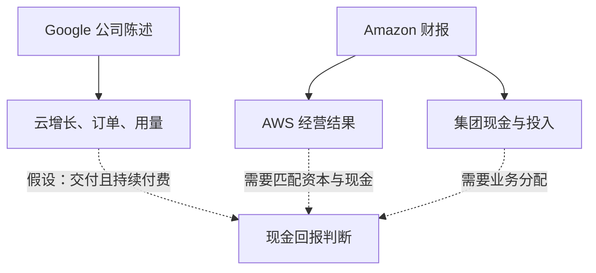
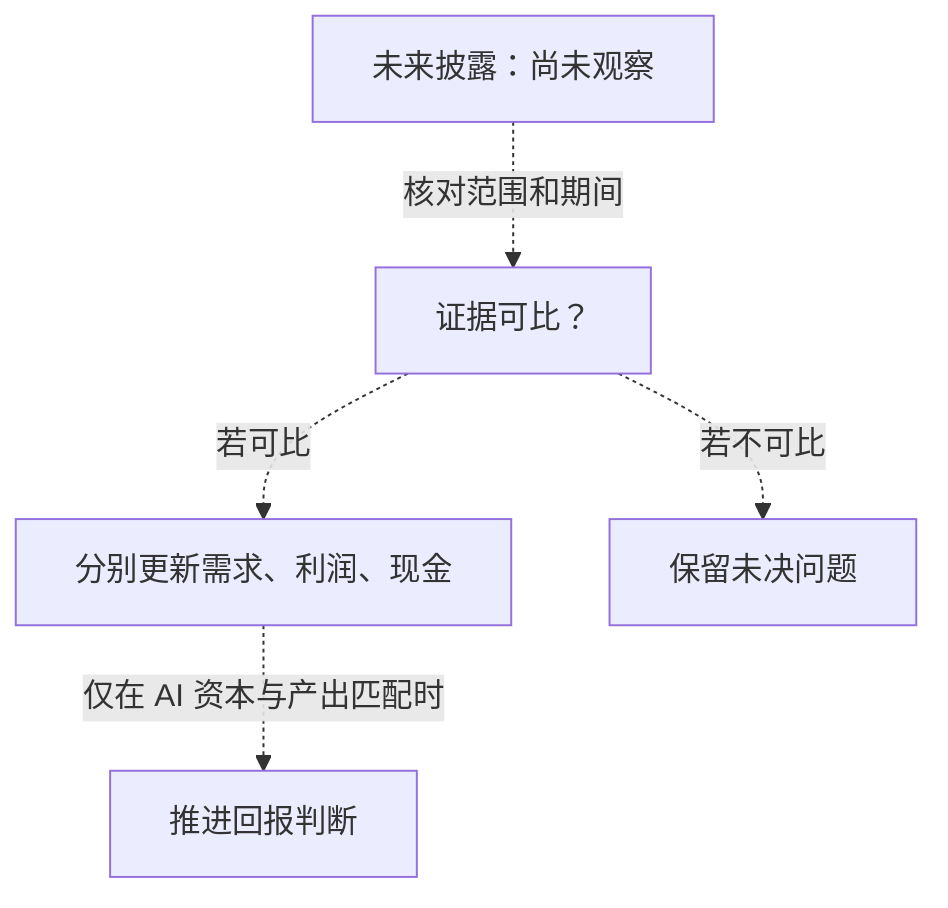

## 云利润上涨，现金却流出：股东该问什么？

云业务增长与自由现金流为负可以同时成立。股东需要先明确每个数字衡量什么，再判断它们共同说明了多少投资回报。Amazon 与 Google 的2026年第二季度披露提供了两个案例，但范围不同，不能直接拼成完整的财务比较。为业务扩张支付的现金，何时、通过哪些资产形成可以持续的现金产出？

Amazon 在2026年7月30日公布，截至6月30日的第二季度，AWS 净销售额422亿美元，同比增长37%，营业利润166亿美元，上年同期为102亿美元，年化收入运行率达到1690亿美元。同一份材料显示，集团截至6月30日的近十二个月（TTM）自由现金流为净流出76亿美元，上年可比期间为净流入182亿美元（[Amazon 财报](https://ir.aboutamazon.com/news-release/news-release-details/2026/Amazon-com-Announces-Second-Quarter-Results/default.aspx)）。

Google 与 Alphabet 首席执行官 Sundar Pichai 在7月22日发布的编辑讲话中表示，云收入同比增长82%，订单积压达到5140亿美元，并介绍客户用量扩张和模型供给约束。该文没有提供相匹配的云资本投入与现金回报（[Google CEO 讲话](https://blog.google/company-news/inside-google/message-ceo/alphabet-earnings-q2-2026/)）。

分析须保留三个边界：AWS 是分部，Amazon 现金数字是集团合并口径；分部业绩覆盖季度，现金数字覆盖十二个月；Google 材料是 CEO 编辑讲话，其中缺少某项信息，不能推定 Alphabet 在全部材料中都未披露（[Amazon 财报](https://ir.aboutamazon.com/news-release/news-release-details/2026/Amazon-com-Announces-Second-Quarter-Results/default.aspx)；[Google CEO 讲话](https://blog.google/company-news/inside-google/message-ceo/alphabet-earnings-q2-2026/)）。

本次资料包的采集元数据显示，两份快照取得于2026年10月14日；快照正文记载的发布日期分别是7月22日和7月30日（[Google 原文地址](https://blog.google/company-news/inside-google/message-ceo/alphabet-earnings-q2-2026/)；[Amazon 原文地址](https://ir.aboutamazon.com/news-release/news-release-details/2026/Amazon-com-Announces-Second-Quarter-Results/default.aspx)）。分析使用的是这些缓存文本，未重新核验实时页面；缓存的公司陈述不构成独立核实。内容仍是 Q2 公司陈述，不是十月新增经营结果，也不足以代表整个行业。

需求、收入和营业利润，究竟能说明多少 AI 基础设施的持续现金回报？判断回报需要把投入资本与现金产出对应起来。两份披露展示了商业进展，但还没有补齐这笔账。

## Amazon 的三本账：经营利润、现金投入与投资收益

AWS 经营表现、集团现金投入和非经营投资收益，回答的是不同问题。把它们合并成一句“AI 投资已经赚钱”，会抹去原文中最重要的范围区别。Amazon 将 AWS 营业利润、集团现金流及投资相关其他收益分别呈现，阅读时也应保留这种区分（[Amazon 财报](https://ir.aboutamazon.com/news-release/news-release-details/2026/Amazon-com-Announces-Second-Quarter-Results/default.aspx)）。

以166亿美元营业利润除以422亿美元销售额，AWS 本季营业利润率约为39.3%。按照四舍五入后的37%增速反推，上年销售额约308亿美元；使用 Jassy 所说的36.7%，约为308.7亿美元。结合上年102亿美元营业利润，之前的利润率约33.1%。这些都是由披露数字计算的近似值，受到舍入影响，并非公司另行报告的精确利润率（[Amazon 财报](https://ir.aboutamazon.com/news-release/news-release-details/2026/Amazon-com-Announces-Second-Quarter-Results/default.aspx)）。

计算支持一个有限结论：报告分部营业利润增长快于收入。原文没有将改善分配给不同工作负载，也未单列 AI 营业利润、折旧和投入资本。因此，不能把整个利润率变化归因于 AI 或某款自研芯片（[Amazon 财报](https://ir.aboutamazon.com/news-release/news-release-details/2026/Amazon-com-Announces-Second-Quarter-Results/default.aspx)）。后续值得问的是，能否把特定业务的改善，与支撑它的资产及投入对应起来。

经营利润与投资后的现金余额还提出不同的时间问题：采购付款是否先于资产产生预期业务？费用确认与现金支出是否落在不同期间？这些是解释差异时需要检验的条件。原文未提供项目资产寿命、折旧安排或设备经济更换周期，无法据此确定一种具体机制（[Amazon 财报](https://ir.aboutamazon.com/news-release/news-release-details/2026/Amazon-com-Announces-Second-Quarter-Results/default.aspx)）。假定一个硬件寿命，只会制造精确外观，不能补上投入和产出的联系。

Amazon 的集团现金数字显示，采购增加超过了经营现金流增加。TTM 经营现金流由1211亿美元升至1614亿美元，增加403亿美元；物业与设备采购扣除销售及激励所得后的净额，同比增加661亿美元。净采购增量超过经营现金流增量258亿美元，恰好对应自由现金流由流入182亿转为流出76亿美元的降幅（[Amazon 财报](https://ir.aboutamazon.com/news-release/news-release-details/2026/Amazon-com-Announces-Second-Quarter-Results/default.aspx)）。这些是现金数字，不能写成新增收入。

公司将自由现金流下降主要联系到净采购增加，并称采购增加主要反映 AI 投资。“主要”是需要保留的公司归因，却不是金额分配。原文没有把增量拆到各个 AI 项目及其他活动，也没有说明采购在四个季度内如何分布（[Amazon 财报](https://ir.aboutamazon.com/news-release/news-release-details/2026/Amazon-com-Announces-Second-Quarter-Results/default.aspx)）。累计结果不能证明每季支出都加速，也无法辨认多少采购在6月30日前已支撑实际客户活动。

第三本账是净利润与非经营收益。Amazon 报告季度净利润626亿美元、稀释每股收益5.75美元，上年分别为182亿美元和1.68美元；其中包含534亿美元税前非经营其他收益，主要来自 Anthropic 投资。非经营分类将这笔金额与 AWS 营业利润分开（[Amazon 财报](https://ir.aboutamazon.com/news-release/news-release-details/2026/Amazon-com-Announces-Second-Quarter-Results/default.aspx)）。

不能把税前金额直接从税后净利润扣除，得出有意义的调整后净利润。所给段落也没有确立现金实现情况或详细估值机制，因而不支持把全额称为未实现股权重估收益（[Amazon 财报](https://ir.aboutamazon.com/news-release/news-release-details/2026/Amazon-com-Announces-Second-Quarter-Results/default.aspx)）。适当的问题是：其中是否有本期可用现金，应如何纳入回报分析？集团净利润和投资相关收益，都不能替代基础设施投入与经营现金产出的配对证据。

## Google 的需求证据：订单、付费使用与收入各到哪一步

Pichai 报告云收入增长82%、订单积压5140亿美元、新客获取速度同比翻倍以上、现有客户使用超出承诺超过50%，以及 Google Cloud Marketplace 交易同比增长超过七倍。这些指标计量基础不同，仍属于公司自述，不能互换为利润或现金回报（[Google CEO 讲话](https://blog.google/company-news/inside-google/message-ceo/alphabet-earnings-q2-2026/)）。这些指标说明需求，却没有披露相应业务赚取的现金利润。

近一年里，近500个云客户各处理超过一万亿 tokens，超过2000家企业消耗超过一千亿 tokens；Pichai 在付费 token 使用增长的语境下介绍这些数字。另一组范围更广的指标是模型 API 每分钟处理约220亿 tokens，高于上一季度160亿，每月超过900万开发者通过 API 和主要开发者产品构建应用（[Google CEO 讲话](https://blog.google/company-news/inside-google/message-ceo/alphabet-earnings-q2-2026/)）。

企业付费用量与整体 API 活动应保持不同范围。讲话未提供共同价格或模型组合，不能按统一单价估值全部 tokens；客户数也不揭示收入集中度。财富100强近90%使用 Gemini Enterprise，说明该群体的采用程度，不披露支出，也不证明每项部署有相同商业条款（[Google CEO 讲话](https://blog.google/company-news/inside-google/message-ceo/alphabet-earnings-q2-2026/)）。这种使用能否形成持续购买，并支持双方可持续的经济条件，仍需更多材料。

Amazon 提供了另一种规模信号。Amazon 披露，AWS AI 与芯片业务年化收入运行率各超过250亿美元，均保持三位数同比百分比增长。这是当前业务的年化数字，不是已完成全年收入；原文没有证明两类业务互斥，不能相加得到 AI 总收入，也未拆出它们各自的分部利润贡献（[Amazon 财报](https://ir.aboutamazon.com/news-release/news-release-details/2026/Amazon-com-Announces-Second-Quarter-Results/default.aspx)）。

| 指标及来源 | 期间与范围 | 支持什么判断 | 仍缺少什么 |
| :--- | :--- | :--- | :--- |
| AWS 收入与营业利润：[Amazon](https://ir.aboutamazon.com/news-release/news-release-details/2026/Amazon-com-Announces-Second-Quarter-Results/default.aspx) | 截至2026年6月30日的 Q2；分部 | 报告收入与经营盈利 | AI 独立利润、投入及现金产出 |
| 自由现金流负76亿美元：[Amazon](https://ir.aboutamazon.com/news-release/news-release-details/2026/Amazon-com-Announces-Second-Quarter-Results/default.aspx) | 截至6月30日的 TTM；集团 | 指定投资扣除后的现金结果 | AWS 与 AI 各自贡献 |
| 云订单积压5140亿美元：[Google](https://blog.google/company-news/inside-google/message-ceo/alphabet-earnings-q2-2026/) | 7月22日 Q2 讲话；Cloud | 公司披露的未来业务承诺 | 履约期限、合同利润与收款 |
| 云收入增长82%：[Google](https://blog.google/company-news/inside-google/message-ceo/alphabet-earnings-q2-2026/) | 7月22日 Q2 讲话；Cloud | 报告商业化增长 | 匹配的云利润和现金转换 |
| AI 与芯片运行率各超250亿美元：[Amazon](https://ir.aboutamazon.com/news-release/news-release-details/2026/Amazon-com-Announces-Second-Quarter-Results/default.aspx) | 7月30日披露；业务年化口径 | 当前商业规模 | 类别重叠与全年实际结果 |
| 企业 tokens 与 API 活动：[Google](https://blog.google/company-news/inside-google/message-ceo/alphabet-earnings-q2-2026/) | 十二个月客户用量及当前吞吐量 | 采用程度与使用深度 | 可比价格、任务效果与现金利润 |

较高报告增速不能直接证明较高资本回报，一家公司的营业利润也不能回答另一家的盈利问题。未来承诺与已确认收入涉及不同时间问题。每个指标的统计范围，决定了它的变化能说明什么。

Google 这份讲话没有云营业利润、分部资本开支或订单履约时间表（[Google CEO 讲话](https://blog.google/company-news/inside-google/message-ceo/alphabet-earnings-q2-2026/)）。缺项限制比较，却不证明亏损、收款困难或合同薄弱。更有用的补充应连接承诺与交付期间，再连接交付、收入和现金。取得这种材料之前，商业指标有意义，但回报证据仍不完整。

## 从需求到回报，中间有哪些条件？

可以用四个条件性问题组织分析：供给能否交付，客户是否继续付费，效率收益由谁保留，以及现金产出相对支撑它的投入如何。问题能够指引核验，不意味着答案已经确定。尤其不能因为多个有利指标同时出现，就默认它们之间的连接已经获得证明。

Pichai 表示模型需求仍受供给约束，Amazon 则报告设备采购增加。前者是公司描述的限制，后者记录支出；二者都没有确定某项资产何时开始生产，或某笔投入可以释放多少收入（[Google CEO 讲话](https://blog.google/company-news/inside-google/message-ceo/alphabet-earnings-q2-2026/)；[Amazon 财报](https://ir.aboutamazon.com/news-release/news-release-details/2026/Amazon-com-Announces-Second-Quarter-Results/default.aspx)）。

新增产能能否在客户需要时上线，支撑经济上有吸引力的付费业务？若交付延后，承诺转为收入是否更慢？若可用供给扩张快于有吸引力的用量，什么能够保护预期回报？这些问题用于检验资本生产率；两份材料没有报告这样的延迟或闲置。需要观察的是部署实际支撑了哪些业务，而非假定每笔付款立即解除真正的限制。

第二个问题是持续付费。Google 企业用量提供商业基础，但讲话未披露续约经济性、客户生产力，也未区分试验和持续生产使用的比例（[Google CEO 讲话](https://blog.google/company-news/inside-google/message-ceo/alphabet-earnings-q2-2026/)）。客户是否继续购买，交易是否同时满足客户需求和供应商经济条件？应以持续购买和服务成本的信息回答，不能预设每个 token 有同样价值。

第三个问题是效率收益留存。Amazon 介绍 Graviton 性价比、Graviton5 计算性能改善及 Trainium 承诺；Google 介绍 TPU 8t、8i、Virgo 网络，以及 Axion 相较同类产品每美元性能提高30%的说法。这些是供应商陈述，不是独立测得的财务效果（[Amazon 财报](https://ir.aboutamazon.com/news-release/news-release-details/2026/Amazon-com-Announces-Second-Quarter-Results/default.aspx)；[Google CEO 讲话](https://blog.google/company-news/inside-google/message-ceo/alphabet-earnings-q2-2026/)）。

工程改善能否降低完整服务成本？节省是由供应商保留、通过降价交给客户，还是用于支持更复杂任务？若价格下降，新增付费用量能否补偿？答案需要价格、利用率和服务组合证据。Google 还称 Search AI Mode 响应成本降至发布以来最低，但这是搜索案例，不能量化 Google Cloud 成本或利润改善（[Google CEO 讲话](https://blog.google/company-news/inside-google/message-ceo/alphabet-earnings-q2-2026/)）。

第四个问题是现金与资本匹配。哪些支出用于扩张，哪些维持现有服务，各自对应什么现金产出？所给材料没有项目层面的这种分配（[Amazon 财报](https://ir.aboutamazon.com/news-release/news-release-details/2026/Amazon-com-Announces-Second-Quarter-Results/default.aspx)；[Google CEO 讲话](https://blog.google/company-news/inside-google/message-ceo/alphabet-earnings-q2-2026/)）。当前分部利润率不能代替设备更换预算，也不能识别新增一批资产的回报。

*实线表示所引 [Google](https://blog.google/company-news/inside-google/message-ceo/alphabet-earnings-q2-2026/) 和 [Amazon](https://ir.aboutamazon.com/news-release/news-release-details/2026/Amazon-com-Announces-Second-Quarter-Results/default.aspx) 材料的证据关系，虚线标出假设与缺失联系。图不是事件顺序，也不是两家公司拼成的财务模型。*

即使现金结果为正，还需问它相对于承诺资本是否足够。判断需要合适的资本分母、对应产出及明确比较标准，原文没有提供 AI 项目的这些输入（[Amazon 财报](https://ir.aboutamazon.com/news-release/news-release-details/2026/Amazon-com-Announces-Second-Quarter-Results/default.aspx)；[Google CEO 讲话](https://blog.google/company-news/inside-google/message-ceo/alphabet-earnings-q2-2026/)）。条件框架的作用是定位缺口，不能据此生成回报百分比。

## 最强反论证：增长和负现金流都可能被误读

支持扩张的最强理由来自报告经营进展：AWS 收入和营业利润增长，Amazon 集团经营现金流上升，Google 在收入和订单增长之外描述付费用量与客户扩张（[Amazon 财报](https://ir.aboutamazon.com/news-release/news-release-details/2026/Amazon-com-Announces-Second-Quarter-Results/default.aspx)；[Google CEO 讲话](https://blog.google/company-news/inside-google/message-ceo/alphabet-earnings-q2-2026/)）。忽略这些陈述，也会漏掉已经披露的商业进展。

当前现金支出是否可能早于所购资产的有吸引力产出？若成立，扩张阶段负自由现金流可以与有效投资相容。这个可能性值得检验，却不证明每笔采购配置良好，也不保证最终回报。关键是后续什么信息能够把本期支出与可持续、经济上可接受的产出连接起来。

质疑乐观解释的最强问题针对增量投资：既有业务盈利，是否证明新购资产的经济性？成熟工作负载保持盈利时，新增产能能否取得相同回报？履行订单之后，扣除服务成本和资本投入的现金是否足够？这些问题指出商业进展与资本收回之间的距离，不需要声称任何一方的新项目已经失败。

怀疑观点也有边界。Amazon 负现金数字属于集团，原文未分离 AI 的金额贡献；Google 讲话也未记录订单取消、闲置资产或收款问题（[Amazon 财报](https://ir.aboutamazon.com/news-release/news-release-details/2026/Amazon-com-Announces-Second-Quarter-Results/default.aspx)；[Google CEO 讲话](https://blog.google/company-news/inside-google/message-ceo/alphabet-earnings-q2-2026/)）。这些情况仍只是待取得证据后才能调查的可能性，尚未成为观察结果。

两种解释都应明确什么会削弱自己。持续收入与营业利润、经营现金相对采购改善，以及经济有效交付的更清楚证据，是否会减轻过度扩张疑虑？这样的组合能够增强有效投资解释。但即使集团现金改善，仍需业务分配，否则 AI 独立贡献可能依旧未知。

反过来，收入或利润走弱、投入继续很高且现金转换变差，是否会降低对高回报的信心？这会支持进一步调查资本生产率，却不能自动识别原因。仍应辨认业务组合、投资时间和被研究资产之外的活动。变化方向可以更新判断，不能直接充当完整因果解释。

后续比较需要范围和期间相匹配的观察。 两份来源均未提供可以裁决投资争议的利润率或增速界线（[Amazon 财报](https://ir.aboutamazon.com/news-release/news-release-details/2026/Amazon-com-Announces-Second-Quarter-Results/default.aspx)；[Google CEO 讲话](https://blog.google/company-news/inside-google/message-ceo/alphabet-earnings-q2-2026/)）。后续应尽量匹配可比期间和开始产生业务的投资批次。连续 TTM 窗口共享月份，也不能每次都当作一整套全新证据。

## 下一份披露该怎样改变判断

后续阅读应分别更新需求、报告利润和现金投入。需求信心可以提高，而项目回报仍不可识别；集团现金压力也可以增加，同时分部继续进步。先分开记录，才能说明一项新增披露究竟改变了哪个判断，而不是每次都重新给出笼统的成功或失败结论。

Amazon 当前基线包含 AWS 收入和营业利润、集团 TTM 经营现金流及物业设备净采购（[Amazon 财报](https://ir.aboutamazon.com/news-release/news-release-details/2026/Amazon-com-Announces-Second-Quarter-Results/default.aspx)）。后续应保留可比定义与期间。若自由现金流改善，先问经营现金增加、采购减少，还是两者共同作用，再问哪些材料支持归因于 AI。集团结果不能默认回答分部问题。

Google 基线包含云收入增长、订单与客户用量口径，CEO 讲话留下云利润、资本开支和履约时间缺口（[Google CEO 讲话](https://blog.google/company-news/inside-google/message-ceo/alphabet-earnings-q2-2026/)）。应寻找补充财务信息。完整披露可以填补空白，另一份简短讲话继续省略某项数字，则不证明经营恶化。披露完整度和业务表现应各自记录。

| 待取得的新增证据 | 可帮助回答的问题 | 仍然存在的限制 |
| :--- | :--- | :--- |
| AWS 利润与集团现金共同改善 | 经营进展是否伴随更强集团现金转换？ | AI 贡献可能仍不明确 |
| 采购稳定而经营现金增长 | 投入压力是否相对现金生成减轻？ | 项目分配和变化原因仍重要 |
| 订单期限与收入一同披露 | 承诺可能何时转为交付业务？ | 合同利润和收款可能仍未知 |
| 按业务和期间匹配 AI 资本与现金产出 | 能否直接研究增量资本生产率？ | 资产寿命、分配与资本成本仍待核验 |

表中是拟议检验，不是已取得后续结果。不能把缺失输入记为失败，也不能让有利代理指标代替真正所需信息。

*所有箭头都是条件性分析步骤。图是拟议判断框架，不是公司事件时间线。*

Amazon 的 Q3 指引为这份基线提供历史背景。截至7月30日，管理层预计集团净销售额1970亿至2020亿美元，同比增长9%至12%；营业利润225亿至265亿美元，上年为174亿美元。公司预计汇率有约80个基点负面影响，排除两年 Prime Day 影响后的增长将高出近400个基点。这些是存在不确定性的集团前瞻预期，不是 AWS 预测，也不是随后实际现金结果（[Amazon 财报](https://ir.aboutamazon.com/news-release/news-release-details/2026/Amazon-com-Announces-Second-Quarter-Results/default.aspx)）。

假设下一期采购下降，自由现金流改善。如果采购下降是因为计划产能已经建成，而且客户继续付费，会支持一种解释；如果是因为项目推迟，同样的现金改善也可能伴随更少的未来产能。这里没有报告任何一种情况。区分它们需要部署与客户证据，仅凭自由现金流的方向无法决定。分析时可以把现金改善和对其原因的解释分别记录，再列出支持该解释的交付或用量披露。即使还不能计算项目回报，这项检验仍然有用。

## 目前能判断什么，回报还缺哪块证据

Q2 材料支持有限判断：公司报告云增长，AWS 报告经营盈利改善，Amazon 净设备采购增加超过经营现金流增加，Google 描述显著订单与付费用量（[Amazon 财报](https://ir.aboutamazon.com/news-release/news-release-details/2026/Amazon-com-Announces-Second-Quarter-Results/default.aspx)；[Google CEO 讲话](https://blog.google/company-news/inside-google/message-ceo/alphabet-earnings-q2-2026/)）。这些观察可以并存，分别建立投资故事的一部分。

未决问题是新增 AI 资本对应多少持续现金产出。哪些资产支持哪些业务？承诺何时成为交付、收入与收款，服务利润如何？工程收益怎样与价格、利用率、业务组合和维持服务的投入共同作用？这些问题确定了回报判断所需的联系。

所给材料没有项目层面的配对关系，因此不能计算 AI 资本回报、确认超过资本成本，或判定投资失败（[Amazon 财报](https://ir.aboutamazon.com/news-release/news-release-details/2026/Amazon-com-Announces-Second-Quarter-Results/default.aspx)；[Google CEO 讲话](https://blog.google/company-news/inside-google/message-ceo/alphabet-earnings-q2-2026/)）。两家公司也不能提供行业裁决。

回报未明不意味着成功与失败概率相同，现有证据也不支持量化的乐观评分。公司披露了商业进展；这些进展最终体现怎样的资本生产率，仍是未决问题。

## 参考资料

1. Amazon Q2 2026 earnings release. [Amazon.com, Inc. - Amazon.com Announces Second Quarter Results](https://ir.aboutamazon.com/news-release/news-release-details/2026/Amazon-com-Announces-Second-Quarter-Results/default.aspx). .
2. Alphabet Q2 2026 CEO remarks. [Alphabet earnings call Q2 2026: Sundar Pichai remarks](https://blog.google/company-news/inside-google/message-ceo/alphabet-earnings-q2-2026/). .
