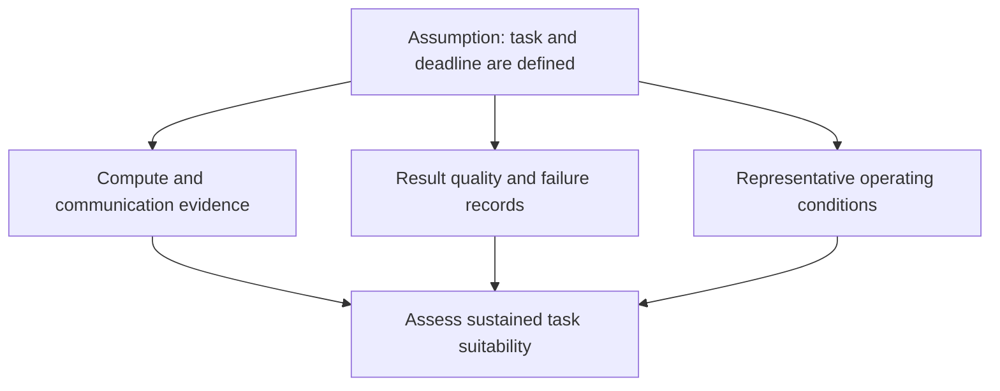
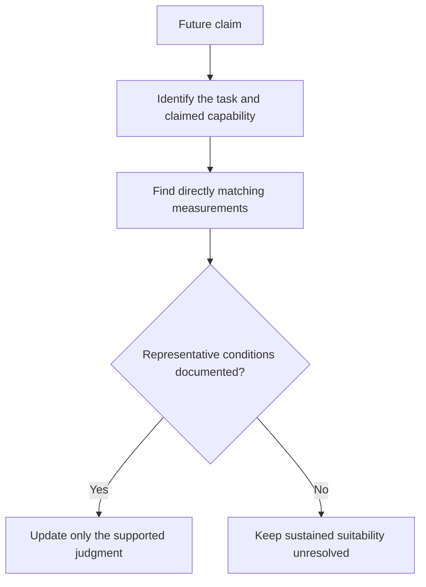

## How much does an orbital response establish?

On October 30, 2026, [Google reported](https://blog.google/innovation-and-ai/models-and-research/google-research/project-suncatcher-satellite-response/) that its Project Suncatcher prototype satellite had completed an orbital "Hello World." The satellite launched on October 1. The response occurred "this week," with no exact experiment date given. During a ground-station pass, the team uploaded a prompt to an onboard Gemma 4 open model running on a data center class TPU. As the satellite passed Svalbard, Norway, it downlinked a haiku about being in space.

At the level of Google's report, this supports a functioning prompt-to-response path in orbit. It leaves sustained computing service, representative workload reliability and economic advantage unproven. Each requires observations beyond a returned response.

This weekend analysis revisits two October 30 disclosures. [NVIDIA's telescope account](https://blogs.nvidia.com/blog/ai-joins-the-search-for-extraterrestrial-signals/) describes processing at the Allen Telescope Array and provides a comparison of task requirements. It does not independently confirm Google's result. Both accounts are publisher disclosures, without independent verification here, and neither describes a new event from the October 31 to November 1 weekend.

The question for infrastructure readers is how much uncertainty the response removed, and what further evidence would support confidence in sustained tasks.

## What the two accounts report

[Google describes](https://blog.google/innovation-and-ai/models-and-research/google-research/project-suncatcher-satellite-response/) several weeks of commissioning after launch: powering up the host and TPU trays, then successfully running early machine learning tests. After the haiku, the team tested space-themed limericks and telemetry prompts reporting payload-system status. These extend the reported functional checks. The excerpt supplies no continuous operating duration, error-rate measurements, power figures or environmental test results.

[The announcement](https://blog.google/innovation-and-ai/models-and-research/google-research/project-suncatcher-satellite-response/) places orbital thermal-stress and radiation-exposure tests next. It identifies twin interconnected satellites in 2027 as the next milestone, without specifying a launch in that sentence. This is a future research objective, with no completed service implied. The description of the response as the first from a data center class TPU in orbit is also Google's claim.

[NVIDIA reports](https://blogs.nvidia.com/blog/ai-joins-the-search-for-extraterrestrial-signals/) that Breakthrough Listen and the SETI Institute are bringing agentic AI into daily operations at the Allen Telescope Array in Northern California. DAQIRI, a Holoscan platform library, sends sensor data directly into GPU memory. CyberEther processes signals using CUDA-X libraries including cuFFT and cuBLAS. Nexus, a web-based observatory orchestrator, provides instrument state, compute-resource and pipeline information. Researchers can use natural-language interactions to monitor packet loss and read live spectrograms.

[According to NVIDIA](https://blogs.nvidia.com/blog/ai-joins-the-search-for-extraterrestrial-signals/), the system can handle 2.4 terabits per second on NVIDIA RTX PRO 6000 Blackwell GPUs, with inference running on premises beside the instrument. It also reports the first real-time AI detection of a pulsar in the Crab Nebula. This is an astronomical detection, not a discovery of extraterrestrial technology. Open models including NVIDIA Nemotron are being evaluated; observatories that might someday operate offline on the lunar far side remain a future scenario.

| Evidence dimension | [Suncatcher: Google](https://blog.google/innovation-and-ai/models-and-research/google-research/project-suncatcher-satellite-response/) | [Telescope: NVIDIA](https://blogs.nvidia.com/blog/ai-joins-the-search-for-extraterrestrial-signals/) |
| :--- | :--- | :--- |
| Task described | Uploaded prompts and returned responses | Processing incoming radio observations beside the instrument |
| Reported result | Orbital prompt-to-response path | 2.4 Tbps handling capability; real-time pulsar detection |
| Unquantified in the excerpt | Sustained duration, errors, power and environmental performance | Long-term average throughput, operating duration and detection errors |
| Status boundary | Prototype and future research milestones | Publisher-described observatory pipeline; further model evaluation |

These are different workloads, so the table cannot rank accelerator efficiency. NVIDIA's 2.4 Tbps handling capability must also retain its stated scope: the account does not present it as a measured long-term average throughput. Neither publisher independently verifies the other's account.

## From model execution to task completion

Evaluation starts with a defined task: the required input, an acceptable result and its delivery deadline. A demonstration can show that a path worked under the reported conditions. Sustained availability requires that path to keep meeting the task's requirements over a representative operating period.

[NVIDIA's description](https://blogs.nvidia.com/blog/ai-joins-the-search-for-extraterrestrial-signals/) exposes the sensor-data path. Observations enter GPU memory for processing instead of first filling hard drives. Assessing this arrangement requires evidence that it keeps pace with the relevant observation stream, preserves information needed for analysis and produces dependable detections. The architecture and handling-capability figure do not settle all of those questions.

For Suncatcher, [Google reports](https://blog.google/innovation-and-ai/models-and-research/google-research/project-suncatcher-satellite-response/) an uploaded prompt and a response received during a ground-station pass. The excerpt does not quantify communication waiting time, execution time or consistency across repeated requests. Whether a proposed task can tolerate the complete turnaround time needs a workload-specific test. The disclosure establishes neither a timing advantage nor a timing limitation.

The diagram connects evaluation questions to evidence needs. It is an analytical framework, with no project progress or completed-test sequence implied.

[Google's planned environmental tests](https://blog.google/innovation-and-ai/models-and-research/google-research/project-suncatcher-satellite-response/) raise further questions: do results remain acceptable under the tested thermal and radiation conditions, and what recovery does an interruption require? The excerpt cannot establish a failure probability, maximum duty cycle or cooling limit. Missing measurements leave these questions unresolved; they do not demonstrate failure. Nor does the orbital response establish energy, communication or cooling advantages.

The telescope's nearby processing cannot establish an advantage for an orbital workload either. That assessment requires knowing where the orbital task's inputs originate and where its outputs are needed. Shared use of AI inference does not make the data paths interchangeable, and these accounts provide no quantified, universal model of task value.

## Evaluating an early research prototype

Commercial readiness is an inappropriate immediate requirement for an early experiment. [Google describes Suncatcher](https://blog.google/innovation-and-ai/models-and-research/google-research/project-suncatcher-satellite-response/) as a long-term research moonshot. Its announcement reports an orbital response and further tests, without claiming an established commercial computing service.

A functioning integrated path has research value within that scope. Taking the report at its attributed level, the returned output supports confidence that the payload completed the described operation in orbit. The [limerick and telemetry checks](https://blog.google/innovation-and-ai/models-and-research/google-research/project-suncatcher-satellite-response/) extend that evidence beyond the initial haiku, while leaving continuous availability unspecified. Production-system requirements should not erase that progress.

Stronger claims still need matching evidence. Environmental reliability, sustained workload execution and commercial suitability each require more than functional success. A later report could increase confidence by documenting representative workloads, operating duration, environmental conditions, output quality and unsuccessful attempts, then showing dependable completion under relevant conditions. Evidence confined to a few short tests would leave sustained operation unresolved. If environmental tests exposed restrictions, their significance would depend on whether the intended task could accommodate them.

These are proposed evaluation criteria, not reported outcomes or official acceptance rules. They set no universal duration, error threshold or probability of benefit; the appropriate standard depends on the task.

The same scrutiny applies to [NVIDIA's account](https://blogs.nvidia.com/blog/ai-joins-the-search-for-extraterrestrial-signals/). It provides no long operating record or detection-error statistics. Packet-loss records would also matter when assessing dependable processing. Its statement that agents compress work from weeks or years into hours has no comparison method in the excerpt, so it cannot support a quantified productivity estimate here. The useful comparison is the explicit connection between the instrument, its data stream and a reported result.

## What to look for in the next update

[Google identifies](https://blog.google/innovation-and-ai/models-and-research/google-research/project-suncatcher-satellite-response/) environmental testing and the 2027 twin-interconnected-satellite milestone as future work. These directions need separate assessment. A communication result answers a different question from sustained workload reliability, and neither automatically establishes a useful advantage for a distributed task.

| Evidence level | Question to ask | Present evidence boundary |
| :--- | :--- | :--- |
| Functional path | Can an input produce a returned result? | [Google reports](https://blog.google/innovation-and-ai/models-and-research/google-research/project-suncatcher-satellite-response/) this for the prototype |
| Sustained task | What runs, for how long, with what quality? | Neither [Google](https://blog.google/innovation-and-ai/models-and-research/google-research/project-suncatcher-satellite-response/) nor [NVIDIA](https://blogs.nvidia.com/blog/ai-joins-the-search-for-extraterrestrial-signals/) supplies a sustained operating record in these excerpts |
| Environmental reliability | What happens under specified conditions, including failures and recovery? | [Google names](https://blog.google/innovation-and-ai/models-and-research/google-research/project-suncatcher-satellite-response/) thermal and radiation tests as next work |
| Economic comparison | What is the complete cost relative to a suitable alternative? | The [Google](https://blog.google/innovation-and-ai/models-and-research/google-research/project-suncatcher-satellite-response/) and [NVIDIA](https://blogs.nvidia.com/blog/ai-joins-the-search-for-extraterrestrial-signals/) excerpts do not provide that comparison |

For sustained-task evidence, workload definition matters alongside duration. Readers need to know what ran, what counted as completion and whether unsuccessful attempts were included. A longer demonstration would be more informative if it supplied those details, allowing success to be assessed against the full record of attempts.

Environmental observations should connect conditions to computation. Did execution continue? Did results remain acceptable? Was intervention necessary for recovery? An isolated health indicator cannot answer all these questions. For interconnected satellites, the corresponding questions concern what information must be exchanged and which task requires it. [Google's excerpt](https://blog.google/innovation-and-ai/models-and-research/google-research/project-suncatcher-satellite-response/) specifies no interconnect technology, bandwidth requirement or distributed-model design; those details cannot be filled in ahead of evidence.

This diagram proposes a way to read future claims. It assumes no test result or event order.

Commercial comparison also requires a defined alternative and an accounting boundary. Launch, communication, operation, maintenance and replacement costs would need consideration for the chosen task. The [Google account](https://blog.google/innovation-and-ai/models-and-research/google-research/project-suncatcher-satellite-response/) supplies no figures for that exercise. The reported response cannot establish economic advantage or a commercial deployment timetable. For now, the evidence supports continued research tracking rather than an investment-return estimate.

## Questions the response leaves open

The unresolved questions concern which workloads the system can sustain, how unsuccessful executions are identified and handled, and how complete costs compare with a suitable alternative. Useful cross-satellite coordination also needs evidence tied to a specific task.

Future measurements should change only the judgments they directly support. The telescope's components, handling capability and reported detection belong to its particular pipeline; they cannot validate Suncatcher, establish a general performance ranking or prove an industry-wide trend. Neither account supports predicting when space data centers will become widespread or how large their market will be.

## References

1. Google 官方博客. [Google receives response from Project Suncatcher prototype satellite in space](https://blog.google/innovation-and-ai/models-and-research/google-research/project-suncatcher-satellite-response/).
2. NVIDIA Newsroom. [AI Joins the Search for Extraterrestrial Signals | NVIDIA Blog](https://blogs.nvidia.com/blog/ai-joins-the-search-for-extraterrestrial-signals/).
