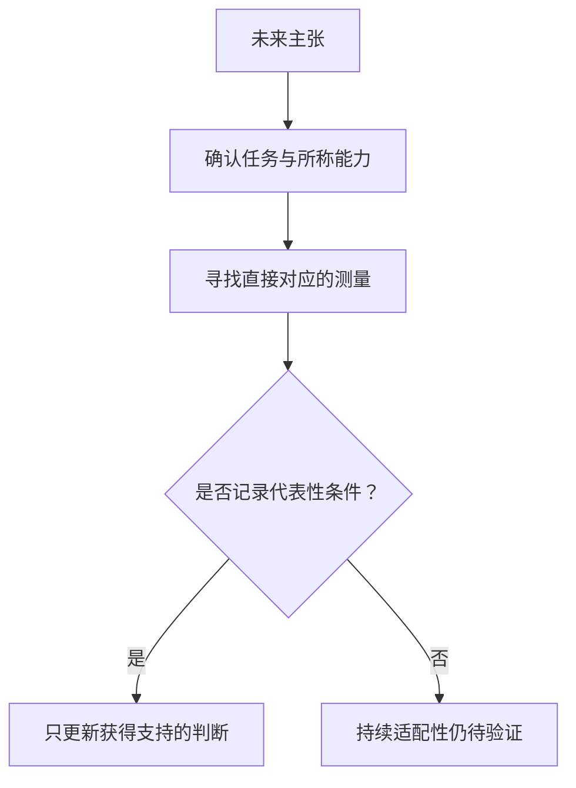

## 一次在轨响应证明了什么？

2026年10月30日，[Google披露](https://blog.google/innovation-and-ai/models-and-research/google-research/project-suncatcher-satellite-response/)，Project Suncatcher原型卫星完成了在轨“Hello World”。卫星于10月1日发射；响应发生时间仅称“本周”，没有确切实验日期。团队在地面站过境期间向星载Gemma 4开放模型上传提示词，由数据中心级TPU执行。卫星经过挪威斯瓦尔巴时，下传了一首关于太空的俳句。

按Google的报告，这支持原型完成了在轨提示到响应的功能路径。持续计算服务、代表性负载的可靠性和经济优势，仍需各自的证据。

本文回看两篇10月30日材料，作为周末专题。同日的[NVIDIA望远镜报告](https://blogs.nvidia.com/blog/ai-joins-the-search-for-extraterrestrial-signals/)提供不同任务要求的参照，不能独立验证Google的结果。两篇均为发布者披露，本文没有独立核验，也不能将其包装成10月31日至11月1日的新事件。关注基础设施的读者需要判断：这次响应减少了哪些疑问，还需什么证据才能相信系统能持续完成任务？

## 两个案例分别披露了什么？

[Google介绍](https://blog.google/innovation-and-ai/models-and-research/google-research/project-suncatcher-satellite-response/)，发射后的数周调试包括宿主系统与TPU托盘上电，以及成功运行早期机器学习测试。俳句之后，团队还测试了太空主题打油诗和报告载荷技术状态的遥测提示。这些扩展了功能检查，但摘录没有连续运行时长、错误率、功耗或环境测试结果。

[公告](https://blog.google/innovation-and-ai/models-and-research/google-research/project-suncatcher-satellite-response/)将轨道热应力与辐射暴露测试列为后续工作，将2027年双星互联列为下一项里程碑。该句没有指定发射；这仍是未来研究目标，不代表服务已经完成。“数据中心级TPU首次在轨响应”也属于Google的主张。

[NVIDIA称](https://blogs.nvidia.com/blog/ai-joins-the-search-for-extraterrestrial-signals/)，Breakthrough Listen与SETI Institute正把智能体AI用于加州北部Allen Telescope Array的日常工作。Holoscan平台库DAQIRI让传感器数据直接进入GPU显存；CyberEther通过cuFFT、cuBLAS等CUDA-X库处理信号。网页观测编排器Nexus提供仪器状态、计算资源和管线信息，支持以自然语言监测丢包、读取实时频谱。

[据NVIDIA披露](https://blogs.nvidia.com/blog/ai-joins-the-search-for-extraterrestrial-signals/)，该系统在RTX PRO 6000 Blackwell GPU上可处理每秒2.4太比特数据，推理在仪器旁的现场运行。发布者还报告了对蟹状星云中脉冲星的首次实时AI检测。这是天文目标检测，不是发现外星技术信号。团队正在评估包括NVIDIA Nemotron在内的开放模型；月球背面离线天文台仍是可能的未来情境。

| 证据维度 | [Suncatcher：Google](https://blog.google/innovation-and-ai/models-and-research/google-research/project-suncatcher-satellite-response/) | [望远镜：NVIDIA](https://blogs.nvidia.com/blog/ai-joins-the-search-for-extraterrestrial-signals/) |
| :--- | :--- | :--- |
| 任务描述 | 上传提示并返回响应 | 在仪器旁处理射电观测流 |
| 披露结果 | 在轨提示到响应路径 | 2.4 Tbps处理能力、实时脉冲星检测 |
| 摘录未量化 | 持续时长、错误、功耗及环境表现 | 长期平均吞吐、运行时长及检测误差 |
| 状态边界 | 原型及未来研究里程碑 | 发布者描述的观测管线，继续评估模型 |

负载不同，表格不能用于加速器效率排名。2.4 Tbps须保留为NVIDIA所述的处理能力，不能改写成实测长期平均吞吐量。两家发布者也互不构成独立复核。

## 从模型执行到任务完成

评估要先明确任务的输入、合格结果和交付期限。一次演示可以说明路径在所述条件下运行过；持续可用性则要求它在代表性运行期间不断满足任务要求。

[NVIDIA描述的路径](https://blogs.nvidia.com/blog/ai-joins-the-search-for-extraterrestrial-signals/)是观测数据直接进入显存处理，无须先填满硬盘。判断这种安排是否适用，还要看它能否跟上目标观测流、保留分析所需信息，并产生可靠检测。架构和处理能力数字没有回答全部问题。

Suncatcher的[已披露操作](https://blog.google/innovation-and-ai/models-and-research/google-research/project-suncatcher-satellite-response/)是上传提示，并在地面站过境期间收到响应。摘录未量化通信等待、执行耗时或重复请求的交付一致性。目标任务能否容忍完整周转时间，需要负载测试，不能预先认定为优势或限制。

下图连接任务要求与证据需求，是分析框架，不表示项目进度或已完成测试的顺序。

```mermaid
flowchart TD
    A[假设：任务与期限已定义] --> B[计算与通信证据]
    A --> C[结果质量与失败记录]
    A --> D[代表性运行条件]
    B --> E[评估持续任务适配性]
    C --> E
    D --> E
```

[Google计划的环境测试](https://blog.google/innovation-and-ai/models-and-research/google-research/project-suncatcher-satellite-response/)还需回答：热应力与辐射条件下结果是否合格，中断后怎样恢复？摘录不能确定故障概率、最大占空比或散热上限。缺少测量意味着未决，不代表失败；在轨响应也没有证明能源、通信或散热优势。

望远镜的就近处理同样不能证明轨道任务受益。要先确定该任务的输入在哪里产生、输出在哪里使用。都执行AI推理，不意味着数据路径可以互换；两篇材料也没有可量化的统一任务价值模型。

## 怎样评价早期研究原型？

立即要求早期实验证明商业成熟度，并不合适。[Google将Suncatcher](https://blog.google/innovation-and-ai/models-and-research/google-research/project-suncatcher-satellite-response/)定位为长期研究项目，公告报告在轨响应和后续测试，没有宣称商业计算服务已经成立。

在这一范围内，集成路径成功运行具有研究价值。按发布者报告，返回输出支持载荷完成了所述在轨操作；[打油诗和遥测检查](https://blog.google/innovation-and-ai/models-and-research/google-research/project-suncatcher-satellite-response/)又扩展了最初俳句的证据，但仍未说明连续可用性。生产系统标准不应抹去这项进展。

更强的主张仍需对应证据。后续若记录代表性负载、运行时长、环境条件、输出质量与失败尝试，并显示任务在相关条件下可靠完成，就应提高对持续运行的信心。若仅有少量短测试，持续能力仍待验证；若环境测试暴露限制，则要看目标任务能否容纳。

这些是本文提出的观察标准，不是已公布结果或官方验收规则，也没有统一时长、错误阈值或收益概率；适当标准取决于任务。

[NVIDIA案例](https://blogs.nvidia.com/blog/ai-joins-the-search-for-extraterrestrial-signals/)也缺少长期运行记录和检测误差统计，判断可靠处理还需丢包记录。其“数周或数年缩至数小时”的表述没有比较方法，不能据此估算量化生产率。有用的参照是仪器、数据流与报告结果之间明确的任务联系。

## 下一次更新应看哪些证据？

[Google列出的](https://blog.google/innovation-and-ai/models-and-research/google-research/project-suncatcher-satellite-response/)环境测试与2027年双星互联目标应分别检查。通信结果与持续负载可靠性回答不同问题，任何一项都不自动证明分布式任务具有实用优势。

| 证据层级 | 应追问的问题 | 当前边界 |
| :--- | :--- | :--- |
| 功能路径 | 输入能否产生返回结果？ | [Google报告](https://blog.google/innovation-and-ai/models-and-research/google-research/project-suncatcher-satellite-response/)原型已完成 |
| 持续任务 | 什么负载、运行多久、质量如何？ | [Google](https://blog.google/innovation-and-ai/models-and-research/google-research/project-suncatcher-satellite-response/)与[NVIDIA](https://blogs.nvidia.com/blog/ai-joins-the-search-for-extraterrestrial-signals/)摘录均未给出持续运行记录 |
| 环境可靠性 | 指定条件下如何执行、失败和恢复？ | [Google](https://blog.google/innovation-and-ai/models-and-research/google-research/project-suncatcher-satellite-response/)将热与辐射测试列为后续工作 |
| 经济比较 | 完整成本相对合适替代方案如何？ | [Google](https://blog.google/innovation-and-ai/models-and-research/google-research/project-suncatcher-satellite-response/)与[NVIDIA](https://blogs.nvidia.com/blog/ai-joins-the-search-for-extraterrestrial-signals/)摘录未提供这种比较 |

持续任务报告需要同时交代负载和时长：执行了什么，怎样算完成，失败尝试是否计入？更长演示若提供这些细节，才便于把成功结果放回全部尝试中判断。

环境观测应联系计算表现：执行是否继续，结果是否合格，恢复是否需要干预？孤立的健康指标无法回答全部问题。跨星协作还要说明交换什么信息、哪项任务需要交换。[Google摘录](https://blog.google/innovation-and-ai/models-and-research/google-research/project-suncatcher-satellite-response/)没有指定互联技术、带宽要求或分布式模型设计，不能提前补全。

下图提出阅读未来主张的方法，没有假定测试结果或事件顺序。

商业比较需要明确替代方案和核算边界，考虑发射、通信、运行、维护及替换成本。[Google材料](https://blog.google/innovation-and-ai/models-and-research/google-research/project-suncatcher-satellite-response/)没有相应数字，不能从这次响应推出经济优势或商业部署时间表。现阶段证据适合支持继续跟踪研究，无法估算投资回报。

## 响应之后仍待回答的问题

尚待回答的是：系统能持续承担什么负载，如何识别和处理执行失败，完整成本如何与合适替代方案比较？有用的跨星协作也需与具体任务相对应的证据。

新测量应只改变其直接支持的判断。望远镜的处理组件、能力数字和检测结果属于特定管线，不能验证Suncatcher、建立通用性能排名，或证明全行业趋势。两篇材料也不足以预测太空数据中心的普及时间或市场规模。

## 参考资料

1. Google 官方博客. [Google receives response from Project Suncatcher prototype satellite in space](https://blog.google/innovation-and-ai/models-and-research/google-research/project-suncatcher-satellite-response/).
2. NVIDIA Newsroom. [AI Joins the Search for Extraterrestrial Signals | NVIDIA Blog](https://blogs.nvidia.com/blog/ai-joins-the-search-for-extraterrestrial-signals/).
