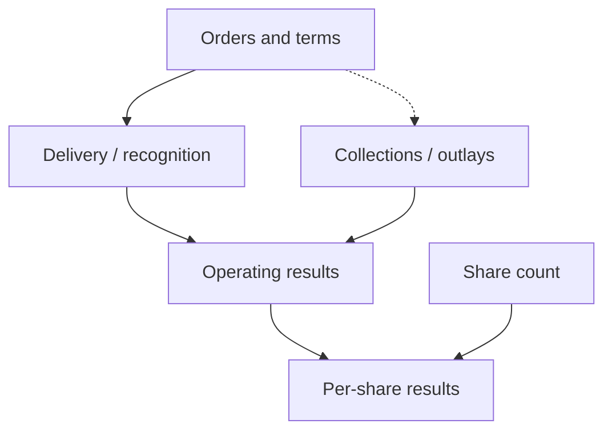
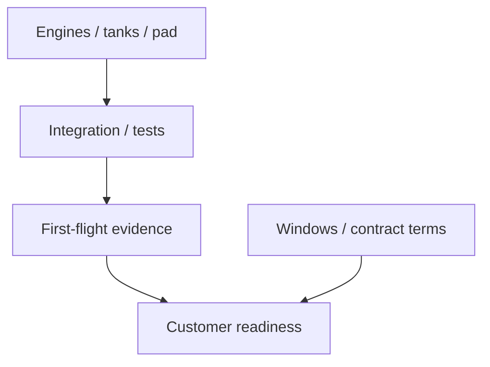

## What must the growth announcements deliver?

Rocket Lab's growth announcements raise a practical question: <u>what do orders and financing establish</u>, and what further delivery, operating, and capital evidence would show that growth is improving results per share? Rising demand matters to shareholders. Assessing their eventual benefit also requires examining fulfillment costs, collections, continuing investment, and the number of shares dividing the business.

<figure class="article-photo" markdown="1">
{: width="3997" height="2998" loading="lazy" }

<figcaption>Electron launching CAPSTONE in 2022. A historical illustration, not evidence of operating performance in 2026. Yourong F. Wang · <a href="https://commons.wikimedia.org/wiki/File:CAPSTONE-LAUNCH.jpg">Source</a> · <a href="https://creativecommons.org/licenses/by-sa/4.0/">License: CC BY-SA 4.0</a>. Original image, displayed at a smaller size.</figcaption>
</figure>

This article uses research records as of **October 8, 2026**, retaining the company disclosure dates recorded there. The linked originals were not independently rechecked for this edit, and operating conditions after October 8 are not updated. Company disclosures, follow-up questions, and conditional analysis are identified separately.

According to the research summary attributed to Rocket Lab's [Second Quarter 2026 Financial Results](https://investors.rocketlabcorp.com/news-releases/news-release-details/rocket-lab-announces-second-quarter-2026-financial-results-posts), released August 10, the company reported record revenue of $234 million for the quarter ended June 30, 2026, up 62% year over year. It reported *backlog* of $2.36 billion as of June 30, up 137% year over year. The research summary also describes the September 30 announcement of a [20-launch Electron agreement for Synspective](https://investors.rocketlabcorp.com/news-releases/news-release-details/rocket-lab-secures-largest-ever-electron-commercial-deal-20), which the company said brought its launch backlog above 100 missions.

**Revenue, backlog value, and mission count answer different questions.** Quarterly revenue provides evidence of recognized business, without answering whether the corresponding cash has been collected. Backlog needs a breakdown of firm commitments, options, segments, and delivery years before it can support a detailed forecast. Future mission count needs pricing and cost information before it can support a profitability assessment. Dividing backlog by quarterly revenue cannot establish a guaranteed period of revenue coverage.

How should backlog growth exceeding revenue growth be interpreted? Has future demand strengthened, has work awaiting fulfillment increased, or have both occurred? Without complete delivery schedules and contract composition, the percentages cannot resolve those alternatives. The next questions concern when work enters production, what supports recognition, and how much funding fulfillment requires.

A per-share assessment needs another comparison. If total corporate earnings increase, what happens to the share count? Do additional benefits compensate for additional shares and expenditure? The material lacks complete cash flow, capital expenditure, and share data needed to calculate per-share value or a price target. The analysis therefore follows demand and execution through operating conversion, then examines the capital required to obtain the benefits.

## One customer, two kinds of evidence

Synspective provides a concrete comparison because the same customer appears in recent mission records and a future agreement. The research summary of [Rocket Lab News Updates](https://investors.rocketlabcorp.com/news) records company disclosures of successful Electron Missions 96 and 97 on September 19 and September 25, 2026. Both were Synspective missions. The cumulative Electron mission count reported in the historical material was 97 as of September 25. These are issuer-reported execution results; the flights have not been independently verified for this article.

The dates are six days apart. They establish that the company reported two completed missions within that interval. They do not establish the entire launch-pad turnaround process, whether manufacturing deliveries met their original schedules, or whether the same pace can continue every month. A stronger conclusion about sustained execution would require a longer record, original windows, actual dates, and explanations for changes.

The September 30 [Synspective 20-Launch Electron Agreement](https://investors.rocketlabcorp.com/news-releases/news-release-details/rocket-lab-secures-largest-ever-electron-commercial-deal-20) concerns a different stage. The research summary describes a signed multiyear agreement that Rocket Lab described as its largest Electron commercial contract, with missions planned annually during 2028 to 2031. **Signing had occurred; execution remained planned.** The agreement supports an interpretation of continuing demand without establishing recognized revenue, profit, or current cash from those 20 launches.

The research summary of [that agreement](https://investors.rocketlabcorp.com/news-releases/news-release-details/rocket-lab-secures-largest-ever-electron-commercial-deal-20) records that its value and remaining commercial terms were undisclosed. Mission count therefore cannot be converted into contract revenue. The material cannot determine whether payment precedes production, who bears rescheduling costs, or how much flexibility the customer has to change launch windows. If customer readiness matches the schedule, would the arrangement progressively support clearer production allocation? If windows change, how would the terms distribute the economic consequences?

Those missing terms should remain explicit rather than be filled in with assumed industry practice. The agreement's execution years also matter: planned demand several years ahead cannot substitute for evidence about the next quarter's collections. A signed agreement can warrant attention even when its financial consequences cannot yet be quantified.

The [100-plus mission pool](https://investors.rocketlabcorp.com/news-releases/news-release-details/rocket-lab-secures-largest-ever-electron-commercial-deal-20) is an issuer-defined disclosure. It is useful as a demand indicator, but the research record does not establish equal certainty across every mission or identify all legal forms within the total. Follow-up should distinguish firm awards, options, scheduled missions, completed missions, delays, and windows awaiting definition. Movement between those categories would reveal more about delivery prospects than another headline total.

Customer continuity supports the persistence of an existing relationship, while leaving diversification unanswered. If future missions become concentrated among a few customers, would changes in their readiness have a larger effect on production arrangements? The material supplies no concentration calculation or evidence that this effect has occurred. Repeated business alone cannot determine whether concentration risk has risen or fallen.

Subsequent scheduling, production allocation, and actual missions would help connect the recent execution record to the future agreement. That connection is the next test for this customer relationship: can the signed demand move into executable windows and then completed work?

| Evidence | What it supports | What remains unestablished |
| --- | --- | --- |
| Synspective missions on September 19 and 25 | Recent issuer-reported execution | Sustained cadence, unit profit, or full turnaround |
| 20-launch agreement signed September 30 | Planned 2028 to 2031 demand and customer continuity | Recognized revenue, current collections, or realized profit |
| Issuer's 100-plus mission pool | Demand at the company's stated scope | Equal certainty or known legal terms for every mission |

*Comparison based on the two company records cited in this section. Track execution and future demand separately.*

## From orders to operating results

Order conversion requires a sequence of questions. Is the agreement effective? Has the customer made a commitment sufficient to support scheduling? Are resources available for production? Does delivery satisfy applicable recognition conditions? When does payment occur? These questions organize the analysis. The research record does not contain contract originals sufficient to establish that every Rocket Lab project follows one fixed accounting or billing sequence.

The first question concerns firm commitments and options. The August 10 [Second Quarter 2026 Financial Results](https://investors.rocketlabcorp.com/news-releases/news-release-details/rocket-lab-announces-second-quarter-2026-financial-results-posts), as summarized in the research record, included an approximately $397 million SB-AMTI contract encompassing options, multiple Flatellite spacecraft, and planned Neutron launches. The research summary also describes two contracts totaling more than $160 million involving the manufacture and operation of three GEO satellites. Because the first amount includes options, potential contract value needs to be distinguished from committed business.

If options remain unexercised, how much forecasting weight should the associated work receive? The answer requires the firm and optional amounts, exercise conditions, and mission windows. The research record does not provide those breakdowns or the complete backlog methodology. It would therefore be unsupported to claim that Rocket Lab included every option in backlog or to calculate the firm-order proportion. Assigning the entire option-inclusive amount to certain future revenue would remove conditions the evidence explicitly preserves.

The second question concerns production and delivery. Do resource allocation and customer readiness align once work enters manufacturing? Does reported progress bring the project closer to acceptance, or does it require a revised schedule? If a project changes, which expenditure or delivery arrangement changes with it? These are questions for subsequent disclosure. General production logic cannot establish that Rocket Lab has suffered overruns, and contract amounts cannot supply missing project margins.

The third question separates recognized revenue from cash received. The record cannot specify percentage-of-completion treatment, named design reviews, or particular payment triggers. If recognition comes before collection, does cash subsequently arrive as expected? If customer advances arrive earlier, do they cover the relevant initial expenditure? Whether delayed acceptance affects revenue, cash, or both requires contract terms and financial statement notes.

After revenue rises, collections still need examination. After cash arrives before delivery, the associated obligation still needs examination. Financing proceeds and customer advances should not be treated as operating revenue, and recognized revenue should not be treated as proof that an equal amount of cash has arrived. The timing of specific contracts remains open because the record does not establish a policy for them.

The fourth question concerns working capital. The research record identifies contract assets, contract liabilities, inventory, and product margins as linked [Space Systems monitoring categories](https://investors.rocketlabcorp.com/news-releases/news-release-details/rocket-lab-announces-second-quarter-2026-financial-results-posts). If inventory and contract assets increase, do related deliveries and collections follow? Do advances and receipts cover the additional expenditure? The material provides no balance movements proving that a funding problem has already emerged.

A rising balance cannot decide the interpretation alone. Does it represent production preparation, expenditure before delivery, or money repeatedly failing to convert into collections? An assessment across periods, alongside contract liabilities, revenue, and operating cash flow, would help distinguish those possibilities. Looking at one balance can misidentify normal preparation or miss persistent funding demands. Disclosure connecting the movement to specific business activity would help explain its direction.

The research summary describes Rocket Lab's [third-quarter guidance](https://investors.rocketlabcorp.com/news-releases/news-release-details/rocket-lab-announces-second-quarter-2026-financial-results-posts) of $250 million to $265 million in revenue and 29% to 31% GAAP gross margin. These are near-term checkpoints and remain management's forward-looking statements. Achieving them would support greater confidence in operating conversion. It would not identify the contribution of a particular Space Systems contract without a breakdown, or replace examination of operating cash flow.

After margin improvement, further questions remain. Do other operating expenses and capital requirements increase at the same time? Are additional gross profits and cash sufficient to support continuing investment? If revenue and funding needs both rise, does the explanation concern delivery timing, collection arrangements, or other expenditure? Each answer concerns a different part of the conversion process and requires its own disclosure.

*Figure 1: Evidence relationships in the assessment. Arrows represent analytical connections. Contracts determine payment and recognition timing; this is not an established accounting or payment sequence.*

## Neutron: how a hardware target can affect delivery

The Neutron discussion begins with a specific link: the research summary describes [planned Neutron launches under the SB-AMTI arrangement](https://investors.rocketlabcorp.com/news-releases/news-release-details/rocket-lab-announces-second-quarter-2026-financial-results-posts). How much of the associated commercial schedule depends on this vehicle? The material cannot quantify the dependency, but it establishes why hardware readiness and customer timing need to be examined together.

The research summary attributed to the [Neutron Product Page](https://rocketlabcorp.com/launch/neutron/) and [Q2 update](https://investors.rocketlabcorp.com/news-releases/news-release-details/rocket-lab-announces-second-quarter-2026-financial-results-posts) records management's statement that first-stage tank production was aligned with a target of reaching the launch pad in the fourth quarter of 2026. This is a company target, neither a completed transport event nor a promise of a fourth-quarter first flight. The material cannot establish hardware conditions as of October 12 or supply missing test results.

The research record's [critical-path framework](https://rocketlabcorp.com/launch/neutron/) includes engines, structures, the launch pad, integrated vehicle testing, first flight, and the first customer mission. It supplies a monitoring framework without the original results and completion dates for every requirement. The questions concern what a component milestone answers, what integration still requires, whether testing supports the next step, and what remains between first flight and the customer's window.

The material also does not establish that every activity proceeds in a strictly serial sequence. If some work advances concurrently, which unfinished requirement still constrains the overall window? If the tank reaches the pad while other conditions remain unmet, how should overall readiness be assessed? If the target changes, what caused the revision? A date change alone cannot identify an engineering defect or manufacturing problem.

An update should identify which uncertainty a hardware milestone reduces and whether another requirement becomes the limiting issue. Without test results, remaining work, and customer arrangements, the distance to commercial delivery remains uncertain. Those details would allow a later announcement to be assessed against a specific outstanding requirement.

The [approximately $397 million SB-AMTI arrangement](https://investors.rocketlabcorp.com/news-releases/news-release-details/rocket-lab-announces-second-quarter-2026-financial-results-posts) includes options, multiple Flatellite spacecraft, and planned Neutron launches. The research record does not disclose individual component values, recognition conditions, or alternative arrangements. If the launch target moves later, would spacecraft manufacturing revenue be affected, and which portion at what time? Would tank arrival relate to a payment milestone? The evidence cannot answer either question.

Two hypothetical branches organize follow-up. If necessary hardware, integration, and testing are completed promptly, and later flight readiness matches customer windows, uncertainty around the relevant deliveries could decline. First-flight results, actual customer scheduling, and production arrangements would still be needed. Progress can support revising a specific condition without guaranteeing the eventual profit.

If a necessary requirement slips, do the revised target, remaining work, and customer window change together? Does the agreement provide flexibility? Are feasible alternatives available, and is additional expenditure disclosed? Those answers must limit any assessment of the economic consequences. The material cannot assign probabilities, loss amounts, or certain outcomes to either branch, or assume undisclosed schedule allowances already exist.

An investment model should revise the timing assumption addressed by new evidence while keeping other unknowns visible. An unexplained delay cannot establish a manufacturing defect, and a component milestone cannot replace integrated vehicle validation. The research record's [97 cumulative Electron missions](https://investors.rocketlabcorp.com/news) provide evidence about an established business. Neutron needs its own testing and flight results to support conclusions about its readiness.

*Figure 2: A Neutron observation framework. Arrows summarize readiness questions to examine together, not a strictly serial engineering schedule or proof of completed milestones.*

## Does waiting for results miss the growth?

The strongest objection comes from the leading indicators themselves. Revenue growth, repeat-customer missions, and a new agreement together provide more information than a solitary backlog figure. Investment judgments necessarily precede the arrival of all future cash. If every positive development is disregarded because final profitability remains unproven, analysis loses its ability to recognize improvement. This is an interpretation of the supplied evidence, not a quotation attributed to an analyst.

The research record's [$234 million quarterly revenue and 62% year-over-year growth](https://investors.rocketlabcorp.com/news-releases/news-release-details/rocket-lab-announces-second-quarter-2026-financial-results-posts) support an assessment of expanding recognized business. The [two September Synspective missions](https://investors.rocketlabcorp.com/news) provide issuer-reported execution records. The [additional 20-launch agreement](https://investors.rocketlabcorp.com/news-releases/news-release-details/rocket-lab-secures-largest-ever-electron-commercial-deal-20) supports continuing demand. Dismissing all progress as meaningless paper commitments would overlook the revenue and completed work already reported.

The strength of each conclusion still needs calibration. Without a supporting revenue breakdown, growth cannot be attributed to a particular new agreement. Two recent missions cannot establish sustained frequency or unit profitability. Undisclosed commercial terms prevent the future agreement's returns from being quantified. Confidence should increase in the step receiving evidence while the next unproven step remains open.

Leading indicators and capital questions can coexist. When demand evidence improves, does fulfillment still require increased expenditure? When execution expands, do changes in the share count alter the per-share distribution? Asking those questions preserves the operating progress while testing what shareholder conclusion it supports. The record contains neither share-price evidence nor market expectations sufficient to determine whether developments are already reflected in valuation. It cannot establish a trading opportunity or entry point.

To make the debate testable, both interpretations need conditions that would change them. If delivery continues, actual revenue and margins approach or meet [disclosed third-quarter guidance](https://investors.rocketlabcorp.com/news-releases/news-release-details/rocket-lab-announces-second-quarter-2026-financial-results-posts), and contract assets and inventory convert through delivery into collections, an excessively pessimistic explanation would need reconsideration. If options become firm commitments and distant missions receive concrete schedules, confidence in order certainty and timing should be reassessed too.

These tests do not require immediate transformation into a mature cash-distribution business. If cash pressure remains contained while investment continues, does that indicate better conversion? The answer still needs consistency with delivery, margins, and ongoing expenditure. One favorable quarter of operating cash flow may merit attention without settling every long-term issue. The source of balance movements needs examination before improvement is described as durable.

Evidence should accumulate across different steps. Revenue and margin results address operating performance. Collections and funding needs address cash. More definite mission windows address timing. Consistent observations across those categories could justify a stronger revision than a single favorable result. If the categories conflict, the assessment should preserve the conflict and seek the missing connection.

The reverse test also needs restraint. If revenue continues growing while margins and cash repeatedly deteriorate, does the claim that demand assures shareholder benefits remain defensible? A third-quarter GAAP gross margin below the [29% guidance floor](https://investors.rocketlabcorp.com/news-releases/news-release-details/rocket-lab-announces-second-quarter-2026-financial-results-posts) would initially establish a shortfall against that expectation. It would not alone prove underbidding or manufacturing overruns. Explaining the cause requires business mix, cost information, and financial disclosure.

Options remaining unexercised or windows repeatedly moving later would justify lower forecast certainty or revised timing without automatically establishing cancellation. Actual cancellations or further financing would require distinguishing customer factors, growth investment, and ordinary operating funding needs. Persistent improvement should change pessimistic judgments, while persistent difficulty should change optimistic ones. Both interpretations need to meet the same evidence requirements.

## What should shareholders check after funding is secured?

The Iridium case brings the capital questions into focus. Financing completion, transaction closing, and integration benefits require separate examination. After funding arrangements progress, has the acquisition actually closed? After closing, can the added business support the costs incurred to obtain it? Different evidence answers each question.

The research summary of the September 15, 2026 [Iridium Acquisition Financing Update](https://investors.rocketlabcorp.com/news-releases/news-release-details/rocket-lab-fully-funds-iridium-acquisition-including-completion) records the company's statement that it completed approximately $1.944 billion of *ATM* equity financing, obtained change-of-control consent under its existing term loan, and terminated a $3.6 billion bridge loan commitment. These amounts concern financing and a loan commitment. They are not operating revenue or evidence that acquisition benefits have already been realized.

The disclosures support progress in the funding arrangements. The research record does not provide the full financing costs needed to quantify savings or establish that every liquidity risk has been eliminated. Which constraint has improved, and what remains unresolved? Issuance terms, fees, remaining capital needs, and arrangements before closing would help answer that question. The financing amount cannot establish the effects of undisclosed conditions.

The research summary describes the [company's mid-2027 closing target](https://investors.rocketlabcorp.com/news-releases/news-release-details/rocket-lab-fully-funds-iridium-acquisition-including-completion), subject to regulatory approval and other closing conditions. This is an expected timetable, not an accomplished event or regulatory deadline. The next evidence concerns approvals and actual satisfaction of conditions. If the target changes, its cause and implications need examination; the present record cannot establish approval outcomes or additional costs in advance.

The distribution base after equity financing also needs assessment. The research record lacks shares issued, issuance prices, and the resulting share count, preventing an exact dilution calculation. How many shares were added? What sustainable benefits and costs accompany the additional business? When those figures are compared on the same share base, what happens to results per share? The amount raised identifies funding scale without answering whether benefits compensate for the added shares.

A reduced ownership percentage cannot determine the direction of per-share value by itself. If benefits from the new capital compensate for the additional shares and expenditure, per-share outcomes could improve. If compensation is insufficient, a larger company could still fail to deliver better outcomes to existing holders. Both remain conditional until the share and integration data, including the integration budget, become available. Funding receipt should not be recognized prematurely as acquisition accretion.

Financing, closing, and operating benefits should each retain their own dates. Will expected benefits appear, when might they appear, and what expenditure is required before then? Subsequent disclosure needs to test those questions. A strategic rationale can guide observation without replacing realized revenue, cash, or per-share results.

The [Q2 research summary describes completed acquisitions of Mynaric and Motiv](https://investors.rocketlabcorp.com/news-releases/news-release-details/rocket-lab-announces-second-quarter-2026-financial-results-posts), expanding optical communications and spacecraft capabilities, and identifies integration costs and delivery synergies for monitoring. Their first distinction from Iridium is transaction stage. The completed acquisitions permit examination of post-acquisition operations; Iridium still requires examination of closing. The material does not support numerical comparisons of integration complexity or establish that management resources have already been diverted.

Synergies need identifiable results. Do expanded capabilities produce observable orders, delivery improvements, or cost benefits? If those results have not been disclosed, how should the assessment avoid substituting a broader portfolio for economic achievement? Whether management resources or operating cash face pressure also remains a question for disclosure. The research record does not establish that such harm has occurred.

Follow-up information includes actual shares issued, the diluted share base, regulatory and closing progress, integration expenses, and capital requirements. If operating measures such as EBITDA are subsequently supplied, how do they relate to cash flow, capital expenditure, and shares outstanding? Are they sufficient to support a per-share accretion conclusion? Sustainable benefits need to be evaluated against the full costs of obtaining them.

| Iridium stage | Status in the record | Evidence still needed |
| --- | --- | --- |
| Funding | Issuer reports $1.944B of ATM financing and termination of a $3.6B bridge commitment | Shares, prices, fees, and remaining funding needs |
| Closing | Mid-2027 company target, subject to approvals and other conditions | Regulatory progress and conditions actually met |
| Integration / per-share benefit | Accretion or dilution cannot yet be quantified | Integration costs, sustainable cash flow, and comparable share data |

*Based on the September 15 financing update cited in this section. Funding, closing, and operating benefits need separate dates and evidence.*

## Which results would change the judgment?

Updates should match new evidence to the relevant step. The research record's [Electron monitoring framework](https://investors.rocketlabcorp.com/news) includes completed missions and delay days over the following 90 days. Its [Synspective agreement follow-up](https://investors.rocketlabcorp.com/news-releases/news-release-details/rocket-lab-secures-largest-ever-electron-commercial-deal-20) includes customer concentration, scheduling, and the first 2028 missions. That 90-day window is anchored to the October 8 research record and must not be silently rolled forward to the article date. Continuing execution and explanations for gaps or rescheduling would help assess delivery confidence.

For Space Systems, examine production, acceptance, revenue, margins, and the interaction of contract assets, contract liabilities, and inventory. The research record's [$250 million to $265 million revenue and 29% to 31% GAAP gross margin figures](https://investors.rocketlabcorp.com/news-releases/news-release-details/rocket-lab-announces-second-quarter-2026-financial-results-posts) are company-wide third-quarter guidance. They should not be assigned to an individual project or another quarter without disclosed guidance. If achieved, do operating cash flow and capital requirements support the same improvement assessment?

For Neutron, follow the [research record's critical-path framework](https://rocketlabcorp.com/launch/neutron/): the tank target, testing, LC-3 integration, first flight, and the first customer mission. For Iridium, follow the [financing and closing record](https://investors.rocketlabcorp.com/news-releases/news-release-details/rocket-lab-fully-funds-iridium-acquisition-including-completion), examining approvals and conditions before integration benefits, expenses, funding needs, and share changes.

These workstreams require separate revisions. A launch record cannot establish acquisition accretion, and financing completion cannot validate a new rocket. If revenue rises while cash weakens, the conversion step causing the difference needs investigation. If hardware advances while customer arrangements remain undefined, commercial timing remains open.

The outstanding gaps are contract originals and firm-order breakdowns, complete cash flow and capital expenditure, ATM-related share changes, and hardware conditions after October 8. The material supports taking demand expansion and partial execution evidence seriously. Stronger conclusions about profit, cash, and results per share require disclosure about those outcomes.

## References

1. Rocket Lab Investor Relations. [Second Quarter 2026 Financial Results](https://investors.rocketlabcorp.com/news-releases/news-release-details/rocket-lab-announces-second-quarter-2026-financial-results-posts). 2026-08-10.
2. Rocket Lab Investor Relations. [Rocket Lab Secures Largest-Ever Electron Commercial Deal: 20-Launch Contract for Synspective](https://investors.rocketlabcorp.com/news-releases/news-release-details/rocket-lab-secures-largest-ever-electron-commercial-deal-20). 2026-09-30.
3. Rocket Lab Investor Relations. [News](https://investors.rocketlabcorp.com/news). 2026-09-30.
4. Rocket Lab. [Neutron launch vehicle](https://rocketlabcorp.com/launch/neutron/). 2026-09-14.
5. Rocket Lab Investor Relations. [Rocket Lab Fully Funds Iridium Acquisition, Including Completion of $1.94 Billion ATM](https://investors.rocketlabcorp.com/news-releases/news-release-details/rocket-lab-fully-funds-iridium-acquisition-including-completion). 2026-09-15.
