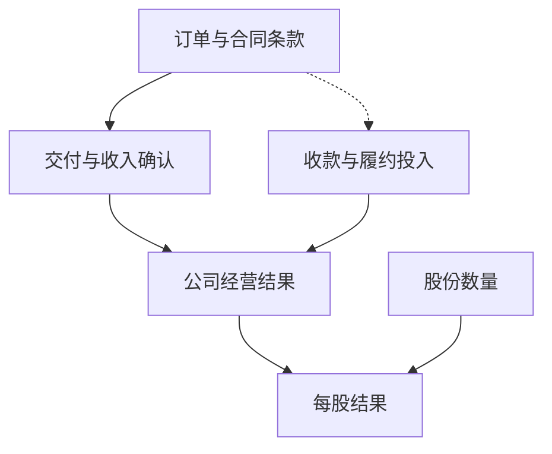
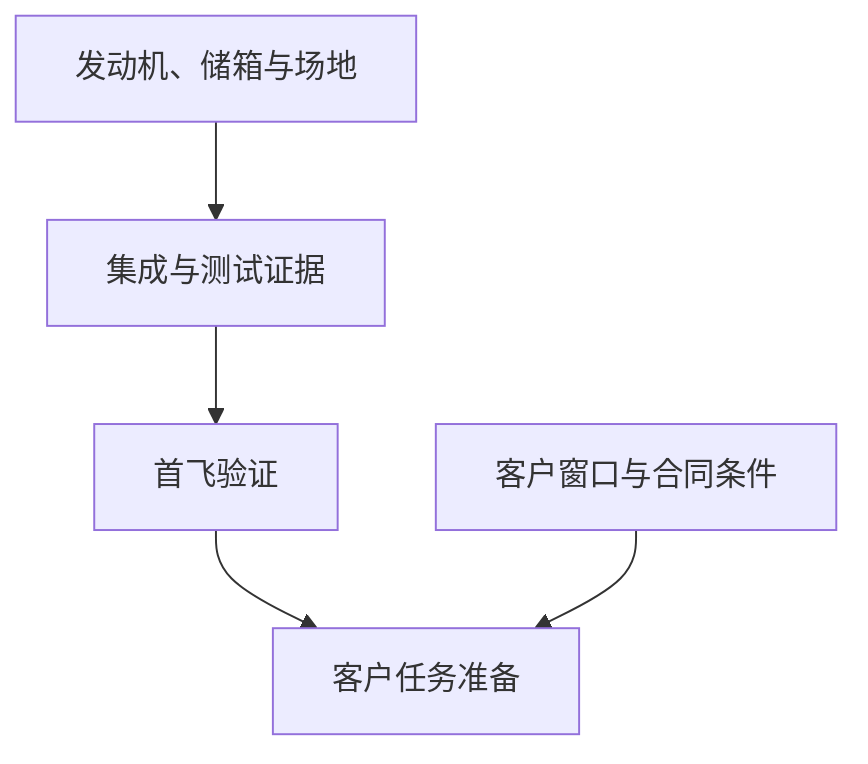

## 增长消息还需要哪些兑现证据？

Rocket Lab 的增长消息提出了一个具体问题：<u>订单与融资分别证明了什么</u>，还需要哪些交付、经营和资本证据，才能判断增长正在改善每股结果？对股东而言，需求扩大值得关注，最终可分享的收益还要与履约成本、收款、持续投入和股份数量一起评估。

<figure class="article-photo" markdown="1">
{: width="3997" height="2998" loading="lazy" }

<figcaption>2022 年 Electron 发射 CAPSTONE 任务的历史照片；仅展示发射场景，不作为 2026 年经营表现的证据。 Yourong F. Wang · <a href="https://commons.wikimedia.org/wiki/File:CAPSTONE-LAUNCH.jpg">图片出处</a> · <a href="https://creativecommons.org/licenses/by-sa/4.0/">许可: CC BY-SA 4.0</a>. 原图等比显示，未裁剪或修改。</figcaption>
</figure>

本文依据截至 **2026 年 10 月 8 日** 的研究记录，保留其中注明的公司披露日期。链接原文未在本次编辑中重新独立核验，10 月 8 日之后的经营状态也未更新。文中分别标明公司披露、后续观察项目和条件性分析。

根据研究资料引用的 [第二季度财务业绩公告](https://investors.rocketlabcorp.com/news-releases/news-release-details/rocket-lab-announces-second-quarter-2026-financial-results-posts)，Rocket Lab 于 2026 年 8 月 10 日披露，截至 2026 年 6 月 30 日的第二季度收入为 2.34 亿美元（$234M），同比增长 62%，创季度纪录；截至同日，订单积压（*backlog*）为 23.6 亿美元（$2.36B），同比增长 137%。资料同时列出，公司于 9 月 30 日宣布签署 [Synspective 的 20 次 Electron 发射协议](https://investors.rocketlabcorp.com/news-releases/news-release-details/rocket-lab-secures-largest-ever-electron-commercial-deal-20)，并称发射订单池由此超过 100 次。

**收入、积压金额与任务数量对应不同阶段。**季度收入提供已确认业务的证据，这个数字不能回答现金是否已经收到。积压金额需要结合确定订单、选择权、业务分部和交付年度理解，才能支持详细预测；未来任务数量则需要价格及成本资料，才能进入利润判断。用积压除以季度收入，不能推算有保证的收入覆盖年数，因为这些条件尚未得到回答。

积压增长快于收入增长，应怎样解释？后续需求是否更加充足，还是待交付业务增加，或两者同时出现？研究记录没有完整交付期限和合同结构，无法仅凭增长率区分这些可能性。接下来需要观察新增业务何时进入生产、什么条件支持收入确认，以及履约需要先投入多少资金。

每股判断还需要另一组问题：公司总收益若增长，股份数量是否也发生变化？新增收益能否补偿新增股份与相关投入？材料缺少完整现金流、资本开支和股本数据，不能据此计算每股价值或目标价。以下分析先检查需求和履约证据，再检查经营转换，最后评估取得这些收益所需的资本代价。

## 同一个客户，已执行任务与远期协议说明不同的事

Synspective 提供了一个具体对照：同一客户既出现在近期任务记录中，也出现在多年协议里。根据研究资料引用的 [Rocket Lab 新闻动态汇总](https://investors.rocketlabcorp.com/news)，公司披露于 2026 年 9 月 19 日、25 日分别成功完成第 96、97 次 Electron 任务，两次均为 Synspective 任务。截至 9 月 25 日，资料所列 Electron 累计任务为 97 次。这是公司披露的执行记录，本文没有独立核验这些飞行结果。

两次日期相隔六天，可以说明这一段时间内公司报告完成了两次任务。它不能单独证明发射台周转全过程、制造交付是否符合原定时间，或未来每月都能保持同样节奏。若要提高对持续交付能力的判断，需要更长时间的任务记录，以及原定窗口、实际日期和改期原因。

9 月 30 日的 [20 次 Synspective 协议公告](https://investors.rocketlabcorp.com/news-releases/news-release-details/rocket-lab-secures-largest-ever-electron-commercial-deal-20)，在资料摘要中列为一份已经签署、尚待执行的多年协议。公司称其为 Electron 最大商业合同，任务计划于 2028 至 2031 年每年执行。**签署已经发生，未来任务仍是计划。**协议可支持需求延续的解释，不能证明这 20 次任务已经形成已确认收入、利润或当期现金。

资料记载协议金额及其余商务条款未披露，因而无法从任务数计算合同收入，也无法判断付款是否先于生产、延期代价由谁承担，或客户能够在多大范围内调整窗口。这些缺口均对应 [该协议的资料摘要](https://investors.rocketlabcorp.com/news-releases/news-release-details/rocket-lab-secures-largest-ever-electron-commercial-deal-20)。若客户准备进度与排期一致，协议是否会逐步支持更明确的生产分配？若窗口调整，条款如何分配经济影响？两种问题都需要后续材料。

缺失条款应明确保留，不能用行业习惯补齐。执行年份也有独立意义：数年后的计划需求，不能代替下一季度收款的证据。已经签署的协议值得关注，其财务影响仍可能暂时无法量化。

超过 100 次的订单池同样属于 [公司披露口径](https://investors.rocketlabcorp.com/news-releases/news-release-details/rocket-lab-secures-largest-ever-electron-commercial-deal-20)。它可以作为需求指标记录，研究记录不足以证明其中每项任务拥有相同确定性，也不足以断言它具体混合了哪些法律形式。后续观察应把确定授予、选择权、已排期、已执行、延期及待定窗口分别跟踪。不同类别之间的变化，比再增加一个总数更能说明交付前景。

同一客户持续出现，可以支持既有业务关系延续的解释，却不能回答客户结构是否更加分散。如果未来任务向少数客户集中，客户准备进度变化或改期是否会更明显地影响生产安排？材料没有客户集中度数值，也没有证据证明这一影响已经发生。重复业务本身不能决定集中度风险上升还是下降。

后续排期、生产分配和实际执行，可以帮助连接近期执行记录与远期协议。这个客户关系接下来要接受的检验，是已签需求能否进入可执行窗口，再转成完成的任务。

| 证据 | 已能说明什么 | 还不能说明什么 |
| --- | --- | --- |
| 9 月 19 日、25 日两次 Synspective 任务 | 公司披露的近期执行记录 | 长期发射频次、单次利润或完整周转过程 |
| 9 月 30 日签署 20 次协议 | 2028 至 2031 年计划需求与客户关系延续 | 已确认收入、当期收款或已兑现利润 |
| 公司称订单池超过 100 次 | 公司口径下的需求规模 | 各任务确定性相同，或其全部法律形式已知 |

*对照依据本节两份公司披露的研究记录；执行结果与远期需求应分别跟踪。*

## 订单怎样转成经营结果？

订单转换需要逐项询问：合同是否有效，客户承诺是否足以支持排期，资源能否满足生产，交付是否达到适用确认条件，付款何时发生？这些问题组成本文的分析顺序。研究记录没有提供足以确定各合同会计政策和付款节点的原文，不能把这一顺序写成 Rocket Lab 每个项目都遵循的固定流程。

第一项是确定承诺与选择权。8 月 10 日的 [第二季度财务业绩公告](https://investors.rocketlabcorp.com/news-releases/news-release-details/rocket-lab-announces-second-quarter-2026-financial-results-posts)，在资料摘要中列出约 3.97 亿美元（$397M）的 SB-AMTI 合同，金额包含选择权，涉及多颗 Flatellite，并计划由 Neutron 发射。资料同时列出两份合计超过 1.60 亿美元（$160M）的合同，涉及三颗 GEO 卫星的制造与运营。由于前一项金额包含选择权，潜在合同金额与已确定业务需要分别判断。

若选择权尚未行使，相应业务应获得多大的预测权重？需要先知道确定部分与选择权部分的金额、行使条件及任务窗口。研究记录没有这些拆分，也没有完整订单积压口径，不能认定公司已将全部选择权计入积压，更不能计算确定订单占比。将含选择权金额全部纳入确定收入预测，会去掉证据明确保留的条件。

第二项是生产与交付。合同进入制造后，资源投入与客户准备能否配合？生产进展是否更接近验收，还是需要调整时间或安排？若项目发生变化，哪些支出或交付安排会随之改变？这些都是后续披露应回答的问题。一般生产逻辑不能证明 Rocket Lab 已有成本超支，合同金额也不能代替项目毛利资料。

第三项是收入与收款。材料不足以指定完工百分比法、具体设计评审名称或付款触发点。若收入确认先于收款，现金是否随后如期到账？若客户预付款较早到账，它是否足以覆盖相关前期投入？验收延后影响收入、现金还是两者，仍需合同和财报附注回答。

收入上升之后，需要检查现金回收；现金提前收到之后，需要检查对应交付义务。不能把融资或预付款当作营业收入，也不能把已确认收入当作同额现金已经到账。本文不为具体合同指定这两者的时间关系，因为研究记录没有提供相应政策。

第四项是资金占用。研究记录将合同资产、合同负债、库存与产品毛利的联动列为 [Space Systems 观察项目](https://investors.rocketlabcorp.com/news-releases/news-release-details/rocket-lab-announces-second-quarter-2026-financial-results-posts)。若库存及合同资产增长，相关交付和回款是否随后跟上？客户预付款与收款是否覆盖新增投入？这些关系仍待检验，材料没有余额变化证明资金问题或异常已经发生。

余额增加本身不能决定好坏。它究竟对应生产准备、交付前投入，还是迟迟不能回收的资金？较可靠的判断需要跨期观察，并结合合同负债、收入及经营现金流。只看单项余额，既可能误判正常准备，也可能漏掉持续占用。后续披露若能解释变化对应哪些业务，才有助于理解余额方向。

资料记载公司给出的 [第三季度指引](https://investors.rocketlabcorp.com/news-releases/news-release-details/rocket-lab-announces-second-quarter-2026-financial-results-posts) 为收入 2.50 亿至 2.65 亿美元（$250M 至 $265M）、GAAP 毛利率 29% 至 31%。这是近期检查点，仍属管理层前瞻陈述。实际收入和毛利率若达标，可增强经营转换的可信度；没有相应拆分，仍不能证明某份 Space Systems 合同贡献了多少，也不能替代经营现金流检查。

毛利改善之后，还应问：其他经营费用和资本投入是否同步增加？新增毛利与现金能否承担持续投入？若收入增加而资金需求也增加，原因来自交付时间、收款安排还是其他支出？这些答案对应转换过程中的不同环节，需要各自的披露支持。

*图 1：判断需要连接哪些证据。箭头表示分析关系，收款与确认的先后取决于合同；图中没有指定任何项目的会计或付款流程。*

## Neutron：一个硬件目标如何影响商业交付？

Neutron 的讨论有一个具体起点：资料记载 [SB-AMTI 合同计划使用 Neutron 发射](https://investors.rocketlabcorp.com/news-releases/news-release-details/rocket-lab-announces-second-quarter-2026-financial-results-posts)。相关商业排期究竟在多大程度上依赖这款运载器？材料无法量化这种依赖，却足以说明为什么需要把硬件准备与客户时间安排放在一起检查。

依据 [Neutron 官方产品页](https://rocketlabcorp.com/launch/neutron/) 与 [Q2 更新](https://investors.rocketlabcorp.com/news-releases/news-release-details/rocket-lab-announces-second-quarter-2026-financial-results-posts) 的研究记录摘要，公司称一级储箱生产与 2026 年第四季度运抵发射台的目标一致。**这是公司目标**，不是已经完成运输，也不是第四季度首飞承诺。材料不足以确认截至 10 月 12 日的硬件现场状态，更不能补写缺失的试验结果。

研究记录整理的 [关键路径框架](https://rocketlabcorp.com/launch/neutron/) 包括发动机、结构、发射台、整箭测试、首飞及首个客户任务。它是观察框架，没有附上所有关卡的原始测试结果和完成日期。应逐项询问：部件节点解决了哪个问题，集成还需要什么证据，测试结果是否支持下一步，首飞与客户窗口之间还隔着哪些工作？

这些工作是否全部严格串行，材料也无法确定。若部分环节同时推进，哪项尚未完成的必要工作仍限制整体窗口？若储箱到达，而其他条件尚未满足，如何评价整体准备程度？若目标日期改变，原因来自何处？不能仅凭日期变化指定工程缺陷或制造问题。

一次硬件更新应说明它减少了哪项不确定性，并检查另一项要求是否成为新的限制。没有测试结果、剩余工作与客户安排，无法判断距离商业交付还剩多远。这些细节能让后续公告与某项尚未完成的要求具体对应。

研究记录中的 [约 3.97 亿美元 SB-AMTI 合同](https://investors.rocketlabcorp.com/news-releases/news-release-details/rocket-lab-announces-second-quarter-2026-financial-results-posts) 包含选择权，涉及多颗 Flatellite 并计划由 Neutron 发射，但没有各部分金额、确认条件或替代安排。因此，若火箭目标延后，是否影响卫星制造收入，影响哪部分、何时发生？若储箱运抵发射台，是否与任何付款节点关联？都没有足够依据回答。

可以建立两条假设分支。若必要硬件、集成与测试及时完成，且后续飞行准备符合客户任务窗口，相应交付的不确定性可能下降。还需要首飞结果、实际客户任务安排及生产衔接支持判断。进展可以改变对应条件的评价，不能直接写成未来利润保证。

若某项必要关卡延后，新目标日期、剩余工作与客户窗口是否随之变化？合同是否提供弹性，是否存在可行替代安排，额外投入是否得到披露？延期的经济影响要由这些答案约束。材料不能为任何分支赋予概率、损失金额或确定后果，也不能把尚未披露的时间缓冲安排视为已经存在。

对投资模型而言，需要调整的是得到新证据的具体时间假设，其余未知应继续保留。原因未明的延期不能定性为制造缺陷，部件进展也不能替代整箭验证。资料记载的 [Electron 累计 97 次任务](https://investors.rocketlabcorp.com/news) 提供既有业务的执行证据；Neutron 则需要自己的测试和飞行结果，才能支持自身准备程度和成熟度的判断。

*图 2：Neutron 的后续观察框架。箭头概括需要联合检查的准备条件，不代表全部工程工作严格串行，也不表示任一节点已完成。*

## 等待全部兑现，会不会错过增长？

最有力的反论证来自领先指标本身：收入增长、重复客户任务和新增协议结合起来，已经比单独一个订单数字提供更多信息。投资判断需要在未来现金全部兑现之前形成；若每项积极变化都因缺少最终利润而被忽略，分析就会失去识别经营改善的能力。这是本文对已有证据的解释，并非引用某位分析师的原话。

研究记录中的 [2.34 亿美元季度收入及 62% 同比增长](https://investors.rocketlabcorp.com/news-releases/news-release-details/rocket-lab-announces-second-quarter-2026-financial-results-posts) 支持已确认业务扩大的判断；[9 月两次 Synspective 任务](https://investors.rocketlabcorp.com/news) 提供公司披露的执行记录；[20 次新协议](https://investors.rocketlabcorp.com/news-releases/news-release-details/rocket-lab-secures-largest-ever-electron-commercial-deal-20) 则支持未来需求延续的解释。将所有进展笼统归为没有意义的纸面承诺，会忽略其中已有的执行与收入证据。

每类证据支持多强的结论，仍需校准。没有相应收入拆分，不能将增长归因于某一新合同；两次近期任务不能证明长期频次或单位利润；协议商务条款未披露，不能量化回报。判断应随证据改善而提高对相应环节的信心，并保留尚未证实的下一环。

领先指标与资本问题可以同时成立。需求证据改善时，交付投入是否仍需要增加？实际执行增长时，股份数量变化是否改变每股分配？这些问题保留了经营进展，同时检验它能支持哪一种股东结论。材料没有足够的股价和市场预期证据，无法判断积极变化是否已经反映在估值或价格中，也不能据此确定交易机会或买卖时点。

要让争论可检验，两种解释都需要说明什么条件会改变判断。若后续实际交付持续，收入与毛利率接近或达到 [已披露的第三季度指引](https://investors.rocketlabcorp.com/news-releases/news-release-details/rocket-lab-announces-second-quarter-2026-financial-results-posts)，且合同资产和库存随交付转为收款，过度悲观的解释就需要重新评估。若选择权落实为确定承诺、远期任务形成更明确排期，订单确定性与执行窗口的判断也应随之调整。

这些检验不要求公司立刻成为成熟的现金分配企业。若持续投资期间现金压力得到控制，是否已经表明转换质量改善？仍需检查这种变化是否与交付、毛利率和持续投入相互吻合。一个季度经营现金流较好，可能值得提高关注程度，却不足以独自证明长期问题全部解决；在把改善称为持久变化之前，余额变化的来源也需要解释。

证据应沿不同环节积累。收入与毛利率提供经营结果方面的材料，收款与资金需求提供现金方面的材料，更明确的任务窗口提供时间方面的材料。若几类观察一致，判断可以比单个有利指标更强；若它们互相矛盾，就应保留矛盾，寻找尚未披露的连接。

反向检验也要避免过度归因。若收入继续增长而毛利率、现金表现持续恶化，需求足以保证股东收益的结论是否仍成立？若第三季度 GAAP 毛利率低于 [29% 的指引下限](https://investors.rocketlabcorp.com/news-releases/news-release-details/rocket-lab-announces-second-quarter-2026-financial-results-posts)，首先只能确认实际结果低于该项预期，不能单独证明低价竞标或制造超支。原因还需要业务结构、成本与财报说明支持。

若选择权迟迟未落实、任务窗口反复后移，应降低预测确定性或推迟时间，但不能自动认定取消。若确有撤单或新增融资，还需要区分客户因素、增长投入与日常经营资金需求。持续改善应促使悲观判断更新，持续困难也应促使乐观判断更新。两种解释都应接受同样的证据要求。

## 融资到位之后，股东还需要检查什么？

Iridium 案例让资本问题更具体。融资完成、交易交割和整合收益需要分别检查。资金安排取得进展后，收购是否已经完成？交割之后，新增业务能否承担为获得它付出的成本？这些问题分别需要不同材料。

根据 2026 年 9 月 15 日的 [Iridium 收购融资更新公告](https://investors.rocketlabcorp.com/news-releases/news-release-details/rocket-lab-fully-funds-iridium-acquisition-including-completion) 在研究记录中的记录，公司称已完成约 19.44 亿美元（$1.944B）*ATM* 股权融资，取得既有定期贷款的控制权变更同意，并终止 36 亿美元（$3.6B）过桥贷款承诺。上述数字是融资和贷款承诺金额，不是营业收入，也不证明收购收益已经实现。

这些披露支持融资安排取得进展，研究记录没有完整融资成本，不能量化节省，也不能宣称所有流动性风险已经消除。若要判断资金安排改善了哪项约束、还有什么未解决，应继续询问发行条件、费用、剩余资金需求以及交易未完成期间的安排。融资金额不能证明未披露条件会带来什么影响。

资料记载 [公司目标为 2027 年中交割](https://investors.rocketlabcorp.com/news-releases/news-release-details/rocket-lab-fully-funds-iridium-acquisition-including-completion)，交易仍待监管批准及其他交割条件。这个日期属于公司预计时间，不是已完成事实，也不是监管截止日。下一项证据应是批准与条件满足的实际进展。若目标调整，需要查看原因及影响，记录不能预先确定审批结果或额外成本。

股权融资后的分配基础也需要检查。研究记录缺少发行股数、发行价格和完成后的股本，无法计算准确稀释比例。应问：新增股份是多少，新增业务的可持续收益与成本是多少，将它们放在同一股本基础上后，每股结果怎样变化？融资金额可以说明筹集规模，却不能回答收益是否足以补偿股份增加。

持股比例下降也不足以独自决定每股价值方向。若新增资本带来的收益足以补偿股份增加及相关投入，每股结果可能改善；若补偿不足，公司总规模扩大仍可能未惠及原有股东。两种情形都需要后续数据。不能在股数和整合数据、预算缺失时选定结论，也不能将资金到账提前视为收购增厚。

融资、交割和经营收益应分别对应各自发生日期。预计收益能否实现、何时实现，以及实现前需要多少投入，都应在后续披露中检验。战略解释可以提出观察方向，不能替代已经发生的收入、现金或每股成果。

[Q2 资料记载 Mynaric、Motiv 收购已经完成](https://investors.rocketlabcorp.com/news-releases/news-release-details/rocket-lab-announces-second-quarter-2026-financial-results-posts)，扩展了光通信与航天器能力，并将整合成本和交付协同列为观察事项。它们与 Iridium 的区别首先是交易阶段：前者可以检查收购后的实际经营，后者尚需检查交割。材料不支持对整合复杂度作数值或倍数比较，也没有证明管理资源已被挤占。

协同应通过具体结果接受检验。能力扩展是否带来可识别订单、交付改善或成本效益？相关收益若尚未披露，怎样避免用业务版图扩大替代经济成果？管理资源和经营现金是否承受压力，也应等待披露回答，研究记录没有证据证明这些损害已经发生。

后续检查包括实际发行股份、稀释后的股本基础、监管和交割进展、整合费用及资本需求。若以后披露 EBITDA 等经营指标，它与现金流、资本开支和股份数量是什么关系？它是否足以支持每股增厚判断？需要把可持续收益与取得这些收益的全部代价放在一起评估。

| Iridium 的观察阶段 | 研究记录中的状态 | 下一项需要的证据 |
| --- | --- | --- |
| 融资安排 | 公司称已完成约 19.44 亿美元 ATM 融资，并终止 36 亿美元过桥贷款承诺 | 发行股数、价格、费用与剩余资金需求 |
| 交易交割 | 公司目标为 2027 年中，仍有审批及其他交割条件 | 监管进展与条件实际满足情况 |
| 整合与每股收益 | 材料尚不能量化增厚或稀释结果 | 整合支出、持续现金流与同口径股本数据 |

*依据本节 9 月 15 日融资更新。融资、交割与经营收益需要各自的证据和日期。*

## 下一次披露，哪些结果会改变判断？

更新判断时，应让新证据对应具体环节。研究记录的 [Electron 观察框架](https://investors.rocketlabcorp.com/news) 包括后续 90 天完成任务数和延期天数；[Synspective 协议跟踪](https://investors.rocketlabcorp.com/news-releases/news-release-details/rocket-lab-secures-largest-ever-electron-commercial-deal-20) 包括客户集中度、排期及首批 2028 年任务。这里的 90 天应以 10 月 8 日研究记录为观察起点，不能因本文日期改变而默默滚动。持续执行记录，以及对空档或改期的解释，有助于评估交付可信度。

Space Systems 看生产、验收、收入、毛利率以及合同资产、合同负债和库存的联动。研究记录中的 [收入 2.50 亿至 2.65 亿美元、GAAP 毛利率 29% 至 31%](https://investors.rocketlabcorp.com/news-releases/news-release-details/rocket-lab-announces-second-quarter-2026-financial-results-posts) 是公司整体的第三季度指引，不应套用于某个项目，或未披露相应指引的其他季度。达标之后，经营现金流与资本投入是否支持同样的改善判断？

Neutron 按 [研究记录关键路径](https://rocketlabcorp.com/launch/neutron/) 检查储箱目标、测试、LC-3 集成、首飞及首个客户任务的推进关系。Iridium 则沿 [融资与交割记录](https://investors.rocketlabcorp.com/news-releases/news-release-details/rocket-lab-fully-funds-iridium-acquisition-including-completion)，先看批准和条件满足，再检查整合收益、费用、资金需求及股本变化。

这些工作流需要分别更新。一次发射记录不能证明并购增厚，融资完成也不能证明新火箭成熟。若收入增长而现金减弱，需要追查造成差异的转换环节；若硬件推进而客户安排未明，商业时间仍有待确定。

尚未补齐的材料包括合同原文与确定订单拆分、完整现金流和资本开支、ATM 股本变化，以及 10 月 8 日之后的硬件状态。已有材料支持认真对待需求扩大与部分执行证据；更强的利润、现金和每股结论，需要关于这些结果的补充披露。

## 参考资料

1. Rocket Lab Investor Relations. [Second Quarter 2026 Financial Results](https://investors.rocketlabcorp.com/news-releases/news-release-details/rocket-lab-announces-second-quarter-2026-financial-results-posts). 2026-08-10.
2. Rocket Lab Investor Relations. [Rocket Lab Secures Largest-Ever Electron Commercial Deal: 20-Launch Contract for Synspective](https://investors.rocketlabcorp.com/news-releases/news-release-details/rocket-lab-secures-largest-ever-electron-commercial-deal-20). 2026-09-30.
3. Rocket Lab Investor Relations. [News](https://investors.rocketlabcorp.com/news). 2026-09-30.
4. Rocket Lab. [Neutron launch vehicle](https://rocketlabcorp.com/launch/neutron/). 2026-09-14.
5. Rocket Lab Investor Relations. [Rocket Lab Fully Funds Iridium Acquisition, Including Completion of $1.94 Billion ATM](https://investors.rocketlabcorp.com/news-releases/news-release-details/rocket-lab-fully-funds-iridium-acquisition-including-completion). 2026-09-15.
