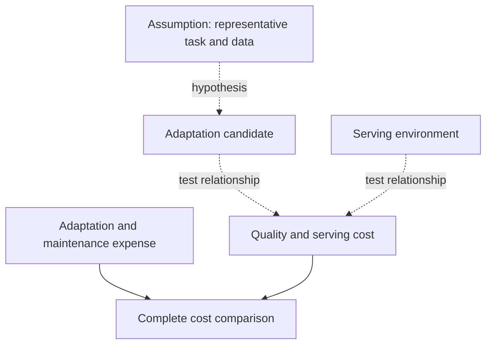
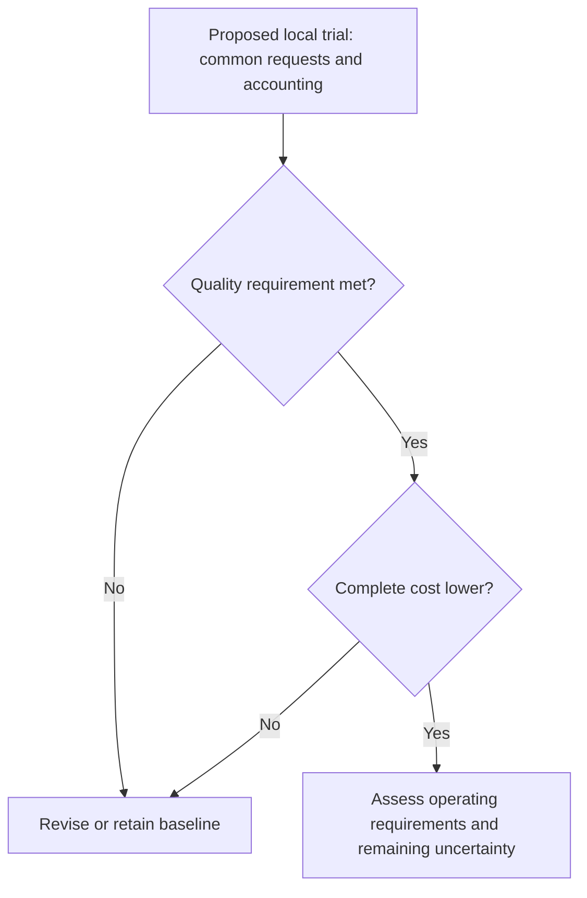

## Define the outcome before budgeting the savings

For teams choosing enterprise models, a cost reduction matters only if it buys the required business outcome. A cheaper model call does not establish a cheaper completed workflow. Under what conditions can a reported task-level saving become a defensible enterprise budget assumption?

In its October 2026 [financial report](https://blogs.nvidia.com/blog/european-financial-services-organizations-open-models-proprietary-intelligence/), NVIDIA says digital bank bunq's agentic assistant Finn now runs on open-weight models. Deployment on Nebius reportedly matches the quality of leading closed models at 60% of their cost per answer. That means approximately 40% lower reported answer cost, not a 60% saving.

NVIDIA's [retail report](https://blogs.nvidia.com/blog/european-retail-open-models-robotics/) says Shopify post-trained Nemotron 3.5 Lightning for the GraphQL subagent integrated into Sidekick. On Shopify's internal benchmark, the model reportedly surpassed a leading frontier model in accuracy, cut serving costs by 90%, and delivered responses 7x faster.

These disclosures cover different tasks and comparison boundaries. They cannot establish which architecture is more economical or predict another enterprise's overall budget reduction. Both come from NVIDIA, and the supplied evidence contains no independent verification. They identify comparisons worth testing, provided the task, quality requirement, and accounting boundary are explicit.

## Three savings claims with different denominators

A cost denominator identifies what an organization receives for the expenditure being measured. Here, the units are an answer, a subagent's serving activity, and an offline data pipeline. They cannot be substituted for one another or averaged into a common savings percentage.

| Organization and task | NVIDIA-reported result | Evidence boundary |
| :--- | :--- | :--- |
| [bunq: Finn answers](https://blogs.nvidia.com/blog/european-financial-services-organizations-open-models-proprietary-intelligence/) | Open-weight models deployed on Nebius; quality matching leading closed models at 60% of their cost per answer | Finn is described as running on open-weight models. Evaluation methods, named comparison models, traffic mix, and complete cost composition are not supplied. |
| [Shopify: GraphQL subagent](https://blogs.nvidia.com/blog/european-retail-open-models-robotics/) | Post-trained Nemotron 3.5 Lightning; higher accuracy than a leading frontier model, 90% lower serving costs, and responses 7x faster | Results are from Shopify's internal benchmark for this subagent. They do not establish total Sidekick costs or complete interaction latency. |
| [Stripe: Radar data pipelines](https://blogs.nvidia.com/blog/european-financial-services-organizations-open-models-proprietary-intelligence/) | NVIDIA GPU-accelerated Ray Data; pipelines 42x faster and 92% cost savings | Explicitly limited to offline testing. This does not establish production inference savings or online fraud-scoring latency. |

*Table 1: The reported work units differ; the rows are not a ranking.*

The [Stripe disclosure](https://blogs.nvidia.com/blog/european-financial-services-organizations-open-models-proprietary-intelligence/) illustrates the accounting problem: an offline pipeline improvement cannot establish a reduction in the cost of live customer answers. The [Shopify benchmark](https://blogs.nvidia.com/blog/european-retail-open-models-robotics/) likewise does not measure the operating expense of the whole assistant.

Even within one category, the comparison needs qualification. Which outputs count as acceptable answers? Which requests enter the calculation, and which resources enter the serving bill? The [financial](https://blogs.nvidia.com/blog/european-financial-services-organizations-open-models-proprietary-intelligence/) and [retail](https://blogs.nvidia.com/blog/european-retail-open-models-robotics/) excerpts do not provide enough detail to reconstruct the comparisons. For Shopify, the supplied material also omits benchmark samples, the accuracy definition, and the comparison model's version.

Missing detail limits what an outside reader can conclude; it does not demonstrate that an evaluation is invalid. Two pages from the same publisher do not provide independent cross-validation of the customer results.

## Why task specialization may lower serving costs

Shopify provides a concrete adaptation example. According to the [retail report](https://blogs.nvidia.com/blog/european-retail-open-models-robotics/), its engineers use Megatron Bridge for fine-tuning and NeMo RL for reinforcement learning. The post-trained Nemotron 3.5 Lightning model handles a GraphQL subtask that retrieves store data for several Sidekick features.

The same [report](https://blogs.nvidia.com/blog/european-retail-open-models-robotics/) separately says CCluster vLLM inference optimization helped Shopify achieve 4.5x faster performance and up to 12x lower inference cost across five additional use cases beyond Sidekick: catalog enrichment, merchant assistance, shopping simulation, taxonomy classification, and recommendations. The cost figure retains the source's wording, "up to 12x lower inference cost"; it does not mean a 12% reduction or a uniform result for every workload. These figures cannot be added to the GraphQL subagent's 90% reduction or treated as its measured explanation.

The mechanism remains a question: if a task has clear boundaries and adaptation data represent actual requests, can specialization reach the quality requirement with fewer serving resources? Can serving optimization improve that comparison after adaptation and maintenance expenses are included?

*Analytical relationships to test, not measured causal effects or an implementation timeline.*

The [retail excerpt](https://blogs.nvidia.com/blog/european-retail-open-models-robotics/) does not isolate the contributions of open weights, post-training, inference software, and hardware. It cannot tell another organization how much improvement would remain if it adopted only one component.

For procurement, compare the configuration the team can actually operate. A shared model or component name does not establish an identical implementation, workload, or delivered capability. The hypothesis concerns a complete configuration serving a defined task; the published percentage is not a saving guaranteed by the model name.

## Lower serving cost may not lower total cost

A narrow serving advantage could disappear when the organization accounts for successful task completion. Would adaptation, evaluation, maintenance, retries, fallback calls, or human review offset the initial saving? These are conditions to investigate, not problems demonstrated at bunq or Shopify.

Neither the [financial excerpt](https://blogs.nvidia.com/blog/european-financial-services-organizations-open-models-proprietary-intelligence/) nor the [retail excerpt](https://blogs.nvidia.com/blog/european-retail-open-models-robotics/) supplies a complete incremental cost account. The retail excerpt also does not establish how the internal benchmark covers difficult production requests. The absence of published detail does not prove poor production performance.

For a local comparison, define cost per accepted business task as follows:

<math xmlns="http://www.w3.org/1998/Math/MathML" display="block"><mrow><mi>C</mi><mo>=</mo><mfrac><mrow><mi>S</mi><mo>+</mo><mi>H</mi><mo>+</mo><mi>A</mi></mrow><mi>N</mi></mfrac></mrow></math>

Here, <math xmlns="http://www.w3.org/1998/Math/MathML"><mi>S</mi></math> is serving expenditure, <math xmlns="http://www.w3.org/1998/Math/MathML"><mi>H</mi></math> is necessary error-handling expenditure, and <math xmlns="http://www.w3.org/1998/Math/MathML"><mi>A</mi></math> is adaptation, evaluation, and maintenance allocated to the comparison period. <math xmlns="http://www.w3.org/1998/Math/MathML"><mi>N</mi></math> counts accepted completed tasks and must be positive. Define the categories without overlap and apply the same treatment to both configurations.

The denominator needs care. In this proposed accounting, a retry adds expenditure without automatically adding another accepted task. A fallback may complete a request that initially failed. Record the full route to the accepted outcome: calls are not business results, and initial failures are not necessarily final failures.

Quality and complete cost are separate decision criteria. The deployment hypothesis fails if the candidate misses the agreed quality requirement or its complete cost per accepted task is no lower than the baseline. It gains support if representative requests continue to meet that requirement and complete costs remain lower. The reports supply no universal break-even volume or payback period.

## Turn the cases into a local trial

The following framework is a recommendation for evaluating the disclosures. It is not a process attributed to NVIDIA or the customer organizations.

Begin with one identifiable work unit. For an assistant, define what constitutes a qualified answer within the chosen scope. For a retrieval component, define successful completion of the requested retrieval. Checking syntax alone cannot substitute for checking whether the result fulfills the business request. Agree on acceptance criteria before examining comparative results.

Compare existing and candidate configurations on the same representative requests under the same quality standard. Make difficult requests visible separately, so an aggregate score cannot settle the decision by itself. Where relevant, distinguish familiar requests from those affected by changing schemas or business requirements.

| Observation | What to record | Decision relevance |
| :--- | :--- | :--- |
| Accepted completion | Outputs meeting predefined business criteria, including difficult requests | Tests whether required quality is maintained. |
| Serving expenditure | Comparable charges at the observed workload | Tests the local serving advantage. |
| Retries and remediation | Additional calls, fallbacks, and human intervention through resolution | Completes the handling-cost account. |
| Adaptation and maintenance | Necessary engineering, training, evaluation, and updates | Includes expenditure outside initial serving. |
| Response latency | End-to-end behavior and its distribution | Tests the business requirement beyond component speed. |

*Table 2: Suggested local observations; set thresholds for the chosen business task.*

Use a common accounting period and workload assumption. Do not spread the candidate's fixed investment over optimistic future volume while assessing the baseline only at current traffic. Keep observed costs separate from projections. If adoption depends on future growth, state that dependency explicitly.

*Suggested decision sequence, not a reported customer deployment process.*

A positive result should remain specific: this configuration, for this task and workload, meets the required quality at the observed or explicitly projected cost. If evidence remains uncertain, extend the trial or retain the existing approach. Neither outcome requires treating a supplier's result as false. The trial determines whether that result supports the local deployment decision.

## What remains unknown about quality and lasting savings

The [bunq disclosure](https://blogs.nvidia.com/blog/european-financial-services-organizations-open-models-proprietary-intelligence/) and [Shopify disclosure](https://blogs.nvidia.com/blog/european-retail-open-models-robotics/) give teams reasons to test task-specific configurations. They do not establish lower total system costs, a general advantage for open-weight models, or savings reproducible elsewhere without evaluation.

Further evidence needs to answer several questions. Which real requests did the quality comparisons cover, and how were difficult cases assessed? Which necessary expenditures entered the reported unit costs? Do the results persist as traffic, models, schemas, and business requirements change?

Customer evaluation records, cost breakdowns, and continuing operational measurements would help answer those questions. The supplied excerpts do not resolve them. After a favorable initial trial, retain the quality and accounting boundaries when the system changes; otherwise, a later comparison could silently measure a different task.

A budget decision needs a statement that can be revisited: the accepted outcome, workload, comparison configuration, included costs, and remaining projections. Reported savings can guide the choice of trial. Deployment depends on what that trial establishes.

## References

1. NVIDIA Newsroom. [European Financial Institutions Embrace Open Models to Build Proprietary Intelligence | NVIDIA Blog](https://blogs.nvidia.com/blog/european-financial-services-organizations-open-models-proprietary-intelligence/).
2. NVIDIA Newsroom. [NVIDIA Transforms European Retail, From Digital Discovery to Physical Operations | NVIDIA Blog](https://blogs.nvidia.com/blog/european-retail-open-models-robotics/).
