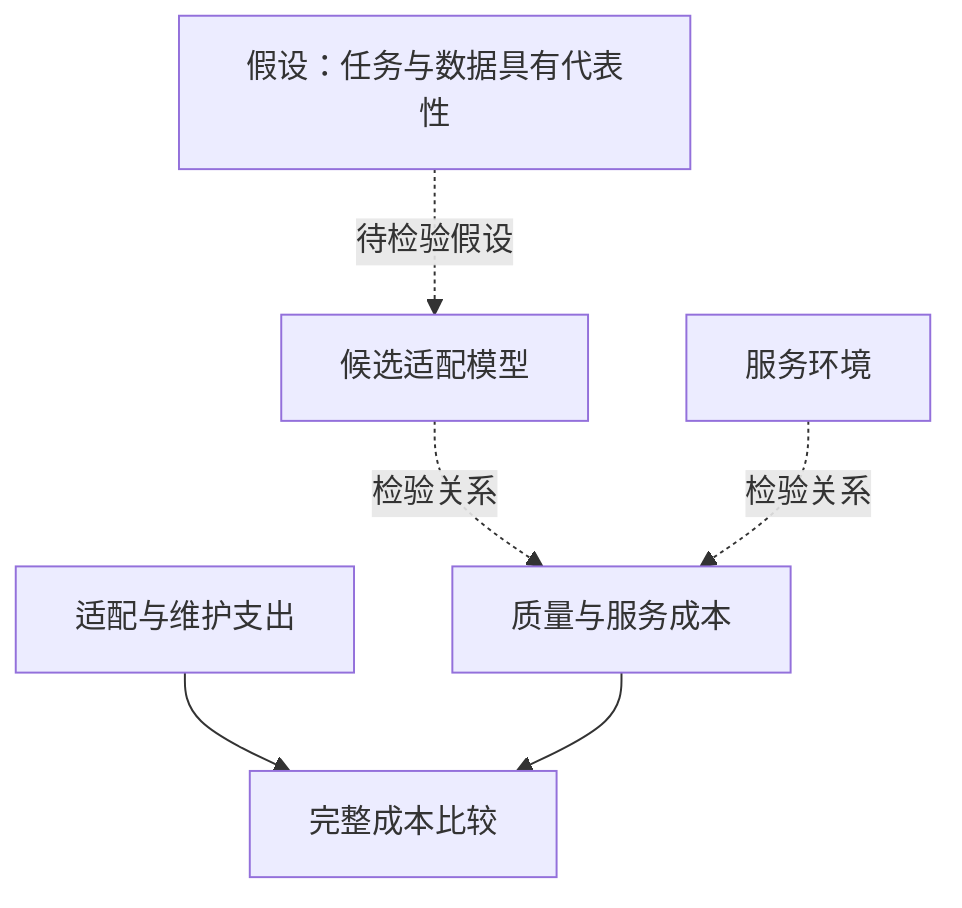
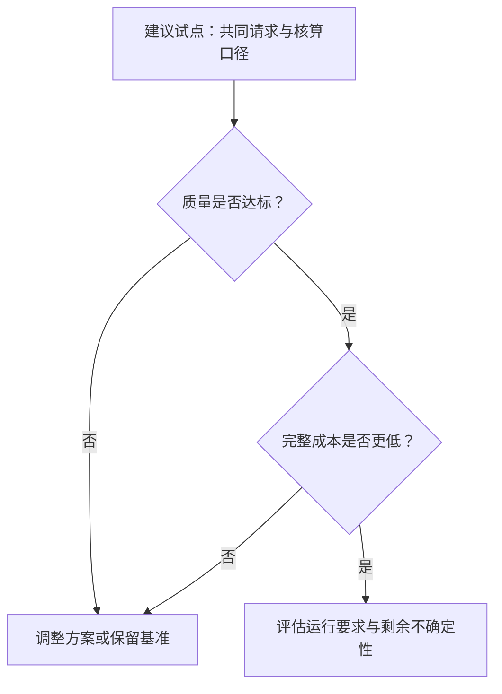

## 把降本比例写进预算前，先确定买到了什么

企业选择模型时，降本比例只有与合格业务结果对应，才有预算意义。单次调用便宜，不代表完整任务便宜。供应商报告的任务级节省，在什么条件下足以成为企业预算与部署的依据？

NVIDIA 的 2026 年 10 月[金融案例](https://blogs.nvidia.com/blog/european-financial-services-organizations-open-models-proprietary-intelligence/)称，数字银行 bunq 的智能助手 Finn 现已运行于开放权重模型；部署在 Nebius 上，在达到领先闭源模型相当质量的同时，每次回答成本为其 60%。这意味着所述回答成本约低 40%，并非节省 60%。

NVIDIA 的[零售案例](https://blogs.nvidia.com/blog/european-retail-open-models-robotics/)称，Shopify 为集成于 Sidekick 的 GraphQL 子智能体后训练 Nemotron 3.5 Lightning。在 Shopify 内部基准上，该模型准确率超过一款领先前沿模型，服务成本降低 90%，响应速度为比较对象的 7 倍。

这些数字对应不同任务与比较边界，不能据此判断哪种架构更经济，也不能推算其他企业整体预算的降幅。两篇都来自 NVIDIA，现有证据没有独立验证。它们可以帮助选择值得测试的配置，前提是明确任务、质量要求和核算口径。

## 三种节省，三个不同的分母

成本分母说明支出换来了什么。这里分别是一次回答、一个子智能体的服务活动，以及离线数据管线处理。三者不能互相替代，也不能跨任务平均节省比例。

| 机构与任务 | NVIDIA 披露的结果 | 证据边界 |
| :--- | :--- | :--- |
| [bunq：Finn 回答](https://blogs.nvidia.com/blog/european-financial-services-organizations-open-models-proprietary-intelligence/) | 开放权重模型部署于 Nebius；质量匹配领先闭源模型，每次回答成本为其 60% | Finn 被描述为已运行于开放权重模型；未提供评测方法、比较模型名称、请求结构及完整成本构成。 |
| [Shopify：GraphQL 子智能体](https://blogs.nvidia.com/blog/european-retail-open-models-robotics/) | 后训练 Nemotron 3.5 Lightning；准确率更高、服务成本降低 90%、响应速度为比较对象的 7 倍 | 限于该子智能体的内部基准；不能证明 Sidekick 总成本或完整交互延迟。 |
| [Stripe：Radar 数据管线](https://blogs.nvidia.com/blog/european-financial-services-organizations-open-models-proprietary-intelligence/) | NVIDIA GPU 加速 Ray Data；处理速度为比较对象的 42 倍、成本节省 92% | 明确属于离线测试，不能证明生产推理降本或在线反欺诈评分延迟。 |

*表 1：各行工作单元不同，不构成排名。*

[Stripe 的披露](https://blogs.nvidia.com/blog/european-financial-services-organizations-open-models-proprietary-intelligence/)说明了跨分母套用的问题：离线管线节省不能证明在线客户回答账单下降。[Shopify 子智能体基准](https://blogs.nvidia.com/blog/european-retail-open-models-robotics/)也没有衡量整个助手的运营成本。

即使比较同类任务，也要问清哪些输出算合格、哪些请求进入计算，以及费用包括哪些资源。现有[金融](https://blogs.nvidia.com/blog/european-financial-services-organizations-open-models-proprietary-intelligence/)与[零售](https://blogs.nvidia.com/blog/european-retail-open-models-robotics/)摘录不足以重建这些比较；Shopify 的基准样本、准确率定义及比较模型版本也未提供。

缺少细节限制了外部读者的判断，并不证明评测无效。同一发布者的两个页面，也不构成客户结果的独立交叉验证。

## 任务专门化为何可能降低服务成本

Shopify 提供了具体适配路径。[零售正文](https://blogs.nvidia.com/blog/european-retail-open-models-robotics/)称，其工程师使用 Megatron Bridge 微调、以 NeMo RL 开展强化学习；后训练的 Nemotron 3.5 Lightning 承担 GraphQL 子任务，为若干 Sidekick 功能检索店铺数据。

同一[正文](https://blogs.nvidia.com/blog/european-retail-open-models-robotics/)另称，CCluster vLLM 推理优化帮助 Shopify 在 Sidekick 之外的另外五种用例中，实现 4.5 倍性能与最高 12 倍的推理成本改善。这些用例是商品目录扩充、商家助手、购物模拟、类目分类及推荐。成本表述沿用来源的“up to 12x lower inference cost”，不是降低 12%，也不是每种用例都达到相同幅度。这些数字不能叠加到 GraphQL 子智能体的 90% 降幅上，或充当该降幅的实测解释。

机制仍待检验：如果任务边界清楚，适配资料覆盖真实请求，专门化能否以更少服务资源达到质量门槛？计入适配与维护后，运行优化能否继续改善完整成本？

*图示为待检验的分析关系，不是已测得的因果贡献，也不表示实施时间顺序。*

[零售摘录](https://blogs.nvidia.com/blog/european-retail-open-models-robotics/)没有分离开放权重、后训练、推理软件和硬件各自的贡献，无法说明只采用某个组件还能保留多少收益。

采购应比较本企业能够运行的完整配置。相同模型或组件名称，不足以证明实现、工作负载及交付能力相同。需要检验的是完整配置在特定任务上的表现，发布的百分比不是模型名称自带的保证。

## 服务成本更低，完整任务仍可能更贵

成功完成任务所需的其他支出，可能抵消局部服务优势。适配、评测、维护、重试、回退调用及人工复核是否会改变结果？这些是待检验条件，不能写成 bunq 或 Shopify 已发生的问题。

[金融摘录](https://blogs.nvidia.com/blog/european-financial-services-organizations-open-models-proprietary-intelligence/)与[零售摘录](https://blogs.nvidia.com/blog/european-retail-open-models-robotics/)都没有完整增量成本账；后者也没有说明内部基准如何覆盖困难生产请求。缺少公开细节同样不能证明生产质量差。

本地比较可以采用以下定义，计算每个合格完成任务的成本：

<math xmlns="http://www.w3.org/1998/Math/MathML" display="block"><mrow><mi>C</mi><mo>=</mo><mfrac><mrow><mi>S</mi><mo>+</mo><mi>H</mi><mo>+</mo><mi>A</mi></mrow><mi>N</mi></mfrac></mrow></math>

其中，<math xmlns="http://www.w3.org/1998/Math/MathML"><mi>S</mi></math> 是服务支出，<math xmlns="http://www.w3.org/1998/Math/MathML"><mi>H</mi></math> 是必要错误处理支出，<math xmlns="http://www.w3.org/1998/Math/MathML"><mi>A</mi></math> 是分摊至比较周期的适配、评测与维护支出；<math xmlns="http://www.w3.org/1998/Math/MathML"><mi>N</mi></math> 为合格完成任务数，必须大于零。各费用类别应避免重复计入，两种配置使用相同口径。

分母也要准确。在这套建议核算中，重试增加支出，却不自动增加一个合格完成任务；回退可能让初次失败的请求最终合格。应记录直到验收的完整路径，不能把调用次数当业务成果，也不能把初次失败全部当最终失败。

质量与完整成本是两项独立决策标准。若候选方案未达约定质量门槛，或每个合格任务完整成本不低于基准，部署收益假设便不成立。若代表性请求持续达标且完整成本更低，采用判断才得到加强。材料没有给出通用的回本业务量或回收期限。

## 把案例转成一次可判断的本地试点

以下是评估披露的建议框架，并非 NVIDIA 或案例企业已实行流程的说明。

先选定一个可辨认的工作单元。助手任务应定义范围内什么回答算合格；检索组件应检查请求是否正确完成，不能用语法有效替代业务正确。验收标准应在看到比较结果前确定。

让现行与候选配置处理相同的代表性请求，使用相同质量标准。困难请求应单独可见，避免仅凭汇总分数决定采用。必要时区分熟悉请求与受数据模式、业务要求变化影响的请求。

| 观察项 | 记录内容 | 决策用途 |
| :--- | :--- | :--- |
| 合格任务完成 | 包括困难请求在内的验收结果 | 检验所需质量是否保持。 |
| 服务支出 | 相同工作负载下的可比费用 | 检验本地服务优势。 |
| 重试与补救 | 直至解决的额外调用、回退及人工介入 | 补齐处理成本。 |
| 适配与维护 | 必要工程、训练、评测和更新投入 | 纳入初次服务之外的支出。 |
| 响应延迟 | 端到端表现及其分布 | 检验组件速度之外的业务要求。 |

*表 2：本地试点建议记录项；具体门槛由所选任务决定。*

核算应采用共同周期与业务量假设。不能按乐观未来流量摊薄候选方案固定投入，却只按当前流量评价基准。将实测成本与预测成本分开；若采用依赖未来增长，应明确写出这一条件。

*图示为建议决策顺序，不是客户部署过程的事实记录。*

正面结论也应保持具体：这一配置，在这一任务与业务量下，以实测或明确预测的成本达到所需质量。若证据仍不确定，可以继续测试或保留原方案。两种选择都不要求否定供应商结果；试点要判断的是，该结果能否支持本地部署。

## 仍需回答：质量能否保持，成本能否持续

[bunq 披露](https://blogs.nvidia.com/blog/european-financial-services-organizations-open-models-proprietary-intelligence/)与[Shopify 披露](https://blogs.nvidia.com/blog/european-retail-open-models-robotics/)提供了测试任务专用配置的理由，不能证明完整系统总成本下降、开放权重普遍占优，或其他企业无需评测便能复现。

后续证据需要回答：质量比较覆盖哪些真实请求，如何评估困难样本？单位成本包括哪些必要投入？当流量、模型、数据模式与业务要求变化时，结果能否保持？

客户原始评测、成本明细与持续运行记录有助于回答这些问题，现有摘录尚不足以解决。初次试点有利，也应在系统变化后保留质量与核算边界，否则后续比较可能已在测量另一种任务。

预算决策应留下可复查的说明：合格结果、业务量、比较配置、计入的费用及尚存的预测。披露的节省可用于选择试点，是否部署则取决于试点证据。

## 参考资料

1. NVIDIA Newsroom. [European Financial Institutions Embrace Open Models to Build Proprietary Intelligence | NVIDIA Blog](https://blogs.nvidia.com/blog/european-financial-services-organizations-open-models-proprietary-intelligence/).
2. NVIDIA Newsroom. [NVIDIA Transforms European Retail, From Digital Discovery to Physical Operations | NVIDIA Blog](https://blogs.nvidia.com/blog/european-retail-open-models-robotics/).
