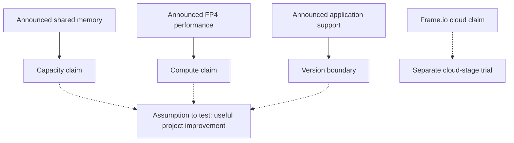
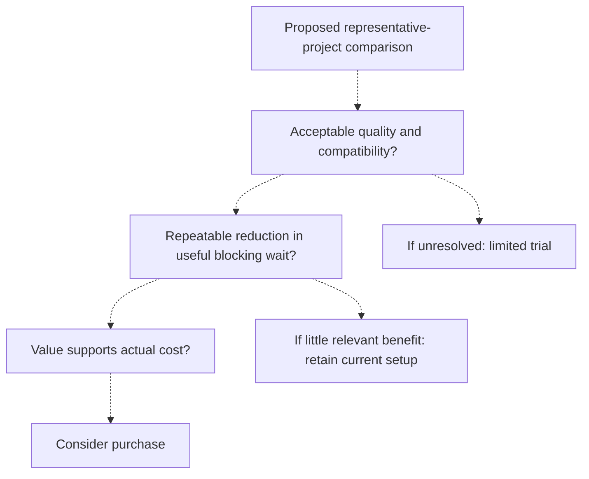

## Which part of your work should a $2,599 PC improve?

In its October 16, 2026 announcement, [NVIDIA said RTX Spark laptops were available from ASUS, Dell, HP, Lenovo, Microsoft and MSI, starting at $2,599](https://nvidianews.nvidia.com/news/nvidia-rtx-spark-pcs-available-today-a-new-beginning-for-windows-pcs). Prices and configurations vary by region. The previous day, an [Adobe and NVIDIA announcement described up to 2x faster AI processing, editing, color and effects in optimized creative applications](https://nvidianews.nvidia.com/news/adobe-and-nvidia-expand-collaboration-to-speed-agentic-creation). For someone whose computer still completes projects, these claims suggest tasks to investigate. They leave the value of replacement unproven.

Consider a creator moving between image compositing, video editing, 3D assets and local models. This is a hypothetical case for analysis, not a surveyed user or a completed hardware test. A project might involve direct editing, waiting for an effect, exporting in the background, uploading media and responding to review notes. Start by identifying which activity prevents useful progress.

A more responsive canvas could make adjustments easier. Shorter blocking calculations could let the next necessary action begin sooner. A background export might finish while another assignment continues, leaving the eventual handoff unchanged. Uploads or client approval might determine delivery. Record improvements in interaction, operation time and delivery separately, because each has a different value.

Price needs similar care. [NVIDIA lists a $2,599 starting price and up to 128GB of unified memory](https://nvidianews.nvidia.com/news/nvidia-rtx-spark-pcs-available-today-a-new-beginning-for-windows-pcs), without pricing a particular 128GB configuration. Combining the lowest advertised price with the highest capacity would create a purchase proposition the announcement does not establish. Use a regional quote for the configuration the assignment needs.

With the existing computer still able to complete projects, which repeated task would justify moving to RTX Spark? An answer needs the relevant software version, comparable output quality, a repeatable improvement and enough use to make that improvement valuable. A creator combining images, video and local models may reach different answers for tasks within the same project.

Before investigating more specifications, write a purchase hypothesis: could this configuration remove a recurring wait in a required operation without adding checking, rework or incompatibility? Describe the task closely enough to recognize a useful result. A demonstration of an unfamiliar feature may justify experimentation; its relevance to recurring work still needs explaining.

The current machine provides a practical reference, with known inconveniences and an established delivery path. Compare replacement with that working arrangement, including the time needed to adopt a new one.

## Four different claims to check

The evidence consists of two announcements on NVIDIA Newsroom: the [October 16 hardware launch](https://nvidianews.nvidia.com/news/nvidia-rtx-spark-pcs-available-today-a-new-beginning-for-windows-pcs) and the [October 15 Adobe collaboration announcement](https://nvidianews.nvidia.com/news/adobe-and-nvidia-expand-collaboration-to-speed-agentic-creation). Their details complement one another, but two URLs do not constitute independent performance verification. Hardware capability, application optimization, local agents and cloud processing need separate comparisons.

| Claim category | Publisher-reported capability or result | Stated scope or availability | Purchase question |
| :--- | :--- | :--- | :--- |
| Local hardware | Up to 128GB unified memory and up to 1 PFLOPS FP4 AI performance | [October 16 launch announcement](https://nvidianews.nvidia.com/news/nvidia-rtx-spark-pcs-available-today-a-new-beginning-for-windows-pcs); configurations vary | What does the required configuration cost, and can it complete the intended project? |
| Creative applications | Up to 2x faster AI processing, editing, color and effects across the named optimized applications | [Adobe collaboration claim](https://nvidianews.nvidia.com/news/adobe-and-nvidia-expand-collaboration-to-speed-agentic-creation); [Photoshop and Premiere launch beta support, Substance coming soon](https://nvidianews.nvidia.com/news/nvidia-rtx-spark-pcs-available-today-a-new-beginning-for-windows-pcs) | Does the actual application build support required functions at acceptable quality? |
| Local models and agents | Guided installation, Nemotron 3.5 Bolt 74B-A9B 24GB on supported configurations, and permission controls | [Capabilities described in the launch announcement](https://nvidianews.nvidia.com/news/nvidia-rtx-spark-pcs-available-today-a-new-beginning-for-windows-pcs) | Can useful work be completed, including alongside creative applications? |
| Frame.io cloud processing | Approximately 5x faster embedding generation, 4–5x improvement in P95 processing latency, approximately 80% smaller search proxy | [Early results from selected transcode and search workloads](https://nvidianews.nvidia.com/news/adobe-and-nvidia-expand-collaboration-to-speed-agentic-creation) | Does the relevant cloud stage improve this project, independently of a laptop purchase? |

The application row draws on both releases. The [October 15 announcement describes Photoshop, Premiere and Substance 3D optimization and the up-to-2x claim](https://nvidianews.nvidia.com/news/adobe-and-nvidia-expand-collaboration-to-speed-agentic-creation). The [October 16 announcement specifies native Photoshop and Premiere support through beta releases available at launch, with Substance coming soon](https://nvidianews.nvidia.com/news/nvidia-rtx-spark-pcs-available-today-a-new-beginning-for-windows-pcs). The broader performance statement does not change those availability limits.

Beta status calls for checking the intended production path; it does not establish that an application will fail. The required build must open the project, provide essential features and work with necessary plugins. Check whether adoption would disrupt a dependable delivery setup. Keep forthcoming support outside the current benefit calculation until the needed version and functions can be examined. The announcements describe availability without confirming the buyer’s downloads, regional supply or delivery.

Frame.io’s metrics measure different things. In the [early selected-workload results](https://nvidianews.nvidia.com/news/adobe-and-nvidia-expand-collaboration-to-speed-agentic-creation), embedding generation is a processing stage, P95 processing latency is the 95th-percentile processing latency, and search-proxy size concerns a particular representation. These results do not establish equivalent reductions in average project duration, all stored media or an individual account’s bill. The supplied measurements are insufficient to reconstruct a buyer’s expected result.

The computing location also matters. [Adobe and NVIDIA describe a cloud pipeline using NVDEC for hardware-accelerated decoding and TensorRT with CUDA for preprocessing and embedding generation](https://nvidianews.nvidia.com/news/adobe-and-nvidia-expand-collaboration-to-speed-agentic-creation). The announcement does not establish RTX Spark ownership as a prerequisite for those server-side gains. Account availability, service conditions and effects on the buyer’s library still need verification. A useful service improvement might leave the hardware purchase case unchanged.

For agents, [NVIDIA describes guided installers and permission controls through OpenShell and Microsoft Execution Containers](https://nvidianews.nvidia.com/news/nvidia-rtx-spark-pcs-available-today-a-new-beginning-for-windows-pcs). Installation, execution and successful work are separate observations. The release does not measure assignment accuracy or productive throughput. A trial should include the supervision and corrections needed to finish the intended assignment.

All four categories lack a comparison with the creator’s current machine. A maximum specification, selected performance result and availability statement answer different questions. They cannot be combined into an overall performance ranking. Each purchasing argument needs evidence suited to its claim.

## Capacity, compute and software solve different constraints

Identify the current limitation: whether the task fits, whether a relevant operation takes too long, or whether the software supports the required capability. A specification helps procurement when it addresses an observed problem. A creator whose project already fits faces a different question from one whose required assignment cannot run in the existing arrangement.

[NVIDIA describes a superchip combining a Blackwell RTX GPU and Grace CPU with up to 128GB of unified memory](https://nvidianews.nvidia.com/news/nvidia-rtx-spark-pcs-available-today-a-new-beginning-for-windows-pcs). The release identifies large creative projects and local models as uses, including [Nemotron 3.5 Bolt 74B-A9B 24GB, a 74-billion-parameter model available to supported RTX Spark configurations](https://nvidianews.nvidia.com/news/nvidia-rtx-spark-pcs-available-today-a-new-beginning-for-windows-pcs). Capacity is a reasonable trial subject when existing equipment cannot accommodate a required assignment.

Test the complete working set with the intended applications open. A model’s named footprint or an asset’s file size does not measure the resources needed by the whole running assignment. The announcements provide no budget for every combination. Record whether the task completes and foreground editing stays usable; headline capacity does not prove comfortable simultaneous use, available bandwidth or sustained performance.

Feasibility itself could support a purchase. If a necessary task becomes workable locally, a dramatic speed increase may be unnecessary. That case still needs a defined assignment, acceptable output and an explanation of why local completion matters to the buyer. If projects already fit and run acceptably, ask whether added capacity would serve ordinary recurring work or occasional experiments. Both can have value, with different implications for spending.

Compute needs a different measurement. [The launch release specifies up to 1 PFLOPS of FP4 AI performance](https://nvidianews.nvidia.com/news/nvidia-rtx-spark-pcs-available-today-a-new-beginning-for-windows-pcs). Retain FP4 whenever describing that figure. It supplies neither tokens per second nor time to first response or project completion. Measure the assignment’s outcome instead of converting peak compute into an experience claim.

Application details offer more specific trial candidates. [Adobe says Photoshop was rearchitected around GPU-accelerated compositing, naming the Remove Tool, on-canvas Gaussian Blur and Light Leaks; it also names Premiere’s Enhance Speech and Object Mask and heavy texturing steps in Substance 3D Painter](https://nvidianews.nvidia.com/news/adobe-and-nvidia-expand-collaboration-to-speed-agentic-creation). The announcement does not disclose the same separate speedup for each feature. Choose functions used regularly, retaining [Substance’s coming-soon status](https://nvidianews.nvidia.com/news/nvidia-rtx-spark-pcs-available-today-a-new-beginning-for-windows-pcs).

With the creator’s assets, check whether the supported application path improves the operation, preserves acceptable output and lets the rest of the project proceed without extra intervention. An announced optimization does not establish equal benefits for every filter, plugin or export stage. Follow the required operation through to a usable result, including any repair needed afterward.

A complete new setup may reasonably include a changed application version. Record what changes. Different builds can help establish which setup is preferable without isolating the hardware contribution. This matters when explaining whether replacement is necessary for the observed benefit or whether software changes contribute to it.

Solid arrows classify claims from the [hardware](https://nvidianews.nvidia.com/news/nvidia-rtx-spark-pcs-available-today-a-new-beginning-for-windows-pcs) and [Adobe](https://nvidianews.nvidia.com/news/adobe-and-nvidia-expand-collaboration-to-speed-agentic-creation) announcements. Dashed arrows indicate conditional evaluation relationships. The diagram shows concepts, not event order, measured causal effects or benefit sizes.

## How much does a faster step change the whole project?

A simplified time model identifies what needs measuring. Assume sequential work, unchanged output quality and no changes outside the accelerated operation. Baseline total time equals unaffected time plus time in the operation being accelerated:

<math xmlns="http://www.w3.org/1998/Math/MathML" display="block"><mrow><msub><mi>T</mi><mtext>total</mtext></msub><mo>=</mo><msub><mi>T</mi><mtext>unaffected</mtext></msub><mo>+</mo><msub><mi>T</mi><mtext>accelerated</mtext></msub></mrow></math>

If that operation achieves a measured speedup, the new time is:

<math xmlns="http://www.w3.org/1998/Math/MathML" display="block"><mrow><msub><mi>T</mi><mtext>new</mtext></msub><mo>=</mo><msub><mi>T</mi><mtext>unaffected</mtext></msub><mo>+</mo><mfrac><msub><mi>T</mi><mtext>accelerated</mtext></msub><msub><mi>S</mi><mtext>local</mtext></msub></mfrac></mrow></math>

Here, <math xmlns="http://www.w3.org/1998/Math/MathML"><msub><mi>S</mi><mtext>local</mtext></msub></math> is baseline operation time divided by measured new time. If <math xmlns="http://www.w3.org/1998/Math/MathML"><mi>p</mi></math> denotes that operation’s share of baseline time, overall speedup is:

<math xmlns="http://www.w3.org/1998/Math/MathML" display="block"><mrow><msub><mi>S</mi><mtext>overall</mtext></msub><mo>=</mo><mfrac><mn>1</mn><mrow><mo>(</mo><mn>1</mn><mo>−</mo><mi>p</mi><mo>)</mo><mo>+</mo><mfrac><mi>p</mi><msub><mi>S</mi><mtext>local</mtext></msub></mfrac></mrow></mfrac></mrow></math>

The time share lies between zero and one, and measured speedup must be positive. These equations are an analytical model, not RTX Spark results. The unaffected portion explains why a feature running twice as fast does not automatically halve project duration. [Adobe’s up-to-2x announcement](https://nvidianews.nvidia.com/news/adobe-and-nvidia-expand-collaboration-to-speed-agentic-creation) supplies neither the creator’s time share nor their achievable operation speedup. Without those inputs, a precise project estimate is unavailable.

A purchase becomes more plausible if a supported operation repeatedly blocks the next necessary action and the candidate completes it sooner at comparable quality. Establish how much of the completion path that operation occupies, then observe whether improvement advances delivery or removes valuable daytime waiting. A shorter stopwatch result leaves that final connection unresolved.

If most elapsed time belongs to selection, creative decisions, uploading or approval, faster local effects might barely change delivery. The gain can still improve responsiveness or convenience. Value it at that observed scope when deciding whether it supports the cost. A smoother interaction may matter even when a delivery date stays fixed; state that preference explicitly.

Background exports illustrate the distinction. An earlier finish may release useful computing capacity while another required assignment continues. The same export immediately before delivery could affect the handoff. Record both operation completion and the next useful action it enables. Machine minutes saved do not automatically become recovered labor hours, especially when the creator was already doing productive work during the calculation.

Parallel use falls outside the sequential model. [NVIDIA describes shared memory supporting demanding creative projects and local models simultaneously](https://nvidianews.nvidia.com/news/nvidia-rtx-spark-pcs-available-today-a-new-beginning-for-windows-pcs). The buyer’s particular model and timeline still need a combined-use trial. Keep isolated and simultaneous-use observations separate; the announcement does not measure that combination. Queueing and resource competition require their own records.

For Frame.io, observe whether earlier search readiness advances a search-dependent task. [The reported cloud work concerns decoding, preprocessing, embedding generation and selected transcode/search workloads](https://nvidianews.nvidia.com/news/adobe-and-nvidia-expand-collaboration-to-speed-agentic-creation). Separate upload readiness, cloud processing, discovery and local editing. Local up-to-2x and cloud approximately-5x claims cannot be added or multiplied into a project speedup, even when both stages appear in one assignment.

## Why the announcements do not yet justify an upgrade

[NVIDIA’s launch statement](https://nvidianews.nvidia.com/news/nvidia-rtx-spark-pcs-available-today-a-new-beginning-for-windows-pcs) and the [Adobe and NVIDIA collaboration statement](https://nvidianews.nvidia.com/news/adobe-and-nvidia-expand-collaboration-to-speed-agentic-creation) are supplier announcements, without independent comparisons against the reader’s equipment. They identify promising operations but do not establish a project-level return for replacement.

The [up-to-2x claim](https://nvidianews.nvidia.com/news/adobe-and-nvidia-expand-collaboration-to-speed-agentic-creation) lacks a complete disclosed comparison configuration, representative project collection, equivalent-output checks and repeated measurements. That limits calculation; it does not prove the claim false or predict an unfavorable independent test. The relevant performance difference remains to be measured.

A striking demonstration could emphasize an especially well-supported task. Software changes could also contribute to an observed improvement. If hardware and application versions change together, document both: the comparison may inform a choice between complete setups while isolating little about the chip itself. It remains useful purchasing evidence when the conclusion stays attached to the tested combination.

Availability creates a separate uncertainty. [NVIDIA states that many described products and features remain in various stages and will be offered on a “when-and-if-available basis,” with development, release and timing subject to change](https://nvidianews.nvidia.com/news/nvidia-rtx-spark-pcs-available-today-a-new-beginning-for-windows-pcs). This warrants caution when a purchase depends on future functions. It does not mean every announced capability is undelivered. Preserve the status of each relevant feature.

Set observation criteria that could reject the purchase hypothesis. It could fail if frequent tasks show no useful improvement at comparable quality, compatibility work or output correction consumes the saved time, the main wait lies elsewhere, or an initially good result does not recur under intended conditions. These are proposed criteria, not reported RTX Spark failures.

The judgment should change if representative work reliably preserves quality and repeatedly removes valuable blocking waits. That could justify the tested configuration without requiring equal gains across every application. Important recurring work must improve enough to support the actual cost and transition. Averaging unrelated features could obscure the task that matters most to this buyer.

A trial might support a narrower purchase case: one necessary local task becomes feasible while ordinary editing changes little. Evaluate its frequency and importance without extending the result to the entire workflow. Conversely, a useful gain in Frame.io’s cloud stage could support continued use of the existing computer. The announcements support a targeted trial; they leave both broad replacement recommendations and broad rejection unsupported.

## Make the purchase decision with one real project

Choose an archived project representing recurring work, retaining its inputs and accepted output. Define the useful assignment before selecting a benchmark. Include unaffected stages so the comparison reflects the setup the creator would actually use. A project chosen solely to showcase a newly announced feature may answer a narrower question than the purchase requires.

| Record | Comparison to make | Decision value |
| :--- | :--- | :--- |
| Configuration and software | Actual memory, application build and required plugins | Establishes what was tested and what would be purchased |
| Inputs and accepted output | Same assets, relevant settings and quality checks | Prevents unacceptable output from counting as a gain |
| Local operation and interaction | Operation duration, foreground response and blocking wait | Separates processing speed from usable time |
| Concurrent model work | Task quality, checking effort and creative-application usability | Tests the intended combination |
| Cloud stages | Upload, processing readiness and search-dependent work | Keeps service effects separate from hardware effects |
| Reliability and cost | Failures, rework, actual quote and relevant service charges | Connects the trial to the purchase decision |

This is a proposed method, not a completed test. Before timing, establish that the candidate opens the project, performs required functions and produces acceptable output. Repeat important operations under comparable conditions and retain individual observations. A single best result should not become the assumed everyday result. Note circumstances that change between runs so an unexplained difference does not become a confident purchasing claim.

For a local model, check completion of the intended metadata, summary or other assignment, including the checking and correction it requires. If the intended use includes editing simultaneously, test that combination. Faster isolated inference may have limited value once output correction and foreground usability are included. The endpoint is a usable assignment, with the creator’s participation accounted for.

Keep cloud observations separate. Earlier Frame.io readiness alongside an adequate existing computer would assign the gain to the appropriate stage. The [published early results](https://nvidianews.nvidia.com/news/adobe-and-nvidia-expand-collaboration-to-speed-agentic-creation) establish neither individual account availability nor charges or savings. Confirm those before entering them in the budget.

Use the buyer’s frequency and constraints to interpret economics. A recurring time reduction might support useful work, reduce overtime or create delivery flexibility. Do not automatically multiply processing minutes saved by a billing rate. Saved machine time, available labor time, additional revenue and cash saved are different outcomes. Count a financial benefit only when its mechanism can be explained.

Compare the required configuration quote and relevant transition expenses with continued use of existing equipment and services needed for the same assignment. Neither announcement supplies the reader’s workload, budget, electricity costs or recurring service charges. Neither establishes a universal payback period, minimum speedup or purchasing threshold. <u>The cost comparison must use the configuration that actually passed the project comparison.</u>

All arrows describe conditional decision relationships. The diagram proposes a reasoning path; it does not show that any branch has occurred. Comparable quality, repeatability and useful time connect the trial to procurement. Job titles cannot replace these observations: two editors or designers may face different constraints while using the same applications.

## What remains to be established?

The October 15 and 16, 2026 announcements provide enough detail about [local hardware, model support and launch software boundaries](https://nvidianews.nvidia.com/news/nvidia-rtx-spark-pcs-available-today-a-new-beginning-for-windows-pcs), alongside [application optimization and cloud media processing](https://nvidianews.nvidia.com/news/adobe-and-nvidia-expand-collaboration-to-speed-agentic-creation), to choose meaningful evaluation tasks. Their specifications and performance figures remain attributed publisher statements at those dates, without independent reproduction or a quote for the buyer’s chosen configuration.

The unanswered questions concern actual local price, reliable software support, quality during prolonged and simultaneous use, and whether faster processing releases time that matters to delivery. Independent project comparisons, production-version support information and sustained-use records could help. These are evidence to seek, not findings supplied here. Battery life and other untested conditions would remain unresolved even after a successful project comparison.

Match each observation to its purpose. A configuration quote establishes price, not performance. A support statement identifies an available software path, not output quality on the buyer’s assets. Later production builds could change the decision, but their suitability cannot be assumed now. Future support stays outside the calculation of present benefits, particularly when it concerns an essential task.

One successful project establishes something about that project and tested setup. It may justify repeating the comparison on another ordinary assignment, especially if assets or required functions differ. It does not establish equal gains throughout the creator’s workload. Further testing should resolve a meaningful purchasing uncertainty instead of merely accumulating favorable demonstrations.

Different tasks within one project may warrant different choices. A creator could retain cloud processing for library discovery, use a tested local model for a particular assignment and keep an existing editing setup until application support meets requirements. These are conditional options, not reported outcomes. A cloud improvement need not force a hardware decision, and a useful local task need not require moving every stage onto the new computer.

RTX Spark could earn its cost by making a necessary task feasible, improving a recurring blocking operation or enabling useful local work. The purchasing record should identify which weekly task the tested configuration reliably improves, how much unavoidable waiting it removes and what that improvement costs. Retain the checking, rework and software restrictions that qualify the result. Where compatibility or useful time remains unresolved, a limited trial preserves the option to buy later without counting a future improvement as a present return.

## References

1. NVIDIA Newsroom. [NVIDIA RTX Spark PCs Available Today :  A New Beginning for Windows PCs | NVIDIA Newsroom](https://nvidianews.nvidia.com/news/nvidia-rtx-spark-pcs-available-today-a-new-beginning-for-windows-pcs).
2. NVIDIA Newsroom. [Adobe and NVIDIA Expand Collaboration to Speed Agentic Creation | NVIDIA Newsroom](https://nvidianews.nvidia.com/news/adobe-and-nvidia-expand-collaboration-to-speed-agentic-creation).
