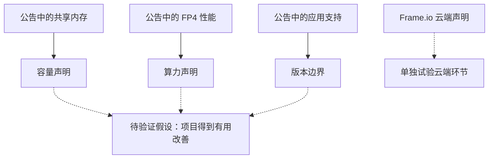
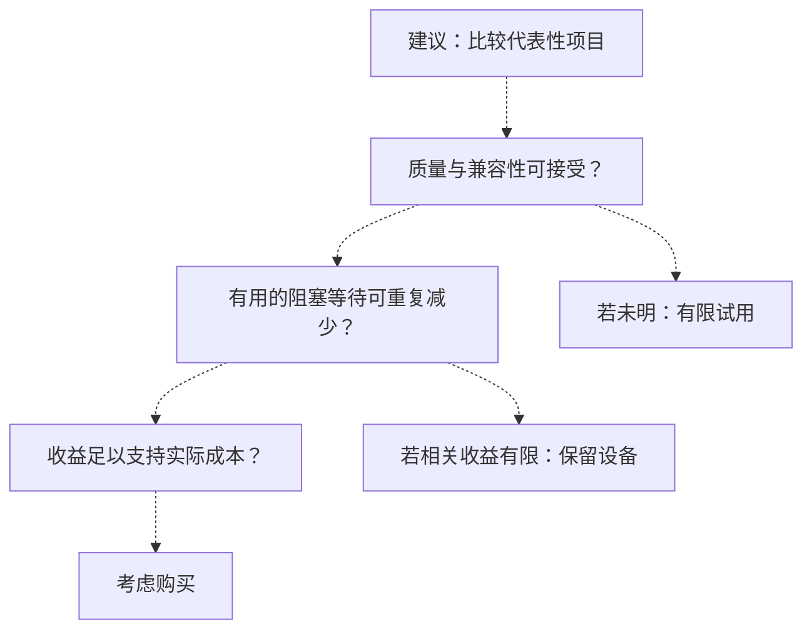

## 一台起价 2599 美元的电脑，要改善哪段工作？

2026 年 10 月 16 日，[NVIDIA 宣布 RTX Spark 笔记本由华硕、戴尔、惠普、联想、微软和微星推出，起价为 2599 美元](https://nvidianews.nvidia.com/news/nvidia-rtx-spark-pcs-available-today-a-new-beginning-for-windows-pcs)，价格与配置因地区而异。前一天，[Adobe 与 NVIDIA 的合作公告称，优化后的创意应用在 AI 处理、编辑、色彩与特效方面最高快 2 倍](https://nvidianews.nvidia.com/news/adobe-and-nvidia-expand-collaboration-to-speed-agentic-creation)。对于现有电脑仍能完成项目的人，这些声明指出了值得考察的任务，换机价值仍待证明。

以一位在图像合成、视频剪辑、三维资产和本地模型之间切换的创作者为例。这是分析用的假设案例，不是用户调查或已完成的硬件测试。他的项目可能包括直接编辑、等待特效计算、后台导出、上传素材和处理审阅意见。采购首先要找出：哪项活动阻止了有用工作的继续？

画布响应改善，可能使调整更顺手；阻塞计算缩短，可能让下一步提前开始。后台导出也可能在另一项必需工作进行时结束，最终交付时间并未改变。上传或客户审批则可能决定交付。交互体验、操作耗时和交付时间各有价值，应分别记录，不能相互代替。

价格也要按实际配置判断。[NVIDIA 公布了 2599 美元起价和最高 128GB 统一内存](https://nvidianews.nvidia.com/news/nvidia-rtx-spark-pcs-available-today-a-new-beginning-for-windows-pcs)，却没有给出某个 128GB 配置的确定售价。最低价格与最高容量不能拼成公告已经证实的购买方案。预算应采用目标任务所需配置在买家所在地的真实报价。

现有电脑仍能完成项目时，哪项重复工作足以支持迁到 RTX Spark？答案需要对应的软件版本、相当的输出质量、可重复的改善，以及使改善有价值的使用频率。对同时处理图像、视频和本地模型的人，同一项目内的不同任务也可能得到不同答案。

在继续查看规格前，可以先写下购买假设：这个配置能否减少某项必需操作的反复等待，同时不增加核对、返工或兼容性负担？把任务写具体，才能识别值得投入的结果。精彩演示可以引发实验兴趣，它与重复工作的关系仍需要说明。

现有电脑提供了现实参照：它能完成一组已知工作，有熟悉的不便，也有已经建立的交付路径。比较换机方案时，应把这套安排和适应新方案所需的时间一起计入。

## 四类声明，需要分别检查

本文依据两份刊登于 NVIDIA Newsroom 的公告：[10 月 16 日硬件上市稿](https://nvidianews.nvidia.com/news/nvidia-rtx-spark-pcs-available-today-a-new-beginning-for-windows-pcs)和[10 月 15 日 Adobe 合作稿](https://nvidianews.nvidia.com/news/adobe-and-nvidia-expand-collaboration-to-speed-agentic-creation)。细节可以互补，但两个 URL 不构成独立性能验证。硬件能力、应用优化、本地智能体与云端处理，需要各自的比较。

| 声明类别 | 发布方报告的能力或结果 | 状态与适用范围 | 采购前的问题 |
| :--- | :--- | :--- | :--- |
| 本地硬件 | 最高 128GB 统一内存、最高 1 PFLOPS FP4 AI 性能 | [10 月 16 日上市公告](https://nvidianews.nvidia.com/news/nvidia-rtx-spark-pcs-available-today-a-new-beginning-for-windows-pcs)，配置存在差异 | 所需配置多少钱，能否完成目标工程？ |
| 创意应用 | 所列优化应用在 AI 处理、编辑、色彩和特效方面最高快 2 倍 | [合作公告的性能声明](https://nvidianews.nvidia.com/news/adobe-and-nvidia-expand-collaboration-to-speed-agentic-creation)；[Photoshop、Premiere 首发 Beta，Substance 即将推出](https://nvidianews.nvidia.com/news/nvidia-rtx-spark-pcs-available-today-a-new-beginning-for-windows-pcs) | 实际版本是否支持必需功能，并保持合格质量？ |
| 本地模型与智能体 | 引导式安装、受支持配置上的 Nemotron 3.5 Bolt 74B-A9B 24GB，以及权限控制 | [上市公告所述能力](https://nvidianews.nvidia.com/news/nvidia-rtx-spark-pcs-available-today-a-new-beginning-for-windows-pcs) | 能否完成有用任务，与创意软件并用时表现如何？ |
| Frame.io 云端 | 嵌入生成约快 5 倍、P95 处理延迟改善 4 至 5 倍、搜索代理约小 80% | [选定转码与搜索工作负载的早期结果](https://nvidianews.nvidia.com/news/adobe-and-nvidia-expand-collaboration-to-speed-agentic-creation) | 云端环节是否帮助项目，这与购买电脑有何关系？ |

应用一栏需要结合两篇正文。[10 月 15 日公告描述 Photoshop、Premiere、Substance 3D 优化与最高两倍声明](https://nvidianews.nvidia.com/news/adobe-and-nvidia-expand-collaboration-to-speed-agentic-creation)；[10 月 16 日公告明确，Photoshop 和 Premiere 通过首发可用的 Beta 版本提供原生支持，Substance 即将推出](https://nvidianews.nvidia.com/news/nvidia-rtx-spark-pcs-available-today-a-new-beginning-for-windows-pcs)。较宽泛的性能描述没有改变这些可用性限制。

Beta 状态要求检查生产路径，并不证明软件一定失败。实际版本需要能够打开工程、提供必需功能，并与所需插件配合。还要检查采用它是否会打乱可靠的交付方案。尚未提供的支持，必须等到所需版本和功能可以核查后，才能考虑计入当前收益。公告所述状态不能代替下载、地区供应或交付确认。

Frame.io 的三项指标各有对象。[选定工作负载的早期结果](https://nvidianews.nvidia.com/news/adobe-and-nvidia-expand-collaboration-to-speed-agentic-creation)中，嵌入生成属于处理阶段；P95 处理延迟指处理延迟的第 95 百分位；搜索代理体积针对一种特定表示。它们不能证明平均项目耗时、全部存储素材或个人账单按相同比例下降。底层测量也不足以让买家重建自己的预期结果。

计算位置影响采购含义。[Adobe 与 NVIDIA 描述的云端流水线使用 NVDEC 进行硬件加速解码，以 TensorRT 和 CUDA 进行预处理及嵌入生成](https://nvidianews.nvidia.com/news/adobe-and-nvidia-expand-collaboration-to-speed-agentic-creation)。公告没有建立购买 RTX Spark 是获得服务端收益的必要条件。账号能否使用、适用什么服务条件、买家的素材库是否受益，仍需验证。服务改善可以有用，也可能不改变换机理由。

智能体则要分别观察安装、运行和完成工作。[NVIDIA 描述了引导式安装，以及 OpenShell 和 Microsoft Execution Containers 提供的权限控制](https://nvidianews.nvidia.com/news/nvidia-rtx-spark-pcs-available-today-a-new-beginning-for-windows-pcs)。公告没有测量任务准确率或有效产出。试用应包含完成指定任务所需的监督，以及核对和修正结果的工作。

四类声明共同缺少与现有电脑对应的基线。规格上限、选定性能结果和可用性说明回答不同问题，不能合成整体性能排名。每项采购理由都需要与其声明相称的证据。

## 容量、算力和软件支持，分别解决什么限制？

先找出现有设备的问题：任务放不下，相关操作耗时过长，还是软件没有所需路径？规格对应到已观察到的限制，才能帮助采购。工程本来就放得下的人，与必需任务无法运行的人，面临的判断并不相同。

[NVIDIA 称 RTX Spark 超级芯片结合 Blackwell RTX GPU 与 Grace CPU，提供最高 128GB 统一内存](https://nvidianews.nvidia.com/news/nvidia-rtx-spark-pcs-available-today-a-new-beginning-for-windows-pcs)。公告将大型创意工程和本地模型列为用途，包括[受支持配置上的 Nemotron 3.5 Bolt 74B-A9B 24GB，这是一款 740 亿参数模型](https://nvidianews.nvidia.com/news/nvidia-rtx-spark-pcs-available-today-a-new-beginning-for-windows-pcs)。如果现有设备无法容纳必需任务，容量值得成为试用重点。

测试应包含实际工作集和准备同时打开的应用。模型名称中的容量或资产文件大小，不等于整个运行任务的资源需求。公告没有为每种组合提供预算。记录任务是否完成、前台编辑是否仍可用，不能从标称容量推导并用顺畅、可用带宽或持续性能。

可行性本身也可能支持购买。一个必需任务能够在本地完成，即使没有显著提速，也可能值得投入。但仍要明确任务、合格输出，以及本地完成为何对买家有用。如果工程本来就放得下、运行也正常，则要问新增容量服务于普通重复工作，还是偶尔实验。两者都可能有价值，对应的支出理由有所不同。

算力需要另一种测量。[上市稿给出的最高 1 PFLOPS AI 性能带有 FP4 精度限定](https://nvidianews.nvidia.com/news/nvidia-rtx-spark-pcs-available-today-a-new-beginning-for-windows-pcs)，描述时必须保留 FP4。该数字没有提供每秒词元数、首次响应时间或项目完成时间。应测量任务需要的实际结果，不能把峰值计算指标直接改写成体验结论。

应用功能提供了更具体的试用对象。[Adobe 称 Photoshop 围绕 GPU 加速合成进行了重构，列举 Remove Tool、画布上的 Gaussian Blur 和 Light Leaks；Premiere 列举 Enhance Speech 与 Object Mask，Substance 3D Painter 则涉及较重的纹理处理步骤](https://nvidianews.nvidia.com/news/adobe-and-nvidia-expand-collaboration-to-speed-agentic-creation)。正文没有逐项披露这些功能获得相同的独立提速。选择日常确实使用的功能，并保留[Substance 支持即将推出的状态](https://nvidianews.nvidia.com/news/nvidia-rtx-spark-pcs-available-today-a-new-beginning-for-windows-pcs)。

在真实素材上，受支持的软件路径能否改善操作、保持合格输出，并让后续流程无需额外干预？一项优化不能证明所有滤镜、插件和导出阶段都同幅改善。观察应一直跟到可用结果，并包含事后修补。

比较完整新方案时，可以纳入应用版本变化，但要记录改变了什么。不同版本的结果能够帮助选择整套方案，未必能隔离硬件贡献。这关系到收益是否必须通过换机获得，或其中还有软件变化的作用。

实线归类[硬件](https://nvidianews.nvidia.com/news/nvidia-rtx-spark-pcs-available-today-a-new-beginning-for-windows-pcs)与[Adobe](https://nvidianews.nvidia.com/news/adobe-and-nvidia-expand-collaboration-to-speed-agentic-creation)公告中的声明，虚线表示有条件的评估关系。该图展示概念，不表示事件顺序、已测得的因果效果或收益大小。

## 局部更快，整项交付能改变多少？

简化时间模型可以指出需要测量什么。假设工作顺序执行、输出质量不变，且受加速操作之外的条件不变。基准总耗时等于未受影响的耗时，加上待加速操作的耗时：

<math xmlns="http://www.w3.org/1998/Math/MathML" display="block"><mrow><msub><mi>T</mi><mtext>total</mtext></msub><mo>=</mo><msub><mi>T</mi><mtext>unaffected</mtext></msub><mo>+</mo><msub><mi>T</mi><mtext>accelerated</mtext></msub></mrow></math>

如果该操作获得实测提速，新耗时为：

<math xmlns="http://www.w3.org/1998/Math/MathML" display="block"><mrow><msub><mi>T</mi><mtext>new</mtext></msub><mo>=</mo><msub><mi>T</mi><mtext>unaffected</mtext></msub><mo>+</mo><mfrac><msub><mi>T</mi><mtext>accelerated</mtext></msub><msub><mi>S</mi><mtext>local</mtext></msub></mfrac></mrow></math>

其中，<math xmlns="http://www.w3.org/1998/Math/MathML"><msub><mi>S</mi><mtext>local</mtext></msub></math> 是该操作基准耗时与实测新耗时之比。以 <math xmlns="http://www.w3.org/1998/Math/MathML"><mi>p</mi></math> 表示该操作占基准总耗时的比例，整体提速为：

<math xmlns="http://www.w3.org/1998/Math/MathML" display="block"><mrow><msub><mi>S</mi><mtext>overall</mtext></msub><mo>=</mo><mfrac><mn>1</mn><mrow><mo>(</mo><mn>1</mn><mo>−</mo><mi>p</mi><mo>)</mo><mo>+</mo><mfrac><mi>p</mi><msub><mi>S</mi><mtext>local</mtext></msub></mfrac></mrow></mfrac></mrow></math>

时间占比介于零与一之间，实测提速倍数必须为正。这些公式是分析模型，不是 RTX Spark 实测。未受影响的部分解释了为何单项功能快两倍，不会自动使项目耗时减半。[Adobe 的最高两倍公告](https://nvidianews.nvidia.com/news/adobe-and-nvidia-expand-collaboration-to-speed-agentic-creation)没有给出读者的时间占比或任务可实现的提速。缺少这些输入，就无法得到精确项目估计。

如果一项受支持操作反复阻塞下一步，候选配置又能以相当质量更早完成，购买理由就可能增强。还需测量它占完成路径的多少，再观察改善是否提前交付或减少有价值的白天等待。单凭秒表结果，仍无法确认最后这层联系。

若主要时间用于素材选择、创意判断、上传或审批，本地特效更快可能很少改变交付。响应和便利性仍可能改善，但应按观察到的范围估值，再判断是否足以承担成本。交付日期不变时，更顺畅的操作也可能对买家有意义，应明确说明这一偏好。

后台导出能说明两者的区别。提前结束可能释放设备容量，同时另一项必需工作仍在继续；同一导出若紧接交付，则可能改变交接时间。记录操作何时结束，也记录它何时让下一项有用行动成为可能。节省机器分钟不能自动算成收回人工小时，尤其当创作者原本就在计算期间处理其他工作。

并行使用超出了顺序模型的假设。[NVIDIA 描述共享内存可支持高要求创意工程与本地模型同时运行](https://nvidianews.nvidia.com/news/nvidia-rtx-spark-pcs-available-today-a-new-beginning-for-windows-pcs)，但买家自己的模型和时间轴仍需组合测试。单独运行与同时使用要分别记录，公告没有测量这一具体组合。排队和资源竞争也需要独立观察。

Frame.io 应观察更早可检索是否推进了依赖搜索的任务。[公告所述云端工作涉及解码、预处理、嵌入生成和选定转码、搜索工作负载](https://nvidianews.nvidia.com/news/adobe-and-nvidia-expand-collaboration-to-speed-agentic-creation)。上传就绪、云端处理、检索和本地编辑应分开。本地最高两倍与云端约五倍不能相加或相乘，成为整项工程提速，即使它们出现在同一项目中。

## 为什么公告还不足以支持换机？

[NVIDIA 上市稿](https://nvidianews.nvidia.com/news/nvidia-rtx-spark-pcs-available-today-a-new-beginning-for-windows-pcs)和[Adobe、NVIDIA 合作稿](https://nvidianews.nvidia.com/news/adobe-and-nvidia-expand-collaboration-to-speed-agentic-creation)都是供应方公告，没有针对读者设备的独立比较。它们指出有希望的操作，尚未建立替换正常电脑的项目级回报。

[最高两倍声明](https://nvidianews.nvidia.com/news/adobe-and-nvidia-expand-collaboration-to-speed-agentic-creation)缺少完整披露的比较配置、代表性工程集合、等质量检查和重复测量。这限制了计算，不能据此证明声明虚假，也不能预测独立测试会不利。与读者有关的性能差异仍待测量。

精彩演示可能选择支持特别好的任务，软件变化也可能贡献改善。硬件和应用版本一起改变时，应把两者都记下来：比较可以帮助选择完整方案，对芯片本身贡献的隔离却可能有限。只要结论对应测试过的组合，这仍然是有用的采购证据。

可用性还有独立的不确定性。[NVIDIA 称许多产品与功能仍处于不同阶段，将按“when-and-if-available basis”提供，开发、发布与时间安排可能变化](https://nvidianews.nvidia.com/news/nvidia-rtx-spark-pcs-available-today-a-new-beginning-for-windows-pcs)。如果采购依赖未来功能，就应谨慎。这不意味着所有已宣布能力均未交付，每项相关功能都必须保留其具体状态。

提前设定可能否定购买假设的观察标准：高频任务在相当质量下没有实用改善；兼容性处理或输出修正耗尽节省；主要等待位于别处；最初的好结果无法在预期条件下重复。这些是建议标准，不是已经报告的 RTX Spark 失败。

若代表性工作可靠保持质量，并反复减少有价值的阻塞等待，判断也应随之改变。这可能支持购买测试过的配置，无需要求所有应用等幅改善。重要重复工作的收益必须足以支持实际成本和迁移负担。将不相关功能平均起来，反而可能掩盖买家最在乎的任务。

试用也可能只支持较窄用途：一项必需本地任务变得可行，普通编辑变化不大。可以按该任务的频率与重要性估值，不能扩大为整个工作流改善。反过来，若有用收益集中在 Frame.io 云端，也可能支持继续使用现有电脑。现有公告适合支持有针对性的试用，尚不足以支持普遍换机或普遍拒绝。

## 用一个真实项目作采购比较

选择能代表重复工作的归档项目，保留输入和已验收输出。先定义有用任务，再选择计时对象。纳入未获加速的环节，比较才反映创作者实际会采用的方案。仅为展示新功能而选择的项目，可能回答不了采购需要解决的完整问题。

| 记录对象 | 比较内容 | 判断用途 |
| :--- | :--- | :--- |
| 配置与软件 | 实际内存、应用版本、必需插件 | 明确测试对象与购买对象 |
| 输入与合格输出 | 相同素材、相关设置、质量检查 | 避免把不可接受的输出算作收益 |
| 本地操作与交互 | 操作耗时、前台响应、阻塞等待 | 区分处理速度与可利用时间 |
| 模型并用 | 任务质量、核对负担、创意软件可用性 | 检查真实工作组合 |
| 云端环节 | 上传、处理就绪、依赖检索的工作 | 区分服务效果与硬件效果 |
| 可靠性与成本 | 失败、返工、报价、相关服务费 | 连接试用与采购判断 |

这是建议方法，不是已完成的测试。计时前先确认候选方案能打开工程、执行必需功能并产生合格输出。在相近条件下重复重要操作，保留单次记录。一次最佳结果不能成为日常表现的默认预期。记录各次运行间改变的条件，避免把原因不明的差异写成确定收益。

本地模型应检查是否完成预定的元数据、摘要或其他任务，并计入核对和修改。若计划一边使用模型一边编辑，就测试这一组合。加入输出修正和前台可用性后，孤立推理更快的价值可能有限。终点应是可用任务成果，也要把创作者的参与算进去。

云端观察单独保存。Frame.io 更早就绪、现有电脑仍然够用，能把收益归到正确环节。[公布的早期结果](https://nvidianews.nvidia.com/news/adobe-and-nvidia-expand-collaboration-to-speed-agentic-creation)没有建立个人账号可用性、费用或节省，进入预算前必须分别确认。

经济判断采用买家自己的频率和约束。反复减少耗时，可能支持有用工作、减少加班或增加交付余量，但不能直接把每一分钟处理时间乘以收费标准。机器时间节省、可用工时增加、收入增加和现金支出减少，是不同结果。只有能够解释财务收益如何产生，才应计入。

用所需配置的真实报价和相关迁移费用，与继续使用现有设备及同一任务所需服务比较。两份公告没有读者的工作量、预算、电费或经常性服务费用，无法建立统一回本期限、最低提速或采购门槛。<u>成本比较必须采用实际通过项目比较的配置。</u>

箭头表示有条件的决策关系，是建议思路，不证明任何分支已经发生。质量相当、结果可重复、时间确实有用，才能连接试用与采购。职业名称不能代替观察，同为剪辑师或设计师，即使使用相同软件，也可能面对不同限制。

## 还有哪些问题需要证据？

2026 年 10 月 15 日和 16 日的公告，提供了[本地硬件、模型支持、首发软件边界](https://nvidianews.nvidia.com/news/nvidia-rtx-spark-pcs-available-today-a-new-beginning-for-windows-pcs)，以及[应用优化和云端媒体处理](https://nvidianews.nvidia.com/news/adobe-and-nvidia-expand-collaboration-to-speed-agentic-creation)的具体信息，足以选择有意义的评估任务。规格与性能数字仍是对应日期的发布方声明，没有独立复现，也不是买家所选配置的报价。

未决问题包括本地实际价格、软件组合是否可靠、长时间和同时使用时质量能否保持，以及更快处理是否释放影响交付的时间。独立项目比较、正式版本支持说明和持续使用记录可以帮助回答。这些是后续应寻找的证据，并非已有结果。即使项目比较成功，续航和其他未测条件也仍未解决。

不同观察各有用途。配置报价解决价格，不能证明性能；支持说明确定可用软件路径，不能证明买家素材上的输出质量。后续正式版本可能改变决定，但目前不能预设适用性，也不能把未来支持计入当前收益，尤其当它涉及必需任务时。

一个成功项目说明了该项目和测试组合的情况。如果其他普通任务的素材或必需功能不同，可以再选一个项目核查。成功记录不能证明全部工作同幅改善。追加比较应解决影响购买的具体疑问，而不只是累积有利演示。

同一项目的不同任务可能适合不同方案：继续使用云端素材检索，为特定任务采用经过测试的本地模型，等应用支持满足要求后再改变编辑方案。这些是有条件的选择，不是已报告的结果。云端改善未必要求换机，有用的本地任务也未必要求把所有环节迁到新电脑。

RTX Spark 可以通过让必需任务变得可行、改善反复阻塞的操作，或支持有用的本地工作来证明价值。采购记录应说明，这个配置可靠改善了哪项每周重复的任务、减少多少无法并行处理的等待，以及实际成本。同时保留核对、返工和软件限制对结果的影响。兼容性或有用时间尚无答案时，有限试用保留以后购买的选择，也避免把未来改善当成当前回报。

## 参考资料

1. NVIDIA Newsroom. [NVIDIA RTX Spark PCs Available Today :  A New Beginning for Windows PCs | NVIDIA Newsroom](https://nvidianews.nvidia.com/news/nvidia-rtx-spark-pcs-available-today-a-new-beginning-for-windows-pcs).
2. NVIDIA Newsroom. [Adobe and NVIDIA Expand Collaboration to Speed Agentic Creation | NVIDIA Newsroom](https://nvidianews.nvidia.com/news/adobe-and-nvidia-expand-collaboration-to-speed-agentic-creation).
