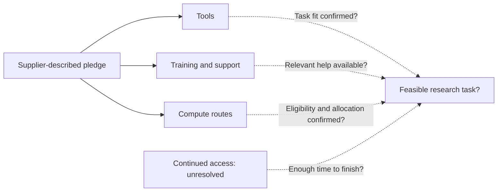

## What a team needs before research can begin

For a small research team, a new supercomputer becomes relevant when it can support a particular investigation. Before including it in a project plan, the team needs to know whether it is eligible, whether its software will run, how to prepare its data and whether access will last long enough to finish. How should small laboratories and research startups judge whether open courses, open models and shared computing lower the barriers to completing research? Machine size answers only part of that question.

[NVIDIA's European scientific computing announcement](https://blogs.nvidia.com/blog/ec-scientific-computing-pledge/) identifies assembling tools, finding compute and developing expertise as difficulties that can precede scientific work, especially for smaller laboratories, early-career scientists and science-based startups. This supplier account gives reasons to examine those barriers separately. It is not a representative survey: it establishes neither how frequently each difficulty occurs nor which constraint matters most for a particular team.

According to [the same announcement](https://blogs.nvidia.com/blog/ec-scientific-computing-pledge/), the European Commission launched the AI in Science Enablers Initiative at the AI in Science Summit in Dublin, connected to RAISE, the Resource for AI Science in Europe. NVIDIA describes its participation through tools, computing resources, training, technical support and collaborative projects. These are its descriptions of the framework and its commitments; the Commission's original policy documents have not been independently examined here.

The evidence consists of local cached copies of that article and [NVIDIA's Nordic technology ecosystem article](https://blogs.nvidia.com/blog/nordics-technology-ecosystem/), both retrieved on October 15, 2026. The Nordic page displays October 14, 2026 internally, while its supplied source metadata gives October 15. Retrieval dates identify when the snapshots were obtained, not a common announcement date for every project. Both articles come from NVIDIA, so overlapping descriptions add context without providing independent corroboration.

These materials support a resource map and questions for prospective users. They leave individual allocation prospects and typical research outcomes unresolved. A resource being described, an organization gaining permission to use it, a task running successfully and a result meeting its scientific purpose are four separate steps. Each needs its own evidence.

A team can still identify a relevant channel, request its actual terms and test a limited workflow before comprehensive evaluation exists. The scale of its commitment should follow what that exercise establishes. Missing outcome data narrows the judgment available; it does not establish that a channel is useful or ineffective.

## Separate the resources within the pledge

The European announcement groups several forms of assistance together. Prospective applicants should separate them by what they deliver, whom they address and which conditions remain unanswered. In [NVIDIA's account](https://blogs.nvidia.com/blog/ec-scientific-computing-pledge/), open course materials, model assets and computing access for open research have different arrangements. The conditions attached to one do not automatically apply to another.

For education, [NVIDIA says its Deep Learning Institute has launched an open-source courseware hub](https://blogs.nvidia.com/blog/ec-scientific-computing-pledge/) with hands-on accelerated computing and deep learning materials. It describes them as freely downloadable and openly licensed, with no enrollment, fees or deadline. Their modular design allows adaptation for university curricula, supercomputing bootcamps and developer events, with a connection to NVIDIA's broader training and certification programs. These conditions concern the courseware. Hardware for exercises and the terms of other programs require separate confirmation.

For software assets, [NVIDIA reports more than 250 open models, 250 open datasets and over 1,400 open-source software projects](https://blogs.nvidia.com/blog/ec-scientific-computing-pledge/). It specifically states that the models and datasets are available on Hugging Face and GitHub. The cached passage does not place every software project on those platforms or independently verify individual licenses. It also identifies Nemotron architectures, weights, models, training data and recipes, alongside BioNeMo Agent Toolkit, PhysicsNeMo libraries, Earth-2 models and ALCHEMI NIM microservices. Its stated scientific coverage includes biology, chemistry, molecular design, weather, climate, energy, engineering, physics and materials.

The catalog can help a team find candidates. Choosing an asset still requires checking its particular license, intended inputs and outputs, execution requirements and suitability for the research question. Catalog totals cannot establish whether an individual item will work. A field name can guide the search, but the team needs a specific use and acceptance criteria before it can assess fit.

For computing, [NVIDIA says the EuroHPC centers CINECA and JSC provide academia and startups with free NVIDIA GPU infrastructure and services for open research](https://blogs.nvidia.com/blog/ec-scientific-computing-pledge/). The cached description supplies neither allocation volumes nor detailed eligibility rules, application success rates, review criteria or waiting times. Free describes the reported price condition for this route. A research plan still needs confirmation of eligibility, quantity, timing and the usable environment.

Startup channels have distinct audiences and stages. [NVIDIA describes Inception as providing access to computing resources and technical support](https://blogs.nvidia.com/blog/ec-scientific-computing-pledge/). It reports four months of collaboration with France's AI2F and characterizes the results positively without supplying evaluation measures. Spain's BSC AI Factory had run a pilot and was rolling out its first full accelerator program. Interest elsewhere in replicating the model in 2027 remained prospective. Sweden AI Factory, described as one of 19 EuroHPC-funded AI factories, announced a collaboration addressing Inception startups and SMEs across several sectors.

The table separates these supplier-described provisions from questions left open. Its factual entries come from [the European announcement](https://blogs.nvidia.com/blog/ec-scientific-computing-pledge/). The final column suggests follow-up questions, not additional program requirements.

| Resource | Channel described by NVIDIA | Stated provision or stage | Questions still requiring answers |
| :--- | :--- | :--- | :--- |
| Courseware | DLI open-source courseware hub | Downloadable, openly licensed materials; no enrollment, fees or deadline | Exercise hardware; relevance to the team's task |
| Models and software | Nemotron and named scientific toolkits | Models, recipes, libraries and services | Asset-specific permissions, execution needs and adaptation effort |
| Open-research compute | CINECA and JSC | Free GPU infrastructure and services for academia and startups conducting open research | Eligibility details, quotas, review schedules and waiting times |
| Startup support | Inception and national AI factory collaborations | Computing routes, expertise; French collaboration, Spanish rollout and Swedish announcement | Actual application terms, allocation duration and support scope |
| Technical assistance | Office hours, bootcamps and hackathons | Help with model adaptation and fine-tuning | Availability, selection and continuing assistance |
| Infrastructure expansion | 35 supercomputers in development | Future capacity and intended researcher reach | Delivery dates and capacity available to an individual applicant |

[NVIDIA also describes office hours, bootcamps and hackathons](https://blogs.nvidia.com/blog/ec-scientific-computing-pledge/), including an event "this month" with Austrian Scientific Computing, LRZ, HLRS and the Cyprus Institute for Pharos-CY. In this October 2026 snapshot, that relative date refers to October 2026. The description does not establish a continuing engineering service for every participant.

[NVIDIA describes 35 supercomputers as in development](https://blogs.nvidia.com/blog/ec-scientific-computing-pledge/), calls this Europe's largest single-year supercomputing buildout and says the systems will equip over 3 million researchers. These remain supplier claims about development and intended reach. They cannot be converted into a current allocation for a particular laboratory.

## What shared facilities and application cases establish

The Nordic article offers three points of comparison: a consortium facility, a channel addressing particular organizations and a task-specific model output. Each concerns a different part of the access question. [NVIDIA's descriptions](https://blogs.nvidia.com/blog/nordics-technology-ecosystem/) need to be read at the scale of the action reported, without treating equipment, an access channel and a research output as interchangeable evidence.

For Sferical One, [NVIDIA reports a Swedish consortium anchored by Ericsson, AstraZeneca, Saab, SEB and Wallenberg Investments, with SKF as strategic partner](https://blogs.nvidia.com/blog/nordics-technology-ecosystem/). Its stated configuration is two DGX SuperPODs, 16 racks of DGX GB300 systems and 1,152 GPUs. The consortium plans to build services using Nemotron open models in a secure environment. This is a supplier description of shared industrial infrastructure; the cached passage does not demonstrate an application route for unaffiliated academic teams.

A prospective external user therefore needs to ask what institutional relationship or agreement would permit use. The equipment total cannot establish that user's available resources. The absence of a public application route in this passage also does not establish that every possible external collaboration is excluded. Either conclusion would require terms beyond those supplied.

[Sweden AI Factory's announced collaboration](https://blogs.nvidia.com/blog/nordics-technology-ecosystem/) addresses Inception startups and SMEs, including those in life and materials sciences, autonomous systems and gaming. That audience makes it a relevant lead for matching organizations. Acceptance, allocation size, timing and support still require confirmation. Its appearance in [the European article](https://blogs.nvidia.com/blog/ec-scientific-computing-pledge/) repeats the same supplier's account without independently validating its effects.

Klang provides a more specific connection between tools and an output. [NVIDIA says the Swedish speech laboratory fine-tuned Parakeet v3 using the open-source NeMo framework and over 50,000 hours of Swedish speech](https://blogs.nvidia.com/blog/nordics-technology-ecosystem/) to create Pianissimo, described as freely available on Hugging Face. NVIDIA reports 75% fewer errors and execution 64 times faster than the most accurate alternative. The cached text does not provide the complete comparison protocol. These remain attributed performance claims and cannot support rankings across different tasks.

The case identifies a base model, framework, training material and output model. It leaves the computing acquisition route, training allocation, engineering effort and continuing operating costs undisclosed in the supplied passage. Another team could inspect whether the workflow is relevant to its own task, but could not derive its budget or expected performance from the reported ratios. Public availability permits examination; it does not establish that the results have been independently reproduced here.

Other Nordic examples require the same care. [NVIDIA describes Spotify using TensorRT-LLM for faster, cheaper podcast recommendations](https://blogs.nvidia.com/blog/nordics-technology-ecosystem/). It attributes to ABB Robotics claims of up to 99% simulation accuracy and up to 80% less commissioning time for RobotStudio HyperReality, and reports up to 50% shorter autonomous-solution deployment time at Toyota Material Handling Europe. These are task-specific supplier accounts, with each "up to" qualification retained.

The same [Nordic snapshot](https://blogs.nvidia.com/blog/nordics-technology-ecosystem/) describes Elisa launching a Moontalk AIRI beta, Einride developing its next-generation autonomous driver, and Embedl with Space Cargo Unlimited unveiling an onboard prototype using a single Jetson Orin NX. It reports that FirstQFM trained a model reducing quantum-processor execution time by 33% without sacrificing performance, validated on a QuantWare QPU. A beta, a development effort, a prototype and reported validation have different maturity descriptions; none should be upgraded in retelling.

[NVIDIA also reports that Sweden's startup ecosystem raised $2.8 billion in the first half of 2026 and projects $5 billion for the full year](https://blogs.nvidia.com/blog/nordics-technology-ecosystem/). These are fundraising figures, with the annual number explicitly a projection. They are neither revenue nor cash available to each featured team. None of these ecosystem or performance figures supplies the denominator needed to assess access: how many eligible teams sought resources, obtained them and completed their intended work?

## When tools, skills and compute might complement one another

The European pledge places tools, training, computing and support in a common framework, as [NVIDIA describes it](https://blogs.nvidia.com/blog/ec-scientific-computing-pledge/). This suggests a conditional question: when would these inputs help a team more effectively together? The announcements do not establish a causal answer. A pilot or later evaluation could examine the conditions under which the combination helps, without assuming equal importance for every input or inventing savings, probabilities or time estimates.

Consider a hypothetical team with a working workflow and relevant engineering experience but no suitable allocation. Additional introductory instruction might do little for its immediate research step; confirmed compute access might resolve the uncertainty. That would still depend on whether the existing workflow can run in the offered environment. The team's prior experience needs examination through its work, not an assumption based on its title or size.

Another hypothetical team has hardware access but has not adapted its intended software to its data. A small execution test could ask what work remains before a larger allocation is requested, and whether targeted assistance can resolve it. The purpose is to identify the obstacle before deciding that more hardware or more training would address it.

An existing model raises a related choice. If its inputs, outputs, permissions and scientific behavior fit the investigation, adaptation might avoid some work of building a model from the beginning. If they do not fit, the team needs to determine what would have to change. [Klang's reported speech workflow](https://blogs.nvidia.com/blog/nordics-technology-ecosystem/) offers something concrete to examine, but cannot establish another toolkit's suitability for a different scientific task. A catalog's field labels help with initial screening, not scientific validation.

The diagram separates the source's resource description from these proposed relationships. Solid arrows record categories described in [the European announcement](https://blogs.nvidia.com/blog/ec-scientific-computing-pledge/). Dashed arrows ask questions under the assumption that the resource matches the task. They indicate neither event order nor demonstrated effects.

Support also needs to arrive at a useful time. If help is available, will it address the problem before the team must make a consequential project decision? One workflow might need only a short intervention; another might require a different form of assistance. The existence or duration of a support program cannot answer this without records of what the team needed and received.

Execution and scientific adequacy need separate acceptance criteria. A pilot can check whether the workflow accepts the intended inputs, completes its operations and preserves inspectable outputs. Scientific review then asks whether the method addresses the research question and whether the output supports the proposed interpretation. A completed job provides evidence about execution under tested conditions. The scientific conclusion requires its own assessment.

Continued use needs investigation too. If the next allocation uses a different environment, what must be maintained, transferred or repeated? The articles establish neither migration costs nor inevitable dependency. A team can request these terms before relying on them in a grant plan. This is a proposed planning method, not a finding that the named programs have caused such problems.

The complementarity hypothesis helps focus the next test: identify the prerequisite still unresolved and ask what limited exercise could clarify it. The answer should remain open to revision, including the possibility that one additional resource is sufficient for the team's next stage.

## More entry points may already help

The strongest objection to excessive caution is that a channel need not remove every difficulty to be useful. A prepared team might find an appropriate model, relevant course material or usable computing route among [the provisions NVIDIA describes](https://blogs.nvidia.com/blog/ec-scientific-computing-pledge/). Whether that happens for a particular team can be investigated without first proving universal access or a system-wide productivity gain.

This objection affects how progress should be assessed. A team that already knows how to execute and evaluate its workflow need not receive additional training before its progress can be recognized. For a team awaiting an allocation, a larger catalog may leave the immediate problem unresolved. The assessment needs to concern the fit between that team, its task and the actual terms of use.

Supplier-selected cases can direct attention to something worth inspecting. [The Nordic article's model and deployment examples](https://blogs.nvidia.com/blog/nordics-technology-ecosystem/) identify reported actions and outputs. They do not supply a defined population of attempts, including unsuccessful applications, withdrawals and projects that received no publicity. Without that denominator, featured cases cannot establish a typical experience. Their limited representativeness does not automatically invalidate each reported action.

Records showing eligible small teams obtaining appropriate resources in time, completing specified tasks and continuing after initial assistance would support the complementarity explanation. Those records would still need to distinguish teams newly gaining suitable resources from teams that already had comparable access. Otherwise, increased activity could be mistaken for broader participation.

The explanation would need narrowing if technically prepared teams repeatedly could not obtain suitable allocations. Distribution might then be the more relevant constraint for that group. Application and allocation records would be needed to investigate it: a waiting period alone cannot establish whether the reason was capacity, eligibility, proposal fit or another condition.

If comparable teams completed more work after receiving hardware without additional training, that would weaken a claim that new training is universally necessary. It would leave open the role of skills those teams already possessed. Conversely, better outcomes among teams receiving support would require checking whether the groups were comparable before assistance began. Association alone would leave the causal question unresolved.

These are proposed observation criteria, with no invented numerical pass marks. Neither [the European snapshot](https://blogs.nvidia.com/blog/ec-scientific-computing-pledge/) nor [the Nordic snapshot](https://blogs.nvidia.com/blog/nordics-technology-ecosystem/) supplies the application logs, waiting distributions or comparative completion records needed to answer them. Access, successful execution, research completion and output quality remain separate judgments. Evidence could strengthen one while leaving another unsettled.

## How to evaluate a resource channel before applying

For a research director, the immediate decision is whether a particular channel warrants an inquiry, an application or a bounded trial. The method here is a proposal for making that decision. It adds no eligibility guarantees, deadlines or service promises to [NVIDIA's resource descriptions](https://blogs.nvidia.com/blog/ec-scientific-computing-pledge/).

Start with the next research deliverable and the evidence needed to accept it. A model adaptation, simulation output and continuously available service each need their own criteria. Decide what the next stage must establish before choosing a facility or toolkit to investigate. This connects the hardware comparison to the research task.

Use the resource table as a working document, recording what the team already knows beside each relevant row and what the operator must confirm. For courseware, identify who would use it and for which task. For a model or library, check permissions, task fit and execution requirements. For computing, request eligibility rules, allocation units, duration, availability and the supported environment. For assistance, describe the problem and ask when and how help can be obtained.

Data and continuation terms need direct answers. Which data may be uploaded, who may process them and what happens to stored material afterward? Does the intended work satisfy applicable disclosure or commercial conditions? What remains available after initial support, and what are the exit terms? These questions do not imply fees, equity requirements or data problems in any named channel. The supplied descriptions leave the answers unresolved.

Consider two explicitly hypothetical teams. Team A has a verified workflow and engineering experience but lacks suitable compute. [CINECA or JSC, as described by NVIDIA](https://blogs.nvidia.com/blog/ec-scientific-computing-pledge/), could be leads if the organization and open-research task meet the actual conditions. Its next inquiry should establish allocation prospects and environment compatibility. Team B has data and some computing access but lacks adaptation experience. Relevant DLI materials or technical assistance might help it test whether it can establish a small working pipeline first. Neither scenario represents a typical user, predicts acceptance or estimates savings; actual terms and trial records should guide each choice.

Before making a channel critical to a funded milestone, define a limited task with independently assessable criteria. Include the preparation, execution and output inspection needed to answer the main feasibility question. Record effort, resource consumption, interruptions and assistance used. A successful trial supports proceeding within the conditions tested; expansion and future availability require further confirmation. An unsuccessful trial should clarify the unresolved issue and whether another test is worthwhile. Its scale should follow the question, without inventing a universal data percentage or GPU-hour allowance for all projects.

## What can be judged now, and what evidence is missing

The two local snapshots describe educational materials, software assets, computing routes, startup collaborations and technical support that can be examined against a specific task. [The European article](https://blogs.nvidia.com/blog/ec-scientific-computing-pledge/) identifies provisions and plans; [the Nordic article](https://blogs.nvidia.com/blog/nordics-technology-ecosystem/) adds facilities and reported applications. They support finding leads and preparing questions. Individual allocations, sustained costs and typical scientific benefits remain unresolved, as do claims of fair access, scientific breakthroughs or achieved European technological autonomy.

Operators could clarify access by providing eligibility rules, allocation terms and records separating applications, awards and actual use. Information about first-time users, waiting periods and withdrawals would help test whether participation is broadening. These are proposed evidence needs, not statistics found in the snapshots.

Participating teams could document preparation, adaptation, resources consumed, support received and unfinished work. Independent evaluation would need a defined population and coverage of unsuccessful attempts before assessing how far results generalize beyond the featured cases.

A small team can investigate a described resource now while making larger commitments depend on confirmed terms and tested execution. [The 35 systems described as in development and possible replication of accelerator arrangements in 2027](https://blogs.nvidia.com/blog/ec-scientific-computing-pledge/) remain future-facing claims in these October 2026 materials. Later evaluation needs to establish whether the channels bring in teams that previously lacked suitable resources, and whether those teams can continue long enough to complete their research.

## References

1. nvidia-robotics. [NVIDIA Expands Advanced Technology Access for Europe’s Scientific Community Through Open Learning Resources, Collaborations and Compute | NVIDIA Blog](https://blogs.nvidia.com/blog/ec-scientific-computing-pledge/).
2. NVIDIA Newsroom. [The Nordics and NVIDIA Show What’s Possible When a Region Commits to Advanced Computing | NVIDIA Blog](https://blogs.nvidia.com/blog/nordics-technology-ecosystem/).
