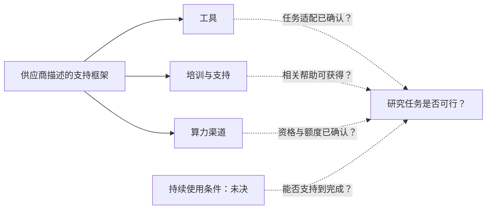

## 研究开始之前，团队缺什么

对小型研究团队来说，一台新超级计算机是否有用，要看它能否支持具体研究。组织能否申请，软件能否运行，数据如何准备，资源能否持续到任务结束？把设施写进项目计划之前，这些问题都需要答案。公开课程、开放模型和共享算力分别解决什么门槛，小型实验室和科研创业公司怎样判断它们是否降低了完成研究的难度？机器规模只能回答其中一部分。

[NVIDIA 欧洲科学计算公告](https://blogs.nvidia.com/blog/ec-scientific-computing-pledge/)把组装工具、寻找算力和建立使用能力，列为小型实验室、早期科研人员及科学创业公司可能在正式研究之前遇到的困难。这个供应商视角支持把门槛拆开检查，但它不是代表性调查，既不能确定各类困难的发生率，也不能判断某个团队的首要约束。

据[同一公告](https://blogs.nvidia.com/blog/ec-scientific-computing-pledge/)介绍，欧盟委员会在都柏林科学人工智能峰会上启动了科学人工智能赋能者倡议，与 RAISE，即欧洲科学人工智能资源框架相连接。NVIDIA 将自身参与内容概括为工具、计算资源、培训、技术支持和协作项目。这里引用的是供应商对框架及承诺的介绍，尚未独立核验欧盟原始政策文件。

本文证据限于该文及[NVIDIA 北欧技术生态文章](https://blogs.nvidia.com/blog/nordics-technology-ecosystem/)的本地缓存，两者均在 2026 年 10 月 15 日取得。北欧页面内部显示 2026 年 10 月 14 日，所附来源元数据标为 10 月 15 日。缓存取得时间不能作为所有项目统一的公告日期。两篇文章均来自 NVIDIA，内容重合可以补充语境，不能算独立交叉验证。

这些材料可以帮助建立资源地图、准备询问事项，个别配额前景和典型科研收益仍未确定。资源被描述出来、组织获得使用许可、任务成功执行、结果满足科学目的，是四个需要分别取证的环节。

团队可以先识别相关渠道、询问实际条款，再开展有限测试，无需等到全面评估出现。投入程度应随证据调整：测试支持什么判断，哪些条件还待确认，都应写进计划。缺少成效数据会收窄判断范围，既不能据此认定渠道有效，也不能认定它无用。

## 把支持承诺拆成具体资源

欧洲公告把多种支持放在同一框架中。准备申请的团队可以按交付内容、适用对象和未决条件拆分。尤其要问清“开放”的对象：[课件、模型资产与开放研究算力](https://blogs.nvidia.com/blog/ec-scientific-computing-pledge/)具有不同安排，一项资源的条件不能自动套用到另一项。

[NVIDIA 称 DLI 已推出开源课件中心](https://blogs.nvidia.com/blog/ec-scientific-computing-pledge/)，提供加速计算与深度学习实践资料，可自由下载、采用开放许可，无需报名、无费用和无截止日期。材料采用模块化设计，可用于高校课程、超算训练营和开发者活动，并衔接其更广泛的培训认证项目。这些条件适用于课件；练习所需硬件及其他项目条款仍须单独确认。

模型与软件方面，[NVIDIA 报告超过 250 个开放模型、250 个开放数据集及 1400 多个开源软件项目](https://blogs.nvidia.com/blog/ec-scientific-computing-pledge/)，并明确表示模型和数据集可在 Hugging Face 与 GitHub 获取。该段没有把全部软件项目都放在这两个平台上，也没有独立核验各项许可。正文还列出 Nemotron 架构、权重、模型、训练数据和配方，以及 BioNeMo Agent Toolkit、PhysicsNeMo 软件库、Earth-2 模型和 ALCHEMI NIM 微服务，所述领域覆盖生物、化学、分子设计、天气、气候、能源、工程、物理及材料。

目录能帮助筛选候选资产，具体选择仍要检查单项许可、输入输出、运行要求和科学适用性。数量不能证明某一项适合当前研究；领域名称可以引导检索，团队还需明确拿它做什么，以及怎样验收。

计算渠道方面，[NVIDIA 称 EuroHPC 中心 CINECA 和 JSC 向学术界及初创企业提供用于开放研究的免费 NVIDIA GPU 基础设施与服务](https://blogs.nvidia.com/blog/ec-scientific-computing-pledge/)。缓存没有提供额度、详细资格、申请通过率、评审标准或等待时间。“免费”描述的是该渠道所述的价格条件，研究计划仍需确认资格、数量、时间和可用环境。

创业支持具有不同对象和阶段。[NVIDIA 描述 Inception 提供计算资源和技术支持](https://blogs.nvidia.com/blog/ec-scientific-computing-pledge/)。法国 AI2F 已合作四个月，供应商评价积极，但未提供成效指标。西班牙 BSC AI 工厂完成试点后，正推出首个完整加速项目。其他工厂有意在 2027 年复制这一模式，仍属未来意向。瑞典 AI 工厂被介绍为 19 个 EuroHPC 资助工厂之一，其宣布的合作面向多个行业的 Inception 初创企业和中小企业。

下表事实项来自[欧洲公告](https://blogs.nvidia.com/blog/ec-scientific-computing-pledge/)。最后一栏是可继续询问的事项，不代表额外发现的项目规定。

| 资源 | NVIDIA 所述渠道 | 已描述的供给或阶段 | 仍需确认的问题 |
| :--- | :--- | :--- | :--- |
| 教学材料 | DLI 开源课件中心 | 开放下载、开放许可；无报名、费用或截止日期 | 练习硬件、与具体任务的关联 |
| 模型与软件 | Nemotron 及科研工具包 | 模型、配方、软件库和服务 | 单项许可、运行要求、适配工作 |
| 开放科研算力 | CINECA、JSC | 面向学术界及初创的免费开放研究资源 | 详细资格、额度、评审与等待时间 |
| 创业支持 | Inception、国家 AI 工厂合作 | 计算渠道与专业支持；法国合作、西班牙项目推出、瑞典合作公告 | 实际申请条款、资源期限与支持范围 |
| 技术辅导 | 答疑、训练营、黑客松 | 模型适配与微调帮助 | 可用时间、选择条件、持续服务 |
| 设施扩建 | 35 台开发中的超级计算机 | 未来容量与预期覆盖 | 交付日期、个别申请者可得额度 |

[NVIDIA 还提及答疑、训练营和黑客松](https://blogs.nvidia.com/blog/ec-scientific-computing-pledge/)，包括“本月”与奥地利科学计算、LRZ、HLRS 及塞浦路斯研究所针对 Pharos-CY 合办的活动。在这份 2026 年 10 月缓存中，“本月”指 2026 年 10 月；这没有构成面向所有参加者的长期工程服务承诺。

[NVIDIA 称有 35 台超级计算机处于开发阶段](https://blogs.nvidia.com/blog/ec-scientific-computing-pledge/)，将其称为欧洲最大单年超算扩建，并表示这些系统将装备超过 300 万研究人员。这些仍是供应商关于开发进度与预期覆盖的说法，不能换算为某个实验室现在能获得的配额。

## 共享设施和应用案例能证明到哪一步

北欧文章提供了三个比较层面：财团设施、面向特定组织的资源渠道，以及具体模型任务的输出。[NVIDIA 的这些描述](https://blogs.nvidia.com/blog/nordics-technology-ecosystem/)需要按所述行动的尺度阅读，设备、渠道和研究结果不能相互替代证据。

[NVIDIA 报告，瑞典 Sferical One 由爱立信、阿斯利康、萨博、SEB 和 Wallenberg Investments 牵头的财团推出，SKF 为战略伙伴](https://blogs.nvidia.com/blog/nordics-technology-ecosystem/)。所述配置为两套 DGX SuperPOD、16 个 DGX GB300 机架及 1152 块 GPU。财团计划利用 Nemotron 开放模型，在安全环境中建设服务。这是供应商对工业共享设施的描述，所附段落没有证明无关联高校团队拥有申请入口。

外部团队因此需要先问清使用设施所需的机构关系或协议。设备总量不能说明自己的可用算力；正文未写公众申请，也不能据此排除一切外部合作。两种判断都需要材料之外的实际条款。

[瑞典 AI 工厂的合作公告](https://blogs.nvidia.com/blog/nordics-technology-ecosystem/)明确面向 Inception 初创企业与中小企业，包括生命与材料科学、自主系统和游戏领域。对象相关，使其成为值得询问的线索；是否入选、额度、可用时间及辅导范围仍待确认。它也出现在[欧洲公告](https://blogs.nvidia.com/blog/ec-scientific-computing-pledge/)中，仍是同一供应商的重复介绍，不能独立验证效果。

Klang 展示了更具体的工具与输出关系。[NVIDIA 称这家瑞典语音实验室使用开源 NeMo 框架，在超过 50,000 小时瑞典语语音上微调 Parakeet v3](https://blogs.nvidia.com/blog/nordics-technology-ecosystem/)，形成可在 Hugging Face 免费获取的 Pianissimo。供应商报告，与最准确的替代模型相比，错误减少 75%，执行速度为 64 倍。缓存未提供完整比较协议，这些数字须保留归属，也不能用于跨任务排名。

案例给出了基础模型、框架、训练材料和输出模型，却没有披露算力取得过程、训练额度、工程投入及持续运行成本。另一团队可以检查工作流是否相关，不能从这些比例直接推出自身预算或预期性能。公开获取提供了检查机会，也不等于这些结果已在此得到独立复现。

其他案例也需保留各自范围。[NVIDIA 描述 Spotify 使用 TensorRT-LLM 加快播客推荐并降低成本](https://blogs.nvidia.com/blog/nordics-technology-ecosystem/)；转述 ABB Robotics 对 RobotStudio HyperReality 最高 99% 仿真准确度、最多减少 80% 调试时间的说法；并报告丰田物料搬运欧洲公司的自主方案部署时间最多减少 50%。这些是特定任务的供应商陈述，“最高”和“最多”不能删去。

[同一北欧缓存](https://blogs.nvidia.com/blog/nordics-technology-ecosystem/)还介绍 Elisa 推出 Moontalk AIRI 测试版、Einride 开发下一代自动驾驶系统，以及 Embedl 与 Space Cargo Unlimited 推出使用单个 Jetson Orin NX 的机载原型。它报告 FirstQFM 训练的模型在不牺牲性能的前提下，将量子处理器执行时间减少 33%，且在 QuantWare QPU 上验证。测试版、研发、原型和所述验证具有不同成熟度，转述时不能升级。

[NVIDIA 另称瑞典初创生态在 2026 年上半年融资 28 亿美元，全年预计 50 亿美元](https://blogs.nvidia.com/blog/nordics-technology-ecosystem/)。这是融资金额，全年数字还是预测，既非营业收入，也不表示各团队可支配的现金。这些性能或生态数字都没有提供准入评估所需的分母：多少符合资格的团队申请、获得资源并完成了任务？

## 工具、技能与算力在什么条件下可能互补

[欧洲公告](https://blogs.nvidia.com/blog/ec-scientific-computing-pledge/)把工具、培训、算力和支持放在同一框架中，由此可以追问：这些投入在什么情况下能够共同帮助团队完成任务？公告没有验证因果答案。试点或后续评估可以检查组合发挥作用的条件，但不能预设各项同等重要，也不能虚构收益、概率或时间节省。

假设一个团队已有可运行的流程与工程经验，但没有合适配额。更多入门课程对眼前研究步骤的帮助可能有限，确认算力或许才能消除当前不确定性。这仍取决于现有流程能否在提供的环境中运行。团队经验应根据已有工作检查，不能凭机构名称或规模推定。

另一个假设团队有硬件，却尚未把软件适配到自身数据。它可以通过小型执行测试，检查申请更大额度之前还有哪些工作，以及针对性帮助能否解决问题。先识别障碍，才能判断增加硬件或培训是否相关。

已有模型也带来条件选择：如果输入输出、许可和科学行为符合研究需要，适配可能避免部分从头构建工作；如果不符，就需判断哪些内容必须改动。[Klang 的语音工作流](https://blogs.nvidia.com/blog/nordics-technology-ecosystem/)提供了可检查的实例，却不能证明另一套工具适合另一项科学任务。目录中的领域名称只能帮助初筛，不能充当科学验证。

下图区分来源描述与待检验关系。实线表示[欧洲公告](https://blogs.nvidia.com/blog/ec-scientific-computing-pledge/)列出的资源类别；虚线是在资源匹配任务的假设下提出的问题。箭头不表示事件先后，也不表示效果已经发生。

技术帮助还要在合适时间到达。它能否在团队作出重大项目决定之前解决实际问题？某个流程也许只需一次简短介入，另一个可能需要不同形式的协助。没有团队需求和实际服务记录，仅凭支持项目存在或持续多久，无法回答这一问题。

执行与科学适用性需要不同验收标准。试点可以检查流程能否接受预定输入、完成操作并保存可检查输出；科学评估则要问方法是否回答研究问题、输出能否支持解释。作业完成提供的是已测条件下的执行证据，科学结论仍须另行判断。

持续使用也需要调查。如果下一份配额换了环境，需要维护、转移或重做什么？文章既没有证明迁移成本，也没有证明依赖不可避免。团队可以在把相关条件写成基金计划假设之前取得答案。这是建议的规划方法，并非所列项目已经造成问题的调查结论。

互补性假设可以帮助确定下一次测试：找出尚未确认的前提，再问什么有限测试能够澄清它。答案应随证据调整，也应允许某个团队只增加一项资源，就足以推进下一阶段。

## 资源入口增加，可能已经有帮助

对过度谨慎最有力的反驳是，渠道不必消除所有困难才值得使用。准备充分的团队可能在[NVIDIA 所述资源](https://blogs.nvidia.com/blog/ec-scientific-computing-pledge/)中找到适合的模型、教材或计算入口。某个团队是否受益，可以具体调查，无需先证明普遍准入或整个体系的科研生产率提升。

这一点应影响评估方式。团队已能运行并评估工作流时，无需新增培训才能承认其进展。对仍在等待配额的团队，更大的目录可能没有解决眼前问题。判断应围绕团队、任务与实际使用条款的匹配展开。

供应商筛选的案例仍能指出值得检查的对象。[北欧文章](https://blogs.nvidia.com/blog/nordics-technology-ecosystem/)提供了所报告的行动和输出，缺少的是明确范围内的全部尝试，包括申请未获资源、退出和未被报道的项目。缺少分母，无法确定典型经历；代表性有限，也不自动否定每项所述行动。

如果记录显示，符合资格的小团队及时获得合适资源，完成预定任务，并在初期帮助结束后继续工作，就会支持互补性解释。还需区分首次获得此类资源的团队与原本已有类似条件的团队，否则新增活动可能被误当成参与范围扩大。

如果技术准备充分的团队持续无法获得合适额度，就需要收窄解释：分配可能是这类群体更相关的约束。调查需要申请和分配记录；仅有等待时间，不能确定原因是容量、资格、项目匹配还是其他条件。

如果条件相近的团队只增加硬件、没有新增培训，完成工作量便提高，就会削弱“新培训对所有人都必要”的主张，但团队原有技能的作用仍未排除。反过来，获得支持的团队结果更好，也要检查它们在帮助开始前是否可比。仅凭相关性，因果问题仍未解决。

这些是建议的观察标准，没有人为设定的数值及格线。[欧洲缓存](https://blogs.nvidia.com/blog/ec-scientific-computing-pledge/)与[北欧缓存](https://blogs.nvidia.com/blog/nordics-technology-ecosystem/)均未提供所需的申请台账、等待分布或可比较完成记录。准入、成功执行、研究完成和成果质量需要分别判断，证据可能支持其中一环，同时让另一环继续未决。

## 申请之前，怎样评估一个资源渠道

研究负责人的眼前决定是，某个渠道是否值得询问、申请或开展有限试点。以下是本文提出的方法，不为[NVIDIA 描述的资源](https://blogs.nvidia.com/blog/ec-scientific-computing-pledge/)增加资格保证、截止日期或服务承诺。

先写清下一阶段交付物，以及接受它所需的证据。模型适配、仿真输出和持续在线服务，各有自己的验收标准。明确下一步研究必须确定什么，再选择设施或工具，能让硬件比较始终联系实际任务。

把前表作为工作文件，在相关行旁记录已有证据和需运营方确认的事项。对课件，写出谁来学习、用于什么任务；对模型或库，检查许可、任务适配和运行要求；对算力，询问资格、额度单位、期限、可用时间及环境；对辅导，说明问题，确认何时、以何种方式获得帮助。

数据与后续条款需要直接答案：哪些数据可以上传，谁能处理，结束后如何保存？研究是否满足相应披露或商业条件？初期支持以后还能获得什么，退出条件是什么？这些询问不暗示任何渠道收费、要求股权或存在数据问题，所附描述只是尚未回答。

考虑两个明确标为假设的团队。团队 A 已有验证过的流程与工程经验，缺少合适算力。如果组织和开放研究任务满足实际条件，[NVIDIA 所述 CINECA 或 JSC 渠道](https://blogs.nvidia.com/blog/ec-scientific-computing-pledge/)可以作为线索，下一步应核实额度前景和环境兼容性。团队 B 已有数据与部分算力，缺少适配经验；相关 DLI 材料或技术帮助，可能帮助它检验能否先建立小型流程。两种情境都不代表典型用户，不预测入选或节省金额，选择应由实际条款和试点记录修正。

在让渠道成为基金里程碑的关键依赖之前，可以设定一个能独立验收的小任务，覆盖回答主要可行性问题所需的准备、执行和输出检查，并记录工作量、资源消耗、中断及所用帮助。成功支持的是已测条件内继续，扩展和未来可用性仍需确认。未成功则应澄清剩余问题，再判断另一次测试是否值得。规模应由待解问题决定，不能为所有项目虚构统一的数据比例或 GPU 小时预算。

## 现在能判断什么，还缺哪些证据

两份本地快照描述了可按具体任务检查的课程、软件、计算渠道、创业合作和技术支持。[欧洲文章](https://blogs.nvidia.com/blog/ec-scientific-computing-pledge/)列出供给与计划，[北欧文章](https://blogs.nvidia.com/blog/nordics-technology-ecosystem/)补充设施和所报告应用。它们支持寻找线索、准备问题，个别配额、持续成本及典型科研收益仍未确定，也不足以判断公平准入、科研突破或欧洲技术自主已经实现。

运营方可以提供资格规则、分配条款，以及分别记录申请、获批和实际使用的数据，让准入更容易判断。首次使用者、等待和退出情况，有助于检验参与范围是否扩大。这些是后续证据需求，并非缓存已经提供的统计。

参与团队可以记录准备、适配、资源消耗、所获支持和未完成工作。独立评估还需明确考察范围，纳入不成功的尝试，再判断结果能否推广到报道案例之外。

小团队现在就可以调查资源，同时让更大的承诺取决于确认条款和执行测试。[所述 35 台开发中的系统，以及可能在 2027 年复制加速项目的安排](https://blogs.nvidia.com/blog/ec-scientific-computing-pledge/)，在这些 2026 年 10 月材料中仍面向未来。后续评估需要查明，渠道是否让原本缺乏合适资源的团队进入，以及这些团队能否持续到研究完成。

## 参考资料

1. nvidia-robotics. [NVIDIA Expands Advanced Technology Access for Europe’s Scientific Community Through Open Learning Resources, Collaborations and Compute | NVIDIA Blog](https://blogs.nvidia.com/blog/ec-scientific-computing-pledge/).
2. NVIDIA Newsroom. [The Nordics and NVIDIA Show What’s Possible When a Region Commits to Advanced Computing | NVIDIA Blog](https://blogs.nvidia.com/blog/nordics-technology-ecosystem/).
