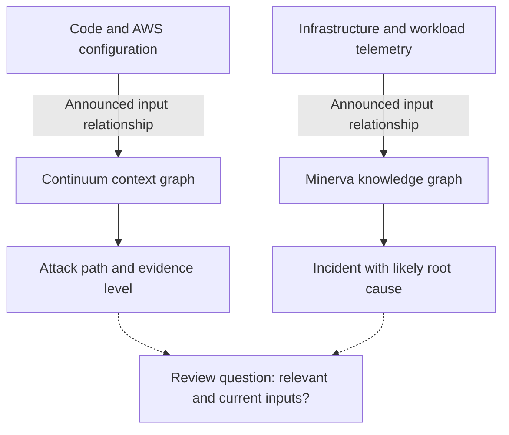
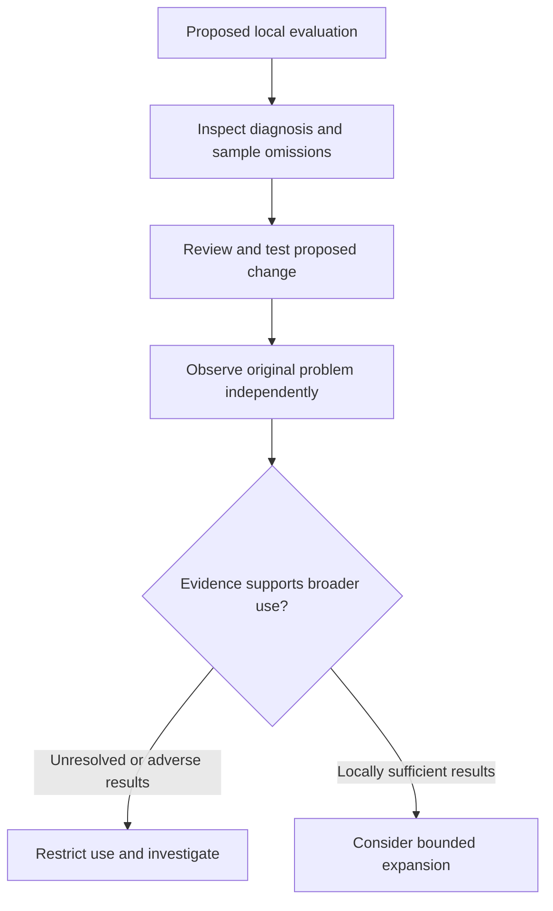

## What remains outside a shorter alert queue?

An on-call team must decide which signal to investigate, whether a proposed change is justified, and when an incident can be closed. A shorter alert queue leaves those decisions open. What evidence survives the compression, and can operators inspect what was left out?

Two announcements dated October 22, 2026 describe different workflows. [AWS Continuum](https://aws.amazon.com/blogs/aws/aws-continuum-for-code-vulnerabilities-is-now-generally-available/) connects code findings with their AWS environment to assess exploitability and propose fixes. [NVIDIA Minerva](https://blogs.nvidia.com/blog/minerva-platform-infrastructure/) connects infrastructure and workload telemetry to group related symptoms into incidents with a likely root cause. Their descriptions establish neither equivalent graph implementations nor identical diagnostic capabilities.

[AWS](https://aws.amazon.com/blogs/aws/aws-continuum-for-code-vulnerabilities-is-now-generally-available/) describes large application estates producing thousands of findings daily, many unreachable, unexploitable, or already mitigated. [NVIDIA](https://blogs.nvidia.com/blog/minerva-platform-infrastructure/) describes a degraded component slowing an entire job while separate teams see different symptoms. These are the publishers' accounts of the problem, not measurements of a reader's organization.

Accurate connections might reduce repeated investigation. Missing inputs might also hide unresolved exposure behind a shorter queue. Evaluating those possibilities requires distinguishing evidence that directs attention from evidence that justifies a modification or confirms recovery.

## What evidence does each workflow provide?

[AWS says Continuum](https://aws.amazon.com/blogs/aws/aws-continuum-for-code-vulnerabilities-is-now-generally-available/) builds a context graph from repositories and AWS resources. Its walkthrough connects code through GitHub or Amazon S3 and optionally adds infrastructure context through a collector in the account and Region where the code runs. The collector gathers resource details, including AWS Config resources and network configuration. The announcement lists availability in US East (N. Virginia) and US West (Oregon); it does not establish broader regional availability.

The [cart-service demonstration](https://aws.amazon.com/blogs/aws/aws-continuum-for-code-vulnerabilities-is-now-generally-available/) shows High severity and High likelihood, exploitability marked *Exploitable*, evidence marked *Static proven*, and validation marked *Completed*. Supporting source analysis explains the verdict. This is a static-analysis example, not a demonstrated sandbox exploit. AWS separately says that findings the service can reproduce receive isolated-sandbox exploitation, proof-of-concept code, and reproduction steps.

The [demonstrated pull request](https://aws.amazon.com/blogs/aws/aws-continuum-for-code-vulnerabilities-is-now-generally-available/) changes four files, adding 50 lines and removing 24. These figures describe the patch's scope; they cannot establish correctness. The console warns that a generated patch does not mean the issue is fixed. Every fix still requires human approval and pull-request review and merge. Autonomous remediation within user-defined guardrails remains a future capability.

[NVIDIA describes Minerva](https://blogs.nvidia.com/blog/minerva-platform-infrastructure/) as connecting GPU, networking, storage, scheduler, and workload signals. Its dynamic knowledge graph maps infrastructure, including GPUs, SuperNICs, switches, and cables, to running jobs. NVIDIA says it analyzes billions of data points per hour using supervised and unsupervised machine learning. It also describes tracing problems across a factory with hundreds of thousands of GPUs. These are separate processing and deployment-scale statements, not measured results for every installation.

| Workflow | Announced diagnostic material | Announced action boundary |
| :--- | :--- | :--- |
| [Continuum](https://aws.amazon.com/blogs/aws/aws-continuum-for-code-vulnerabilities-is-now-generally-available/) | Attack path, source analysis, evidence level; sandbox artifacts for reproducible findings | Human approval and pull-request review and merge |
| [Minerva](https://blogs.nvidia.com/blog/minerva-platform-infrastructure/) | Telemetry, infrastructure-to-job relationships, incident with a likely root cause | Manual implementation or connection to external automation |

[NVIDIA reports](https://blogs.nvidia.com/blog/minerva-platform-infrastructure/) IREN using Minerva. Aolani, Bitdeer AI, IBM, Jio, Lambda, Quake AI, and Tesla plan to deploy it; Dell Technologies, Lenovo, and Supermicro will offer it within their AI factory operations portfolios. Reported use, deployment plans, and future offerings carry different evidentiary weight. None provides a controlled effectiveness comparison in this announcement.

## How context connects symptoms to a diagnosis

Both workflows relate a signal to its surroundings, although their objects and evidence differ. Calling either structure a graph does not explain how its relationships were collected, updated, or validated.

[Continuum's description](https://aws.amazon.com/blogs/aws/aws-continuum-for-code-vulnerabilities-is-now-generally-available/) links code with network reachability, ownership, service dependencies, and the data systems touch. AWS says it identifies business-critical systems, ranks issues by how close attack paths run to them, and evaluates whether existing defenses would detect and stop a validated path. These are announced inputs to prioritization; the article provides no independent accuracy measurements.

[Minerva's description](https://blogs.nvidia.com/blog/minerva-platform-infrastructure/) links workloads with supporting infrastructure and correlates events using topology. NVIDIA's examples include a GPU running hotter than its peers and an NVMe drive losing performance under load. The resulting incident carries a *likely root cause*, a hypothesis that still requires investigation.

The solid connections summarize the [AWS](https://aws.amazon.com/blogs/aws/aws-continuum-for-code-vulnerabilities-is-now-generally-available/) and [NVIDIA](https://blogs.nvidia.com/blog/minerva-platform-infrastructure/) descriptions. The dotted connections introduce an evaluation question. The diagram shows evidence relationships; it is neither an incident timeline nor proof of benefit.

Reviewers could ask which code and configuration versions support a reachability judgment, which job-to-component relationships support a suspected fault, and whether they can examine those connections themselves. These are proposed inspection questions, not claims that either product supplies a complete audit mechanism.

Relevant, current relationships might improve investigation, but would that improvement outweigh the work of maintaining context and checking recommendations? Neither announcement supplies comparative operating records to answer this. A persuasive explanation alone cannot establish measured labor savings.

## A detailed explanation can still be wrong

A coherent explanation could rest on incomplete context. A queue might shrink because related work was successfully grouped, filtering became more aggressive, or both. An inspectable narrative helps frame those possibilities without determining which occurred or how much each contributed.

Consider possible failure conditions. If environment information becomes outdated, would a reachability judgment still describe the deployed system? If sandbox conditions differ materially from production, how far should a reproduction result generalize? Successful reproduction establishes a result under its test conditions; failure to reproduce cannot alone establish production immunity. These are evaluation concerns prompted by [AWS's announced evidence methods](https://aws.amazon.com/blogs/aws/aws-continuum-for-code-vulnerabilities-is-now-generally-available/), not documented Continuum failures.

For a topology-based diagnosis, an abnormal component could be responding to a fault elsewhere, or a grouped incident could contain a separate problem. [Minerva's announcement](https://blogs.nvidia.com/blog/minerva-platform-infrastructure/) describes correlation and a likely root cause, but supplies no audited distribution of missed or incorrectly grouped incidents. The material therefore cannot establish how often those outcomes occur; the omission does not prove that they have occurred.

Missing accuracy measurements also do not demonstrate ineffectiveness. [Continuum's evidence levels and reproduction artifacts](https://aws.amazon.com/blogs/aws/aws-continuum-for-code-vulnerabilities-is-now-generally-available/) and [Minerva's telemetry and topology context](https://blogs.nvidia.com/blog/minerva-platform-infrastructure/) provide different material to inspect. Vulnerability assessment and infrastructure diagnosis require evaluation against their respective tasks, without a single cross-product accuracy ranking.

Before a local pilot begins, teams could define observations that would lower confidence: known relevant findings repeatedly disappear from the actionable set; later investigation overturns suggested root causes; a modification fails to improve the original problem; or a patch addresses a vulnerable path while damaging other behavior. These are proposed evaluation conditions, not reported outcomes or universal thresholds. Unresolved cases should remain unresolved in the record, rather than silently count as successes.

## Trust involves three separate decisions

An attack path or plausible component-to-job relationship may justify investigating somewhere first. A pilot should check whether that allocation of attention leaves important work unseen by preserving original findings and telemetry and sampling lower-priority and grouped signals. [AWS's walkthrough](https://aws.amazon.com/blogs/aws/aws-continuum-for-code-vulnerabilities-is-now-generally-available/) shows a Findings tab containing raw scanner findings alongside prioritized issues. The supplied Minerva description does not establish an identical inspection interface.

Before modifying a system, reviewers should examine the actual change, intended behavior, and possible effects outside the diagnosed path. [Continuum currently requires human approval and review and merge](https://aws.amazon.com/blogs/aws/aws-continuum-for-code-vulnerabilities-is-now-generally-available/). [Minerva offers conversational investigation and remediation recommendations](https://blogs.nvidia.com/blog/minerva-platform-infrastructure/) that teams can implement manually or connect to automation through infrastructure APIs and external systems. That connection option does not establish that every recommendation is suitable for automatic execution.

Human approval cannot prove correctness. Reviewers should record what they tested and why they accepted, revised, or rejected a suggestion. The patch dimensions in AWS's example give reviewers a concrete scope, but cannot replace behavioral assessment.

Recovery requires observations suited to the local case, such as security retesting or performance checks, to determine whether the original vulnerability or operational degradation was addressed. A delivered patch, merged pull request, or closed incident should be recorded separately from outcome observations. Closure needs an explicit evidentiary basis.

| Decision | Proposed pilot record | Question to resolve |
| :--- | :--- | :--- |
| Investigate | Inputs, relationships, sampled omissions | Did prioritization leave relevant problems unseen? |
| Modify | Actual change, review reasoning, tests, revisions | Was this change justified and adequately checked? |
| Confirm recovery | Independent observations and subsequent recurrence | Did the original problem improve, and for how long? |

This diagram proposes an evaluation sequence. It assumes access to relevant records and suitable tests; it describes neither vendor's delivered workflow. Linking the three records would let teams compare accepted suggestions with observed results and count investigation, review, and recovery effort when judging the local tradeoff.

## Which operational records are still missing?

The [AWS](https://aws.amazon.com/blogs/aws/aws-continuum-for-code-vulnerabilities-is-now-generally-available/) and [NVIDIA](https://blogs.nvidia.com/blog/minerva-platform-infrastructure/) announcements are primary product descriptions from separate publishers. They do not independently verify one another's results. AWS's console example and NVIDIA's IREN statement add specificity, but neither supplies a longitudinal controlled comparison.

Several operational questions remain unanswered. How many important issues are omitted or wrongly grouped? How often does subsequent investigation overturn a diagnosis? How long does improvement persist after a modification? How much labor goes into maintaining context, reviewing suggestions, and verifying outcomes, and what is the total cost? These gaps concern the supplied material; they do not establish that vendors or customers have never measured them.

The announcements provide enough detail to design a bounded trial that retains original records, follows diagnoses through changes and outcomes, and accounts for the people maintaining the process. It should assess fewer repeated investigations separately from sustained recovery: a smaller queue alone establishes neither. Any broader use should depend on local omission checks, recovery observations, and effort records.

## References

1. AWS News Blog. [AWS Continuum for code vulnerabilities is now generally available | AWS News Blog](https://aws.amazon.com/blogs/aws/aws-continuum-for-code-vulnerabilities-is-now-generally-available/).
2. NVIDIA Newsroom. [NVIDIA Unveils Minerva to Bring End-to-End Observability for AI Factories | NVIDIA Blog](https://blogs.nvidia.com/blog/minerva-platform-infrastructure/).
