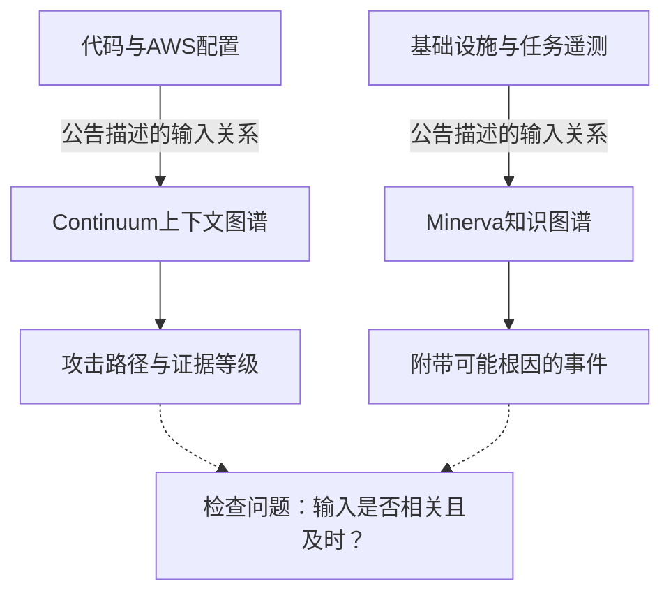
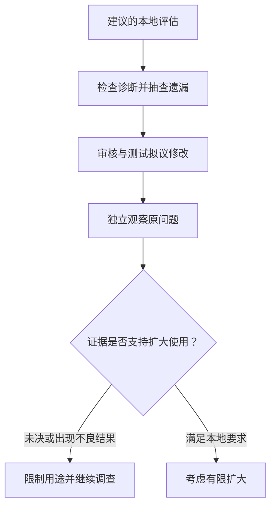

## 告警变少后，怎样检查被省略的问题？

值班团队需要决定先查什么、是否修改系统，以及何时确认恢复。较短的告警队列仍留下这些决定：压缩后保留了哪些证据，操作人员能否检查被省略的信号？

2026年10月22日的两篇公告描述了不同工作流。[AWS Continuum](https://aws.amazon.com/blogs/aws/aws-continuum-for-code-vulnerabilities-is-now-generally-available/)将代码发现与AWS环境连接，评估可利用性并提出修复；[NVIDIA Minerva](https://blogs.nvidia.com/blog/minerva-platform-infrastructure/)连接基础设施与工作负载遥测，把相关症状归并为附带可能根因的事件。这些描述不能证明两者的图谱实现或诊断能力相同。

[AWS](https://aws.amazon.com/blogs/aws/aws-continuum-for-code-vulnerabilities-is-now-generally-available/)描述大型应用资产每天产生数千项发现，其中不少不可达、不可利用或已有缓解措施；[NVIDIA](https://blogs.nvidia.com/blog/minerva-platform-infrastructure/)描述单个退化组件拖慢整项任务，而不同团队各见部分症状。这是发布者对问题的描述，不能替代读者所在组织的测量。

准确关联可能减少重复排查，输入缺失也可能让短队列隐藏未解决的风险。要评估这两种可能，需要区分支持调查、批准修改和确认恢复的证据。

## 两个工作流提供了什么证据？

[AWS表示](https://aws.amazon.com/blogs/aws/aws-continuum-for-code-vulnerabilities-is-now-generally-available/)，Continuum从代码仓库与AWS资源构建上下文图谱。演示通过GitHub或Amazon S3接入代码，并可选用部署在代码运行账户及区域的收集器，补充AWS Config资源、网络配置等信息。公告列出的可用区域仅为美东（弗吉尼亚北部）和美西（俄勒冈），不能据此扩大范围。

[购物车服务演示](https://aws.amazon.com/blogs/aws/aws-continuum-for-code-vulnerabilities-is-now-generally-available/)显示高严重性、高利用可能性，可利用性标为Exploitable，证据为静态证明（*Static proven*），验证状态为Completed，并附源代码分析。这是静态分析案例，不能写成已展示沙箱利用。AWS另称，对能够复现的发现，服务会在隔离沙箱运行利用代码，附PoC与复现步骤。

[演示中的拉取请求](https://aws.amazon.com/blogs/aws/aws-continuum-for-code-vulnerabilities-is-now-generally-available/)修改4个文件，增加50行、删除24行。这些数字说明补丁范围，不能证明正确性。控制台明确提醒，生成补丁不等于问题解决。每项修复仍须人工批准、审核和合并；用户自定义护栏内的自主修复属于未来能力。

[NVIDIA表示](https://blogs.nvidia.com/blog/minerva-platform-infrastructure/)，Minerva连接GPU、网络、存储、调度器与工作负载信号，以动态知识图谱映射GPU、SuperNIC、交换机、线缆与运行任务。其有监督和无监督机器学习每小时分析数十亿数据点，正文另描述在拥有数十万GPU的工厂中追踪问题。处理规模和部署规模是两项不同陈述，不能合并为每个部署的实测表现。

| 工作流 | 公告描述的诊断材料 | 公告描述的动作边界 |
| :--- | :--- | :--- |
| [Continuum](https://aws.amazon.com/blogs/aws/aws-continuum-for-code-vulnerabilities-is-now-generally-available/) | 攻击路径、源代码分析、证据等级；可复现发现的沙箱材料 | 人工批准、审核与合并 |
| [Minerva](https://blogs.nvidia.com/blog/minerva-platform-infrastructure/) | 遥测、任务与组件关系、可能根因 | 人工实施或连接外部自动化 |

[NVIDIA报告](https://blogs.nvidia.com/blog/minerva-platform-infrastructure/)IREN正在使用Minerva；Aolani、Bitdeer AI、IBM、Jio、Lambda、Quake AI和Tesla计划部署，Dell Technologies、Lenovo与Supermicro将纳入其AI工厂运维产品组合。使用陈述、部署计划与未来提供的证据分量不同，公告均未给出效果对照。

## 上下文怎样连接症状与诊断？

两个工作流都将信号放回系统关系中，但处理对象与证据不同。图谱名称本身无法回答连接如何采集、更新或验证。

[Continuum的描述](https://aws.amazon.com/blogs/aws/aws-continuum-for-code-vulnerabilities-is-now-generally-available/)将代码与网络可达性、业务归属、服务依赖及系统接触的数据连接。AWS称，服务识别业务关键系统，按攻击路径接近这些系统的程度排序，并评估现有防御能否发现和阻止已验证路径。这些是公告描述的排序依据，尚无独立准确率测量。

[Minerva的描述](https://blogs.nvidia.com/blog/minerva-platform-infrastructure/)连接工作负载及支撑它的基础设施，按拓扑关联事件。NVIDIA举出GPU温度高于同伴、NVMe驱动器在负载下性能下降等信号。事件附带的“可能根因”仍是需要调查的假设。

实线整理[AWS](https://aws.amazon.com/blogs/aws/aws-continuum-for-code-vulnerabilities-is-now-generally-available/)与[NVIDIA](https://blogs.nvidia.com/blog/minerva-platform-infrastructure/)描述的证据关系，虚线提出评估问题。此图不是事故时间线，也不证明收益。

审核者可追问：可达性判断对应哪个代码和配置版本？疑似故障依据哪些任务与组件关系？能否沿这些连接自行复查？这些是建议检查的问题，不代表产品已提供完整审计机制。

即使连接相关且及时，排查改善能否抵消维护上下文和检查建议的投入？两篇公告都没有足够的对照运行记录回答，解释具有说服力也不能直接证明节省工时。

## 详细解释仍可能诊断错误

连贯解释可能建立在不完整环境信息上。队列缩短可能来自有效归并、更激进的筛选，或两者共同作用。可检查的叙事有助于提出问题，却不能确定哪种情况发生，或各占多少。

可能的失效条件包括：环境信息过时后，可达性判断是否仍对应当前部署？沙箱与生产条件存在实质差异时，复现结果能推广多远？成功复现只证明测试条件下的结果，未能复现也不能单独证明生产环境免疫。这些是围绕[AWS所述证据方法](https://aws.amazon.com/blogs/aws/aws-continuum-for-code-vulnerabilities-is-now-generally-available/)提出的评估问题，不是已记录的Continuum故障。

拓扑诊断也需要检查异常组件是否在响应别处的故障，以及一个归并事件中是否包含独立问题。[Minerva公告](https://blogs.nvidia.com/blog/minerva-platform-infrastructure/)未提供经审计的遗漏或错误归并分布，因此不能确定这些情况的发生频率；缺少数据本身也不证明它们已经发生。

缺少准确率测量同样不能推出产品无效。[Continuum的证据等级和复现材料](https://aws.amazon.com/blogs/aws/aws-continuum-for-code-vulnerabilities-is-now-generally-available/)、[Minerva的遥测和拓扑上下文](https://blogs.nvidia.com/blog/minerva-platform-infrastructure/)提供了不同的检查对象。漏洞评估与基础设施诊断应按各自任务衡量，不能用统一准确率横向排名。

试点开始前，可规定下调信任的观察条件：已知相关发现反复从待处理集合消失；后续调查推翻建议根因；修改未改善原问题；或补丁处理漏洞路径却损害其他行为。这些是评估建议，不是已发生结果或统一通过阈值。未决案例应继续记为未决，不能默认为成功。

## 三个决定需要分别判断

攻击路径或合理的组件与任务关系，可以支持先查某处。试点应保留原始发现和遥测，并抽查低优先级及已归并信号，检查这种注意力分配是否遗漏重要工作。[AWS演示](https://aws.amazon.com/blogs/aws/aws-continuum-for-code-vulnerabilities-is-now-generally-available/)展示了与优先问题并列、包含原始扫描发现的Findings页签；所给Minerva描述未证明其具备相同检查界面。

修改系统前，应审核实际变更、预期行为及诊断路径以外的影响。[Continuum当前要求人工批准、审核和合并](https://aws.amazon.com/blogs/aws/aws-continuum-for-code-vulnerabilities-is-now-generally-available/)。[Minerva提供对话式调查与修复建议](https://blogs.nvidia.com/blog/minerva-platform-infrastructure/)，可人工实施，也可通过基础设施API与外部系统连接自动化。连接选项不能证明每项建议都适合自动执行。

人工批准本身不能证明正确，应记录测试内容及接受、改写或拒绝建议的理由。AWS案例的补丁数字只给出具体审核范围，不能替代行为验证。

确认恢复时，应采用适合本地场景的安全复测或性能观察，检查原漏洞或运行退化是否得到处理。补丁交付、PR合并、事件关闭应与结果观察分别记录，关闭状态须有明确证据依据。

| 决定 | 建议保留的试点记录 | 待回答的问题 |
| :--- | :--- | :--- |
| 调查 | 输入、关联依据、遗漏抽检 | 是否遗漏相关问题？ |
| 修改 | 实际变更、审核理由、测试与改写 | 修改是否有据且充分检查？ |
| 确认恢复 | 独立观察与后续复发情况 | 原问题是否改善、持续多久？ |

此图建议一种评估顺序，假设团队能取得相关记录并开展合适测试，不代表任何一家的已交付流程。连接三类记录，才能对照采纳建议与观察结果，并计入排查、审核及确认恢复的人员投入。

## 还缺少哪些运行记录？

[AWS](https://aws.amazon.com/blogs/aws/aws-continuum-for-code-vulnerabilities-is-now-generally-available/)与[NVIDIA](https://blogs.nvidia.com/blog/minerva-platform-infrastructure/)的公告是不同发布者的原始产品描述，不能相互独立验证效果。AWS控制台案例与NVIDIA的IREN陈述增加了具体性，但均未提供长期对照。

尚待回答的问题包括：遗漏或错误归并多少重要问题？后续调查多常推翻诊断？修改后的改善持续多久？维护上下文、审核建议及核验结果需要多少人力，总成本是多少？这些缺口仅指所给材料，不能写成供应商或客户从未测量。

公告足以支持设计有限试验：保留原始记录，追踪诊断、修改与结果，并计入维护流程的人员投入。减少重复调查与实现持续恢复应分别评估，短队列本身不能证明任何一项。是否扩大使用，仍须由本地遗漏检查、恢复观察与投入记录支持。

## 参考资料

1. AWS News Blog. [AWS Continuum for code vulnerabilities is now generally available | AWS News Blog](https://aws.amazon.com/blogs/aws/aws-continuum-for-code-vulnerabilities-is-now-generally-available/).
2. NVIDIA Newsroom. [NVIDIA Unveils Minerva to Bring End-to-End Observability for AI Factories | NVIDIA Blog](https://blogs.nvidia.com/blog/minerva-platform-infrastructure/).
