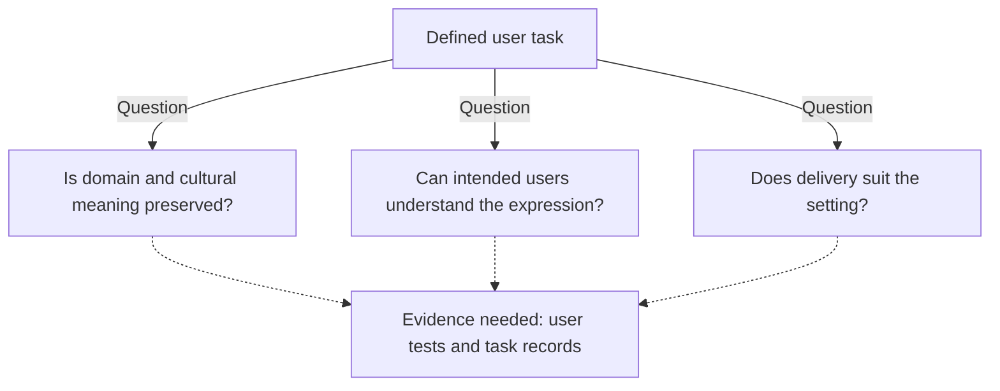
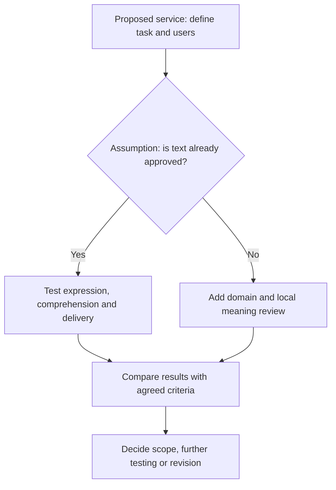

## What language support promises the user

A buyer assessing a local language AI service needs to know whether its intended users can receive the information, understand it and complete a defined task. A language label alone cannot answer that question.

In its [October 26, 2026 roundup](https://aws.amazon.com/blogs/aws/aws-weekly-roundup-amazon-polly-generative-engine-torchneuron-for-trainium-and-more-october-26-2026/), AWS recounts a presentation to a small group of Brazilian agribusiness commercial and technology leaders in São Paulo. The author says their questions concerned delivery: who receives an output, in which language and on which device, often while driving between farms. He connects that exchange to new Brazilian Portuguese voices in Amazon Polly. This publisher's account is neither a representative user survey nor a driving safety evaluation.

[NVIDIA's October 23, 2026 report](https://blogs.nvidia.com/blog/kazakhstan-ai-compute-ecosystem/) records a different concern. At Alem.AI in Astana, Kazakhstan's minister of AI and digital development, Zhaslan Madiyev, expressed a desire for AI that understands and speaks Kazakh and captures cultural contexts and specifics. That is an objective; the statement does not demonstrate that a model has achieved it.

The reports concern spoken delivery and understanding local meaning. For procurement and design, the question is how to turn these statements into evidence requirements for a particular service.

## What each case establishes

[AWS reports](https://aws.amazon.com/blogs/aws/aws-weekly-roundup-amazon-polly-generative-engine-torchneuron-for-trainium-and-more-october-26-2026/) that Polly's Generative engine catalog reached 57 generative voices across 11 languages and 25 locales. The update added 14 voices across nine locales, including Brazilian Portuguese voices Leo and Carolina. Hindi and Finnish became generally available for the first time. AWS calls this a drop-in upgrade and says voice names, the same `SynthesizeSpeech` call and the price remain unchanged. That statement does not establish continuity for every API parameter or resource identifier, or for total implementation costs.

[NVIDIA's report](https://blogs.nvidia.com/blog/kazakhstan-ai-compute-ecosystem/) separates two engagements: Jensen Huang met President Kassym-Jomart Tokayev at the Akorda Presidential Palace and joined Madiyev for a public fireside chat at Alem.AI. The language and culture objective came from the latter discussion.

The same [report](https://blogs.nvidia.com/blog/kazakhstan-ai-compute-ecosystem/) separately describes Firebird's investment agreement with Kazakhstan's government and its secured U.S. export license for 45,000 NVIDIA Grace Blackwell GPUs. It does not say the agreement covered the license. Firebird's first phase was under construction with Kazakhtelecom at Data Center Valley, targeting commercial launch in the third quarter of 2027. A planned second phase would bring total potential capacity in Kazakhstan to approximately 500 megawatts. The license, construction status, launch target and potential capacity describe distinct conditions, not completed commercial operation.

In that [October 23 snapshot](https://blogs.nvidia.com/blog/kazakhstan-ai-compute-ecosystem/), Kazakhtelecom had deployed 400 H200 and 480 B300 GPUs in Astana and Almaty. Its reported plans for 2027 included more than 1,000 GPUs at Data Center Valley and more than 1,000 Vera Rubin GPUs in the Ekibastuz region. These publisher-attributed deployment and planning statements establish no evaluated Kazakh language performance, utilization or subsequent changes.

| Case | Disclosed statement | Evidence level | Still needed for task acceptance |
| :--- | :--- | :--- | :--- |
| [AWS Polly](https://aws.amazon.com/blogs/aws/aws-weekly-roundup-amazon-polly-generative-engine-torchneuron-for-trainium-and-more-october-26-2026/) | Expanded voice catalog; unchanged voice names, call and price | Publisher's product disclosure | Target users' comprehension and task results |
| [Kazakhstan report](https://blogs.nvidia.com/blog/kazakhstan-ai-compute-ecosystem/) | Language and culture objective; deployed compute, construction and plans | Publisher's account of statements and infrastructure | Evaluated local meaning and task performance |

These disclosures concern different objects. They cannot independently verify one another's results, establish a maturity ranking or make computing capacity equivalent to language capability.

## Conditions between language and task completion

An assessment can organize the missing evidence around three questions: does the content preserve the task's meaning, can intended users understand its expression, and does delivery suit the setting? These are proposed checks, with no measured probabilities or weights.

The arrows connect assessment questions to proposed evidence. They show neither an event sequence nor a measured causal chain.

Consider a hypothetical advisory message. More natural speech could still convey an incorrect recommendation. Content evaluation should therefore establish what a correct instruction would say and who checks it. Where cultural meaning matters, locally knowledgeable reviewers need to identify the interpretations to examine. This gives the [reported language and culture objective](https://blogs.nvidia.com/blog/kazakhstan-ai-compute-ecosystem/) a testable scope without assuming it has been achieved or missed.

To examine expression, a trial could ask users to repeat a quantity, identify a named location or explain the requested action. Pronunciation, pauses and unfamiliar wording are possible subjects for investigation. A natural-sounding sample alone cannot establish comprehension. The [Polly disclosure](https://aws.amazon.com/blogs/aws/aws-weekly-roundup-amazon-polly-generative-engine-torchneuron-for-trainium-and-more-october-26-2026/) concerns voice output and supplies no evaluation of speech recognition, reasoning or cultural interpretation.

Delivery testing would ask whether users understand the message through the intended device in the intended environment, and what happens when they request repetition or the connection is interrupted. Correct content could still be unusable through an unsuitable device or delivery method. These are trial questions, not failures reported in either case. The AWS driving example provides a reason to investigate an interface, without validating its safety.

Separate checks help a trial investigate an observed error and determine whether content, pronunciation, equipment or delivery needs adjustment. They leave open whether additional compute or a new voice would help.

## When a task only needs better speech

A narrower evaluation may suit a service whose text is already approved and whose only proposed change is spoken presentation. A hypothetical fixed notification could have stable terminology, a known correct message and no generated advice. It might need neither a new local model nor an extensive cultural interpretation program.

Under those assumptions, a limited voice trial is reasonable. [AWS's stated continuity of voice names, synthesis call and price](https://aws.amazon.com/blogs/aws/aws-weekly-roundup-amazon-polly-generative-engine-torchneuron-for-trainium-and-more-october-26-2026/) gives buyers a reason to investigate it. Integration, content review, equipment adaptation and training still require assessment. Where relevant, the cost comparison should include those activities, without assuming that voice changes or model development are cheaper overall.

A trial could retain the existing voice as a comparison, using the same approved messages, devices and task instructions. Participants should agree beforehand what improvement would matter: clearer understanding, fewer requests for repetition, more accurate actions or another task-specific outcome. Listening preference can be recorded separately.

If the new voice meets those criteria and the service's remaining requirements are satisfied, the result could support accepting the limited upgrade in the tested setting. A fixed notification need not satisfy every broader language and culture ambition.

If no meaningful improvement is observed, the claimed upgrade benefit remains unsupported for that trial. An unchanged error rate alone would not prove the voice useless everywhere. Interpretation still depends on sample coverage, measurement uncertainty and the other agreed outcomes. Neither report supplies this comparison.

## Anchor acceptance to a defined task

A procurement specification can begin with one task and one intended user group. It should state what information must be conveyed, what action should follow, which languages are included and which devices will deliver it. Those choices let buyers request evidence that matches the proposed use.

The table offers task-dependent checks. They are proposals, not standards established by the announcements or commitments already made by either supplier. Fixed-text speech and generated responses require different evidence; acceptance of one cannot substitute for acceptance of the other.

| Acceptance question | Hypothetical fixed-text speech service | Hypothetical generated response service |
| :--- | :--- | :--- |
| Who checks meaning? | An owner approves messages and terminology | Reviewers define correct domain and local interpretations |
| What should users demonstrate? | Understanding of key terms, quantities and requested actions | Understanding plus answers that meet the defined content requirements |
| Where should testing occur? | Intended devices and relevant receiving conditions | Intended access conditions, with content review retained |
| What comparison is useful? | Existing voice or delivery method | Existing service or an agreed human-reviewed reference |
| What happens after an error? | Record the misunderstanding and offer an alternative delivery method | Record the content failure and provide agreed review or escalation |

Sample size, environmental conditions and passing criteria should be agreed for the task. This framework sets no universal noise threshold, weighted score or required number of examples. A short notification and an open-ended advisory service need not share acceptance conditions. Neither voice counts nor GPU counts provide a basis for calculating benefits, and this approach gives no supplier, local deployment or self-built model an assumed advantage.

This proposed review path is not a deployment record for either project. The approved-text branch assumes that content review covers the actual trial messages. If they change, that assumption needs checking again.

The trial plan should specify how serious misunderstandings will be recorded, who investigates them and when the existing delivery method remains available. Teams may agree which outcomes would pause expansion according to their task and responsibilities; this is no universal requirement. Average completion time and voice preference should be considered alongside errors the task owner identifies as consequential.

Acceptance should stay within the tested scope. Results for one message set, device and user group support a decision within those boundaries; extension to other users or tasks needs separate justification. The adopting organization must also account for full implementation costs.

## Evidence still needed for a decision

Neither the [AWS update](https://aws.amazon.com/blogs/aws/aws-weekly-roundup-amazon-polly-generative-engine-torchneuron-for-trainium-and-more-october-26-2026/) nor the [NVIDIA report](https://blogs.nvidia.com/blog/kazakhstan-ai-compute-ecosystem/) establishes sustained task benefits for the users considered here. That absence of evidence proves neither product failure nor policy infeasibility.

Evidence that advances a decision would show whether local users understand the output, whether domain and cultural meaning are preserved, and whether the task can be completed through the actual delivery arrangement. It should identify participants, tested scope and remaining uncertainty, including whether improvements persist under relevant operating conditions. Costs and fallback arrangements need their own accounting.

## References

1. AWS News Blog. [AWS Weekly Roundup: Amazon Polly Generative engine, TorchNeuron for Trainium, and more (October 26, 2026) | AWS News Blog](https://aws.amazon.com/blogs/aws/aws-weekly-roundup-amazon-polly-generative-engine-torchneuron-for-trainium-and-more-october-26-2026/).
2. NVIDIA Newsroom. [Kazakhstan Expands Compute for Its AI Future | NVIDIA Blog](https://blogs.nvidia.com/blog/kazakhstan-ai-compute-ecosystem/).
