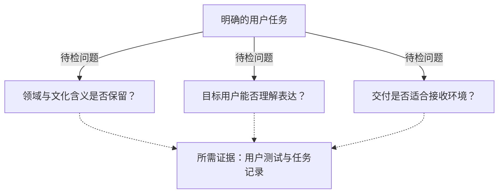
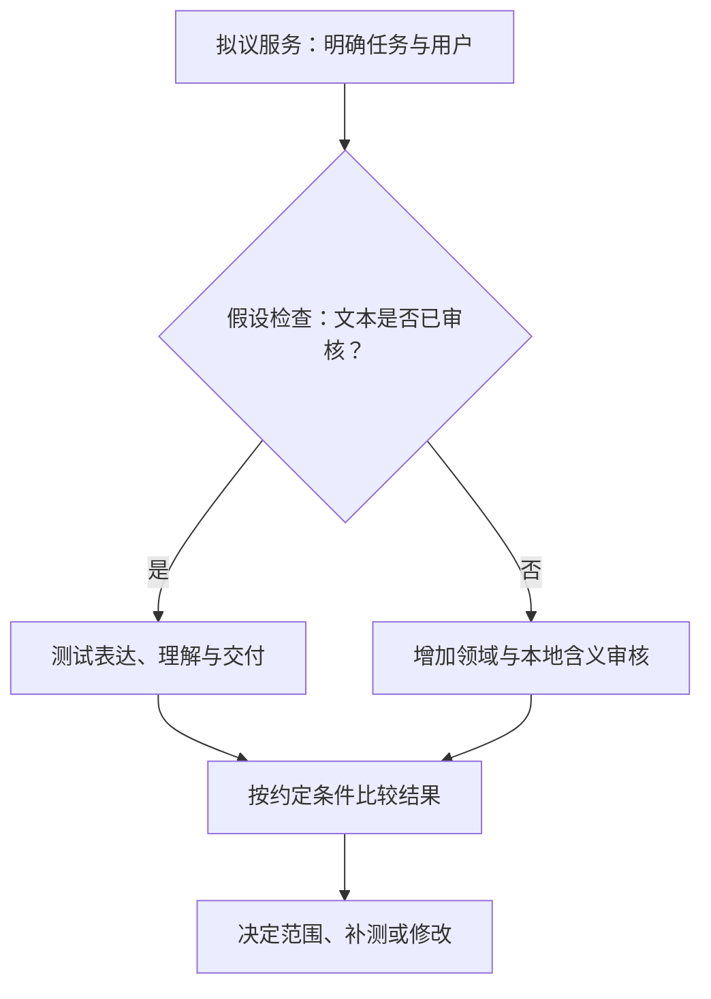

## 语言支持对用户意味着什么

评估本地语言 AI 服务，要问目标用户能否接收信息、理解含义，并完成明确任务。语言标签本身无法回答这个问题。

在 [AWS 2026年10月26日周报](https://aws.amazon.com/blogs/aws/aws-weekly-roundup-amazon-polly-generative-engine-torchneuron-for-trainium-and-more-october-26-2026/)中，作者回顾了在圣保罗与一小组巴西农业商业及技术负责人的交流。他说，对方关心谁接收输出、用什么语言和设备，以及在农场间驾车时如何接收信息，并据此介绍 Polly 新增的巴西葡语声音。这是发布者对一次交流的观察，不能代表总体用户调查，也不是驾驶安全验证。

[NVIDIA 2026年10月23日报道](https://blogs.nvidia.com/blog/kazakhstan-ai-compute-ecosystem/)记录了另一项诉求：哈萨克斯坦人工智能与数字发展部部长 Zhaslan Madiyev 在阿斯塔纳 Alem.AI 对谈中，希望 AI 理解和使用哈萨克语、把握文化语境与文化特点。这是目标陈述，不能证明某个模型已经达标。

两篇报道分别涉及语音交付和本地含义理解。采购与设计需要把这些声明转成具体服务的证据要求。

## 两个案例分别提供什么证据

据 [AWS 披露](https://aws.amazon.com/blogs/aws/aws-weekly-roundup-amazon-polly-generative-engine-torchneuron-for-trainium-and-more-october-26-2026/)，Polly 生成式引擎目录达到57个声音、11种语言和25个语言区域，本次新增覆盖9个语言区域的14个声音，包括巴西葡语 Leo 与 Carolina；印地语和芬兰语首次正式可用。AWS 称其为就地替换升级，声音名称、同一 `SynthesizeSpeech` 调用和价格不变。这不能证明全部接口参数、资源标识或完整实施成本均不变。

[NVIDIA 报道](https://blogs.nvidia.com/blog/kazakhstan-ai-compute-ecosystem/)区分了两场活动：黄仁勋在阿克奥尔达总统府会见总统托卡耶夫，另在 Alem.AI 与 Madiyev 公开对谈。语言文化目标出自后者。

同篇[报道](https://blogs.nvidia.com/blog/kazakhstan-ai-compute-ecosystem/)分别介绍 Firebird 与哈萨克斯坦政府的投资协议，以及其已获45,000块 NVIDIA Grace Blackwell GPU 的美国出口许可，没有说协议涵盖该许可。一期当时正与 Kazakhtelecom 在数据中心谷建设，目标于2027年第三季度商业投产；规划二期将使其在哈萨克斯坦的总潜在容量达到约500兆瓦。许可、建设状态、投产目标与潜在容量，均不能写成已完成商业运营。

该篇[10月23日报道](https://blogs.nvidia.com/blog/kazakhstan-ai-compute-ecosystem/)还称，Kazakhtelecom 已在阿斯塔纳和阿拉木图部署400块 H200 与480块 B300 GPU；2027年计划在数据中心谷部署超过1,000块 GPU，在埃基巴斯图兹地区部署超过1,000块 Vera Rubin GPU。这些是发布者所述的部署快照与计划，不能推导哈萨克语评测成绩、利用率或此后的变化。

| 案例 | 具体声明 | 现有证据 | 任务验收仍需什么 |
| :--- | :--- | :--- | :--- |
| [AWS Polly](https://aws.amazon.com/blogs/aws/aws-weekly-roundup-amazon-polly-generative-engine-torchneuron-for-trainium-and-more-october-26-2026/) | 扩展声音目录；名称、调用和价格不变 | 发布者产品披露 | 目标用户理解与任务记录 |
| [哈萨克斯坦报道](https://blogs.nvidia.com/blog/kazakhstan-ai-compute-ecosystem/) | 语言文化目标；算力部署、建设与规划 | 发布者对目标及基础设施的报道 | 本地含义与任务表现评测 |

两个案例涉及不同对象，不能互相独立验证效果、排列成熟度，也不能把算力容量等同于语言能力。

## 从语言表达到任务完成的条件

缺失证据可按三个问题整理：内容是否保留任务含义，目标用户能否理解表达，交付方式是否适合接收环境？这是建议的检查框架，没有实测概率或权重。

箭头连接检查问题与所需证据，不表示事件顺序或实测因果链。

设想一条咨询建议：自然的声音仍可能传达错误内容。评估应先明确正确指令应说什么、由谁审核；涉及文化含义时，还需由熟悉本地情况的评审者确定应检查哪些解释。这使[语言文化目标](https://blogs.nvidia.com/blog/kazakhstan-ai-compute-ecosystem/)有了可测试的范围，同时不预设目标已经实现或落空。

表达测试可以请用户复述数量、识别地点或解释应采取的行动，并调查发音、停顿和陌生用词是否影响理解。声音听起来自然，不能单独证明用户听懂。[Polly 披露](https://aws.amazon.com/blogs/aws/aws-weekly-roundup-amazon-polly-generative-engine-torchneuron-for-trainium-and-more-october-26-2026/)涉及语音输出，未提供语音识别、推理或文化理解评测。

交付测试则检查用户能否通过预定设备，在预定环境中理解消息，以及要求重播或连接中断时如何处理。即使内容正确，不合适的设备或交付方式仍可能使用户无法使用。这些是试点问题，并非任一案例已报告的失败。AWS 的驾车例子提供了研究接口的背景，不能证明安全性。

分开检查有助于追查已观察到的错误，判断是否需要调整内容、发音、设备或交付方式，同时保留增加算力或更换声音是否有帮助这一问题。

## 有些任务只需测试语音改善

如果文本已经审核，拟改变的只有语音表达，评估范围可以收窄。假设一条固定通知术语稳定、内容已知正确，且不生成建议，它可能无需新建本地模型或开展大规模文化理解工程。

在这些假设下，可以考虑有限语音试点。[AWS 所称名称、合成调用和价格不变](https://aws.amazon.com/blogs/aws/aws-weekly-roundup-amazon-polly-generative-engine-torchneuron-for-trainium-and-more-october-26-2026/)，提供了调查理由，但集成、内容审核、设备适配和培训的工作量仍需评估。成本比较应纳入相关活动，不能预设语音升级或模型开发哪一种整体更便宜。

试点可保留旧声音作对照，使用相同的已审消息、设备和任务指令，事先约定有意义的改善：理解更清楚、重播请求更少、操作更准确，或其他任务指标。声音偏好可单独记录。

若新声音达到约定条件，且服务其他要求均已满足，结果可支持在被测场景接受有限升级。固定通知无需承担全部语言文化目标。

若未观察到有意义的改善，该次试点便未支持升级收益判断。仅凭错误率不变，也不能证明声音在所有场景都无用；解释结果仍须考虑样本覆盖、测量不确定性及其他约定指标。两篇报道均未提供这种对照。

## 把验收落到明确任务

采购规格可从一个任务和一组目标用户开始，说明要传递什么信息、随后采取什么行动、覆盖哪些语言、使用哪些设备，再要求与用途匹配的证据。

下表是按任务调整的建议，不是公告确立的标准或供应商已作出的承诺。固定文本语音与生成式回答需要不同证据，两种验收不能互相替代。

| 验收问题 | 假设的固定文本语音服务 | 假设的生成式回答服务 |
| :--- | :--- | :--- |
| 谁检查含义？ | 责任人审核消息与术语 | 评审者界定正确领域与本地解释 |
| 用户应展示什么？ | 理解关键术语、数量与行动 | 理解输出，且回答满足内容要求 |
| 在哪里测试？ | 目标设备与相关接收条件 | 目标访问条件，并保留内容审核 |
| 用什么对照？ | 原有声音或交付方式 | 原有服务或约定的人工审核参照 |
| 错误后如何处理？ | 记录误解，提供其他交付方式 | 记录内容错误，按约定复核或升级处理 |

样本规模、环境条件和通过要求应按任务约定。这里没有统一噪声门槛、加权分数或固定测试数量；简短通知与开放咨询不必采用相同条件。声音或 GPU 数量不能用于推算收益，这套方法也不预设特定供应商、本地部署或自建模型更优。

这是建议的评估路径，并非项目部署记录。“已审核文本”分支假设审核覆盖试点实际所用消息；消息改变后，应重新检查。

试点还应规定如何记录严重误解、由谁调查、何时保留原有交付方式。团队可按任务责任约定哪些结果会暂停扩展，这并非统一强制规则。平均完成时间和声音偏好，应与任务责任人认定的重要错误一并观察。

验收须限于测试范围。一组消息、设备和用户的结果，支持该范围内的决定；扩展到其他用户或任务，须另行说明依据。采用方也需核算完整实施成本。

## 决定仍需哪些证据

[AWS 更新](https://aws.amazon.com/blogs/aws/aws-weekly-roundup-amazon-polly-generative-engine-torchneuron-for-trainium-and-more-october-26-2026/)与 [NVIDIA 报道](https://blogs.nvidia.com/blog/kazakhstan-ai-compute-ecosystem/)均未证明本文所讨论用户已获得持续任务收益。缺少证据，不能证明产品失败或政策不可行。

后续证据应说明本地用户是否理解输出、领域与文化含义是否保留、实际交付安排下能否完成任务，并交代参与者、测试范围、剩余不确定性，以及改善能否在相关运行条件下持续出现。成本和备用方式需各自核对。

## 参考资料

1. AWS News Blog. [AWS Weekly Roundup: Amazon Polly Generative engine, TorchNeuron for Trainium, and more (October 26, 2026) | AWS News Blog](https://aws.amazon.com/blogs/aws/aws-weekly-roundup-amazon-polly-generative-engine-torchneuron-for-trainium-and-more-october-26-2026/).
2. NVIDIA Newsroom. [Kazakhstan Expands Compute for Its AI Future | NVIDIA Blog](https://blogs.nvidia.com/blog/kazakhstan-ai-compute-ecosystem/).
