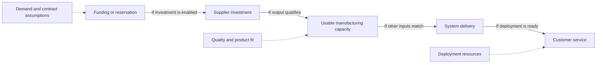
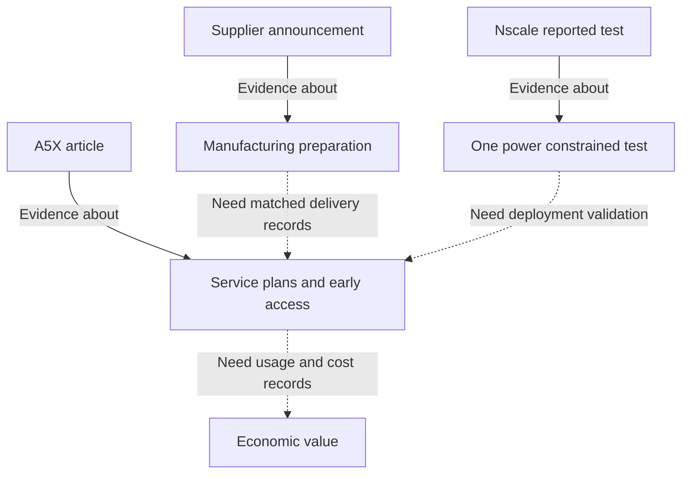

Archive date: 2026-10-21; published on 2026-10-22. This article uses the material saved for the archive date and retains its original reporting cutoffs.

## Whose decision does an expansion announcement change?

On October 21, 2026, NVIDIA disclosed a $1.1 billion capacity reservation advance to KYEC to support new US semiconductor testing facilities and equipment. High-volume production is targeted for April 2027. The amount gives the arrangement a concrete financial dimension, although the announcement does not establish that the advance has been paid in full or explain its accounting treatment. For a compute buyer, it leaves a practical question unanswered: when will a working service be available? ([Supply](https://nvidianews.nvidia.com/news/nvidia-and-supply-chain-partners-expand-capacity-to-accelerate-ai-infrastructure-buildout))

A separate NVIDIA article describes Google Cloud A5X instances built around Vera Rubin infrastructure. Its title announces general availability, but the opening places that event in the following month, with a planned expansion to Europe. At the October 21 evidence date, the body supports a November 2026 availability plan. The KYEC production target and the A5X service plan concern different activities and windows. Neither article identifies a shipment connecting them. ([A5X](https://blogs.nvidia.com/blog/google-cloud-vera-rubin-infrastructure/))

Investors and buyers need different answers from these announcements. An investor may ask whether financing future capacity improves delivery prospects enough to justify the capital committed. A buyer needs a particular service in a particular location and period. The manufacturing arrangement informs both decisions, but treating the advance as available compute would skip the evidence each requires.

Progress can therefore matter before every uncertainty is resolved. Clearer financial terms could improve an investor’s understanding of exposure before a facility produces output. Confirmation of service access might matter more immediately to a buyer. Readers can make a limited judgment by asking whether a disclosure changes the decision at hand.

The decision also determines how much evidence is enough. Identifying a supplier and a production window can justify monitoring a project. Committing a workload to a service requires evidence closer to actual access. Estimating a return requires further information about costs and use. These thresholds need not move together: confidence in preparation could improve while confidence in a particular purchase or financial outcome remained unchanged.

This article asks how a reservation arrangement might relieve a hardware constraint, and what subsequent records would show that the commitment has become usable, economically valuable capacity. The three October 21 articles describe arrangements and downstream plans, all attributed to NVIDIA. Multiple pages from one publisher do not provide independent supplier or customer confirmation. They make supply preparation more specific while leaving eventual output and economic return open. ([Supply](https://nvidianews.nvidia.com/news/nvidia-and-supply-chain-partners-expand-capacity-to-accelerate-ai-infrastructure-buildout), [A5X](https://blogs.nvidia.com/blog/google-cloud-vera-rubin-infrastructure/), [Clouds](https://blogs.nvidia.com/blog/cloud-partners-europe-sovereign-safety-open-agents/))

## What do the four capacity measures describe?

NVIDIA’s supply announcement covers substrates, advanced packaging, semiconductor testing and optical engines. Its multipliers have different denominators. A plant target, an allocation for NVIDIA products and a measure of a particular manufacturing activity cannot be added together. Their dates also describe different milestones. The table retains those distinctions and the forward-looking status of each target. ([Supply](https://nvidianews.nvidia.com/news/nvidia-and-supply-chain-partners-expand-capacity-to-accelerate-ai-infrastructure-buildout))

| Manufacturing object | Arrangement and disclosed scope | Target window and status | Information still needed |
|---|---|---|---|
| Substrates | NVIDIA plans capacity for its products at 2.5 times the starting level; IBIDEN, Samsung Electro-Mechanics and Unimicron arrangements contribute | Over the next three years; a plan | Absolute starting capacity, product allocation and qualified output |
| Amkor interposer wafers | Planned South Korean advanced packaging expansion; the detailed measure is interposer wafer capacity | Increase greater than 300% by end-2028; a target | Starting wafer capacity, usable output and supported product mix |
| Semiconductor testing | NVIDIA expects total testing capacity to double from calendar 2026 to 2027, supported by US, Taiwan and Singapore buildouts | KYEC US high-volume production targeted for April 2027; Singapore expected in February 2027 | Comparable testing measures, production readiness and accepted output |
| SPIL optical engines | Planned Taiwan expansion for optical engines used in co-packaged optics | 15 times capacity by mid-2027, with an aim to double again by end-2028 | Absolute baseline, applicable products and qualified deliveries |

Source for the disclosed arrangements and targets: [NVIDIA’s supply announcement](https://nvidianews.nvidia.com/news/nvidia-and-supply-chain-partners-expand-capacity-to-accelerate-ai-infrastructure-buildout). The final column lists follow-up questions.

Within substrates, NVIDIA describes a previously signed and announced IBIDEN agreement involving a multibillion-dollar capacity reservation advance for the Ono Plant in Japan. The expansion targets capacity at three times the plant’s current level, with additional capacity expected to begin ramping in the first quarter of 2028. This does not establish full payment, completed expansion or achievement of the target. The plant-specific threefold target differs in scope from the overall 2.5-times substrate plan. Adding them would mix denominators and could count overlapping capacity twice. ([Supply](https://nvidianews.nvidia.com/news/nvidia-and-supply-chain-partners-expand-capacity-to-accelerate-ai-infrastructure-buildout))

Samsung Electro-Mechanics is described as joining NVIDIA’s substrate supply chain with immediate capacity from existing South Korean operations. The collaboration also supports facility upgrades and new factories in Sejong and Busan. NVIDIA projects that production allocated to it will account for a significant portion of Samsung Electro-Mechanics’ annual package substrate capacity by 2028. No numerical share is given. Immediate capacity from existing operations should be distinguished from upgrades, new factories and future allocation forecasts. ([Supply](https://nvidianews.nvidia.com/news/nvidia-and-supply-chain-partners-expand-capacity-to-accelerate-ai-infrastructure-buildout))

Unimicron’s KF expansion in Taiwan is supported by a capacity reservation agreement. Additional capacity is expected from the second quarter of 2027, with full capacity by mid-2028. These remain expansion expectations, and a reservation agreement cannot automatically be described as an advance payment. ([Supply](https://nvidianews.nvidia.com/news/nvidia-and-supply-chain-partners-expand-capacity-to-accelerate-ai-infrastructure-buildout))

Amkor’s target requires care with both arithmetic and scope. An increase greater than 300%, on an unchanged baseline, means a resulting level greater than four times that baseline. It does not mean reaching 300% of the original level. The detailed measure is interposer wafer capacity, so the percentage cannot be relabeled as equivalent growth in complete GPU systems. ([Supply](https://nvidianews.nvidia.com/news/nvidia-and-supply-chain-partners-expand-capacity-to-accelerate-ai-infrastructure-buildout))

The testing expectation concerns NVIDIA’s total capacity, with KYEC as one contribution. Counting the total and KYEC as separate increments would risk duplication. SPIL’s target concerns optical engines for co-packaged optics; the announcement does not establish that every GPU system follows the same production route through that capacity. Its further doubling remains an aim. ([Supply](https://nvidianews.nvidia.com/news/nvidia-and-supply-chain-partners-expand-capacity-to-accelerate-ai-infrastructure-buildout))

Beginning a ramp, reaching full capacity and meeting a calendar-year expectation are different milestones. Follow-up should compare performance with each original milestone and explain any changed definition before judging execution. Product allocation matters too: total manufacturing capability could increase without a proportional increase in output suitable for a buyer’s configuration.

A useful comparison would preserve the same manufacturing object on both sides. If an update reports total factory capacity while the original question concerned output allocated to NVIDIA, it has changed the scope. If it reports a full production level after the original ramp-start window, it answers a different timing question. Such updates may still be informative, but readers would need a reconciliation before treating them as confirmation of the original target.

Together, the measures show the breadth of disclosed preparation. Without common absolute baselines or a conversion into finished systems, their relative size cannot identify the most important constraint. Yield, product mix and utilization would also matter to that conversion. The useful next disclosure would connect a defined capacity measure to qualified output for an identified product.

## How might an advance change a supplier’s expansion decision?

The release identifies advances for IBIDEN and KYEC and a reservation agreement for Unimicron, but it does not disclose full contracts. Cancellation rights, repayment provisions, minimum purchases and allocation rights remain unresolved. The phrase “capacity reservation” supplies none of those terms. ([Supply](https://nvidianews.nvidia.com/news/nvidia-and-supply-chain-partners-expand-capacity-to-accelerate-ai-infrastructure-buildout))

If funds are available for relevant facilities or equipment, an advance could reduce what a supplier must finance before receiving production payments. A reservation could also provide a credible signal of future purchases and support earlier investment. These mechanisms address different questions: funding affects the ability to invest, while confidence in orders affects the reason to invest. The announcement neither measures their effects nor establishes the suppliers’ motives.

Risk sharing would depend on the terms. A refundable advance, a conditional reservation and an enforceable purchase commitment could leave different exposures. These are illustrative contract possibilities, not descriptions of NVIDIA’s agreements. The amount alone cannot establish whether the buyer has transferred or retained risk, or exchanged one exposure for another. Nor does it establish nonrefundability, exclusive purchasing or a supplier’s guaranteed profit.

Timing and conditions would affect the financial interpretation. When would support become available relative to investment decisions, and what conditions would have to be met? Allocation certainty might matter even if the financing benefit were limited. To judge the arrangement, readers would need to know what the resources support and what each party receives. An advance cannot be treated as recognized revenue or proof of realized economic benefit.

The consequences of a changed requirement would be particularly useful to understand. If the required product, quantity or delivery window changed, which commitments would remain binding, and which could be revised? Those questions connect contract exposure to the manufacturing plan. They do not imply that demand has changed or that any party can cancel. They identify why the same disclosed amount could carry different financial risks under different undisclosed terms.

The diagram organizes these conditional relationships. Solid arrows represent conversions that require conditions to hold; dashed arrows identify assumptions or constraints. It is an analytical model, not an observed sequence of completed events. It attributes no supplier motive and does not imply that every reservation arrangement involves payment.

Each conversion needs its own test. The supported supplier would have to produce output suitable for the intended platform. Compatible contributions from other activities would need to arrive in the required window. Delivered systems would then need a service environment customers could use. Evidence for a financial commitment cannot establish all those relationships, and a payment record or factory target cannot replace service evidence.

Complete contracts are not necessary for every useful judgment, however. Named counterparties, an identified use of funds and a production target provide concrete matters to investigate. They can support closer attention to preparation without establishing undisclosed contractual protections or a calculated investment return.

The comparison remains conditional: would the arrangement make appropriate capacity more likely to arrive when needed than it otherwise would? Later records connecting supported investment to qualified production could support that mechanism. Evidence of a contribution would still differ from proof that the same output could never have emerged without the arrangement.

Accepted output for intended products would strengthen confidence in conversion. Demonstrated nominal growth without corresponding qualified deliveries would weaken it. Neither outcome is established here. A changed schedule would require explanation before attributing it to a manufacturing defect, financing failure or demand reversal.

## What separates manufacturing capacity from available compute?

A cloud instance measures an integrated service. NVIDIA describes A5X as combining Vera Rubin NVL72, ConnectX-9 SuperNICs, Google Cloud’s Virgo Network and fourth-generation advanced liquid cooling. It also describes compute, networking and storage integration within Google Cloud’s AI Hypercomputer. A unit of substrate, testing or packaging capacity cannot stand in for that environment. ([A5X](https://blogs.nvidia.com/blog/google-cloud-vera-rubin-infrastructure/))

Expanding qualified output at a limiting manufacturing stage could increase potential system deliveries, provided other required inputs matched. If another input remained constrained, the expansion might create headroom at one stage. The supply release does not identify the actual limiting activity, its severity or the quantities required across stages. Its four measures cannot support a defensible GPU shipment estimate or locate the bottleneck by multiplier size. ([Supply](https://nvidianews.nvidia.com/news/nvidia-and-supply-chain-partners-expand-capacity-to-accelerate-ai-infrastructure-buildout))

Product and timing mismatches offer further possibilities. Total capacity could rise while a buyer’s configuration remained unavailable. A particular service could also become available before every long-term manufacturing project reached its target. These possibilities explain why expansion and availability need separate verification; they describe no observed shortage or surplus.

A matched delivery record would need to identify the product and acceptance period. A service definition and access window would address what customers could use. Installed infrastructure and a service offer answer different questions, so related announcements cannot substitute for the missing connection.

Google Cloud plans to scale Vera Rubin-based infrastructure to as many as 960,000 Rubin GPUs across multiple sites. This is a plan’s upper end, not a count already installed, delivered or used. The article allocates none of that plan to the named supplier agreements and therefore does not establish their conversion into cloud capacity. ([A5X](https://blogs.nvidia.com/blog/google-cloud-vera-rubin-infrastructure/))

The multiple-site scope also matters to a buyer’s question. A total across sites supplies no distribution by location or access period. Even confirmation of a larger installed total would leave the buyer needing to establish how much of the relevant service was offered in the intended region. This is a limitation of the aggregate measure, without implying any particular regional allocation or shortage.

Deployment resources add another condition. NVIDIA’s European cloud article reports Nscale tests using GB300 NVL72 systems: DSX MaxLPS enabled 37% more GPUs and nearly 50% higher aggregate inference throughput within the same provisioned power budget. The system, fixed resource boundary and aggregate output measure are all essential. This reported test is neither a universal inference-speed claim nor a Rubin deployment measurement. ([Clouds](https://blogs.nvidia.com/blog/cloud-partners-europe-sovereign-safety-open-agents/))

A comparable result might increase aggregate work within a buyer’s power allocation, but it would need validation in the intended deployment. It would not establish component availability, customer demand or acceptable quality and performance for every workload. Google Cloud and NVIDIA are separately described as exploring DSX MaxLPS capabilities for Vera Rubin infrastructure. Exploration cannot be upgraded into a completed deployment result, and a shared component name does not establish identical implementation or results. ([A5X](https://blogs.nvidia.com/blog/google-cloud-vera-rubin-infrastructure/))

A transfer assessment must retain the resource boundary and output definition. Aggregate inference throughput within a fixed provisioned power budget differs from the time a customer waits for a particular workload to finish. Both may matter, but substituting one for the other requires comparable measurements. The Nscale result supplies a reason to investigate applicability elsewhere, without settling it.

The next diagram classifies evidence. Its arrows mean “provides information about,” without asserting chronology or proof of the next node. Dashed links identify records needed to connect the categories. ([Supply](https://nvidianews.nvidia.com/news/nvidia-and-supply-chain-partners-expand-capacity-to-accelerate-ai-infrastructure-buildout), [A5X](https://blogs.nvidia.com/blog/google-cloud-vera-rubin-infrastructure/), [Clouds](https://blogs.nvidia.com/blog/cloud-partners-europe-sovereign-safety-open-agents/))

The pages support an inquiry spanning manufacturing preparation and potential service environments. Establishing a shipment chain would require a product delivered, accepted and made available in a defined service. Another broad deployment plan would leave that connection unresolved.

## Why the commitments may already justify investment

Preparation may have to precede delivery and use. Under that assumption, waiting for every future workload to materialize could itself create a risk of missing the delivery window. Advance commitments could therefore be commercially rational despite uncertainty. That reasoning does not establish that the disclosed scale is optimal.

NVIDIA gives named partners, manufacturing activities, locations and differentiated target windows. These details make follow-up possible. Its description of immediate substrate capacity from Samsung Electro-Mechanics’ existing operations also means that current contributions should be distinguished from future upgrades and factories. Placing every activity in the distant future would misread the announcement. ([Supply](https://nvidianews.nvidia.com/news/nvidia-and-supply-chain-partners-expand-capacity-to-accelerate-ai-infrastructure-buildout))

The A5X article reports existing access too. NVIDIA says Ineffable Intelligence was the first customer to access A5X and is using it for large-scale reinforcement learning. It also describes WPP’s demonstration of a creative agent reference architecture on A5X. In WPP’s initial tests, workloads typically requiring a multi-node cluster ran on one instance. These are publisher-attributed access and testing examples. They establish neither general availability for all buyers nor sustained utilization or a general consolidation ratio. ([A5X](https://blogs.nvidia.com/blog/google-cloud-vera-rubin-infrastructure/))

These reports give the favorable interpretation concrete downstream activity to consider alongside manufacturing preparation. Early access can coexist with future general availability, and immediate capacity with longer-term expansion. The articles do not identify which future supplier output serves which customer or establish purchasing commitments matching the 960,000-GPU upper plan. ([A5X](https://blogs.nvidia.com/blog/google-cloud-vera-rubin-infrastructure/), [Supply](https://nvidianews.nvidia.com/news/nvidia-and-supply-chain-partners-expand-capacity-to-accelerate-ai-infrastructure-buildout))

Confidence can differ across claims. Reported access supports investigation of downstream use; a named advance supports investigation of a supply arrangement. Together they improve the information available without verifying the whole planned volume, its timing or its economic outcome.

There are therefore two separate judgments within the favorable case. One asks whether preparing before demand is fully realized can be sensible. The other asks whether these particular commitments, at their disclosed scale and timing, will pay off. The conditional argument supports the first judgment. Answering the second requires evidence connecting the arrangements to output and use, together with the financial terms. Accepting the rationale for preparation does not supply the missing measurements.

A stronger positive judgment would follow if relevant lines produced qualified output within their disclosed windows, compatible systems passed acceptance and customers received sustained service. Each observation would close a different gap. The initial announcement need not prove everything for subsequent evidence to improve the assessment, but future targets must retain their original status when evaluating what was known at the time.

Conversely, repeated nominal growth without corresponding accepted deliveries, or a demonstrated persistent separation between reservations and deployment, would challenge the proposed conversion. These are future tests, not reported failures. Missing public records limit outside confidence; they do not prove that production, delivery or usage is absent.

Successful supply conversion would still leave an economic question: is the delivered capacity used productively at an acceptable total cost? Disappointing use or costs could prevent a satisfactory return even after an on-time factory milestone. Supply execution and economic success need related but different evidence. Cash arrangements, production progress and realized benefits must each be checked on their own terms.

## How should buyers and investors use these announcements?

A compute buyer can use manufacturing windows to frame questions, then anchor the purchase decision in the service offered. Follow-up should establish configuration, region, access date and the conditions under which the required workload can run. A supplier expansion target cannot answer for a cloud provider. The A5X body’s future general-availability wording remains essential when interpreting its headline. ([A5X](https://blogs.nvidia.com/blog/google-cloud-vera-rubin-infrastructure/))

An investor needs to track what a commitment finances and how exposure changes through production and delivery. Payment terms, capital tied up, allocation rights and accepted deliveries would help. These are requests for evidence, without asserting that records are public or particular protections exist. The $1.1 billion advance alone establishes neither the cost of completed testing capability nor its return. ([Supply](https://nvidianews.nvidia.com/news/nvidia-and-supply-chain-partners-expand-capacity-to-accelerate-ai-infrastructure-buildout))

The final column below lists records to seek, without assuming their availability.

| Disclosed item | Judgment it can support | Question it leaves open | Follow-up evidence to seek |
|---|---|---|---|
| [Substrate plan](https://nvidianews.nvidia.com/news/nvidia-and-supply-chain-partners-expand-capacity-to-accelerate-ai-infrastructure-buildout) | NVIDIA has identified arrangements contributing to a three-year objective | How much appropriate, qualified output becomes available? | Defined baselines, allocation and accepted output |
| [KYEC target](https://nvidianews.nvidia.com/news/nvidia-and-supply-chain-partners-expand-capacity-to-accelerate-ai-infrastructure-buildout) | A disclosed $1.1 billion advance supports US facilities and equipment, with an April 2027 production target | What are the terms and delivered testing capability? | Contract terms, readiness and accepted production |
| [A5X plan](https://blogs.nvidia.com/blog/google-cloud-vera-rubin-infrastructure/) | The body places general availability in the following month and reports early access | Can a particular customer obtain the required service? | Regional offer, access and acceptance records |
| [Nscale test](https://blogs.nvidia.com/blog/cloud-partners-europe-sovereign-safety-open-agents/) | NVIDIA reports improved aggregate output in a specified GB300 test | Will the result transfer to the intended deployment? | Comparable workload, power, quality and sustained-service measurements |

The evidence should answer the question behind the next decision. A larger global substrate multiplier gives a buyer little additional certainty about regional access. An early user’s successful workload cannot resolve an investor’s questions about contract terms and financial exposure.

This distinction also helps order the inquiry. A buyer could first establish whether the intended service and access window are offered, then examine workload acceptance conditions. An investor could clarify the commitment before following supported capacity into accepted output and eventual use. These are possible investigation sequences, not descriptions of existing procedures or documents. Their purpose is to identify which unanswered question could change the next step.

For workload acceptance, a useful verification request would retain the task and the result that the buyer needs, alongside the service configuration and resource conditions. This would help distinguish a test that demonstrates the intended work from one that reports a different aggregate measure. For an investor following manufacturing progress, the equivalent discipline would preserve the original capacity definition and explain how accepted deliveries relate to it. Neither request assumes access to confidential records.

Favorable results must retain their scope. Qualified production can improve confidence in manufacturing readiness without settling customer access. A service launch can establish availability without settling long-term utilization. Requiring evidence for the relevant gap avoids demanding unrelated proof while keeping one milestone from answering every later question.

## What the next update needs to establish

The supplied October 21, 2026 materials describe concrete supply preparation arrangements, with advances, named partners, manufacturing objects and target windows. They leave open the conversion into matched system deliveries, available services and economic benefits. The supply announcement itself treats future capacity and timing statements as forward-looking. ([Supply](https://nvidianews.nvidia.com/news/nvidia-and-supply-chain-partners-expand-capacity-to-accelerate-ai-infrastructure-buildout))

The remaining inquiry concerns contract exposure if circumstances change, compatible qualified output within delivery windows, and consistent customer use at an acceptable cost. Unanswered questions establish neither eventual scarcity nor excess supply. They also leave the durability of end demand and the return on reserved capacity unresolved.

Qualified output, matched system acceptance and service access would address successive conversion questions; usage and cost records would then inform economic judgment. A larger expansion multiple cannot replace those observations. A5X plans and early-access reports help investigate the downstream side without proving the outcome of upstream arrangements. ([A5X](https://blogs.nvidia.com/blog/google-cloud-vera-rubin-infrastructure/))

Updates need to retain the original object and period. A different product, later window or broader capacity definition may supply useful information, but requires explanation before it resolves the earlier question. A useful update would identify the conversion demonstrated and the product, customer and period to which it applies.

## References

1. NVIDIA Newsroom. [NVIDIA and Supply Chain Partners Expand Capacity to Accelerate AI Infrastructure Buildout | NVIDIA Newsroom](https://nvidianews.nvidia.com/news/nvidia-and-supply-chain-partners-expand-capacity-to-accelerate-ai-infrastructure-buildout).
2. NVIDIA Newsroom. [Google Cloud and NVIDIA Announce General Availability of NVIDIA Vera Rubin Infrastructure | NVIDIA Blog](https://blogs.nvidia.com/blog/google-cloud-vera-rubin-infrastructure/).
3. nvidia-robotics. [NVIDIA Cloud Partners Scale Across Europe :  Sovereign, Open and Built for Safe AI Agents | NVIDIA Blog](https://blogs.nvidia.com/blog/cloud-partners-europe-sovereign-safety-open-agents/).
