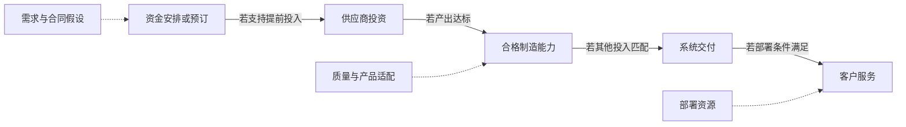
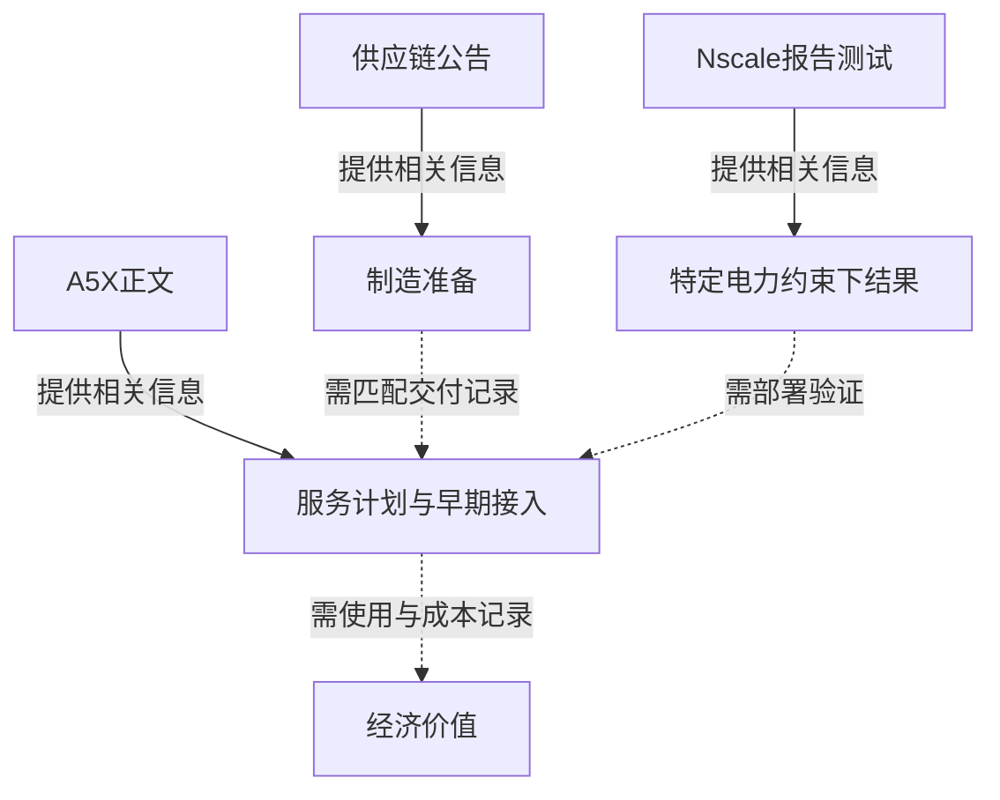

归档日期：2026-10-21；补发于 2026-10-22。本文使用原归档日保存的资料，资料中的经营截止日保持不变。

## 扩产消息改变了谁的决策？

2026年10月21日，NVIDIA披露向KYEC提供11亿美元产能预订预付款，支持美国新半导体测试设施及设备，高产量生产目标为2027年4月。金额让安排有了具体的资金尺度，但公告没有证明款项已全部支付，也没有说明其会计处理。对算力采购者来说，一个实际问题仍未得到回答：什么时候能用上服务？（[供应链](https://nvidianews.nvidia.com/news/nvidia-and-supply-chain-partners-expand-capacity-to-accelerate-ai-infrastructure-buildout)）

同日另一篇NVIDIA文章介绍基于Vera Rubin基础设施的Google Cloud A5X实例。标题宣布一般可用，正文开头却将其放在下个月，并称计划扩展到欧洲。以10月21日为材料时点，正文支持的是2026年11月的可用性计划。KYEC生产目标与A5X服务计划涉及不同活动和窗口，两篇文章都没有给出连接它们的具体供货记录。（[A5X](https://blogs.nvidia.com/blog/google-cloud-vera-rubin-infrastructure/)）

投资者与采购者需要不同的答案。投资者关心提前承诺资金能否提高交付把握，以及这种改善是否值得相应资金占用；采购者需要某种配置在特定地区和期间成为可购买的服务。制造安排可以为两种决策提供线索，但把预付款直接理解为可用算力，会跳过各自需要核对的证据。

因此，有价值的进展未必需要等待所有不确定性消失。合同条款更清楚，可能在设施产出之前改善投资者对风险暴露的理解；服务接入确认可能对采购者更紧迫。读者可以作出有限判断，依据是新增披露是否改变眼前的选择。

不同选择所需的证据门槛也不同。具名供应商和生产窗口，足以提供一个值得跟踪的项目；决定将任务交给某项服务，需要更接近实际接入的证据；估计回报，还需了解成本与使用。对准备程度更有信心时，对某次采购或财务结果的判断仍可能不变。

本文追问的是：产能预订怎样可能缓解硬件约束，后续需要什么记录，才能说明资金承诺已转化为可用且有经济价值的算力？三篇2026年10月21日缓存正文均归属于NVIDIA。同一发布者的多个页面不构成供应商或客户的独立验证；它们使供给准备更具体，最终产出与经济回报仍待观察。（[供应链](https://nvidianews.nvidia.com/news/nvidia-and-supply-chain-partners-expand-capacity-to-accelerate-ai-infrastructure-buildout)、[A5X](https://blogs.nvidia.com/blog/google-cloud-vera-rubin-infrastructure/)、[欧洲云](https://blogs.nvidia.com/blog/cloud-partners-europe-sovereign-safety-open-agents/)）

## 四类扩产数字，分别描述了什么？

供应链公告涉及基板、先进封装、半导体测试和光引擎，各项倍数的分母不同。单厂目标、NVIDIA产品所需产能与特定制造活动的指标不能直接相加，日期也未必代表同一种里程碑。下表保留各项目标的对象、窗口和前瞻状态。（[供应链](https://nvidianews.nvidia.com/news/nvidia-and-supply-chain-partners-expand-capacity-to-accelerate-ai-infrastructure-buildout)）

| 制造对象 | 安排与范围 | 目标窗口及状态 | 尚缺的信息 |
|---|---|---|---|
| 基板 | NVIDIA产品基板产能计划扩至原来的2.5倍；IBIDEN、Samsung Electro-Mechanics和Unimicron相关安排作出贡献 | 未来三年，属于计划 | 绝对基数、产品分配和合格产出 |
| Amkor中介层晶圆 | 韩国先进封装扩张，详细口径为中介层晶圆产能 | 截至2028年底增加超过300%，属于目标 | 起始晶圆产能、可用产出和产品组合 |
| 半导体测试 | NVIDIA预期总测试产能从2026日历年到2027年翻倍，涉及美国、台湾和新加坡扩张 | KYEC美国量产目标为2027年4月；新加坡预期为同年2月 | 可比测试口径、生产准备和验收产出 |
| SPIL光引擎 | 台湾共封装光学所用光引擎制造扩张 | 2027年中扩至15倍，争取2028年底再翻倍 | 绝对基数、适用产品和合格交付 |

表中安排与目标来自[NVIDIA供应链公告](https://nvidianews.nvidia.com/news/nvidia-and-supply-chain-partners-expand-capacity-to-accelerate-ai-infrastructure-buildout)，最后一列为后续核验问题。

基板内部也有不同范围。NVIDIA称，IBIDEN此前已签署并公布的协议包含数十亿美元产能预订预付款，支持日本大野工厂。该厂扩张目标为产能达到当前三倍，新增产能预计2028年第一季度开始爬坡。这不证明已全额付款、完成扩建或实现目标。单厂三倍与总体基板2.5倍不能相加，否则既会混用分母，也可能重复计算重叠产能。（[供应链](https://nvidianews.nvidia.com/news/nvidia-and-supply-chain-partners-expand-capacity-to-accelerate-ai-infrastructure-buildout)）

Samsung Electro-Mechanics的安排包含当前与未来两部分。公告称其加入NVIDIA基板供应链，韩国现有运营提供即时产能，合作还支持世宗和釜山的设施升级及新工厂。到2028年，分配给NVIDIA的生产预计占其年度封装基板产能的显著部分，但没有具体比例。现有运营的即时贡献，应与升级、新厂和未来分配预测分别理解。（[供应链](https://nvidianews.nvidia.com/news/nvidia-and-supply-chain-partners-expand-capacity-to-accelerate-ai-infrastructure-buildout)）

Unimicron台湾KF扩张由产能预订协议支持，预计2027年第二季度开始增加产能、2028年中达到满产。两个日期都是扩张预期，预订协议也不能自动改写成已支付预付款。（[供应链](https://nvidianews.nvidia.com/news/nvidia-and-supply-chain-partners-expand-capacity-to-accelerate-ai-infrastructure-buildout)）

Amkor的目标需要同时核对算术和范围。“增加超过300%”在基数不变时，意味着最终水平超过原来的四倍，并非达到原来的300%。详细指标是中介层晶圆产能，不能换称完整GPU系统的同幅增长。（[供应链](https://nvidianews.nvidia.com/news/nvidia-and-supply-chain-partners-expand-capacity-to-accelerate-ai-infrastructure-buildout)）

测试预期是NVIDIA总口径，KYEC只是其中一项贡献，把两者当作独立增量可能造成重复。SPIL目标则涉及共封装光学所用光引擎；公告没有说明每台GPU系统都经过相同生产路径，后续再翻倍也仍是争取实现的目标。（[供应链](https://nvidianews.nvidia.com/news/nvidia-and-supply-chain-partners-expand-capacity-to-accelerate-ai-infrastructure-buildout)）

开始爬坡、达到满产与满足某日历年的总体预期，是不同里程碑。后续应逐项对照原目标；若定义变化，需要先解释，再判断执行情况。产品分配也会影响转换：制造总能力增加，不保证适配某客户配置的产出同比例增加。

比较时应保持制造对象一致。原问题若是分配给NVIDIA的产出，后来公布全厂产能，范围就发生了变化；原目标若是开始爬坡，后来报告更晚的满产水平，也回答了不同的时间问题。这些更新仍可能有用，但需要说明与原目标的对应关系。

这些指标共同说明了制造准备的覆盖范围。缺少统一绝对基数与成品转换关系，就不能靠倍数大小识别最重要的约束；良率、产品组合和利用率也会影响转换。下一项有用披露，应连接明确产能口径与特定产品的合格产出。

## 预付款怎样可能改变供应商的扩产选择？

公告明确提到IBIDEN、KYEC的预付款及Unimicron的预订协议，但没有披露完整合同。取消权、退款安排、最低采购量和产能分配权仍未确定，不能仅凭“产能预订”补写。（[供应链](https://nvidianews.nvidia.com/news/nvidia-and-supply-chain-partners-expand-capacity-to-accelerate-ai-infrastructure-buildout)）

如果资金可用于相关厂房和设备，预付款可能减少供应商取得生产收入前需自行筹措的资金；预订也可能提供可信的未来采购信号，支持提前投入。两种机制回答不同问题：资金可得性影响有没有条件投资，订单可信度影响为什么投资。公告既没有量化效果，也没有证明合作方的实际动机。

风险如何分担，要看条款。可退预付款、附带条件的预订和具有约束力的采购承诺，可能留下不同责任。这些是解释问题的合同可能性，并非NVIDIA协议的事实。金额本身不能证明买方已转移或保留风险，也不能说明是否换成另一种风险，更不能据此认定预付款不可退、采购排他或供应商获得保底利润。

资金相对哪些投资决定到位，需要满足什么条件，也会影响财务判断。即使融资作用有限，分配确定性仍可能有价值。读者还需了解资源支持什么、双方各自取得什么。预付款不能直接当成已经确认的收入，或已经实现的经济收益。

需求条件变化时的责任尤其值得了解。如果所需产品、数量或交付窗口改变，哪些承诺继续有效，哪些可以调整？这些问题将合同风险与制造计划连接起来，不表示需求已经变化，也不认定任何一方拥有取消权。同一披露金额，在不同的未公开条款下可能对应不同风险。

下图组织这些条件关系。实线表示需要条件成立的转换，虚线表示假设与约束。它是分析模型，不表示已观察到的事件顺序，不认定供应商动机，也不意味着每项预订安排都涉及付款。

每一处转换都需独立检验。受支持的供应商要形成适用于目标平台的产出，其他适配投入要在所需窗口到位，交付系统还要进入客户能够使用的服务环境。财务承诺的证据不能证明全部关系，付款凭证或工厂目标也不能代替服务记录。

不过，有用判断不必等待完整合同公开。具名合作方、资金用途和生产目标已提供可追踪对象，可以支持进一步评估准备程度，只是不足以设定未披露的合同保护或算出投资回报。

需要比较的是：有这项安排，适配产能是否更可能按需到位？后续若能连接受支持投资与合格生产，会支持这一机制。但证明安排有所贡献，仍不同于证明没有它就绝不会产生同样产出，不能将其认定为未来生产的唯一原因。

目标产品形成验收合格产出，应增强对转换的信心；若有证据显示名义增长没有对应合格交付，则应削弱判断。当前材料没有证明任何一种结果。日期变化也需要原因证据，不能直接诊断为制造缺陷、融资失效或需求反转。

## 制造能力与可用算力之间还有什么？

云实例衡量的是集成服务。NVIDIA描述A5X结合Vera Rubin NVL72、ConnectX-9 SuperNIC、Google Cloud Virgo Network和第四代先进液冷，并在Google Cloud的AI Hypercomputer中整合计算、网络与存储。一单位基板、封装或测试能力，无法代替这一环境。（[A5X](https://blogs.nvidia.com/blog/google-cloud-vera-rubin-infrastructure/)）

若某制造活动限制特定产品，扩大其合格产出可能提高潜在系统交付，前提是其他必需投入匹配。若另一投入仍受限，同样扩张可能只为一个阶段留出余量。公告没有识别实际限制环节、约束程度或各阶段所需数量，四类指标因此不能支持可辩护的GPU出货估计，也不能靠倍率定位瓶颈。（[供应链](https://nvidianews.nvidia.com/news/nvidia-and-supply-chain-partners-expand-capacity-to-accelerate-ai-infrastructure-buildout)）

产品与时间还可能错配。总产能增长时，某客户所需配置仍可能不可得；具体服务也可能在全部长期扩产项目达标前开放。这些条件性可能解释了扩产与可用性为何需要分别验证，并非已发生短缺或过剩的描述。

匹配交付记录要说明产品与验收期间；服务定义与访问窗口则说明客户能用什么。安装规模和服务邀约回答不同问题，几项公告主题相近，不能代替它们之间缺失的连接。

Google Cloud计划将基于Vera Rubin的基础设施扩展至多个站点、最多960000颗Rubin GPU。这是计划上限，不是已安装、交付或使用的数量。文章未将计划分配到具名供应商协议，因此不能证明这些协议已转化为云端容量。（[A5X](https://blogs.nvidia.com/blog/google-cloud-vera-rubin-infrastructure/)）

跨站点的范围也影响采购判断。总量没有说明各地点、各接入期间的分配。即使后来确认安装总量增长，采购者仍需核对目标地区实际提供多少相关服务。这是汇总指标的边界，不暗示任何具体地区的分配或短缺。

部署资源还带来另一层条件。欧洲云文章中，NVIDIA报告Nscale使用GB300 NVL72系统测试：DSX MaxLPS在相同已配置电力预算下容纳多37%的GPU，聚合推理吞吐提高接近50%。系统型号、固定资源边界和聚合指标都必须保留。这既不是所有推理任务的速度提升，也不是Rubin部署测量。（[欧洲云](https://blogs.nvidia.com/blog/cloud-partners-europe-sovereign-safety-open-agents/)）

类似结果可能增加采购者电力配置内完成的总工作量，但需要目标部署验证，不能证明部件可得、客户需求或每种任务的质量与性能都可接受。A5X文章另称Google Cloud与NVIDIA正在探索Vera Rubin基础设施上的DSX MaxLPS能力。探索不能升级为完成部署的结果，相同组件名称也不证明实现方式和效果相同。（[A5X](https://blogs.nvidia.com/blog/google-cloud-vera-rubin-infrastructure/)）

检验迁移时，要保留资源边界与输出定义。固定已配置电力预算内的聚合推理吞吐，不同于客户完成某项任务的等待时间。两者都可能重要，但未经可比测量不能互相替代。Nscale结果给出了调查其他部署适用性的理由，尚未回答能否复现收益。

下图分类证据。箭头表示“提供哪类信息”，不表示事件先后或证明下一个节点；虚线标出连接类别所需的记录。（[供应链](https://nvidianews.nvidia.com/news/nvidia-and-supply-chain-partners-expand-capacity-to-accelerate-ai-infrastructure-buildout)、[A5X](https://blogs.nvidia.com/blog/google-cloud-vera-rubin-infrastructure/)、[欧洲云](https://blogs.nvidia.com/blog/cloud-partners-europe-sovereign-safety-open-agents/)）

这些页面支持一项横跨制造准备与潜在服务环境的调查。确认供货链，需要明确产品完成交付、通过验收并进入定义清楚的服务；另一项宽泛部署计划仍会留下这一缺口。

## 为什么这些承诺可能已经值得投入？

准备可能必须领先交付与使用。在这一假设下，等待全部未来工作负载实现，本身也可能带来错过交付窗口的风险。因此，存在不确定性并不排除提前承诺资源的商业合理性，但也不能证明本次披露规模最优。

NVIDIA给出了合作方、制造活动、地点和不同目标窗口，使追踪有具体对象。Samsung Electro-Mechanics现有运营提供即时基板产能的描述，也要求读者区分当前贡献与未来升级、新厂，不能把所有活动都归入遥远未来。（[供应链](https://nvidianews.nvidia.com/news/nvidia-and-supply-chain-partners-expand-capacity-to-accelerate-ai-infrastructure-buildout)）

A5X文章也报告了已有接入。NVIDIA称Ineffable Intelligence是首位接入A5X的客户，正在用其推进大规模强化学习；WPP已在A5X上演示创意智能体参考架构。WPP初步测试中，通常需要多节点集群的工作负载在单个实例上运行。这些是归属于发布者的接入和测试案例，不证明所有采购者均已一般可用，也不能证明持续利用率或通用集群替代比例。（[A5X](https://blogs.nvidia.com/blog/google-cloud-vera-rubin-infrastructure/)）

支持扩产的观点由此有了具体下游活动可供考虑。早期接入可以与未来一般可用并存，即时产能也可以与长期扩张并存。不过，文章没有说明哪批未来供应商产出服务哪个客户，也未证明采购承诺与960000颗GPU的计划上限匹配。（[A5X](https://blogs.nvidia.com/blog/google-cloud-vera-rubin-infrastructure/)、[供应链](https://nvidianews.nvidia.com/news/nvidia-and-supply-chain-partners-expand-capacity-to-accelerate-ai-infrastructure-buildout)）

不同判断可以有不同信心。被报告的接入支持调查下游使用，具名预付款支持调查供给安排。两者改善了信息，却没有验证全部计划数量、时间和经济结果。

支持扩产的论证还包含两个问题：需求完全实现之前准备，是否可能合理？本次特定规模和时间的承诺，是否能获得回报？条件性的商业推理支持前一个判断；后一个问题仍需要资金条款，以及安排与产出、使用之间的对应证据。认可提前准备的理由，不能补齐这些测量。

若相关产线在披露窗口内形成合格产出、适配系统通过验收、客户持续取得服务，应逐步增强对供给兑现的判断。每项观察关闭不同缺口。初始公告不必证明所有结果，后续证据仍可推进判断；但评估当时已知情况时，不能将未来目标重新解释为完成事实。

相反，若有证据表明名义产能反复增长却没有对应验收交付，或预订与部署持续脱节，转换机制就会受到挑战。这些是未来检验标准，不是已报告的失败。公开记录缺失限制外部信心，不能证明生产、交付或使用不存在。

即使供给兑现，仍需问交付能力是否得到有效使用、完整成本是否可接受。若使用或成本表现不佳，工厂按时达标也未必带来满意回报。供给执行与经济成功需要相关但不同的证据，资金安排、生产进度和已实现收益应分别核对。

## 采购者与投资者应如何使用这些公告？

采购者可以用制造窗口确定提问方向，再将购买决定落实到实际提供的服务：配置、地区、接入日期，以及所需任务能运行的条件。供应商扩产目标不能替云服务商作答。解释A5X标题时，必须保留正文对一般可用的未来表述。（[A5X](https://blogs.nvidia.com/blog/google-cloud-vera-rubin-infrastructure/)）

投资者则需追踪承诺支持什么，以及生产、交付推进时风险暴露如何变化。付款条款、资本占用、分配权和验收交付都有帮助。这些是证据需求，不表示记录已公开或合同具有某种保护。11亿美元本身不能确定完成后测试能力的成本或回报。（[供应链](https://nvidianews.nvidia.com/news/nvidia-and-supply-chain-partners-expand-capacity-to-accelerate-ai-infrastructure-buildout)）

下表最后一列列出应寻找的记录，不预设它们已经存在或可取得。

| 公告中的事项 | 可以支持的判断 | 尚不能回答的问题 | 建议索取或等待的记录 |
|---|---|---|---|
| [基板计划](https://nvidianews.nvidia.com/news/nvidia-and-supply-chain-partners-expand-capacity-to-accelerate-ai-infrastructure-buildout) | NVIDIA列出为三年扩张目标作贡献的安排 | 形成多少适配的合格产出？ | 明确基数、产品分配、验收产出 |
| [KYEC目标](https://nvidianews.nvidia.com/news/nvidia-and-supply-chain-partners-expand-capacity-to-accelerate-ai-infrastructure-buildout) | 披露的11亿美元预付款支持美国设施与设备，并有2027年4月生产目标 | 财务条款和实际测试交付能力如何？ | 合同条款、生产准备及验收记录 |
| [A5X计划](https://blogs.nvidia.com/blog/google-cloud-vera-rubin-infrastructure/) | 正文称下个月一般可用，同时报告早期接入 | 特定客户能否获得所需服务？ | 地区服务报价、接入与验收记录 |
| [Nscale测试](https://blogs.nvidia.com/blog/cloud-partners-europe-sovereign-safety-open-agents/) | NVIDIA报告特定GB300测试中的聚合产出改善 | 结果能否迁移到目标部署？ | 可比任务、电力、质量与持续服务测量 |

证据应对应下一项决策的问题。更大的全球基板倍率，不能为采购者增加多少地区接入确定性；早期客户成功运行任务，也不能解决投资者的合同条款与资金暴露疑问。

这一区分有助于安排调查顺序。采购者可先确认目标服务及接入窗口是否提供，再检查自身任务验收条件；投资者可先厘清资金承诺，再追踪受支持能力的验收产出和最终使用。这些是可能的核验顺序，不是既有流程或文件的描述，目的是优先回答可能改变下一步选择的问题。

任务验收应保留采购者需要完成的工作与结果，同时说明服务配置和资源条件，以区分真正验证目标任务的测试与采用其他聚合指标的测试。投资者跟踪制造进展时，也应保留原产能定义，并核对验收交付如何与它对应。这些核验建议不预设读者能取得保密记录。

有利结果也要保持范围。生产合格可增强制造准备判断，却未必解决客户接入；服务上线可证明可用性，却未必说明长期利用率。围绕相关缺口取证，既避免要求无关证明，也防止一个里程碑替后续所有问题作答。

## 下一次更新需要证明什么？

所给2026年10月21日材料描述了具体供给准备，包括预付款、具名合作方、制造对象与目标窗口。从这些安排到匹配系统交付、可用服务和经济收益的转换仍未得到证明。供应链公告本身也将未来产能与时间预期列为前瞻陈述。（[供应链](https://nvidianews.nvidia.com/news/nvidia-and-supply-chain-partners-expand-capacity-to-accelerate-ai-infrastructure-buildout)）

未决问题涉及环境变化时的合同风险、交付窗口内相互适配的合格产出，以及客户能否以可接受成本持续使用。问题未获回答，不证明未来短缺或过剩，也未解决终端需求持续性和预订产能回报。

合格产出、匹配系统验收和服务接入，分别回答转换中的不同问题；使用与成本记录随后帮助判断经济结果。更大扩产倍数不能替代这些观察。A5X计划和早期接入有助于调查下游，但不能证明上游协议的兑现。（[A5X](https://blogs.nvidia.com/blog/google-cloud-vera-rubin-infrastructure/)）

更新需保留原对象与期间。不同产品、更晚窗口或更宽产能定义可能有信息价值，但要先解释，才能判断是否回答了原问题。有用的更新应说明哪项转换已得到证明，以及适用的产品、客户和期间。

## 参考资料

1. NVIDIA Newsroom. [NVIDIA and Supply Chain Partners Expand Capacity to Accelerate AI Infrastructure Buildout | NVIDIA Newsroom](https://nvidianews.nvidia.com/news/nvidia-and-supply-chain-partners-expand-capacity-to-accelerate-ai-infrastructure-buildout).
2. NVIDIA Newsroom. [Google Cloud and NVIDIA Announce General Availability of NVIDIA Vera Rubin Infrastructure | NVIDIA Blog](https://blogs.nvidia.com/blog/google-cloud-vera-rubin-infrastructure/).
3. nvidia-robotics. [NVIDIA Cloud Partners Scale Across Europe :  Sovereign, Open and Built for Safe AI Agents | NVIDIA Blog](https://blogs.nvidia.com/blog/cloud-partners-europe-sovereign-safety-open-agents/).
