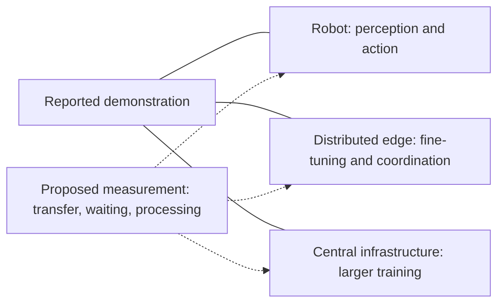
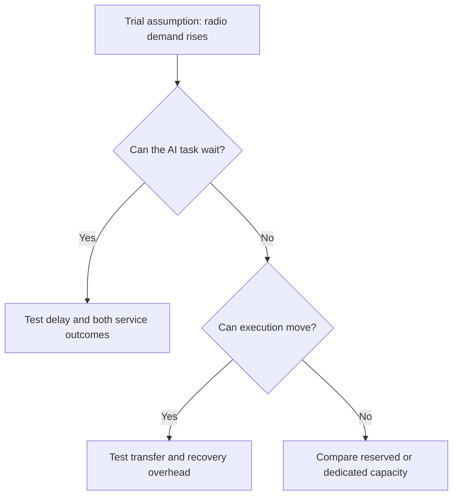

## What should operators gain from adding compute to existing sites?

The investment starts with an existing network site and a proposed addition: accelerated computing. In its October 21, 2026 [telecom announcement](https://nvidianews.nvidia.com/news/nvidia-nokia-and-leading-telecom-operators-turn-networks-into-distributed-intelligence-platforms), NVIDIA describes operators adding computing to centralized data centers, metro sites and cell sites to serve applications closer to users. It presents their land, power, fiber and spectrum as a foundation for distributed intelligence. Those assets provide a starting point, but the announcement does not establish usable spare capacity at any particular site.

An investment committee needs a specific objective for the expenditure. Improving wireless performance requires comparison with the existing radio system. Generating enterprise revenue requires comparison with practical computing alternatives. Reducing internal operating work requires comparison with the workflow an agent would change. A proposal should explain which expenditure supports each benefit before combining the benefits in a financial case.

This requires separating three uses of AI. AI-enhanced radio processing targets the wireless network itself. Edge-hosted AI services support applications such as voice intelligence and robot coordination. Network operations agents assist internal work, including installation inspection and network diagnosis. NVIDIA describes activity in all three areas in its [announcement](https://nvidianews.nvidia.com/news/nvidia-nokia-and-leading-telecom-operators-turn-networks-into-distributed-intelligence-platforms). Progress in one does not establish returns in another without evidence connecting the workloads, resources and benefits.

Location is a separate decision. An installation-photo agent may have different placement requirements from radio processing or a voice application. Does it need to run beside the antenna being inspected? Would the other workloads benefit from the same facility for the same reason? The announcement leaves these questions open. Before counting consolidation as a saving, a procurement proposal should explain why each task belongs at the proposed location and which resources it needs.

The accounting also needs to prevent double counting. If a shared purchase supports radio processing and an enterprise application, the proposal should explain how it allocates that purchase and any common operating work. Otherwise, separate project accounts could each claim the same saving. A useful comparison asks what expenditure disappears under the shared arrangement, what expenditure remains and what new obligation accompanies the application. These are questions for the investment model; the announcement supplies no allocation method or measured saving.

The central question is whether shared computing can deliver measurable task value, preserve the required communication service and cover the full incremental cost. Existing assets should enter the assessment at their actual availability and adaptation cost. Centralized RAN facilities, ordinary cell sites and regional data centers need separate treatment: the label "edge" says too little to determine which configuration belongs where. A useful pilot starts with a defined task and site, with explicit conditions for expansion.

## What do a call and a concurrent workload trial establish?

NVIDIA's October 21 release describes engineering milestones in different environments and at different stages. Combining them into a single deployment timetable would erase distinctions that matter to procurement. These are [supplier-reported cases](https://nvidianews.nvidia.com/news/nvidia-nokia-and-leading-telecom-operators-turn-networks-into-distributed-intelligence-platforms), without independent operator test reports containing the measurements needed for a broader performance assessment. They establish what NVIDIA reported; their commercial implications remain open.

For T-Mobile, NVIDIA reports an AI-RAN call on the operator's commercial network in Bellevue, Washington. The configuration used commercial ARC servers, Nokia's CUDA-accelerated RAN software and massive MIMO radios, connected to an existing 5G Standalone core and a commercial smartphone. This is a reported integration milestone in a commercial network setting. The [description](https://nvidianews.nvidia.com/news/nvidia-nokia-and-leading-telecom-operators-turn-networks-into-distributed-intelligence-platforms) supplies no sustained service records across multiple cells, repeated busy periods or a wider installed base. The commercial setting describes the call; it does not establish a scaled business.

Elisa's result concerns concurrency. NVIDIA says the operator simultaneously ran voice, mobile data and video analytics on ARC in an over-the-air field environment using 5G spectrum. The [trial](https://nvidianews.nvidia.com/news/nvidia-nokia-and-leading-telecom-operators-turn-networks-into-distributed-intelligence-platforms) supports concurrent execution under those conditions. It supplies neither load profiles nor queueing distributions and continuing service-quality records from which to determine dependable application capacity alongside radio processing. The excerpt identifies one platform, without establishing a server count.

Deutsche Telekom validated Nokia and NVIDIA's commercial AI-RAN platform in Bonn and Oulu laboratories, including AI-enhanced uplink channel estimation intended to improve uplink user throughput. Field trials are planned for 2027. BT is planning live trials in Birmingham in 2027. Orange is testing Nokia 5G software on ARC, focusing on spectral efficiency improvements and support for edge services in live networks. The [announcement](https://nvidianews.nvidia.com/news/nvidia-nokia-and-leading-telecom-operators-turn-networks-into-distributed-intelligence-platforms) establishes no common completion date for these activities.

| Operator | NVIDIA-reported action and setting | Evidence boundary | Question before expansion |
| :--- | :--- | :--- | :--- |
| T-Mobile | [AI-RAN call on a commercial network in Bellevue](https://nvidianews.nvidia.com/news/nvidia-nokia-and-leading-telecom-operators-turn-networks-into-distributed-intelligence-platforms) | Reported call and integration | Is service repeatable across relevant traffic and network conditions? |
| Elisa | [Voice, data and video analytics together on ARC over 5G](https://nvidianews.nvidia.com/news/nvidia-nokia-and-leading-telecom-operators-turn-networks-into-distributed-intelligence-platforms) | Concurrent field execution | Do both services meet requirements as combined loads change? |
| Deutsche Telekom | [Platform validation in Bonn and Oulu labs](https://nvidianews.nvidia.com/news/nvidia-nokia-and-leading-telecom-operators-turn-networks-into-distributed-intelligence-platforms) | Laboratory validation; field trials planned for 2027 | What do field comparisons with the existing radio baseline show? |
| BT | [Plans for Birmingham live trials in 2027](https://nvidianews.nvidia.com/news/nvidia-nokia-and-leading-telecom-operators-turn-networks-into-distributed-intelligence-platforms) | Future trial plan | What configuration and operating results emerge? |
| Orange | [Testing Nokia 5G software on ARC](https://nvidianews.nvidia.com/news/nvidia-nokia-and-leading-telecom-operators-turn-networks-into-distributed-intelligence-platforms) | Software testing | What task benefit and service continuity can be measured? |

Procurement needs evidence of repeatability under the conditions relevant to the proposed service. Testing should show what happens when traffic changes, components become unavailable or applications compete, and what resources must remain reserved for recovery. Missing answers do not demonstrate failure. A narrow technical success can stand while broader conclusions await a larger record.

The next test should follow the particular milestone. For T-Mobile, a useful extension would examine whether the integrated configuration maintains the required service across relevant operating conditions. For Elisa, it would examine how each workload behaves as the other changes. Applying the same generic "AI-RAN passed" label to both would conceal the different questions they leave unresolved. Likewise, a future field result should retain its configuration and test conditions so reviewers can judge whether it answers the procurement question at hand.

Other applications need separate accounts. NVIDIA says BT is adopting Nemotron to build agents that inspect installation photographs, detect problems and help reduce repeat visits. This [adoption and development description](https://nvidianews.nvidia.com/news/nvidia-nokia-and-leading-telecom-operators-turn-networks-into-distributed-intelligence-platforms) contains no measured reduction in visits. A trial could examine whether reviewed agent outputs reduce avoidable work. Even a favorable result would require a separate connection to establish the economics of shared radio and AI computing.

## Which tasks benefit from running at the network edge?

A location decision starts with the task: what must be completed, at what quality and within which service requirements? A device or regional facility may provide the same output. Comparing realistic alternatives allows a trial to establish whether placement changes the completed task enough to justify additional deployment. Proximity alone is an incomplete purchasing objective.

NVIDIA's account of Deutsche Telekom's GTC Berlin demonstration with Agile Robots provides a specific example. On-robot intelligence handles real-time perception and action. A model at the distributed edge supports fine-tuning and coordination across robots, while central infrastructure provides capacity for larger training workloads. The [demonstration](https://nvidianews.nvidia.com/news/nvidia-nokia-and-leading-telecom-operators-turn-networks-into-distributed-intelligence-platforms) describes a division of work, without a long-term production record or quantitative comparison of locations.

Solid lines group tasks in NVIDIA's [demonstration description](https://nvidianews.nvidia.com/news/nvidia-nokia-and-leading-telecom-operators-turn-networks-into-distributed-intelligence-platforms); dotted arrows identify proposed measurements. The diagram specifies no event order, control timing or proven location advantage. It provides no basis for moving safety-critical action away from the robot. Each task's placement needs its own assessment.

A trial should measure the complete response path, including input transfer, waiting, processing and return of a usable result. Local execution might shorten that path, or waiting on a shared platform might offset a shorter transfer. Measuring only a processing kernel would miss this interaction. Geographic distance also cannot establish whether the required output arrives when the application needs it.

For another task, NVIDIA describes Orange deploying ARC at distributed sites and using Nemotron Speech to demonstrate multilingual voice translation for emergency and field-service teams. Real-time translation, low latency and reliability are part of NVIDIA's [service description](https://nvidianews.nvidia.com/news/nvidia-nokia-and-leading-telecom-operators-turn-networks-into-distributed-intelligence-platforms); the supplied excerpt contains no measured response-time or reliability result. An evaluation should check whether the same conversation produces usable translations when needed across the candidate locations.

That comparison needs equivalent models, output requirements and conversational difficulty. If a configuration changes the model or shortens the output, the evaluation should record it. The change may be an acceptable service choice, but its contribution must remain distinguishable from placement. Interruptions and unusable responses belong in the record alongside successful translations, so a speed improvement cannot conceal a loss of task quality.

The translation evaluation should also distinguish an occasional late response from a configuration that regularly misses the conversation's needs. An average could combine timely and unusably late results without showing which exchanges suffered. Reviewers should be able to connect each response to its quality judgment and operating conditions. The business owner then needs to decide whether the observed pattern meets the intended service. Neither article supplies a universal response-time threshold or a translation acceptance rule.

The robotics example raises a further question. If a task needs information from several devices, could processing it together at a distributed facility improve coordination? A trial could compare coordination outcomes and record behavior during connection interruptions. It could also test whether near-source processing reduces onward data movement while preserving the result. The [demonstration account](https://nvidianews.nvidia.com/news/nvidia-nokia-and-leading-telecom-operators-turn-networks-into-distributed-intelligence-platforms) quantifies neither benefit; both remain hypotheses for the proposed application.

A favorable result supports the tested task and setting. Expansion then depends on how closely the next site's demand, connectivity and output requirements resemble those conditions. One service may justify a limited local deployment while other tasks remain on devices or in regional facilities. That can be a useful procurement outcome, provided the scope and costs are explicit.

## How should radio and AI workloads share limited resources?

Elisa's [concurrent field trial](https://nvidianews.nvidia.com/news/nvidia-nokia-and-leading-telecom-operators-turn-networks-into-distributed-intelligence-platforms) gives operators a concrete starting point for investigating sharing. Can one purchased platform perform more useful work while preserving both services' requirements, and under which combinations of demand? The announcement does not establish that radio and application demand naturally alternate. Capacity planning needs to test their overlap, without assuming spare resources will appear when needed.

Installed capacity differs from capacity that can support a continuing customer commitment. Communication protection and recovery requirements must be specified before calculating the remainder. Nor should a proposal assume freely available power or cooling headroom at a site. Before estimating capacity for sale, it should state when application work may be admitted, delayed or refused, and how those rules affect the enterprise service promise.

NVIDIA's October 21 [European cloud article](https://blogs.nvidia.com/blog/cloud-partners-europe-sovereign-safety-open-agents/) offers a power comparison with a defined boundary. It reports that, in tests using GB300 NVL72 systems, Nscale demonstrated that DSX MaxLPS enabled 37% more GPUs and nearly 50% higher aggregate inference throughput within the same provisioned power budget. Both figures belong to that reported test and power boundary. They provide no telecom-site gain estimate.

Whether coordination of power allocation and workload requirements changes useful capacity in a telecom configuration needs a telecom trial. Nscale's [test description](https://blogs.nvidia.com/blog/cloud-partners-europe-sovereign-safety-open-agents/) does not test radio coexistence, outdoor operation or the available power of an operator site. Aggregate inference throughput also leaves individual application response requirements unresolved. Records for each promised service remain necessary even if platform-wide output improves.

Scheduling choices can be tested conditionally. An AI task that tolerates waiting could be delayed when radio demand rises. A task suitable for remote execution could be moved, with transfer and recovery overhead included in the assessment. Prompt local execution may instead require reserved capacity, whose ability to protect both services must be weighed against cost. These are proposed evaluation branches; there is no claim that the named operators implemented them.

The diagram is a proposed decision tree, not an operator event sequence. Each branch needs a task-specific acceptance criterion. Delay must stay within permissible waiting; movement must produce usable completion after overhead; reservation must protect service at an acceptable complete cost. Success supports the tested operating policy and conditions, without establishing unrestricted sharing.

A delayed task also needs a route back to completion. A trial that protects radio service by postponing application work should record whether the deferred work subsequently finishes within its requirements. Otherwise, a short observation window could make the allocation appear successful while leaving an unresolved queue outside the report. The same accounting applies to moved tasks: count their completion and the resources used at the destination when comparing the shared configuration with alternatives.

Partial sharing deserves a practical comparison. Reserving resources for one workload might still allow useful shared components or management benefits. Determining whether those benefits exceed reservation costs requires configurations that include software and management requirements. The evidence supports neither rejecting every partially shared arrangement nor treating all installed resources as freely interchangeable.

Joint-load records should connect demand changes with communication quality, application responsiveness, queueing, power and temperature. Separate tests establish baselines; mixed tests expose interactions. The result should describe an operating envelope within which both services meet requirements. A narrow envelope may still support a restricted service, but the restriction must appear in the customer promise and financial model.

## Could centralized compute be more economical?

A device or regional service may already satisfy the application. In that case, distributed hardware needs to provide additional task value sufficient to cover its deployment and operating requirements. The comparison should also identify any measured requirement that makes the regional option inadequate. Equivalent task quality and complete costs should determine the result, with either architecture eligible to meet the need.

NVIDIA's cloud article says Nebius has adopted Groq 3 LPX and is using Spectrum-X Ethernet to integrate it with Vera Rubin NVL72 on Token Factory. Faster token generation through managed serverless and dedicated endpoints is a prospective benefit. The [description](https://blogs.nvidia.com/blog/cloud-partners-europe-sovereign-safety-open-agents/) establishes adoption and an integration approach; it does not explicitly establish completed integration or delivery of that performance benefit. This is an alternative service architecture to examine, without a measured comparison against telecom-hosted inference.

The same article says Crusoe is developing Spark, liquid-cooled modular AI factories designed for Vera Rubin. It also describes Fireworks and Era4 partnering around model services and Blackwell Ultra capacity at Era4's Chesterfield facility. These [regional supply examples](https://blogs.nvidia.com/blog/cloud-partners-europe-sovereign-safety-open-agents/) have different maturity descriptions. Spark's development status does not establish that its facilities are under construction, completed or operational. Neither example supplies a common cost baseline for the telecom decision.

NVIDIA also reports that Mistral Large 4 was trained on 3,800 Grace Blackwell GPUs in Mistral-operated European data centers. Mistral's expansion includes Vera Rubin infrastructure planned for delivery in 2027. The [training report and delivery plan](https://blogs.nvidia.com/blog/cloud-partners-europe-sovereign-safety-open-agents/) concern different states. They support central training activity and a future expansion plan, without establishing the cost or suitability of a regional inference service for the operator's task.

The distributed proposal should therefore test whether a regional service could meet demand without additional hardware at each selected network site. Pooling workloads may fit demand better than matching capacity locally; that remains an economic question to investigate. The assessment also needs to identify which sites require capacity, who maintains software, how failures are handled and how long demand must persist. Cost records should reflect actual facilities and their differences.

The regional alternative needs the same scrutiny as the local proposal. A planned product cannot be treated as immediately available purchasing capacity, and an announced service benefit cannot enter the comparison as a measured result. If the required regional configuration is unavailable during the decision period, record that constraint and assess an available alternative. A procurement case can compare future options, but it should distinguish that exercise from deciding how to serve a current commitment.

Security needs an equally specific comparison. NVIDIA describes the OpenShell Reference Architecture with Vera Rubin NVL72 for inference, Vera CPUs with OpenShell for agent harnesses and tool use, and BlueField-4 DPUs running Sentry for enforcement. It reports ecosystem partner support for the [reference architecture](https://blogs.nvidia.com/blog/cloud-partners-europe-sovereign-safety-open-agents/). Common component names or announced support do not establish identical implementations, delivered controls or independently verified security across partner services. Each deployment needs assessment against the data and actions involved.

The investment hypothesis should permit reversal. If the same task meets quality and response requirements on a device or regional service at lower complete cost, additional edge capacity has a weaker case. Persistent, needed task advantages from local execution, supported by demand that covers cost, would strengthen it. Failure of mixed execution to meet either service's preset requirements would weaken the case for sharing, even if dedicated local computing remained useful.

Location, consolidation and operations automation can consequently receive separate decisions. The service owner should set acceptance requirements before testing and identify results that would change the decision. The announcements provide no universal latency, utilization or error threshold. A committee can request a defensible task-specific threshold and approve a limited configuration without endorsing every proposed use of the platform.

## What evidence should precede a larger deployment?

An expansion proposal should connect each benefit to an observable record and a credible alternative. The table below is an evaluation recommendation. NVIDIA's [telecom cases](https://nvidianews.nvidia.com/news/nvidia-nokia-and-leading-telecom-operators-turn-networks-into-distributed-intelligence-platforms) and [cloud examples](https://blogs.nvidia.com/blog/cloud-partners-europe-sovereign-safety-open-agents/) suggest the questions, but lack the measurements needed to complete it. Both articles are NVIDIA publications; their different URLs do not provide independent confirmation of each other.

| Decision dimension | Records to request | Comparison and interpretation |
| :--- | :--- | :--- |
| Location value | End-to-end completion, output quality, interruptions and transferred data | Same task on device, distributed platform and regional service where feasible |
| Sharing value | Communication quality, AI responsiveness and queueing as both loads change | Separate versus mixed execution under comparable conditions |
| Capacity value | Power, temperature, available headroom and recovery behavior | Actual site conditions and resources needed to protect each service |
| Economic value | Equipment, software, adaptation, energy, maintenance, connectivity and demand | Full incremental cost against attributable benefits |

Hold the task definition steady. For the [Orange translation example](https://nvidianews.nvidia.com/news/nvidia-nokia-and-leading-telecom-operators-turn-networks-into-distributed-intelligence-platforms), request usable translation outcomes alongside speed. For the [Elisa mixed-workload example](https://nvidianews.nvidia.com/news/nvidia-nokia-and-leading-telecom-operators-turn-networks-into-distributed-intelligence-platforms), request radio and video-analysis results. Each test should state which failures count, which conditions it covers and where the comparison stops. A single platform utilization figure cannot supply those answers.

Baselines should be configurations capable of realistically delivering the required service. Comparing a carefully tuned local system with an unsuitable remote option reveals little about procurement. Conversely, adding unnecessary workloads could make the local option look worse than the service requires. Explain each configuration's constraints and costs, and keep changes in model, task or output quality visible. Theoretical peaks and aggregate throughput cannot replace service response and quality records.

High-load and abnormal periods deserve separate records. Preserve the relationship between demand, allocation and each outcome, including tasks that are delayed, moved or rejected. Before expansion, check whether observed conditions cover the customer commitment and identify restrictions needed outside them. Reporting completed work alone would leave reviewers unable to assess that commitment.

Financial assessment needs incremental costs and attributable benefits, including adaptation of existing facilities and the work of reviewing and managing agents. Customer interest, contracted demand, recognized revenue and cash receipts are different measures; none should substitute for another in a payback argument. Neither the supplied [telecom](https://nvidianews.nvidia.com/news/nvidia-nokia-and-leading-telecom-operators-turn-networks-into-distributed-intelligence-platforms) nor [cloud](https://blogs.nvidia.com/blog/cloud-partners-europe-sovereign-safety-open-agents/) article provides the financial figures needed to calculate an operator investment return.

For the installation-photo agent, the relevant saving would need to survive the review process. A proposed evaluation should include the work needed to check outputs and correct errors, then compare the resulting workflow with the existing one. Detecting a problem in a photograph is an intermediate result; the financial case concerns whether that result changes avoidable work at an acceptable complete cost. No reduction in visits or net operating expense can be calculated from the supplied adoption description.

Decisions can remain limited. Convincing service quality with uncertain demand may justify another bounded pilot. Credible demand with unreliable sharing may justify comparison with dedicated capacity. An adequate regional service at lower complete cost may justify deferral. These are possible responses to future evidence, not reported operator decisions. The evidence required for expansion should match the particular commitment being made.

## What can be judged now, and what remains open?

The October 21, 2026 disclosures support a limited conclusion. NVIDIA reports a commercial-network call, concurrent field execution, laboratory validation, application deployment activity and planned trials in its [telecom announcement](https://nvidianews.nvidia.com/news/nvidia-nokia-and-leading-telecom-operators-turn-networks-into-distributed-intelligence-platforms). These distinct states justify further task-specific evaluation. Together, they do not establish scaled service quality, dependable spare capacity or positive commercial returns. The assessment rests on the supplied cached articles and their publication dates, without new external verification.

The 2027 milestones remain observation points. BT's Birmingham trials and Deutsche Telekom's field trials are plans. Elisa's trial is described as clearing the way for distributed deployment and commercial AI-RAN services in 2027. NVIDIA's [release](https://nvidianews.nvidia.com/news/nvidia-nokia-and-leading-telecom-operators-turn-networks-into-distributed-intelligence-platforms) also states that forward-looking statements are uncertain and many products and features remain at various stages, with availability and timing subject to change. Inclusion in an announcement does not guarantee delivery.

The next assessment needs to establish whether location improves the completed task at the required quality, whether shared execution preserves communication and AI requirements under relevant conditions, and whether actual demand or auditable internal savings cover the complete additional cost. A favorable answer to one is useful; an expansion case needs answers covering its full service promise.

Future records could change the judgment in either direction. Sustained measurements could strengthen confidence in sharing. Comparable task tests could show that a regional facility is sufficient, while operating accounts could establish demand or reveal a weak financial case. A pilot should make these outcomes distinguishable through a defined workload, realistic alternatives, acceptance criteria and expansion conditions, all specified before commitment.

## References

1. NVIDIA Newsroom. [NVIDIA, Nokia and Leading Telecom Operators Turn Networks Into Distributed Intelligence Platforms | NVIDIA Newsroom](https://nvidianews.nvidia.com/news/nvidia-nokia-and-leading-telecom-operators-turn-networks-into-distributed-intelligence-platforms).
2. nvidia-robotics. [NVIDIA Cloud Partners Scale Across Europe :  Sovereign, Open and Built for Safe AI Agents | NVIDIA Blog](https://blogs.nvidia.com/blog/cloud-partners-europe-sovereign-safety-open-agents/).
