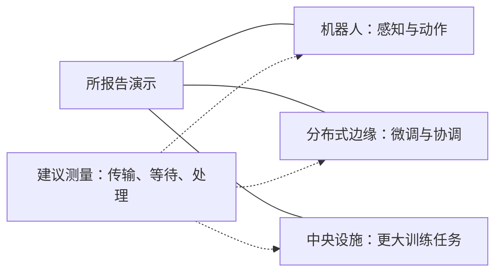
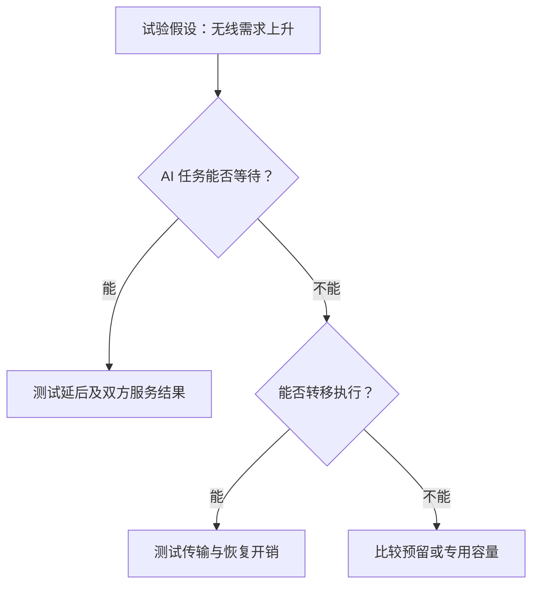

## 已有站点增加算力，运营商要买到什么收益？

这项投资从现有网络站点和一项新增设备开始：加速计算服务器。NVIDIA 在 2026 年 10 月 21 日的[电信公告](https://nvidianews.nvidia.com/news/nvidia-nokia-and-leading-telecom-operators-turn-networks-into-distributed-intelligence-platforms)中描述，运营商正在向中央数据中心、城域站点和蜂窝站点增加计算能力，让应用更靠近用户。公告将土地、电力、光纤和频谱描述为分布式智能的基础。这些资产提供了部署起点，但公告没有证明某个具体站点拥有可用余量。

投资委员会需要明确这笔投入的目的。改善无线表现，要对照既有无线系统；销售企业服务，要对照现实可用的计算方案；减少内部运营工作，要对照智能体准备改变的工作流程。采购建议应先说明哪项投入支持哪种收益，再将收益纳入财务判断，避免把不同用途的进展合并计算。

这里需要区分三类用途。AI 增强无线处理针对无线网络本身；边缘承载的 AI 服务支持语音智能、机器人协调等应用；网络运维智能体辅助安装检查和网络诊断等内部工作。NVIDIA 的[公告](https://nvidianews.nvidia.com/news/nvidia-nokia-and-leading-telecom-operators-turn-networks-into-distributed-intelligence-platforms)涉及这三类活动，但其中一类取得进展，还需要连接任务、资源和收益的额外证据，才能说明另一类的回报。

位置选择也应单独判断。检查安装照片的智能体是否需要运行在天线旁？语音应用和无线处理是否因相同理由进入同一设施？公告没有解决这些问题。把合并运行计为节省之前，采购建议应先说明每项任务为什么放在这里，以及需要哪些资源。

核算还应防止重复计入收益。如果一笔共享采购同时支持无线处理和企业应用，建议书需要解释设备投入与公共运维工作怎样分摊，否则两个项目可能各自认领同一笔节省。比较应具体列明共享后取消了哪些支出、保留了哪些支出，以及新增应用带来什么服务义务。公告没有提供这种分摊方法或实测节省。

核心问题是：共享计算能否提供可测量的任务价值，守住所需通信服务，并覆盖完整增量成本？既有资产应按实际可用性和适配成本进入比较。集中式 RAN 设施、普通蜂窝站点和区域数据中心也须分别评估，“边缘”这个称呼不足以确定配置。试点应从明确的任务和站点开始，并预先说明扩大投入的条件。

## 一次通话与并行试验，各自证明到了哪里？

NVIDIA 10 月 21 日的公告列出了不同环境、不同阶段的工程进展。把它们拼成统一部署时间线，会丢失采购所需的状态差异。[这些案例](https://nvidianews.nvidia.com/news/nvidia-nokia-and-leading-telecom-operators-turn-networks-into-distributed-intelligence-platforms)属于供应商报告，所给材料没有包含独立发布、具备充分测量数据的运营商测试报告，无法据此全面评估表现。可以确认 NVIDIA 报告了什么，商业含义仍需验证。

据 NVIDIA 报告，T-Mobile 在华盛顿州贝尔维尤商用网络完成 AI-RAN 通话。配置包括商用 ARC 服务器、诺基亚 CUDA 加速 RAN 软件和大规模 MIMO 无线设备，连接既有 5G 独立组网核心网与商用智能手机。这是商用网络环境中的集成进展。[相关描述](https://nvidianews.nvidia.com/news/nvidia-nokia-and-leading-telecom-operators-turn-networks-into-distributed-intelligence-platforms)没有提供多小区、反复忙时或更大安装范围内的持续服务记录。“商用”修饰的是通话环境，不能据此认定规模化业务已经成立。

Elisa 的结果涉及并发。NVIDIA 报告，该运营商在使用 5G 频谱的空口现场环境中，在 ARC 平台同时运行语音、移动数据和视频分析。[这项试验](https://nvidianews.nvidia.com/news/nvidia-nokia-and-leading-telecom-operators-turn-networks-into-distributed-intelligence-platforms)支持所报告条件下的并行执行，但没有给出负载曲线、排队分布和持续服务质量记录，尚不足以确定无线处理之外能承诺多少稳定应用容量。原文也未确定服务器数量，不能把一个平台改写成单台服务器。

德国电信在波恩和奥卢实验室验证了诺基亚与 NVIDIA 的商用 AI-RAN 平台，包括旨在改善上行用户吞吐量的 AI 增强上行信道估计，计划于 2027 年开展现场试验。BT 计划于 2027 年在伯明翰开展现网试验。Orange 正测试 ARC 上的诺基亚 5G 软件，关注频谱效率改善和现网边缘服务支持。[公告](https://nvidianews.nvidia.com/news/nvidia-nokia-and-leading-telecom-operators-turn-networks-into-distributed-intelligence-platforms)没有为这些活动确立共同完成日期。

| 运营商 | NVIDIA 报告的环境与动作 | 当前证据边界 | 扩大投入仍需回答的问题 |
| :--- | :--- | :--- | :--- |
| T-Mobile | [贝尔维尤商用网络 AI-RAN 通话](https://nvidianews.nvidia.com/news/nvidia-nokia-and-leading-telecom-operators-turn-networks-into-distributed-intelligence-platforms) | 通话与系统集成 | 相关话务和网络条件下能否重复保持服务？ |
| Elisa | [ARC 上经 5G 并行运行语音、数据和视频分析](https://nvidianews.nvidia.com/news/nvidia-nokia-and-leading-telecom-operators-turn-networks-into-distributed-intelligence-platforms) | 现场并发执行 | 组合负载变化时，两类服务是否达标？ |
| 德国电信 | [波恩和奥卢实验室验证](https://nvidianews.nvidia.com/news/nvidia-nokia-and-leading-telecom-operators-turn-networks-into-distributed-intelligence-platforms) | 实验室验证；计划 2027 年现场试验 | 现场表现与既有无线基线相比如何？ |
| BT | [计划 2027 年伯明翰现网试验](https://nvidianews.nvidia.com/news/nvidia-nokia-and-leading-telecom-operators-turn-networks-into-distributed-intelligence-platforms) | 未来试验计划 | 实际配置与运行结果是什么？ |
| Orange | [正在 ARC 上测试诺基亚 5G 软件](https://nvidianews.nvidia.com/news/nvidia-nokia-and-leading-telecom-operators-turn-networks-into-distributed-intelligence-platforms) | 软件测试 | 能否测出任务收益与服务连续性？ |

采购还需要相关服务条件下的可重复性记录。流量改变、组件不可用、应用竞争时会怎样？恢复服务要保留哪些资源？后续试验应回答这些问题。缺少答案不等于系统已经失败；有限的工程成功可以成立，更大结论则要等待更完整的记录。

后续验证应承接各自的里程碑。对 T-Mobile，可检查集成配置在相关运行条件下能否维持所需服务；对 Elisa，可检查一种任务的负载改变时，另一种任务怎样响应。统一写成“AI-RAN 通过测试”，会掩盖两者尚未回答的不同问题。未来现场结果也应保留配置和测试条件，供采购方判断它是否回答了本次投入的问题。

其他应用也要单独核算。NVIDIA 说 BT 正采用 Nemotron 构建检查安装照片、发现问题并帮助减少重复上站的智能体。[这属于采用与开发描述](https://nvidianews.nvidia.com/news/nvidia-nokia-and-leading-telecom-operators-turn-networks-into-distributed-intelligence-platforms)，没有给出上站次数的实测下降。试验可检查经复核的智能体输出是否减少可避免工作。即使结果有利，仍需另行证明它与无线、AI 共用算力经济性之间的联系。

## 哪些任务值得放到网络边缘？

位置选择应从任务开始：完成什么、达到什么质量、满足哪些服务要求？终端或区域设施可能提供同样输出。比较现实可用的替代方案，才能判断位置是否改变任务结果，以及这种改变是否值得额外部署。仅仅靠近用户，还不足以构成采购目标。

NVIDIA 对德国电信与 Agile Robots 柏林 GTC 演示的描述提供了具体例子：机器人本体处理实时感知和动作，分布式边缘模型支持微调与跨机器人协调，中央基础设施提供更大训练任务所需容量。[这项演示](https://nvidianews.nvidia.com/news/nvidia-nokia-and-leading-telecom-operators-turn-networks-into-distributed-intelligence-platforms)展示了任务分工，没有提供长期生产记录或不同位置的定量比较。

实线归纳 NVIDIA [演示描述](https://nvidianews.nvidia.com/news/nvidia-nokia-and-leading-telecom-operators-turn-networks-into-distributed-intelligence-platforms)中的任务，虚线标记建议测量项目。图中没有设定事件顺序、控制时序或已经成立的位置优势，也不能据此把安全关键动作移出机器人本体。每项任务的位置都需要分别评估。

试验应测量完整响应路径，包括输入传输、等待、处理和可用结果返回。本地执行可能缩短这条路径，共享平台的等待也可能抵消传输路径的缩短。只测处理内核会遗漏这种相互影响；只比较地理距离，也无法说明所需输出是否及时到达。

另一个任务例子来自 Orange。NVIDIA 描述其在分布式站点部署 ARC，使用 Nemotron Speech 展示面向应急和现场服务团队的多语言语音翻译。实时翻译、低时延和可靠性属于 NVIDIA 的[服务描述](https://nvidianews.nvidia.com/news/nvidia-nokia-and-leading-telecom-operators-turn-networks-into-distributed-intelligence-platforms)，所给原文没有实测响应时间或可靠性结果。评估应检查同一会话在候选位置能否及时产生可用译文。

比较需要保持模型、输出要求和会话难度可比。若配置改变模型或缩短输出，应明确记录。这可能是合理的服务选择，但其贡献必须与位置变化区分。中断和无效译文也应与成功响应一起进入记录，避免速度改善掩盖任务质量下降。

翻译评估还应区分偶发迟到与经常赶不上会话需要的配置。平均值可能把及时和无法使用的迟到结果混在一起，无法指出哪些交流受到影响。评审者需要把每次响应、质量判断和当时运行条件对应起来，再由业务负责人判断这种表现是否满足拟议服务。两篇文章均未给出通用响应时间门槛或译文验收规则。

机器人例子还提出了另一项问题：如果任务需要多个设备的信息，在分布式设施共同处理是否改善协调？试验可比较协调结果，并记录连接中断时的表现；也可检查靠近来源处理能否在保留结果质量时减少后续数据移动。[演示材料](https://nvidianews.nvidia.com/news/nvidia-nokia-and-leading-telecom-operators-turn-networks-into-distributed-intelligence-platforms)没有量化这两类收益，它们仍是拟议应用需要检验的假设。

有利结果支持被测任务与环境，下一站扩容还要检查需求、连接和输出要求是否相近。一项服务可以支持有限本地部署，其他任务继续留在终端或区域设施。只要范围和成本明确，这也可以成为有用的采购结果，无须让每项任务为所有站点提供理由。

## 共用平台时，通信与 AI 怎样分配有限资源？

Elisa 的[现场并发试验](https://nvidianews.nvidia.com/news/nvidia-nokia-and-leading-telecom-operators-turn-networks-into-distributed-intelligence-platforms)为研究共享提供了具体起点。同一平台能否在守住双方服务要求时完成更多有用工作，哪些需求组合下能够成立？公告没有证明通信和应用需求天然错峰。容量计划必须测试需求重叠，不能假定资源会在需要时空闲。

装机容量与可持续承诺给客户的容量需要分别计算。先明确通信保护和恢复要求，才能计算剩余资源；也不能预设站点拥有免费可用的电力或散热余量。估算可出售容量之前，应说明何时接收、延后或拒绝应用任务，以及这些规则怎样影响企业服务承诺。

NVIDIA 10 月 21 日的[欧洲云文章](https://blogs.nvidia.com/blog/cloud-partners-europe-sovereign-safety-open-agents/)提供了一个边界明确的电力参照。据其报告，Nscale 在使用 GB300 NVL72 系统的测试中，通过 DSX MaxLPS，在相同配置电力预算内实现 37% 更多 GPU 和近 50% 更高总推理吞吐量。两个数字都限于该测试及其电力边界，不构成电信站点的收益估计。

协调电力分配与任务需求，能否改变拟议电信配置的有效容量，需要电信试验回答。Nscale 的[测试描述](https://blogs.nvidia.com/blog/cloud-partners-europe-sovereign-safety-open-agents/)没有验证无线共存、室外运行或运营商站点可用电力。总推理吞吐量也不能回答具体应用的响应要求；即使平台总产出增加，每项承诺服务仍需单独记录。

调度方式可以按条件验证。允许等待的 AI 任务，可测试在无线需求上升时延后执行；允许远程执行的任务，可测试转移后能否满足要求，并计入传输和恢复开销。要求本地及时执行的任务，则可能需要预留容量，比较其服务保护效果与成本。这些是建议验证的分支，没有声称具名运营商已经实施。

图示是建议决策树，不代表运营商事件顺序。每条分支都需任务专属的验收条件：延后不得超过允许等待时间，转移须计入开销后仍能产生可用结果，预留须以可接受的完整成本保护服务。分支成功支持的是所测条件下的运行策略，不能扩大为无限制共享。

被延后的任务还需要完成路径。试验若通过推迟应用工作保护无线服务，应继续记录这些工作能否在要求内完成，否则短观察窗口可能呈现分配成功，却把未解决的队列留在报告之外。转移任务也须追踪最终完成情况，并把目的地消耗的资源计入比较，才能判断共享配置究竟省下了什么。

部分共享也值得用现实配置比较。为一种任务预留资源后，平台可能仍有共享组件或管理方面的收益。判断收益是否超过预留成本，需要纳入软件和管理要求。现有证据既不支持完全否定部分共享，也不支持把全部装机资源视为随时可以互换。

联合负载记录应把需求变化与通信质量、应用响应、排队、电力和温度对应起来。单独测试建立基线，混合测试检查相互影响，最终形成双方都满足要求的运行范围。范围较窄时，仍可考虑受限服务，但限制必须写入客户承诺和财务模型。

## 集中计算是否可能更合算？

终端或区域服务可能已经满足任务。若如此，分散硬件就需要提供足以覆盖部署和运行要求的额外任务价值。比较也应明确哪项实测要求会使区域方案不够用。判断应依据可比任务质量和完整成本，允许任一种架构满足需求。

NVIDIA 云文章描述 Nebius 已采用 Groq 3 LPX，并使用 Spectrum-X 以太网将其与 Token Factory 上的 Vera Rubin NVL72 集成。通过托管式无服务器和专用端点提供更快令牌生成，是未来收益表述。[原文](https://blogs.nvidia.com/blog/cloud-partners-europe-sovereign-safety-open-agents/)支持已采用及集成方式的描述，没有明确证明集成完成或相关性能收益已经交付。它提供一种可检查的替代服务架构，没有给出与电信承载推理的实测比较。

同文称 Crusoe 正在开发 Spark，即面向 Vera Rubin 设计的液冷模块化 AI 工厂；还描述 Fireworks 与 Era4 围绕模型服务及 Era4 Chesterfield 设施的 Blackwell Ultra 容量开展合作。这些[区域供给案例](https://blogs.nvidia.com/blog/cloud-partners-europe-sovereign-safety-open-agents/)具有不同成熟阶段。Spark 的开发状态不能证明相关设施在建、建成或运营。这两个例子也没有给出电信投资所需的统一成本基线。

NVIDIA 还报告，Mistral Large 4 在 Mistral 自营欧洲数据中心使用 3,800 块 Grace Blackwell GPU 完成训练。Mistral 的扩展计划包括计划于 2027 年交付的 Vera Rubin 基础设施。[训练报告和交付计划](https://blogs.nvidia.com/blog/cloud-partners-europe-sovereign-safety-open-agents/)属于不同状态，可以支持中央训练活动及未来扩展的描述，却不能确定区域推理服务对特定运营商任务的成本与适用性。

因此，分布式建议需要检验：区域服务能否不逐站增加硬件就满足需求？汇聚任务是否比逐站匹配容量更合适？这仍是待调查的经济问题。同时还需明确哪些站点需要容量、谁维护软件、怎样处理故障、需求需要持续多久。成本记录应针对实际设施，并体现站点差异。

区域替代方案也应接受同样审查。计划产品不能当成立即可采购的容量，公告中的预期服务收益也不能当成实测结果。如果所需区域配置在决策期间不可用，应记录限制，并评估可用方案。采购可以比较未来选项，但应与如何满足当前服务承诺的决策区分，避免用尚未交付的能力压低任何一方的成本。

安全也须具体比较。NVIDIA 描述 OpenShell 参考架构使用 Vera Rubin NVL72 承载推理，配备 OpenShell 的 Vera CPU 支持智能体框架与工具使用，运行 Sentry 的 BlueField-4 DPU 实施约束，并报告生态伙伴对[参考架构的支持](https://blogs.nvidia.com/blog/cloud-partners-europe-sovereign-safety-open-agents/)。共同组件名称或支持声明，不能证明各家实现相同、控制已经交付，或各伙伴服务的安全性已经独立验证。每个部署都需按涉及的数据和行动评估。

投资假设应允许被推翻。同一任务若在终端或区域服务满足质量和响应要求，且完整成本更低，新增边缘容量的理由就会减弱。本地执行若带来持续、确有需要的任务优势，且需求覆盖成本，理由会增强。混合执行若无法满足任一服务的预设要求，共享理由就会减弱，即使专用本地计算仍有价值。

位置、共享和运维自动化因此可以分别决策。服务负责人应在试验前确定验收要求，并说明哪些结果会改变判断。现有公告没有给出通用时延、利用率或错误率门槛。委员会可以要求合理的任务专属标准，也可以批准有限配置，而不必同时认可平台的所有拟议用途。

## 扩大试点前，应该索取哪些记录？

扩容建议应把每项收益连接到可观察记录与可信替代方案。下表是评估建议：[电信案例](https://nvidianews.nvidia.com/news/nvidia-nokia-and-leading-telecom-operators-turn-networks-into-distributed-intelligence-platforms)与[云案例](https://blogs.nvidia.com/blog/cloud-partners-europe-sovereign-safety-open-agents/)提供问题线索，没有提供填完表格所需的测量。两文均来自 NVIDIA，不同网址不构成独立交叉验证。

| 决策维度 | 应索取的记录 | 比较方式与解释 |
| :--- | :--- | :--- |
| 位置价值 | 端到端完成、输出质量、中断与传输量 | 条件允许时，在终端、分布式平台和区域服务执行同一任务 |
| 共享价值 | 双方负载变化时的通信质量、AI 响应与排队 | 可比条件下，单独执行对照混合执行 |
| 容量价值 | 功率、温度、可用余量与恢复表现 | 实际站点条件，以及保护双方服务所需资源 |
| 经营价值 | 设备、软件、适配、能源、维护、连接与需求 | 完整增量成本对照可归因收益 |

应保持任务定义稳定。[Orange 翻译例子](https://nvidianews.nvidia.com/news/nvidia-nokia-and-leading-telecom-operators-turn-networks-into-distributed-intelligence-platforms)需要可用译文结果与速度记录；[Elisa 混合负载例子](https://nvidianews.nvidia.com/news/nvidia-nokia-and-leading-telecom-operators-turn-networks-into-distributed-intelligence-platforms)需要无线与视频分析双方结果。每项测试应说明哪些失败计入、覆盖哪些条件、比较在哪里停止。单个平台利用率无法回答这些问题。

基线应是真正能提供所需服务的配置。精心调优的本地系统若只对照不合适的远程方案，对采购帮助有限；不必要的附加任务也可能让本地方案显得比服务实际要求更差。比较应解释各自约束与成本，让模型、任务和输出质量的变化保持可见。理论峰值和总吞吐量不能替代服务响应与质量记录。

高负载和异常时期应分别留痕，保存需求、资源分配和双方结果之间的关系。任务被延后、转移或拒绝，也须进入记录。扩大投入前，应检查所测条件是否覆盖客户承诺，超出范围还需要哪些限制。只报告完成的工作，无法让评审者判断承诺是否可靠。

财务评估应使用增量成本与可归因收益，纳入既有设施适配，以及智能体复核、管理工作。客户兴趣、合同需求、确认收入与现金收款是不同指标，不能在回收期论证中互相替代。所给[电信公告](https://nvidianews.nvidia.com/news/nvidia-nokia-and-leading-telecom-operators-turn-networks-into-distributed-intelligence-platforms)和[云文章](https://blogs.nvidia.com/blog/cloud-partners-europe-sovereign-safety-open-agents/)都没有提供计算运营商投资回报所需的财务数字。

安装照片智能体的节省应经过复核流程后再判断。拟议评估需要纳入检查输出、纠正错误的工作，再将整个流程与既有方式比较。从照片中发现问题是中间结果；财务判断还要看它是否以可接受的完整成本改变了可避免工作。仅凭采用描述，无法计算上站次数或净运营支出的下降。

决策可以保持有限。服务质量可信而需求不明，可以继续限定试点；需求可信而共享不稳，可以比较专用容量；区域服务足够且完整成本更低，可以暂缓扩容。这些是未来证据可能支持的行动，并非已发生的运营商决策。扩容所需证据应与这次实际作出的承诺相符。

## 当前可以怎样判断，哪些问题仍未解决？

2026 年 10 月 21 日的披露支持有限结论。NVIDIA 的[电信公告](https://nvidianews.nvidia.com/news/nvidia-nokia-and-leading-telecom-operators-turn-networks-into-distributed-intelligence-platforms)报告了商用网络通话、现场并发执行、实验室验证、应用部署活动和未来试验。这些不同状态支持进一步开展任务专属评估，没有共同证明规模服务质量、稳定剩余容量或正向商业回报。这里的判断限于所给缓存正文及其发布日期，没有新的外部核验。

2027 年里程碑仍是观察点。BT 伯明翰试验、德国电信现场试验属于计划；Elisa 试验被描述为给 2027 年分布式部署和商用 AI-RAN 服务铺路。NVIDIA 的[新闻稿](https://nvidianews.nvidia.com/news/nvidia-nokia-and-leading-telecom-operators-turn-networks-into-distributed-intelligence-platforms)也说明前瞻性陈述存在不确定性，许多产品与功能仍处不同阶段，可用性和时间可能改变。进入公告不保证交付。

下一轮评估需要确定：位置是否在所需质量下改善完整任务，共享能否在相关条件下守住通信与 AI 服务要求，实际需求或可审计内部节省能否覆盖完整新增成本。某一项答案有利具有价值，但扩容理由仍须覆盖完整服务承诺。

未来记录可能向两个方向改变判断。持续测量可能增强共享可信度，可比任务测试可能说明区域设施足够，经营记录可能证实需求或显示财务理由偏弱。试点应让这些结果可以区分，在投入前明确任务、现实替代方案、验收标准与扩容条件。

## 参考资料

1. NVIDIA Newsroom. [NVIDIA, Nokia and Leading Telecom Operators Turn Networks Into Distributed Intelligence Platforms | NVIDIA Newsroom](https://nvidianews.nvidia.com/news/nvidia-nokia-and-leading-telecom-operators-turn-networks-into-distributed-intelligence-platforms).
2. nvidia-robotics. [NVIDIA Cloud Partners Scale Across Europe :  Sovereign, Open and Built for Safe AI Agents | NVIDIA Blog](https://blogs.nvidia.com/blog/cloud-partners-europe-sovereign-safety-open-agents/).
