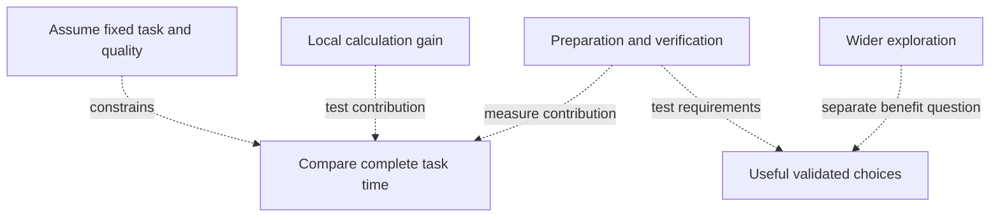
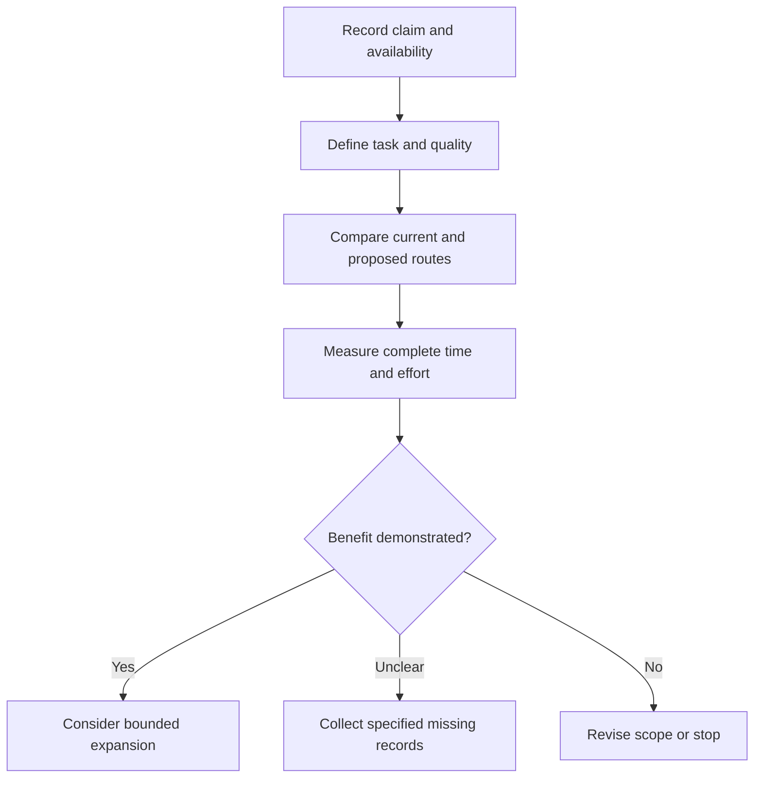

## Which part of the engineering task needs to get faster?

An engineering team evaluating industrial AI should start with its schedule. Is a calculation taking too long? Is there too little time to compare designs, or too much work involved in deploying an autonomous system? These problems can overlap, but a performance claim about one does not answer the others. For procurement, the question is which evidence would show that a faster component improves the complete engineering task.

In its [October 14, 2026 semiconductor announcement, preserved in the supplied local snapshot](https://nvidianews.nvidia.com/news/nvidia-and-semiconductor-leaders-advance-ai-across-chip-design-and-manufacturing-for-ai-defined-labs), NVIDIA reported that `cuPotential` accelerated already GPU-optimized atomic simulation workflows by an additional 2 to 3 times in early-access testing. In the [Nordic ecosystem article cached on October 15, 2026](https://blogs.nvidia.com/blog/nordics-technology-ecosystem/), it described Toyota Material Handling Europe adopting a simulation-first approach with NVIDIA and SoftServe, cutting autonomous solution deployment time by up to 50% across its global engineering, manufacturing and innovation teams.

The first figure concerns computation within simulation workflows; the second concerns deployment time. Neither establishes how much another team's schedule would improve. They cannot form a performance ranking or be combined into an estimate of factory capacity. Their relevance depends on the task boundaries, comparison baseline and quality requirements.

For `cuPotential`, the [release describes specialized functions for modeling electrical forces and other atomic interactions](https://nvidianews.nvidia.com/news/nvidia-and-semiconductor-leaders-advance-ai-across-chip-design-and-manufacturing-for-ai-defined-labs), without a detailed timing breakdown of the measured workflow. For Toyota, the [blog reports a deployment reduction](https://blogs.nvidia.com/blog/nordics-technology-ecosystem/) without defining the activities at the start and end of the measurement. Buyers cannot fill those gaps with plausible implementation details.

Both the [semiconductor release](https://nvidianews.nvidia.com/news/nvidia-and-semiconductor-leaders-advance-ai-across-chip-design-and-manufacturing-for-ai-defined-labs) and the [Nordic article](https://blogs.nvidia.com/blog/nordics-technology-ecosystem/) are NVIDIA publications. Different URLs and partner examples provide different cases, not independent corroboration. Their figures are vendor-reported or vendor-relayed disclosures. That does not establish that the claims are false. The material can help identify tools and questions for a controlled trial, but cannot by itself establish improved fab yield, factory capacity or fleet profitability. A larger commitment needs evidence connecting the reported result to the buyer's own task.

## Put baselines and status beside every performance claim

A multiplier relates two measurements. Its usefulness depends on what was measured, what it was compared with and whether the capability is available. The [semiconductor announcement](https://nvidianews.nvidia.com/news/nvidia-and-semiconductor-leaders-advance-ai-across-chip-design-and-manufacturing-for-ai-defined-labs) contains three different cases: an incremental improvement over an optimized workflow, performance comparable with an existing implementation, and an expected capability in a planned integration.

For `cuPotential`, [NVIDIA reports an additional 2 to 3 times acceleration over already GPU-optimized workflows in early-access testing](https://nvidianews.nvidia.com/news/nvidia-and-semiconductor-leaders-advance-ai-across-chip-design-and-manufacturing-for-ai-defined-labs). The release separately identifies Synopsys as an early adopter for materials simulation. It does not attribute that measured multiplier specifically to Synopsys, so the adopter's name must not become the owner of the benchmark result.

The baseline must remain an already optimized GPU workflow, rather than an unoptimized CPU implementation. The passage does not supply the complete hardware configuration, workload selection or numerical tolerances needed for reproduction. It supports investigating an incremental gain under the reported conditions, without establishing the same gain across all materials simulations. These qualifications belong alongside the multiplier, including in management summaries.

[KLA's comparison has two reference points](https://nvidianews.nvidia.com/news/nvidia-and-semiconductor-leaders-advance-ai-across-chip-design-and-manufacturing-for-ai-defined-labs). NVIDIA says KLA applied insights from highly optimized production kernels to a new NPP NCC kernel. Its performance was 50 times faster than earlier CPU versions and comparable with KLA's hand-tuned implementations. The release therefore does not report a further 50-fold improvement over KLA's existing optimized performance.

A supported library with comparable performance might be worth evaluating as a replacement for custom code. Whether it reduces integration and maintenance effort requires a separate comparison; the announcement does not quantify that saving. An advantage over a historical implementation answers a different procurement question from an advantage over the method currently in production.

[Lam Research's `NanoVDB` example also carries a delivery condition](https://nvidianews.nvidia.com/news/nvidia-and-semiconductor-leaders-advance-ai-across-chip-design-and-manufacturing-for-ai-defined-labs). The detailed release says Lam intends to integrate the open-source library into `SEMulator3D`, part of its Semiverse Solutions portfolio. The addition is expected to accelerate select wafer-etch modeling by up to 30 times, with the capability targeted for release by the end of 2026. The planned integration, selected workload and expected result must accompany the number, including in a headline. It cannot be presented as a delivered production result.

| Case | Object and baseline | Reported result | Status and evidence boundary |
| :--- | :--- | :--- | :--- |
| [`cuPotential` early-access testing](https://nvidianews.nvidia.com/news/nvidia-and-semiconductor-leaders-advance-ai-across-chip-design-and-manufacturing-for-ai-defined-labs) | Atomic simulation; already GPU-optimized workflows | Additional 2 to 3x | Early access; multiplier is not specifically attributed to Synopsys. Complete test configuration is not supplied. |
| [KLA / NPP NCC](https://nvidianews.nvidia.com/news/nvidia-and-semiconductor-leaders-advance-ai-across-chip-design-and-manufacturing-for-ai-defined-labs) | Image-processing kernel; earlier CPU versions and hand-tuned implementations | 50x versus earlier CPU versions; comparable with hand-tuned implementations | Does not establish an improvement over KLA’s optimized implementation. Complete comparison conditions are not supplied. |
| [Lam / `NanoVDB`](https://nvidianews.nvidia.com/news/nvidia-and-semiconductor-leaders-advance-ai-across-chip-design-and-manufacturing-for-ai-defined-labs) | Select wafer-etch modeling in `SEMulator3D`; detailed comparison configuration not supplied | Expected acceleration of up to 30x | Integration intended; capability targeted for release by end of 2026. |

*Table 1: Distinct claims in NVIDIA's October 14 release. Missing conditions are evaluation questions, not evidence of poor performance.*

[Other figures in the release](https://nvidianews.nvidia.com/news/nvidia-and-semiconductor-leaders-advance-ai-across-chip-design-and-manufacturing-for-ai-defined-labs) need the same treatment. Early Synopsys QuantumATK results show a potential 30-fold speedup using `cuEST`; S-Device benchmarks show a 12-fold speedup using `cuDSS`; Cadence AuraStack optimizes packages for heat and stress 8 times faster using `cuDSS` with Celsius. These concern distinct workloads and comparisons, so they cannot form a common ranking.

## How local acceleration reaches the whole workflow

A reproducible local improvement still leaves the question of how much of the complete task it affects. A simple model can identify that dependency without inventing measured time allocations for any partner.

Assume a fixed task with unchanged output requirements. Let its original duration consist of an accelerated computational portion, `T_comp`, and all remaining work, `T_other`. If computation becomes `S` times faster and everything else stays constant:

T_total(S) = T_comp / S + T_other.

This is an illustrative calculation, not a benchmark from either source. It assumes that the work can be separated this way, that acceleration adds no preparation, integration or verification time, and that the two portions contribute additively to completion. A local evaluation must establish whether those assumptions fit.

Under these conditions, accelerating a calculation that occupies much of the original duration offers more scope to shorten the total than accelerating a small part. The [semiconductor release](https://nvidianews.nvidia.com/news/nvidia-and-semiconductor-leaders-advance-ai-across-chip-design-and-manufacturing-for-ai-defined-labs) supplies no workflow time shares for calculating that effect in these cases. Applying Lam's expected up-to-30-fold acceleration directly to an entire engineering schedule would exceed the evidence.

The necessary records are the original calculation time, remaining task time and new calculation time under comparable conditions. Changed preparation or checking work requires revising the assumption that remaining work stays constant. Without those records, the formula describes a relationship to investigate, not a numerical forecast.

Component timings and consistently defined completion times answer different questions, so a trial investigating both needs both. A component report leaves the rest of the task unmeasured; total duration alone does not isolate which activity changed. Nor can this additive model simply absorb parallel activities. If calculation and preparation overlap, adding their durations may overstate elapsed time. The team must identify the activities that determine completion and record their dependencies. This limitation concerns the model, not any named company's operations.

Elapsed time and engineer effort also need separate records. Does calculation block the next decision or run alongside other work? Would an earlier answer advance completion, or merely free computing capacity while leaving the delivery date unchanged? The answers determine which decision a local performance gain can support.

Acceleration can also change the amount of work undertaken. [NVIDIA reports that Luminary uses `PhysicsNeMo`](https://nvidianews.nvidia.com/news/nvidia-and-semiconductor-leaders-advance-ai-across-chip-design-and-manufacturing-for-ai-defined-labs) to train models predicting temperature, pressure drop and thermal stress across semiconductor package configurations. Engineers can reportedly explore 100 times more designs within the same schedule without running a new simulation for every option. This is an exploration result; it establishes neither a corresponding reduction in project duration nor 100 times more useful, validated designs.

Before testing, decide whether the aim is to finish a fixed candidate set earlier or obtain more useful choices within a fixed schedule. Both benefits may occur, but candidate counts alone do not resolve engineering value. Could wider exploration improve the final choice? Could the review burden limit that benefit? Neither mechanism is demonstrated for Luminary in the announcement. A trial can investigate them by following candidates through screening, further simulation and the final decision.

*Diagram 1: An analytical relationship map. Dotted arrows mark questions to test, not established causal effects or an event sequence.*

When both benefits occur, retain the changes to task scope so later comparisons still have a consistent baseline.

## Faster simulation still needs evidence of validity

Speed and suitability require separate measurements: whether an answer arrives sooner and whether it meets the standard for the intended decision. Acceptance needs both. The [semiconductor release discusses accelerated computational libraries and physics AI prediction](https://nvidianews.nvidia.com/news/nvidia-and-semiconductor-leaders-advance-ai-across-chip-design-and-manufacturing-for-ai-defined-labs), which call for different checks.

For accelerated calculation, compare outputs under the same task definition and acceptance tolerances. The presence of a GPU library does not establish numerical suitability in a particular implementation. For a predictive model, determine the conditions under which its predictions meet the intended standard.

[NVIDIA says Lam's use of `PhysicsNeMo` has been demonstrated to assist in reducing plasma-prediction simulation time from days to as little as milliseconds](https://nvidianews.nvidia.com/news/nvidia-and-semiconductor-leaders-advance-ai-across-chip-design-and-manufacturing-for-ai-defined-labs). The qualifications matter: a demonstration, assistance in reducing time, and a minimum reported duration. The passage supplies no error distribution or evidence of unrestricted validity or the same effect across operating conditions.

[Luminary's exploration result](https://nvidianews.nvidia.com/news/nvidia-and-semiconductor-leaders-advance-ai-across-chip-design-and-manufacturing-for-ai-defined-labs) requires follow-up records too. How many predictions need checking, and how much work does that take? The release does not say. Buyers should ask how acceptable and uncertain predictions are distinguished and include additional checking in the task comparison. These are evaluation criteria, not allegations of failure.

The [Nordic article describes how ABB Robotics connects simulation with physical robots](https://blogs.nvidia.com/blog/nordics-technology-ecosystem/). ABB developed `RobotStudio HyperReality` using NVIDIA Omniverse libraries, combining simulation with a virtual controller running the same firmware as its physical robots. Real-world data continuously improves the digital model. According to ABB Robotics, the solution delivers up to 99% simulation accuracy and reduces commissioning time by up to 80%.

These details describe parts of the connection between virtual and physical systems. They neither define the accuracy percentage nor demonstrate coverage of every relevant physical interaction. The [article](https://blogs.nvidia.com/blog/nordics-technology-ecosystem/) does not say whether accuracy concerns a particular quantity, an aggregate score or another method. Its public account also leaves baseline duration and sample distributions unresolved. The percentage cannot be translated into task success, safety assurance or long-term reliability.

| Case | Reported benefit and validation object | Field connection and missing definition | Record to request |
| :--- | :--- | :--- | :--- |
| [ABB Robotics](https://blogs.nvidia.com/blog/nordics-technology-ecosystem/) | Up to 99% simulation accuracy; up to 80% less commissioning time | Same-firmware virtual controller and real-world data updates are described; accuracy metric and commissioning boundary are not defined. | Defined error measures, comparable task boundaries and corresponding field records. |
| [Lam / `PhysicsNeMo`](https://nvidianews.nvidia.com/news/nvidia-and-semiconductor-leaders-advance-ai-across-chip-design-and-manufacturing-for-ai-defined-labs) | Assistance in reducing plasma prediction from days to as little as milliseconds | Prediction timing is reported; detailed field-validation procedure and error distribution are not supplied. | Quality comparisons, evaluated conditions and additional checking effort. |
| [Luminary / `PhysicsNeMo`](https://nvidianews.nvidia.com/news/nvidia-and-semiconductor-leaders-advance-ai-across-chip-design-and-manufacturing-for-ai-defined-labs) | 100x more designs explored within the same schedule | Package-property predictions are described; useful-candidate and follow-up validation records are not supplied. | Screening, follow-up simulation and decision records. |

*Table 2: Evidence boundaries and proposed evaluation records. The linked passages do not supply all the records requested here.*

[Toyota's deployment reduction](https://blogs.nvidia.com/blog/nordics-technology-ecosystem/) needs deployment records: included activities, comparable project conditions and a definition of completion. Whether virtual preparation contributed, and by how much, remains a question. The blog associates the simulation-first approach with the result without isolating individual activities' contributions. A local trial should investigate that breakdown rather than assume it.

## When limited evidence can justify a pilot

An engineering director can reasonably argue that public evidence need not answer every question before an internal test. A team with an identified computational bottleneck, representative tasks and the ability to assess quality has the basis for a bounded experiment. Requiring a complete public account first could make the questions that the experiment is meant to answer into prerequisites for starting it.

The evidence needed to justify testing differs from that needed for broad deployment. The [semiconductor announcement](https://nvidianews.nvidia.com/news/nvidia-and-semiconductor-leaders-advance-ai-across-chip-design-and-manufacturing-for-ai-defined-labs) identifies specific libraries and applications; the [Nordic article](https://blogs.nvidia.com/blog/nordics-technology-ecosystem/) provides partner-reported commissioning and deployment results. These details can guide tool selection and trial design without guaranteeing another team's outcome. Missing independent verification does not make the reported benefits false or invalid.

The condition is that the buyer can supply what the public passages leave unresolved. A trial needs a maintained baseline, representative inputs and a defined quality standard, together with records of the complete task. Otherwise, how would it distinguish improvement attributable to the new workflow from differences in scope or acceptance requirements?

Begin with the current production method. Compare inputs and keep the definition of acceptable completion unchanged. Record elapsed task time separately from engineer effort, including any additional preparation and review required by the new route. This tests whether the benefit survives the complete task boundary.

Task selection limits the conclusion. A trial addressing a known bottleneck can establish usefulness for the work tested, provided it states which conditions were exercised and which remain untested. A positive result can support a next stage with matching scope. It need not establish universal readiness to be useful.

Evidence that would weaken concern about local gains failing to improve the whole workflow would be repeated completion of comparable tasks in less time, under unchanged quality requirements, with integration and verification effort included. If obtained, that result could support adoption for those tasks even without reproducing the vendor's exact multiplier.

A gain that disappears against the current implementation, or savings consumed by checking and maintenance, would reduce the multiplier's procurement value. Such a finding would not necessarily contradict the vendor's original comparison; it would show that the comparison does not settle this buyer's decision. A different proposed benefit would then need its own evaluation.

Mixed results are possible: more exploration without a shorter schedule, or faster computation without less engineer effort. Report them in those terms. Before testing, specify which outcomes justify continuing, which require another measurement and which close the evaluation. An inconclusive result then has a defined next step without being classified as success or failure by default. These are conditions for future observations, not claims that any named partner has already succeeded or failed under them.

## Turn performance claims into acceptance questions

Acceptance criteria should match the claimed benefit. Computational libraries, exploration tools and deployment platforms need different records. The questions here are proposed evaluation criteria, not specifications or contractual terms reported by either source.

For a computational library, identify the current implementation and establish whether both routes complete the same calculation to the same acceptance standard. Record component timings and complete task duration. Include preparation, data movement and review wherever they affect completion. State the configurations tested and whether the workloads represent the team's actual constraint.

The [`cuPotential` comparison](https://nvidianews.nvidia.com/news/nvidia-and-semiconductor-leaders-advance-ai-across-chip-design-and-manufacturing-for-ai-defined-labs) must retain its already GPU-optimized baseline and general early-access attribution. The [KLA comparison](https://nvidianews.nvidia.com/news/nvidia-and-semiconductor-leaders-advance-ai-across-chip-design-and-manufacturing-for-ai-defined-labs) needs both reference points: earlier CPU versions and comparable hand-tuned implementations. If replacing custom code is a proposed benefit, measure integration and maintenance effort separately from computational speed.

For an exploration tool, define a useful candidate. Record output checks, the handling of uncertain cases and the further simulation required. Does the larger candidate set change the engineering choice under the same acceptance requirements, or provide a useful alternative within the available schedule? These questions establish more than a count of generated predictions.

For virtual commissioning and autonomous deployment, define the task's beginning, end and included activities. Record virtual preparation and physical deployment separately while retaining complete duration. Keep completion criteria consistent across projects and document differences that limit comparability. The acceptance boundary must match the benefit being purchased: a promise of shorter deployment cannot be accepted solely on the speed of a computational module.

[ABB's accuracy claim and Toyota's deployment claim](https://blogs.nvidia.com/blog/nordics-technology-ecosystem/) therefore need different definitions. ABB's needs an explicit accuracy measure; Toyota's needs a comparable deployment boundary. A description such as "simulation-first" cannot substitute for either record. The operational test is whether the intended task reaches acceptable completion sooner or with less effort.

[Availability also differs in the October 14 announcement](https://nvidianews.nvidia.com/news/nvidia-and-semiconductor-leaders-advance-ai-across-chip-design-and-manufacturing-for-ai-defined-labs). `cuPotential` is in early access, `NanoVDB` is available as open source within OpenVDB, and NPP is available through CUDA Toolkit. Lam's accelerated `SEMulator3D` capability is targeted for release by the end of 2026. These are historical status statements from the release, not subsequent delivery confirmations. Availability of a library does not establish delivery of the planned application integration.

An inconclusive comparison should state what prevented a decision. If output quality was never checked, a shorter recorded duration leaves suitability unresolved. If quality was checked but preparation time was omitted, the missing observation concerns the complete schedule. These situations call for different follow-up records. Neither justifies entering a confirmed benefit in the acceptance document. This distinction is a proposed way to interpret the trial, not a description of a partner's results.

The same document should distinguish a measured failure to meet an agreed criterion from an unmeasured criterion. In the first case, a repeated trial would need a reason, such as a clearly identified change to the proposed workflow. In the second, the next step could be to collect the omitted observation while keeping the original criterion. Replacing a criterion after seeing an unfavorable result would answer a different question; record that change and assess the new question separately.

For a trial covering only part of the intended work, describe that coverage beside the decision. A team could accept the demonstrated use while leaving other uses unresolved, provided the commitment respects those limits. Any proposed expansion would then have a specific evidence gap to address. This keeps an encouraging local result useful without turning untested work into an implied approval.

*Diagram 2: A proposed evaluation sequence, not a reported partner implementation. It assumes comparable tasks and applicable quality requirements.*

The decision record should retain demonstrated benefits, their conditions and unresolved questions, including unsuccessful and inconclusive comparisons. That gives procurement a basis for a bounded commitment and leaves later evaluators a record of assumptions still needing tests.

## Which field results are still missing?

The [semiconductor release](https://nvidianews.nvidia.com/news/nvidia-and-semiconductor-leaders-advance-ai-across-chip-design-and-manufacturing-for-ai-defined-labs) and [Nordic article](https://blogs.nvidia.com/blog/nordics-technology-ecosystem/) identify tools, workloads and partner-reported results worth investigating. They support conditional engineering evaluation, without establishing a general magnitude of improvement in manufacturing productivity or economic return.

The evidence gaps concern these supplied [semiconductor](https://nvidianews.nvidia.com/news/nvidia-and-semiconductor-leaders-advance-ai-across-chip-design-and-manufacturing-for-ai-defined-labs) and [Nordic snapshots](https://blogs.nvidia.com/blog/nordics-technology-ecosystem/). For the comparisons discussed, they lack complete reproducible configurations, comprehensive error definitions, full task logs, long-term field records and complete integration costs. This does not establish that the companies have never measured these things, that no improvement occurred, or that independent evidence exists nowhere else. It leaves both some outcomes and their magnitude unestablished in these materials.

Several observations could change the assessment. [NVIDIA and ChipAgents describe work on `Build-A-Chip Bench`](https://nvidianews.nvidia.com/news/nvidia-and-semiconductor-leaders-advance-ai-across-chip-design-and-manufacturing-for-ai-defined-labs), intended to evaluate agents across workflows from specification to graphic data system. Its evaluation definitions and available results could provide evidence; the development announcement itself does not establish the local outcomes buyers need.

For [Lam's planned `NanoVDB` integration](https://nvidianews.nvidia.com/news/nvidia-and-semiconductor-leaders-advance-ai-across-chip-design-and-manufacturing-for-ai-defined-labs), buyers can examine actual release status, supported modeling scope and reproducible comparisons. For [ABB and Toyota](https://blogs.nvidia.com/blog/nordics-technology-ecosystem/), defined commissioning and deployment measurements with comparable field records would strengthen the connection to operational decisions. Comparable records showing acceptable task completion with less time or effort could support local adoption despite limited public detail. Until those records exist for the proposed use, a headline multiplier cannot supply the missing evidence.

## References

1. NVIDIA Newsroom — article body. [NVIDIA and Semiconductor Leaders Advance AI Across Chip Design and Manufacturing for AI-Defined Fabs | NVIDIA Newsroom](https://nvidianews.nvidia.com/news/nvidia-and-semiconductor-leaders-advance-ai-across-chip-design-and-manufacturing-for-ai-defined-labs).
2. NVIDIA Newsroom — article body. [The Nordics and NVIDIA Show What’s Possible When a Region Commits to Advanced Computing | NVIDIA Blog](https://blogs.nvidia.com/blog/nordics-technology-ecosystem/).
