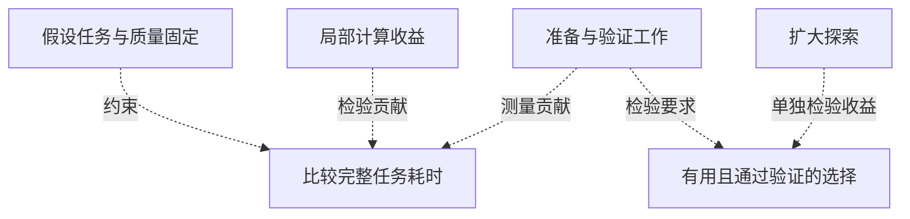
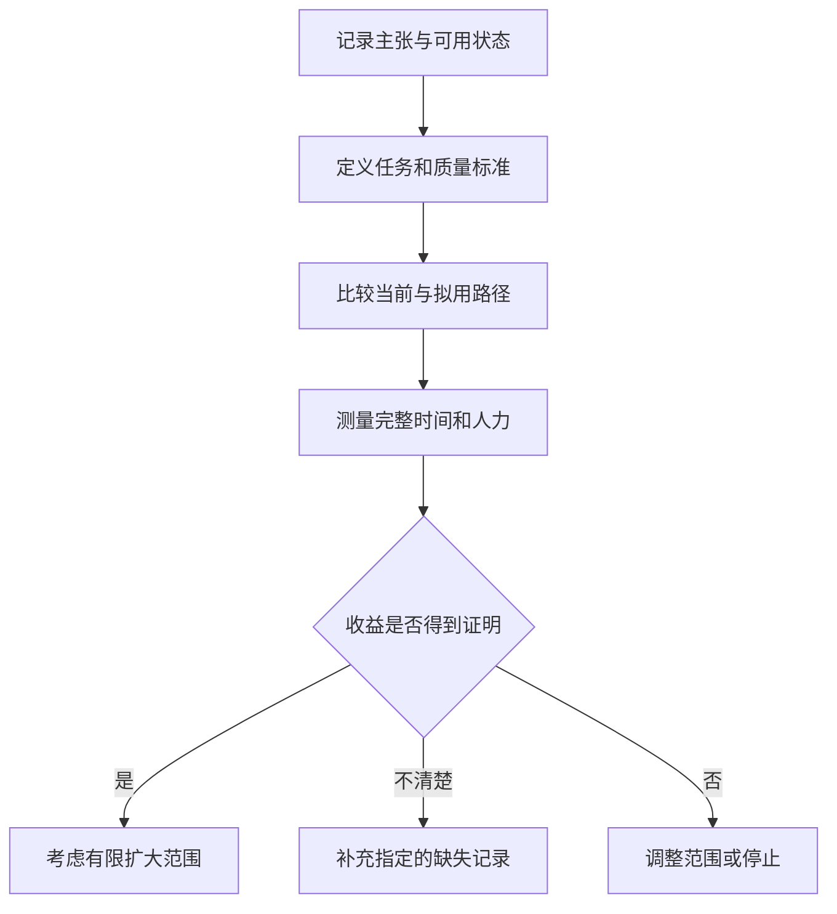

## 工程团队要节省哪段时间？

评估工业AI，工程团队应先看自己的排期：是一项计算等待太久，比较设计的时间不足，还是自主系统部署工作过长？这些问题可能相互关联，但针对其中一个问题的性能数字，不能自动回答其他问题。采购需要判断的是：什么证据能够确认，一个环节更快之后，完整工程任务也得到改善？

在[本地快照保存的2026年10月14日半导体公告](https://nvidianews.nvidia.com/news/nvidia-and-semiconductor-leaders-advance-ai-across-chip-design-and-manufacturing-for-ai-defined-labs)中，NVIDIA报告，`cuPotential` 库在早期访问测试中，使已经针对GPU优化的原子模拟工作流进一步加速2至3倍。在[2026年10月15日本地缓存的北欧生态文章](https://blogs.nvidia.com/blog/nordics-technology-ecosystem/)中，NVIDIA介绍，丰田欧洲物料搬运公司与NVIDIA、SoftServe合作，采用仿真优先的方法，使其全球工程、制造和创新团队的自主解决方案部署时间最多缩短50%。

前者描述模拟工作流内的计算表现，后者描述部署时间，都没有确定其他团队能节省多少排期。两者不能组成效果排名，也不能共同换算成工厂产能增长。团队需要先确定任务起止点、比较基线与质量要求，才能判断数字与自身工作的关系。

关于 `cuPotential`，[公告说明它提供建模电作用力及其他原子相互作用的专用函数](https://nvidianews.nvidia.com/news/nvidia-and-semiconductor-leaders-advance-ai-across-chip-design-and-manufacturing-for-ai-defined-labs)，没有给出被测工作流的详细耗时拆分。关于丰田，[博客报告了部署时间缩短](https://blogs.nvidia.com/blog/nordics-technology-ecosystem/)，却未说明测量从哪项活动开始、到哪项活动结束。评估者不能自行补入看似合理的实施步骤。

[半导体新闻稿](https://nvidianews.nvidia.com/news/nvidia-and-semiconductor-leaders-advance-ai-across-chip-design-and-manufacturing-for-ai-defined-labs)与[北欧博客](https://blogs.nvidia.com/blog/nordics-technology-ecosystem/)均由NVIDIA发布。不同网址和合作伙伴提供了不同案例，不构成独立交叉验证；数字应归为供应商报告或转述。这个限制不能证明主张为假。材料可以帮助筛选工具、设计受控测试，却不足以单独证明良率、产能或车队盈利已经提高。扩大投入仍需把报告结果连接到买方自己的任务。

## 性能数字要连同基线与状态一起看

倍数表达两次测量的关系，其决策价值取决于测量对象、分母和能力是否可用。[半导体公告](https://nvidianews.nvidia.com/news/nvidia-and-semiconductor-leaders-advance-ai-across-chip-design-and-manufacturing-for-ai-defined-labs)包含三种情况：已优化流程上的增量改善、与现有实现相当的性能，以及计划集成中的预期能力。

[NVIDIA报告，`cuPotential` 在早期访问测试中，相对已针对GPU优化的工作流额外加速2至3倍](https://nvidianews.nvidia.com/news/nvidia-and-semiconductor-leaders-advance-ai-across-chip-design-and-manufacturing-for-ai-defined-labs)。公告另将新思科技列为材料模拟的早期采用者，没有把该倍数具体归属于新思科技。采用者名称不能直接变成基准结果的所有者。

比较基线必须保留为已优化GPU工作流，不能改写成未优化CPU实现。相关段落也没有披露复现所需的完整硬件、任务选择和数值容差。因此，可以检验所述条件下的增量收益，不能认定所有材料模拟都能获得同样改善。这些限定应与倍数一起进入管理汇报。

[科磊案例有两个必须同时保留的参照](https://nvidianews.nvidia.com/news/nvidia-and-semiconductor-leaders-advance-ai-across-chip-design-and-manufacturing-for-ai-defined-labs)：它将高度优化生产内核的经验用于新的NPP NCC内核，性能比早期CPU版本快50倍，与科磊手工调优实现相当。公告不支持“在现有优化性能上再提高50倍”的解读。

有支持的库若能提供相近性能，是否值得替代自研代码？这可以成为采购评估的问题，但集成和维护投入必须另行比较，公告没有量化这项节省。相对历史实现的优势，与相对当前生产方案的收益，回答不同问题。

[泛林集团的 `NanoVDB` 案例还带有交付条件](https://nvidianews.nvidia.com/news/nvidia-and-semiconductor-leaders-advance-ai-across-chip-design-and-manufacturing-for-ai-defined-labs)。正文说泛林计划将开源库集成进Semiverse Solutions产品家族中的 `SEMulator3D`，预计使特定晶圆刻蚀建模最多加速30倍，相关能力目标为2026年年底发布。计划集成、特定任务和预期结果必须跟随数字，包括标题中的数字，不能写成已交付的生产结果。

| 案例 | 对象与比较基线 | 报告结果 | 状态与证据边界 |
| :--- | :--- | :--- | :--- |
| [`cuPotential`早期访问测试](https://nvidianews.nvidia.com/news/nvidia-and-semiconductor-leaders-advance-ai-across-chip-design-and-manufacturing-for-ai-defined-labs) | 原子模拟；已针对GPU优化的工作流 | 额外加速2至3倍 | 早期访问；倍数未具体归属于新思科技；未提供完整测试配置。 |
| [科磊 / NPP NCC](https://nvidianews.nvidia.com/news/nvidia-and-semiconductor-leaders-advance-ai-across-chip-design-and-manufacturing-for-ai-defined-labs) | 图像处理内核；早期CPU版本及手工调优实现 | 比早期CPU快50倍；与手工调优实现相当 | 不能推导相对现有优化实现再提高50倍；未提供完整比较条件。 |
| [泛林 / `NanoVDB`](https://nvidianews.nvidia.com/news/nvidia-and-semiconductor-leaders-advance-ai-across-chip-design-and-manufacturing-for-ai-defined-labs) | 特定晶圆刻蚀建模；未提供详细比较配置 | 预计最多加速30倍 | 计划集成；能力目标为2026年年底发布。 |

*表1：NVIDIA于10月14日披露的不同主张。缺失条件属于评估问题，不是性能不佳的证据。*

[同一公告中的其他数字](https://nvidianews.nvidia.com/news/nvidia-and-semiconductor-leaders-advance-ai-across-chip-design-and-manufacturing-for-ai-defined-labs)也应如此处理：新思科技QuantumATK早期结果显示，使用 `cuEST` 有潜在30倍提速；S-Device使用 `cuDSS` 的基准结果为12倍；Cadence AuraStack使用 `cuDSS` 与Celsius进行封装热与应力优化，报告快8倍。任务与比较不同，不能组成统一排名。

## 局部加速如何影响完整工作流

局部改善即便可以复现，也要知道它影响完整任务的多大部分。一个简单模型可以指出这种关系，无需为合作伙伴虚构时间比例。

假设任务范围和输出质量不变，原耗时由可加速计算 `T_comp` 与其余工作 `T_other` 组成。计算加速 `S` 倍，其余工作不变，则：

T_total(S) = T_comp / S + T_other。

这是解释性计算，不是来源中的基准结果。它假设工作可以如此拆分，没有新增准备、集成或验证时间，两部分以相加方式影响完成时间。实际评估必须先确认这些条件适用于本地任务。

在这些条件下，原本耗时较大的计算环节，比占时很小的环节有更大的总时间改善空间。[半导体公告](https://nvidianews.nvidia.com/news/nvidia-and-semiconductor-leaders-advance-ai-across-chip-design-and-manufacturing-for-ai-defined-labs)没有提供各案例的流程时间占比，无法据此计算完整任务收益。把泛林预期最多30倍的局部数字直接用于整个工程周期，会超出证据。

所需记录包括原计算耗时、其余任务耗时，以及可比条件下的新计算耗时。准备或检查工作若有变化，就要修改“其余工作不变”的假设。缺少记录时，公式只能提出待检验的关系，不能给出数值预测。

分环节计时与定义一致的完成时间回答不同问题，同时调查两者就需要两种记录。只有计算计时，无法了解其余工作；只有总耗时，无法分离哪个活动改变。相加模型也不能直接处理并行活动：计算与准备若有重叠，相加可能高估实际经过的时间。团队要识别决定完成时间的活动并记录依赖关系。这是模型的限制，不是对任何企业实际流程的陈述。

日历耗时与工程师工时也应分开。计算是否阻塞下一项决定，还是与其他工作并行？更早结束能推动任务完成，还是仅释放计算资源、交付日期不变？答案决定局部改善能支持什么决策。

加速还可能改变团队完成的工作量。[NVIDIA称，Luminary用 `PhysicsNeMo` 训练模型](https://nvidianews.nvidia.com/news/nvidia-and-semiconductor-leaders-advance-ai-across-chip-design-and-manufacturing-for-ai-defined-labs)，预测半导体封装配置的温度、压降和热应力，使工程师在相同排期内探索100倍设计，无需每个方案都重新运行模拟。这是探索结果，既不能推导项目工期同比缩短，也不能推导有用且通过验证的设计增加100倍。

测试前应确定，是要让固定候选集更早完成，还是在固定排期内获得更多有用选择。两种收益可以并存，但候选数量不能回答工程价值。扩大探索能否改善最终选择，额外复核是否限制收益？公告没有证明Luminary出现了任何一种机制。试点可沿候选去向调查：哪些被排除、哪些需要进一步模拟、哪些影响最终选择。

*图1：分析关系图。虚线表示待检验问题，不表示已经成立的因果效果，也不表示事件顺序。*

两种收益兼有时，保留任务范围变化的记录，以便后续比较仍有一致基线。

## 模拟得更快，还需检验结果是否适用

速度与适用性需要分别测量：答案是否更早到达，是否满足预定决定的标准。验收需要同时保留两者。[半导体公告介绍了加速计算库与物理AI预测](https://nvidianews.nvidia.com/news/nvidia-and-semiconductor-leaders-advance-ai-across-chip-design-and-manufacturing-for-ai-defined-labs)，它们需要不同检查。

对加速计算，应在相同任务定义和验收容差下比较输出。接入GPU库本身，不能证明具体实现已满足数值要求。对预测模型，则要确定哪些条件下的预测符合用途。

[NVIDIA说，泛林使用 `PhysicsNeMo` 已被演示可帮助将等离子体预测模拟从数天降至最低毫秒级](https://nvidianews.nvidia.com/news/nvidia-and-semiconductor-leaders-advance-ai-across-chip-design-and-manufacturing-for-ai-defined-labs)。这里的“演示”“帮助”和“最低”必须保留。段落没有提供误差分布，不能证明所有工况均适用，或均有相同效果。

[Luminary的探索结果](https://nvidianews.nvidia.com/news/nvidia-and-semiconductor-leaders-advance-ai-across-chip-design-and-manufacturing-for-ai-defined-labs)同样需要后续记录：多少预测需要检查，耗费多少工作？公告没有回答。买方应询问如何区分可接受结果与存疑结果，并把追加检查纳入完整任务比较。这些是验收问题，不是系统已经失效的指控。

[北欧文章描述了ABB Robotics连接虚拟与实体机器人的方式](https://blogs.nvidia.com/blog/nordics-technology-ecosystem/)：使用NVIDIA Omniverse库开发 `RobotStudio HyperReality`，将仿真与运行实体机器人相同固件的虚拟控制器结合，并利用现实数据持续改善数字模型。据ABB Robotics报告，方案可实现最高99%仿真准确度，使调试时间最多缩短80%。

这些细节描述了虚实连接的一部分，既没有定义准确度百分比，也没有证明覆盖全部相关物理交互。[文章](https://blogs.nvidia.com/blog/nordics-technology-ecosystem/)未说明准确度针对哪项物理量、综合评分还是其他方法，也未提供基线时长和样本分布。不能将该比例解释为任务成功率、安全保证或长期可靠性。

| 案例 | 报告收益与验证对象 | 现场联系及缺失定义 | 应请求的记录 |
| :--- | :--- | :--- | :--- |
| [ABB Robotics](https://blogs.nvidia.com/blog/nordics-technology-ecosystem/) | 最高99%仿真准确度；调试最多缩短80% | 描述了相同固件的虚拟控制器与现实数据更新；未定义准确度指标和调试边界。 | 误差定义、可比任务边界与对应现场记录。 |
| [泛林 / `PhysicsNeMo`](https://nvidianews.nvidia.com/news/nvidia-and-semiconductor-leaders-advance-ai-across-chip-design-and-manufacturing-for-ai-defined-labs) | 帮助将等离子体预测从数天降至最低毫秒级 | 报告预测耗时；未提供详细现场验证程序与误差分布。 | 质量对照、测试条件及追加检查工时。 |
| [Luminary / `PhysicsNeMo`](https://nvidianews.nvidia.com/news/nvidia-and-semiconductor-leaders-advance-ai-across-chip-design-and-manufacturing-for-ai-defined-labs) | 相同排期探索100倍设计 | 描述封装属性预测；未提供有效候选及后续验证记录。 | 筛选、后续模拟与决策记录。 |

*表2：证据边界与建议索取的评估记录。链接中的相关段落没有提供这里请求的全部记录。*

[丰田的部署缩减](https://blogs.nvidia.com/blog/nordics-technology-ecosystem/)需要部署记录说明包含活动、项目可比条件和完成定义。虚拟准备是否贡献收益、贡献多少，仍待调查。博客将仿真优先方法与结果联系起来，没有分离各活动的贡献；本地试点不能预设因果分配。

## 什么条件下，有限证据足以支持试点

工程负责人可以合理提出，内部测试之前，公开证据不必回答所有问题。团队若有明确计算瓶颈、代表性任务和质量判断能力，就有开展有限实验的基础。要求先获得完整公开记录，可能把实验要回答的问题变成启动前提。

支持测试与支持全面部署，证据门槛不同。[半导体公告](https://nvidianews.nvidia.com/news/nvidia-and-semiconductor-leaders-advance-ai-across-chip-design-and-manufacturing-for-ai-defined-labs)列出具体库和应用，[北欧文章](https://blogs.nvidia.com/blog/nordics-technology-ecosystem/)提供合作伙伴报告的调试与部署结果。这些可以指导选型和试验设计，不保证其他团队的结果。缺少独立验证，也不能据此认定报告收益为假或无效。

条件是买方能补足公开材料未回答的部分。试点需要持续维护的基线、代表性输入、明确质量标准和完整任务记录。否则，如何区分新流程带来的改善，与范围或验收要求变化造成的差异？

比较应从现行生产方案开始，输入可比，合格完成定义不变。日历耗时与工程师投入分别记录，新路径需要的追加准备和复核都计入，以检验收益能否在完整任务内保留。

任务选择限制结论范围。针对已知瓶颈的试点，可以说明工具对已测工作的用途，但须写明已覆盖与未覆盖条件。积极结果可以支持范围相符的下一阶段，无需证明普遍成熟才有价值。

如果可比任务反复以更少总时间完成，质量要求不变，集成与验证投入也已计入，就会削弱“局部收益难以改善完整流程”的担忧。获得这种结果，即使没有精确复现供应商倍数，也可以支持在相应任务中采用。

反过来，相对当前实现的收益消失，或节省被追加检查和维护消耗，会降低倍数的采购价值。这未必反驳供应商原比较，却说明它无法解决本地决策。若改提另一项收益，就应另行评价。

混合结果也可能有价值：探索更多但工期不变，计算更快但人力未减少，应据实报告。测试前应明确哪些结果支持继续、哪些需要追加测量、哪些结束评估，让不明确结果有具体下一步，不默认归为成功或失败。这些都是未来观察条件，没有暗示任何合作伙伴已出现相应成败。

## 把性能主张改写成验收问题

验收应对应所宣称的收益。计算库、探索工具和部署平台需要不同记录。以下问题属于建议的评价框架，不是来源披露的测试规范或合同条款。

对计算库，先确认当前实现，以及两条路径是否以相同标准完成同一计算。同时记录分环节计时与完整耗时，将影响完成的准备、数据移动和复核计入。写明测试配置，并说明任务是否代表团队实际受限的工作。

[`cuPotential`比较](https://nvidianews.nvidia.com/news/nvidia-and-semiconductor-leaders-advance-ai-across-chip-design-and-manufacturing-for-ai-defined-labs)须保留已针对GPU优化的基线与一般早期访问测试归属。[科磊比较](https://nvidianews.nvidia.com/news/nvidia-and-semiconductor-leaders-advance-ai-across-chip-design-and-manufacturing-for-ai-defined-labs)须同时保留早期CPU和手工调优实现两个参照。如果准备替代自研代码，应把集成、维护投入与计算速度分开测量。

对探索工具，先定义有用候选，记录输出检查、存疑情况处理及后续模拟需求。更多候选能否在相同验收要求下改变工程选择，或在现有排期内提供有用替代方案？这比预测生成数量更能回答采购问题。

对虚拟调试和自主部署，应定义任务起止点及包含活动。虚拟准备与实体部署分别记录，同时保留完整耗时。项目间保持完成标准一致，并记录限制可比性的差异。验收边界必须对应所购买的收益：承诺缩短部署，不能仅凭计算模块速度验收。

[ABB准确度与丰田部署主张](https://blogs.nvidia.com/blog/nordics-technology-ecosystem/)需要不同定义：前者是明确准确度指标，后者是可比部署边界。“仿真优先”不能替代任一记录。运营上要检验的是，预定任务能否以更少时间或投入达到合格完成。

[10月14日公告的可用状态也有区别](https://nvidianews.nvidia.com/news/nvidia-and-semiconductor-leaders-advance-ai-across-chip-design-and-manufacturing-for-ai-defined-labs)：`cuPotential`处于早期访问，`NanoVDB`作为OpenVDB的一部分开源提供，NPP通过CUDA Toolkit提供；泛林加速后的 `SEMulator3D` 能力目标为2026年年底发布。这是公告当时的历史状态，不是后来交付的确认。底层库可用，不能证明计划中的应用集成已交付。

比较未能得出结论时，应写明缺少什么判断条件。若没有检查输出质量，较短的记录耗时仍无法确定适用性；若质量已检查，却漏记准备时间，缺口就在完整排期。两种情况需要补充不同记录，都不能直接在验收文件中登记为已确认收益。这是建议的试点解释方法，不是合作伙伴已经取得的结果。

文件还应区分“实测未达到约定标准”和“该标准尚未测量”。前者若要重做试验，需要说明理由，例如拟用流程中哪项改变值得重新检验；后者可以在保留原标准的前提下补测遗漏项。看到不利结果后更换标准，回答的就是另一个问题，应记录变化并另行评估。

试点若只覆盖拟用工作的一部分，应把覆盖范围写在决定旁边。团队可以接受已证明的用途，将其他用途保留为未决，前提是投入承诺遵守这些限制。扩大范围时，便有明确的证据缺口需要补足。这样可以利用积极的本地结果，同时避免把未测试工作默认为已获认可。

*图2：建议的评估顺序，不代表合作伙伴实际实施过程；假设任务可比，质量要求持续适用。*

决策记录应保留已证明收益、成立条件和未决问题，包括未成功及不明确的比较。采购因而有范围明确的承诺依据，后续评估也能看见仍待检验的假设。

## 还缺哪些现场结果？

[半导体公告](https://nvidianews.nvidia.com/news/nvidia-and-semiconductor-leaders-advance-ai-across-chip-design-and-manufacturing-for-ai-defined-labs)与[北欧文章](https://blogs.nvidia.com/blog/nordics-technology-ecosystem/)提供了值得调查的工具、任务和合作伙伴结果，可以支持有条件的工程评估，没有确定制造生产率或经济回报的一般改善幅度。

缺口应限定于所供[半导体](https://nvidianews.nvidia.com/news/nvidia-and-semiconductor-leaders-advance-ai-across-chip-design-and-manufacturing-for-ai-defined-labs)与[北欧快照](https://blogs.nvidia.com/blog/nordics-technology-ecosystem/)：相关比较缺少完整可复现配置、全面误差定义、完整任务日志、长期现场记录和全部集成成本。这不能证明企业从未测量、改善没有发生，或其他地方不存在独立证据。材料既未证明某些结果是否发生，也未确定某些收益的幅度，两类限制都要保留。

后续观察可能改变判断。[NVIDIA与ChipAgents正在开发 `Build-A-Chip Bench`](https://nvidianews.nvidia.com/news/nvidia-and-semiconductor-leaders-advance-ai-across-chip-design-and-manufacturing-for-ai-defined-labs)，拟评估从规格到图形数据系统的智能体工作流。评价定义和可用结果可能提供证据，开发公告本身尚未证明买方所需的本地效果。

[泛林计划集成](https://nvidianews.nvidia.com/news/nvidia-and-semiconductor-leaders-advance-ai-across-chip-design-and-manufacturing-for-ai-defined-labs)的实际发布状态、支持建模范围和可复现比较，仍值得观察。[ABB与丰田](https://blogs.nvidia.com/blog/nordics-technology-ecosystem/)若提供定义明确的调试与部署测量，以及可比现场记录，也能加强报告收益与运营决策的联系。可比记录若证明合格任务以更少时间或投入完成，有限公开细节不必阻止本地采用。在拟用任务缺少这些记录时，标题倍数无法补足证据。

## 参考资料

1. NVIDIA Newsroom — article body. [NVIDIA and Semiconductor Leaders Advance AI Across Chip Design and Manufacturing for AI-Defined Fabs | NVIDIA Newsroom](https://nvidianews.nvidia.com/news/nvidia-and-semiconductor-leaders-advance-ai-across-chip-design-and-manufacturing-for-ai-defined-labs).
2. NVIDIA Newsroom — article body. [The Nordics and NVIDIA Show What’s Possible When a Region Commits to Advanced Computing | NVIDIA Blog](https://blogs.nvidia.com/blog/nordics-technology-ecosystem/).
