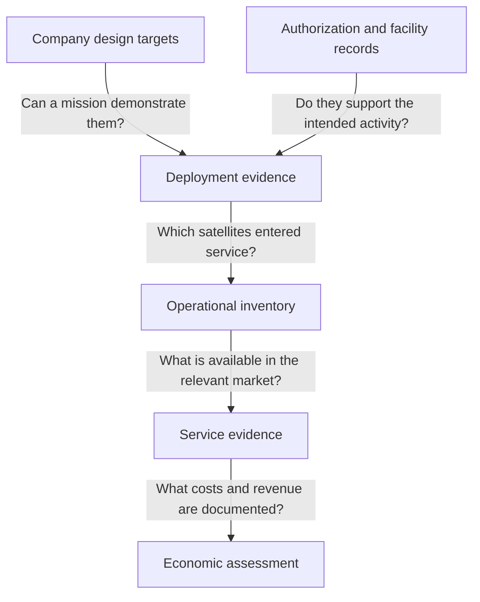
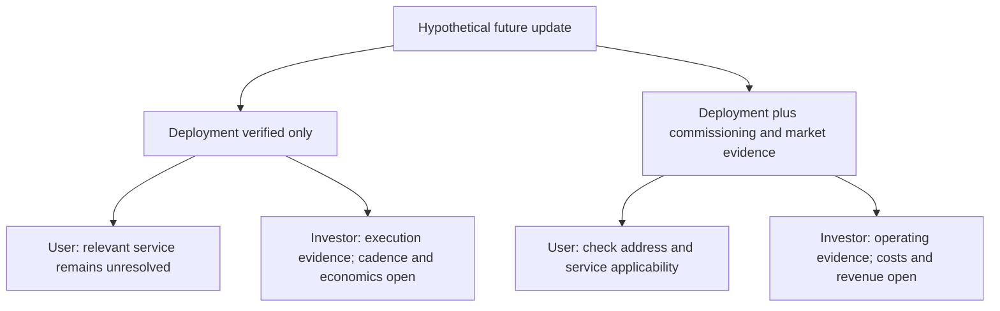

Archive date: 2026-10-13; published on 2026-10-14. This article uses the material saved for the archive date and retains its original reporting cutoffs.

## What users and investors need to know

A prospective satellite-broadband user wants a suitable connection at the place and time they need it. An investor examining the same infrastructure wants to know whether expansion can support sustained economic results. Both may follow a rocket announcement, but their decisions require different evidence. Which deployment, commissioning, authorization and service records would justify interpreting Starship’s technical progress as an improvement in usable Starlink supply?

The starting point is a historical company disclosure. The local research snapshot marked October 12, 2026 attributes approximately 9,600 Starlink satellites, approximately 10.3 million broadband subscribers and approximately 7.4 million monthly unique mobile devices to the [SpaceX EU Prospectus, dated June 5, 2026](https://content.spacex.com/cms-assets/FINAL_Documents%20and%20Updates/SpaceX%20-%20EU%20Prospectus%20%28Approved%20by%20Bafin%29%20-%20June%205%2C%202026.pdf). All three operating figures have a March 31, 2026 cutoff. The satellite count combines broadband and mobile satellites. The mobile-device measure covers approximately 30 countries and services including text messaging and OTT voice. The snapshot also records broadband subscriptions rising approximately 105% from approximately 5.0 million one year earlier.

These figures measure different objects. The satellite count describes disclosed physical scale, broadband subscriptions describe customer relationships, and monthly unique mobile devices describe reach over a measurement period. Subscriptions and mobile devices cannot be added into a single customer total or used directly to compare growth. Neither measure alone establishes connection quality, frequency of use or revenue per device.

The dates limit what the figures can support. The October snapshot date identifies the research record; it does not refresh the March operating cutoff. The historical year-on-year increase does not establish growth after March. A forward-looking assessment can use that base, provided subsequent growth remains an assumption requiring new evidence.

For a user, the next question is whether the evidence applies to the intended address, service and period of use. An investor also needs to examine operating capacity, costs and economic results. The global totals do not answer those questions. The material does not supply regional congestion, terminal-performance, pricing, unit-cost or business-segment profitability evidence sufficient to judge a particular plan or valuation.

The readers and future disclosures discussed below are hypothetical. They do not describe documented complaints, congestion or investment decisions. They help identify what would connect a technical milestone with a usable connection, and what further evidence would support an economic judgment. The analysis uses historical excerpts retained in the local snapshot, without full source text or page references, and does not claim a fresh verification of current events.

## Reading the disclosures together

A comparison needs to preserve the date, attribution and measured object of each statement. A design target identifies intended capability; a mission plan supplies objectives to watch; regulatory material defines an authorization boundary. Each can inform a judgment, but none establishes an operating result by itself.

The table summarizes the local historical snapshot marked October 12, 2026. Its links identify the sources associated with the retained entries. The final column sets out observations that would help resolve the remaining questions; it does not forecast results.

| Item | Dated disclosure retained in the local snapshot | Evidence status and boundary | Next useful observation |
| :--- | :--- | :--- | :--- |
| Constellation scale | [SpaceX prospectus](https://content.spacex.com/cms-assets/FINAL_Documents%20and%20Updates/SpaceX%20-%20EU%20Prospectus%20%28Approved%20by%20Bafin%29%20-%20June%205%2C%202026.pdf): approximately 9,600 broadband and mobile satellites combined, as of March 31, 2026 | Historical issuer disclosure; does not identify current operational capacity | Dated inventory distinguishing deployment and operating status |
| Broadband subscriptions | [Same prospectus](https://content.spacex.com/cms-assets/FINAL_Documents%20and%20Updates/SpaceX%20-%20EU%20Prospectus%20%28Approved%20by%20Bafin%29%20-%20June%205%2C%202026.pdf): approximately 10.3 million as of March 31, up approximately 105% from approximately 5.0 million a year earlier | Historical customer measure; does not establish later growth or local experience | A comparable disclosure with a new cutoff |
| Mobile reach | [Same prospectus](https://content.spacex.com/cms-assets/FINAL_Documents%20and%20Updates/SpaceX%20-%20EU%20Prospectus%20%28Approved%20by%20Bafin%29%20-%20June%205%2C%202026.pdf): approximately 7.4 million monthly unique devices as of March 31, 2026, across approximately 30 countries, including text and OTT voice | Separate reach measure; cannot be added to broadband subscriptions | Dated reach and service-composition information |
| V3 and deployment design | [June 5 company disclosure](https://content.spacex.com/cms-assets/FINAL_Documents%20and%20Updates/SpaceX%20-%20EU%20Prospectus%20%28Approved%20by%20Bafin%29%20-%20June%205%2C%202026.pdf): 1 Tbps downlink design value per V3 satellite; up to 60 V3 satellites per Starship mission; potential added capacity approximately 20 times that of current Falcon 9 missions | Company design and potential-capacity statements; not measured customer throughput | Actual deployment and operational-capacity records |
| Flight objectives | [SpaceX update dated September 15, 2026](https://www.spacex.com/updates/reusability): planned orbital missions from Flight 14, supporting payloads including V3 and testing first orbital propellant transfer | Future objectives in the retained disclosure; not completed results | Applicable authorization and objective-by-objective mission reporting |
| V3 deployment window | Local snapshot associated with the [prospectus](https://content.spacex.com/cms-assets/FINAL_Documents%20and%20Updates/SpaceX%20-%20EU%20Prospectus%20%28Approved%20by%20Bafin%29%20-%20June%205%2C%202026.pdf) and [company update](https://www.spacex.com/updates/reusability): company expectation of deployment beginning in the second half of 2026 | Dated expectation; the local review added no official deployment or commissioning quantities with a cutoff | Actual quantities, dates and entry-into-service status |
| Environmental and authorization boundary | Local snapshot associated with [FAA environmental material](https://www.faa.gov/space/stakeholder_engagement/spacex_starship/environmental_review), [the project page](https://www.faa.gov/space/stakeholder_engagement/spacex_starship) and [the license process](https://www.faa.gov/space/stakeholder_engagement/spacex_starship/license_review_process) | Environmental completion documents and proposed modification scope are separate from the requirement to obtain an experimental permit and/or operator license | The applicable authorization, its terms and evidence of execution |

SpaceX’s approximately twentyfold comparison concerns potential added capacity, according to the [prospectus entry retained in the snapshot](https://content.spacex.com/cms-assets/FINAL_Documents%20and%20Updates/SpaceX%20-%20EU%20Prospectus%20%28Approved%20by%20Bafin%29%20-%20June%205%2C%202026.pdf). It does not establish twentyfold subscription growth, revenue or local speed. Those outcomes require their own measurements. Multiplying the maximum deployment count by the single-satellite design value would still combine two prospective parameters. Actual payload quantity, operating status and market availability would remain unanswered; the product cannot be presented as user-available capacity.

The absence of a new quantity also needs careful interpretation. The V3 entry records no added official deployment or commissioning count with a cutoff. That leaves actual quantities unconfirmed in this review; it does not establish that deployment or commissioning did not occur.

The snapshot associated with the [September company update](https://www.spacex.com/updates/reusability) says the research process obtained no readable new company update and retained the verified September disclosure. The local [FAA project-page record](https://www.faa.gov/space/stakeholder_engagement/spacex_starship) says the review identified no new licensing fact attributable to after October 8. Both statements describe the local record’s limits. Neither proves that no later update, authorization or event exists.

## From launch capability to usable capacity

The local framework associated with the [SpaceX prospectus](https://content.spacex.com/cms-assets/FINAL_Documents%20and%20Updates/SpaceX%20-%20EU%20Prospectus%20%28Approved%20by%20Bafin%29%20-%20June%205%2C%202026.pdf) distinguishes deployed satellites, usable capacity, subscribers, coverage markets and service composition. Those categories support a series of conditional questions. They do not establish a measured causal mechanism connecting technical progress with service outcomes.

The diagram maps the evidence needed to connect these categories. Its arrows indicate relationships requiring verification, without asserting event order or completed progress.

*Conditional model. The questions are assumptions to test; no arrow reports a completed event or measured causal effect. Read the graph as an evidence map, not a mission timeline.*

Can an actual mission demonstrate the stated capability? The company’s [up-to-60 V3 deployment statement](https://content.spacex.com/cms-assets/FINAL_Documents%20and%20Updates/SpaceX%20-%20EU%20Prospectus%20%28Approved%20by%20Bafin%29%20-%20June%205%2C%202026.pdf) identifies a proposed ceiling. A mission record would establish what a particular flight carried and deployed. A smaller batch could demonstrate a narrower achievement without testing that ceiling. A general announcement of success therefore needs to be read against the objectives, payload and quantities actually reported.

Which deployed spacecraft have entered service? A record could confirm release into orbit without supplying an operating count. The next useful disclosure would identify spacecraft status and a cutoff date. An assumed commissioning duration or unsupported technical specification cannot close that gap. It might complete a projection on paper while leaving its operating claim unverified.

Gross additions also differ from net operating supply. A comparison needs to identify the new batch’s status and changes elsewhere in the inventory over compatible periods. A deployment total alone cannot establish a net operating increase. If one number measures releases and another measures entry into service, their difference cannot be treated as a loss or efficiency measure without explaining the definitions.

What capacity is available to the relevant market and service? A global operating count would still leave that question open. The snapshot’s [service framework](https://content.spacex.com/cms-assets/FINAL_Documents%20and%20Updates/SpaceX%20-%20EU%20Prospectus%20%28Approved%20by%20Bafin%29%20-%20June%205%2C%202026.pdf) proposes tracking added usable capacity per launch, subscription increments, coverage markets and service composition. For a user, the value comes from connecting those categories to the intended connection. Global totals alone cannot determine local speed, coverage or purchasable plans.

The distinction between broadband subscriptions and mobile reach matters here. If a future disclosure reports additional mobile-device reach but omits broadband-capacity information, it may answer a mobile-service question while leaving a broadband user’s question unresolved. The reverse applies too. A coverage announcement needs to identify the service covered before it can support a comparison with an earlier record or establish what connection can be purchased and used.

Does the evidence establish availability, performance, or both? In a hypothetical market, an ordering record could show that service is available for purchase. Comparable performance records would address experience. Each observation needs to match the intended address, use and period. A sample from another service or observation window may be informative, but its relevance needs explanation before it supports a purchasing judgment.

An investor then needs to ask what costs and revenue accompany the operating addition. Commissioning evidence could strengthen confidence that infrastructure has become operational while leaving commercial results unresolved. Revenue requires its own measurement. Cash receipts, if later disclosed, must be identified separately; neither measure can silently substitute for the other. No monetary amount or currency conversion is supplied here, and capacity units cannot establish a financial result.

## What authorization and mission records establish

The local snapshot associated with the [FAA environmental material dated March 10, 2026](https://www.faa.gov/space/stakeholder_engagement/spacex_starship/environmental_review) and [project page updated September 2, 2026](https://www.faa.gov/space/stakeholder_engagement/spacex_starship) records environmental completion documents and proposed license-modification scope. It also states that SpaceX must apply for and obtain an experimental permit and/or operator license. Environmental completion does not constitute operating authorization.

The proposed modification describes a scope under consideration. The permit and/or license requirement describes the authorization boundary. The snapshot does not establish that the required operator authorization must take the form of a modification. That judgment requires the applicable instrument and its terms; merging the statements would create a more specific legal requirement than the record supports.

The retained [FAA license-review process dated September 14, 2026](https://www.faa.gov/space/stakeholder_engagement/spacex_starship/license_review_process) supplies procedural context. A reader needs to distinguish a review, a proposal and permission granted. An authorization answers what is permitted within its scope. A subsequent mission record answers what actually happened. The historical review’s failure to identify a licensing fact after October 8 cannot support a present-tense claim that Flight 14 lacks permission. Any later authorization would require assessment on its own date and terms.

Mission objectives require similarly separate readings. The retained [September 15 SpaceX update](https://www.spacex.com/updates/reusability) describes planned orbital missions from Flight 14, payload support including V3 and testing first orbital propellant transfer. These remain plans in this record, not completed flights, deployments or transfers. Transfer evidence would answer the transfer question; deployment evidence would answer the deployment question. This analysis does not assume transfer is a necessary prerequisite for V3 deployment or treat it as proof of service improvement.

A hypothetical report confirming deployment while leaving transfer unresolved would retain value as deployment evidence. A report confirming transfer without V3 deployment or commissioning evidence would leave the service-supply question open. Objective-by-objective reporting allows each result to be assessed on its own terms.

Sustained cadence needs more than one mission result. The local framework associated with the [license process](https://www.faa.gov/space/stakeholder_engagement/spacex_starship/license_review_process), [environmental material](https://www.faa.gov/space/stakeholder_engagement/spacex_starship/environmental_review) and [project page](https://www.faa.gov/space/stakeholder_engagement/spacex_starship) proposes tracking authorized frequency, permission changes and actual facility availability separately at Starbase and LC-39A. This monitoring agenda neither establishes authorization for both sites nor supplies a verified future flight rate.

Reuse needs its own evidence. The local framework associated with the [SpaceX update](https://www.spacex.com/updates/reusability) and [FAA license process](https://www.faa.gov/space/stakeholder_engagement/spacex_starship/license_review_process) calls for checking each flight’s preset objectives and evidence that the same hardware flies again. Recovery and reflight answer different questions. The [prospectus-associated Falcon framework](https://content.spacex.com/cms-assets/FINAL_Documents%20and%20Updates/SpaceX%20-%20EU%20Prospectus%20%28Approved%20by%20Bafin%29%20-%20June%205%2C%202026.pdf) tracks annual launches, mission composition, reuse counts per booster and median turnaround time. It distinguishes Starlink, commercial, NASA and defense missions, without quantifying alternative capacity or a future flight rate.

## What an unfinished plan can contribute

Decisions often precede completed infrastructure. A disclosed customer base, specified design targets and dated mission objectives can help a reader form a forward-looking view. Waiting for every operating and financial result could exclude the future developments the decision is intended to evaluate.

This is an editorial counterargument, not a position attributed to SpaceX, the FAA or a documented investor. Its factual premises come from the retained [prospectus disclosures](https://content.spacex.com/cms-assets/FINAL_Documents%20and%20Updates/SpaceX%20-%20EU%20Prospectus%20%28Approved%20by%20Bafin%29%20-%20June%205%2C%202026.pdf) and [September mission plan](https://www.spacex.com/updates/reusability). Specified capability provides a target for comparison. The planned mission transition and deployment window identify what to observe and when the company expected it. These details give the plan information value while its outcome remains uncertain.

How much weight to give it depends on the judgment. A roadmap can support a conditional view of the proposed expansion and the evidence that would demonstrate progress. A service judgment asks whether suitable supply is available to the relevant user. An economic judgment asks what results accompany that supply. A reader can assess direction while keeping the other questions open.

A limited forward-looking position could be that the disclosed pathway warrants attention, assuming authorization, execution and commissioning can be demonstrated. Those assumptions need to be explicit. The record does not support assigning a success probability, estimating how much expectation a valuation already reflects or predicting a return. Such numbers would add precision without evidence.

Future results should change the assessment at the layer they address. Dated deployment, commissioning and relevant-market service evidence would strengthen the corresponding judgments. A verified failure to meet an objective would weaken confidence in that objective. Deployment that did not become operating supply would weaken the deployment-to-service argument. An operating addition without an identifiable service increment would leave the market interpretation less well supported. These are prospective tests, not reports of failures.

Economic results present a further test. If future records showed unfavorable results alongside an engineering achievement, the commercial case would need reconsideration even while the technical result retained its value. If financial information remained absent, economics would remain unresolved. Missing disclosure would not itself demonstrate an adverse return.

Attribution also requires attention to other documented supply paths. The local [Falcon observation framework associated with the prospectus](https://content.spacex.com/cms-assets/FINAL_Documents%20and%20Updates/SpaceX%20-%20EU%20Prospectus%20%28Approved%20by%20Bafin%29%20-%20June%205%2C%202026.pdf) keeps launches, mission composition, reuse and turnaround in view, without quantifying substitution. If later evidence established improvement through Falcon-supported deployment or another operating change, the explanation would need to reflect it. Starship cannot be assumed necessary for every service improvement, and subscriber growth alone would not identify the cause.

## Reading the same update for different decisions

Consider a hypothetical user deciding whether to subscribe at a particular address and an investor assessing capacity expansion. Both encounter the same design and planning disclosures. Their first question is shared: what new evidence does this update add? Their next questions differ because one decision concerns an applicable connection, while the other also concerns repeatability and economics.

The two future branches below assert no actual event, deployment quantity, service improvement or financial result. They show how a record could strengthen one assessment while leaving another incomplete.

*Hypothetical decision branches. Arrows group the questions prompted by assumed evidence; they do not depict actual events or predict either reader’s action.*

In the first branch, a later record verifies V3 deployment without commissioning or relevant-market service evidence. The user can recognize the upstream achievement while asking what changes for the intended connection. Another record would need to establish entry into service and the applicable market. Deployment alone supplies no direct measurement of the address-level outcome.

The investor could revise the assessment of demonstrated execution. Questions would remain about repeatability, which satellites became operational and the economics of the addition. One deployment could justify further investigation without dictating a valuation change or investment action. Any projection would still need to identify assumptions that lacked observational support.

In the second branch, dated commissioning records and relevant-market service evidence are added. The user now has information closer to the purchasing question, but still needs to check the address, service and observation period. A broad market statement can support a narrower investigation without resolving every individual experience. Confidence should depend on the match between evidence and decision.

For the investor, this branch offers stronger support for an operating-supply assessment. The inquiry then turns to usable capacity added, its employment, costs and revenue, with any cash measures identified separately. An operating-status disclosure deserves credit for answering that question while undisclosed economic results remain open. Verification of an intermediate stage does not establish the whole chain.

| Decision dimension | Prospective user | Infrastructure investor |
| :--- | :--- | :--- |
| Primary question | Is suitable service available where I need it? | Can expansion support repeatable economic results? |
| Deployment-only evidence | An upstream milestone to investigate further | A demonstrated execution result |
| Remaining questions | Which satellites entered service, and does the relevant market benefit? | Commissioning, repeated execution, added usable capacity and economics |
| Commissioning plus market evidence | Stronger basis for checking service applicability | Stronger basis for assessing operating supply |
| Further decision evidence | Address relevance, service terms and comparable experience | Costs, revenue, separately identified cash measures and service composition |

A practical claim record can retain the date, source, measured object, decision relevance and unresolved condition together. It helps prevent an announcement from inheriting conclusions it does not establish. If a judgment changes later, the record can show which new evidence changed it, without requiring every genuine advance to produce an immediate purchase or investment decision.

Comparability matters as much as novelty. Does a later subscriber figure retain the definition and state a clear cutoff? Does an operating figure distinguish commissioning from deployment? Does service evidence identify its market and category? A definition change needs explanation before a trend can be inferred. A new number can be useful even when it cannot be compared directly with an earlier one.

Waiting for evidence and making a limited conditional judgment are both possible responses. The reader needs to state the assumptions and identify what future record would alter the decision. The snapshot’s [capacity, subscriber, market and service-composition framework](https://content.spacex.com/cms-assets/FINAL_Documents%20and%20Updates/SpaceX%20-%20EU%20Prospectus%20%28Approved%20by%20Bafin%29%20-%20June%205%2C%202026.pdf) supplies categories for that inquiry, rather than a finding about which response to choose.

## What the next disclosure could resolve

The retained [SpaceX design disclosure](https://content.spacex.com/cms-assets/FINAL_Documents%20and%20Updates/SpaceX%20-%20EU%20Prospectus%20%28Approved%20by%20Bafin%29%20-%20June%205%2C%202026.pdf) and [September mission plan](https://www.spacex.com/updates/reusability) identify a company-proposed expansion pathway. The local [FAA project snapshot](https://www.faa.gov/space/stakeholder_engagement/spacex_starship) establishes why environmental documentation and operating authorization require separate readings. Together they support a specific inquiry into usable supply, without establishing improved service or profitability.

The next useful record need not answer everything. An authorization could identify the permitted activity and scope. A mission report could compare results with preset objectives. Deployment evidence could state quantity and date; commissioning evidence could establish operating status. Clear definitions, dates and attribution would allow each disclosure to reduce uncertainty at its own layer.

Service evidence would then need to connect operating supply with the relevant market and service. Applicability remains the user’s deciding criterion. An investor would need costs and revenue, with cash measures treated separately where available. Stronger operating evidence would support a more developed economic inquiry without supplying its answer or establishing margins, prices or efficiency.

If later service records showed improvement, attribution would require evidence connecting that improvement with the relevant deployments and entry into service, while considering other documented supply changes. The local [prospectus-associated framework](https://content.spacex.com/cms-assets/FINAL_Documents%20and%20Updates/SpaceX%20-%20EU%20Prospectus%20%28Approved%20by%20Bafin%29%20-%20June%205%2C%202026.pdf) provides categories to investigate, not a completed causal explanation.

For each new disclosure, the reader can identify the layer it supports, check its date and definition, and record which unresolved condition still affects the intended decision. A stronger conclusion about usable Starlink service or economic results requires records connecting the separate stages of the disclosed Starship and V3 pathway.

## References

1. SpaceX. [EU Prospectus](https://content.spacex.com/cms-assets/FINAL_Documents%20and%20Updates/SpaceX%20-%20EU%20Prospectus%20%28Approved%20by%20Bafin%29%20-%20June%205%2C%202026.pdf). 2026-06-05.
2. SpaceX. [Starship to Orbit](https://www.spacex.com/updates/reusability). 2026-09-15.
3. FAA. [Starship/Super Heavy license review process](https://www.faa.gov/space/stakeholder_engagement/spacex_starship/license_review_process). 2026-09-14.
4. FAA. [SpaceX Starship/Super Heavy at Boca Chica environmental review](https://www.faa.gov/space/stakeholder_engagement/spacex_starship/environmental_review). 2026-03-10.
5. FAA. [SpaceX Starship Super Heavy Project at the Boca Chica Launch Site](https://www.faa.gov/space/stakeholder_engagement/spacex_starship). 2026-09-02.
