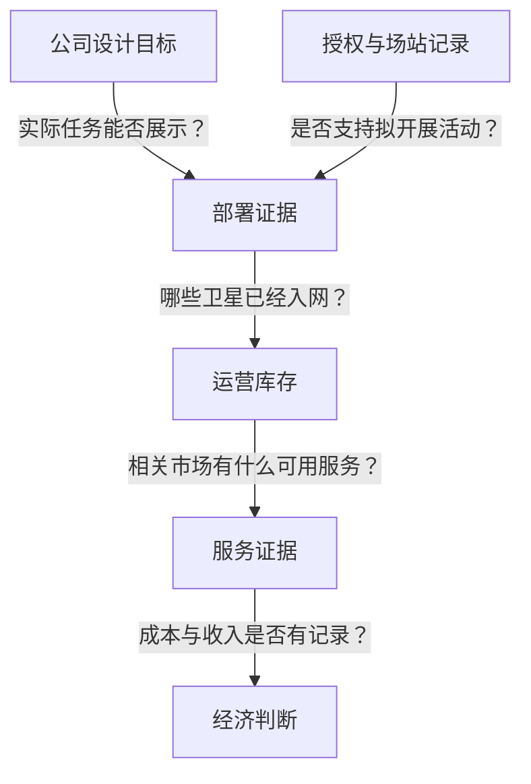
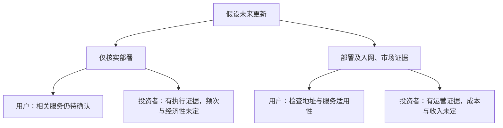

归档日期：2026-10-13；补发于 2026-10-14。本文使用原归档日保存的资料，资料中的经营截止日保持不变。

## 用户与投资者各需要什么证据

考虑订购卫星宽带的人，需要知道准备使用的地点和时段能否获得合适连接。关注基础设施扩张的投资者，则要判断新增供给能否支持持续的经济结果。两者都会留意火箭消息，但决策所需的证据不同：需要看到哪些部署、入网、许可和服务记录，才能把 Starship 的技术进展理解为 Starlink 实际供给的改善？

起点是一组历史公司披露。标记截至 2026 年 10 月 12 日的本地研究快照，引述[日期为 2026 年 6 月 5 日的 SpaceX EU 招股书](https://content.spacex.com/cms-assets/FINAL_Documents%20and%20Updates/SpaceX%20-%20EU%20Prospectus%20%28Approved%20by%20Bafin%29%20-%20June%205%2C%202026.pdf)：截至 2026 年 3 月 31 日，Starlink 卫星约 9,600 颗，宽带订阅用户约 10.3M，即 1030 万，月度独立移动设备约 7.4M，即 740 万。卫星数合计宽带与移动卫星；移动触达涉及约 30 个国家，包括短信与 OTT 语音。宽带订阅较一年前约 5.0M，即 500 万，增长约 105%。

卫星数描述披露的物理规模，宽带订阅描述客户关系，月度独立设备描述一定期间的触达。订阅与移动设备不能相加成为统一客户总数，也不能直接比较增长。这些指标本身无法确定连接质量、使用频率或单台设备收入。

十月是本地研究记录的日期，没有刷新三月的经营截止日；历史同比增幅也不代表三月以后的增长率。前瞻判断可以使用这个基础，但后续增长仍是需要新证据的假设。用户还需检查资料是否对应目标地址、服务和使用时段；投资者则需进一步调查运营容量、成本及经济结果。全球总量不能代答这些问题。

本文使用本地快照保留的历史摘录，没有来源全文或页码，也不声称重新核验了当前事件。材料缺少足以判断具体套餐或估值的地区拥塞、终端性能、价格、单位成本及分业务盈利资料。下文人物与未来分支均为思想实验，不代表已有投诉、拥塞或真实投资决定。

## 把披露放在一起读

比较资料时，需要同时保留日期、陈述者和统计对象。设计值说明拟议能力，任务计划提供观察目标，监管材料划定授权边界。它们都能帮助判断，但本身不能确立实际运营结果。下表整理标记截至 2026 年 10 月 12 日的本地历史快照；链接指向记录关联的来源，最后一列是观察议程，不是预测。

| 项目 | 本地快照保留的带日期披露 | 证据性质与边界 | 下一项有效观察 |
| :--- | :--- | :--- | :--- |
| 星座规模 | [SpaceX 招股书](https://content.spacex.com/cms-assets/FINAL_Documents%20and%20Updates/SpaceX%20-%20EU%20Prospectus%20%28Approved%20by%20Bafin%29%20-%20June%205%2C%202026.pdf)：截至 2026-03-31，宽带与移动卫星合计约 9,600 颗 | 历史公司披露，不能确定当前运营容量 | 区分部署与运营状态的带日期库存 |
| 宽带订阅 | [同一招股书](https://content.spacex.com/cms-assets/FINAL_Documents%20and%20Updates/SpaceX%20-%20EU%20Prospectus%20%28Approved%20by%20Bafin%29%20-%20June%205%2C%202026.pdf)：截至 2026-03-31 约 1030 万，较一年前约 500 万增长约 105% | 历史客户指标，不能确定后续增速或地区体验 | 定义可比、截止日更新的披露 |
| 移动触达 | [同一招股书](https://content.spacex.com/cms-assets/FINAL_Documents%20and%20Updates/SpaceX%20-%20EU%20Prospectus%20%28Approved%20by%20Bafin%29%20-%20June%205%2C%202026.pdf)：截至 2026-03-31，约 740 万月度独立设备、约 30 国，包括短信与 OTT 语音 | 独立触达指标，不能与宽带订阅相加 | 带日期的触达与服务构成 |
| V3 与部署设计 | [六月五日公司披露](https://content.spacex.com/cms-assets/FINAL_Documents%20and%20Updates/SpaceX%20-%20EU%20Prospectus%20%28Approved%20by%20Bafin%29%20-%20June%205%2C%202026.pdf)：单星下行设计值 1 Tbps；单次 Starship 最多部署 60 颗；潜在新增容量约为当前 Falcon 9 任务的 20 倍 | 公司设计及潜在能力，不是实测用户吞吐 | 实际部署与运营容量记录 |
| 飞行目标 | [2026-09-15 公司更新](https://www.spacex.com/updates/reusability)：拟自 Flight 14 起转入轨道任务，支持 V3 等载荷并测试首次轨道推进剂转移 | 保留披露中的未来目标，不是已完成结果 | 适用授权与逐项目标报告 |
| V3 部署窗口 | 与[招股书](https://content.spacex.com/cms-assets/FINAL_Documents%20and%20Updates/SpaceX%20-%20EU%20Prospectus%20%28Approved%20by%20Bafin%29%20-%20June%205%2C%202026.pdf)及[公司更新](https://www.spacex.com/updates/reusability)关联的本地快照：公司预期自 2026 年下半年开始部署 | 带日期预期；本地复核未新增带截止日的官方部署或入网数量 | 实际数量、日期与入网状态 |
| 环境与授权 | 与[FAA 环境资料](https://www.faa.gov/space/stakeholder_engagement/spacex_starship/environmental_review)、[项目页](https://www.faa.gov/space/stakeholder_engagement/spacex_starship)及[许可流程](https://www.faa.gov/space/stakeholder_engagement/spacex_starship/license_review_process)关联的本地快照 | 环境完成文件、拟修改范围与取得实验许可和／或运营许可证的要求分别处理 | 适用授权、条款及执行记录 |

本地快照引述的[招股书记录](https://content.spacex.com/cms-assets/FINAL_Documents%20and%20Updates/SpaceX%20-%20EU%20Prospectus%20%28Approved%20by%20Bafin%29%20-%20June%205%2C%202026.pdf)中，约 20 倍指潜在新增容量，不能转写为订阅、收入或本地网速增幅。把最多部署数量乘以单星设计值，也只是组合两个前瞻参数，没有回答实际载荷数量、运营状态和市场可用性，更不能把乘积称为用户可用容量。

没有新增数量披露，同样需要准确理解。V3 条目说明本地复核未补入带截止日的官方部署或入网数量，实际数量因此未获确认；它没有证明部署或入网未曾发生。

与[九月公司更新](https://www.spacex.com/updates/reusability)关联的快照说明，研究过程未取得可读的新公司更新，因而保留已验证的九月披露。与[FAA 项目页](https://www.faa.gov/space/stakeholder_engagement/spacex_starship)关联的复核记录则未发现可归属于 10 月 8 日之后的新许可事实。这些限制均针对本地记录，不能证明后来没有更新、授权或事件。

## 运力怎样成为可用容量

本地与[SpaceX 招股书](https://content.spacex.com/cms-assets/FINAL_Documents%20and%20Updates/SpaceX%20-%20EU%20Prospectus%20%28Approved%20by%20Bafin%29%20-%20June%205%2C%202026.pdf)关联的观察框架，区分部署卫星、可用容量、用户、覆盖市场和服务组合。沿着这些分类可以提出条件性问题，但不能声称已经测得技术进展通向服务结果的因果机制。

下图标示连接这些分类所需的证据。箭头表示待核验关系，不表示事件顺序或已完成进展。

*条件模型：问题中的假设有待检验；箭头不是完成记录，也不是已测得的因果关系。此图是证据关系图，不是任务时间线。*

实际任务能否展示所述能力？公司[单次最多部署 60 颗 V3 的表述](https://content.spacex.com/cms-assets/FINAL_Documents%20and%20Updates/SpaceX%20-%20EU%20Prospectus%20%28Approved%20by%20Bafin%29%20-%20June%205%2C%202026.pdf)提出一个上限，任务记录回答的则是某次携带和部署了什么。较小批次可能展示较窄能力，却没有检验最大数量。因此，成功公告仍需与具体目标、载荷和实际报告数量对照。

已部署卫星中，哪些进入服务？记录可能确认入轨释放，却没有运营数量。下一份有效资料应说明卫星状态和截止日，不能以假定入网时长或未经支持的技术规格补空白。这些参数或许能补齐预测表，却不能核实其中的运营判断。

总新增量也不同于运营净增量。比较需要识别新批次状态、其他库存变化及相容期间，只有部署总数无法确定运营净增。如果一个数字衡量释放、另一个衡量入网，未解释定义前，两者差额也不能被视作损失或效率。

相关市场和服务获得了什么容量？全球运营数量仍可能无法回答。本地[服务观察框架](https://content.spacex.com/cms-assets/FINAL_Documents%20and%20Updates/SpaceX%20-%20EU%20Prospectus%20%28Approved%20by%20Bafin%29%20-%20June%205%2C%202026.pdf)提出跟踪每次发射新增可用容量、订阅增量、覆盖市场及服务组合。用户需要这些分类与目标连接之间的对应关系；不能凭全球总量推算当地速度、覆盖或可售套餐。

宽带与移动指标的区别在这里直接影响判断。若未来只披露移动设备触达增加，没有宽带容量资料，它可能回答移动服务问题，却留下宽带用户的问题；反过来也一样。覆盖公告必须交代服务类别，才能与旧记录比较，或说明哪种连接可以购买和使用。

记录证明可购买、性能，还是两者？在假设市场中，订购资料可以说明服务是否可买，可比性能记录可以说明体验。每项观察都要检查地址、用途和期间。其他服务或观察期的样本可能有参考价值，但须解释适用关系，才能支持目标连接的购买判断。

投资者还需调查运营新增伴随的成本和收入。入网证据能加强基础设施已运营的判断，商业结果仍需独立测量。若后来披露现金收款，必须与收入分别识别，不能未经说明互相替代。本文没有金额或货币换算依据，容量单位也不能确立财务结果。

## 授权与任务记录分别证明什么

与[日期为 2026 年 3 月 10 日的 FAA 环境资料](https://www.faa.gov/space/stakeholder_engagement/spacex_starship/environmental_review)及[更新于 2026 年 9 月 2 日的项目页](https://www.faa.gov/space/stakeholder_engagement/spacex_starship)关联的本地快照，记录了环境审查完成文件和拟修改许可证的范围，并说明 SpaceX 仍须申请并取得实验许可和／或运营许可证。环境文件完成不构成运行授权。

拟修改范围说明考虑中的范围，实验许可和／或运营许可证要求说明授权边界。记录没有确立所需运营授权必然采用许可证修改形式。判断必须看适用文件及条款；合并两项陈述会形成更具体、却缺乏支持的法律要求。

本地保留的[2026 年 9 月 14 日 FAA 许可流程说明](https://www.faa.gov/space/stakeholder_engagement/spacex_starship/license_review_process)提供程序背景。阅读时需区分审查、提案和已授予权限。授权回答范围内允许做什么，任务记录回答实际发生什么。历史复核没有发现 10 月 8 日之后的新许可事实，不能支持 Flight 14 当前没有许可的断言；后来若有授权，应按其自身日期与条款评估。

本地保留的[九月十五日公司更新](https://www.spacex.com/updates/reusability)提出自 Flight 14 起开展轨道任务、支持 V3 等载荷，并测试首次轨道推进剂转移。这些在记录中仍是计划，不是已完成飞行、部署或转移。转移与部署分别需要对应证据；本文不假定推进剂转移是 V3 部署的必要前置，也不把转移当作服务改善证明。

假设后续报告确认部署而转移未明，部署证据仍有价值；若确认转移，却没有 V3 部署或入网资料，服务供给问题仍未解决。逐项目标报告能让每项结果得到与其范围相符的评价。

持续频次需要超过一次任务的证据。本地与[许可流程](https://www.faa.gov/space/stakeholder_engagement/spacex_starship/license_review_process)、[环境资料](https://www.faa.gov/space/stakeholder_engagement/spacex_starship/environmental_review)和[项目页](https://www.faa.gov/space/stakeholder_engagement/spacex_starship)关联的框架，提出分别跟踪 Starbase、LC-39A 的获准频次、许可变更及场站实际可用时间。此监测议程不证明两个场站均获授权，也不提供已核实的未来飞行率。

复用另需核验。本地与[公司更新](https://www.spacex.com/updates/reusability)及[FAA 许可流程](https://www.faa.gov/space/stakeholder_engagement/spacex_starship/license_review_process)关联的框架，关注每次飞行预设目标及同一硬件再次飞行证据，不能把回收视为复飞。[招股书关联的 Falcon 框架](https://content.spacex.com/cms-assets/FINAL_Documents%20and%20Updates/SpaceX%20-%20EU%20Prospectus%20%28Approved%20by%20Bafin%29%20-%20June%205%2C%202026.pdf)跟踪年度发射数、任务结构、单枚助推器复用次数和中位周转时间，区分 Starlink 自用、商业、NASA 与国防任务，但没有量化替代容量或未来飞行率。

## 未完成的计划有什么判断价值

决策经常先于基础设施完成。已披露客户基础、具体设计目标和带日期任务计划，能够帮助形成前瞻看法。若等待所有运营和财务结果出现，可能会排除决策原本希望评估的未来发展。

这是本文提出的反论证，不是 SpaceX、FAA 或某位真实投资者的立场。事实前提来自保留的[招股书披露](https://content.spacex.com/cms-assets/FINAL_Documents%20and%20Updates/SpaceX%20-%20EU%20Prospectus%20%28Approved%20by%20Bafin%29%20-%20June%205%2C%202026.pdf)与[九月任务计划](https://www.spacex.com/updates/reusability)。具体能力提供比较目标，计划中的任务转换及部署窗口说明要观察什么、公司预期何时开始。即使结果不确定，这些信息仍有判断价值。

权重取决于判断对象。路线图可以帮助评估拟议扩张方向及进展标准；服务判断需要知道目标用户是否获得合适供给，经济判断需要知道供给伴随什么结果。读者可以评价方向，同时保留后两项问题。

有限的前瞻立场可以认为披露路径值得关注，条件是授权、执行和入网能够得到核验。这些假设应写清。材料不支持赋予成功概率、估计估值已经反映多少预期或预测回报；加入数字无法补足证据。

后续结果应改变其所对应的判断。带日期部署、入网及相关市场服务资料，可以加强相应层次的认识。若核实任务未达目标，应下调对该目标的信心；若部署未转为运营供给，会削弱部署到服务的论证；若运营新增无法对应可识别服务增量，市场解释就缺少支持。这些均为未来检验，不是失败报道。

经济结果还需单独检验。若未来工程目标实现却伴随不利经营结果，应重新考虑商业判断，同时承认技术结果。若财务资料缺失，则经济性仍未确定；未披露本身不能证明回报不佳。

归因也要考虑其他已记录供给路径。本地[招股书关联的 Falcon 观察框架](https://content.spacex.com/cms-assets/FINAL_Documents%20and%20Updates/SpaceX%20-%20EU%20Prospectus%20%28Approved%20by%20Bafin%29%20-%20June%205%2C%202026.pdf)保留发射、任务结构、复用与周转分类，没有量化替代能力。若后来证据确认 Falcon 支持的部署或其他运营变化带来改善，解释应反映这些资料。不能预设 Starship 是所有服务改善的必要条件，订阅增长本身也不能识别原因。

## 同一则更新怎样用于不同决策

设想一名读者考虑在具体地址订购宽带，另一名评估容量扩张。两人面对相同设计和计划披露，首先都需问：这则消息新增什么证据？之后，一方检查连接是否适用，另一方还要调查重复执行及经济结果。

下列两个未来分支不声称发生过真实事件，也没有设定部署数量、服务改善或财务结果。它们展示同一记录如何加强一种判断，同时留下另一种判断的缺口。

*假设决策分支：箭头归纳假定证据引出的疑问，不描绘真实事件，也不预测人物行动。*

第一分支仅核实 V3 部署，没有入网或相关市场服务资料。用户可以承认上游进展，但仍需另一份记录说明哪些卫星进入服务、适用哪个市场。部署本身没有直接测量地址层结果。

投资者可以更新对已展示执行能力的评价，但能否重复、哪些卫星成为运营供给、经济结果如何，仍需调查。一项部署可以支持继续研究，不能规定估值变化或投资动作。预测若继续使用假设，也须标明哪些尚无观察支持。

第二分支加入带日期入网记录和相关市场服务证据。用户获得更接近购买问题的资料，仍需检查地址、服务与观察期。宽泛市场陈述可以支持具体调查，不会自动解决每个人的体验；信心应取决于证据与决策的对应程度。

投资者对运营供给的判断也会更有依据，随后应调查新增可用容量、用途、成本与收入，另行识别现金指标。运营状态披露应获得对应评价，未披露的经济结果继续开放。中间阶段得到核验，不能据此认定整条链已完成。

| 决策维度 | 潜在用户 | 基础设施投资者 |
| :--- | :--- | :--- |
| 首要问题 | 所需地点是否有合适服务？ | 扩张能否支持可重复的经济结果？ |
| 只有部署证据 | 值得继续调查的上游里程碑 | 已展示的执行结果 |
| 剩余问题 | 哪些卫星入网，相关市场是否受益？ | 入网、持续执行、可用容量及经济性 |
| 入网加市场证据 | 更有依据检查服务适用性 | 更有依据评估运营供给 |
| 进一步决策资料 | 地址对应、服务条款、可比体验 | 成本、收入、分别识别的现金指标及服务构成 |

实用判断记录可以把日期、来源、统计对象、决策关联及未解决条件放在一起，避免公告继承它没有证明的结论。之后若改变判断，也能指出哪项新证据发挥作用，无需把每次真实进展立即转为购买或投资决定。

可比性同样需要检查：后续订阅数字是否沿用定义并注明截止日，运营数字是否区分入网与部署，服务资料是否说明市场和类别？定义变化应先解释，再判断趋势。新数字即使不能与旧数字直接比较，也可能有价值。

等待补证和有限条件判断都是可能选择。读者需要明确假设，以及哪份未来记录会改变决定。本地[容量、订阅、市场与服务构成框架](https://content.spacex.com/cms-assets/FINAL_Documents%20and%20Updates/SpaceX%20-%20EU%20Prospectus%20%28Approved%20by%20Bafin%29%20-%20June%205%2C%202026.pdf)提供调查分类，没有替读者选定行动。

## 下一份资料能解决什么

本地保留的[SpaceX 设计披露](https://content.spacex.com/cms-assets/FINAL_Documents%20and%20Updates/SpaceX%20-%20EU%20Prospectus%20%28Approved%20by%20Bafin%29%20-%20June%205%2C%202026.pdf)与[九月任务计划](https://www.spacex.com/updates/reusability)识别了一条公司提出的扩张路径；[FAA 项目快照](https://www.faa.gov/space/stakeholder_engagement/spacex_starship)说明环境文件与运行授权应分别阅读。这些材料支持调查可用供给，尚不能确立服务或盈利改善。

下一份有效资料不必回答全部问题。授权可以说明允许的活动和范围，任务报告可以对照预设目标，部署记录可以给出数量与日期，入网记录可以确认运营状态。定义、日期和归属清楚，每份资料就能减少对应层的不确定性。

服务证据还需把运营供给连接到相关市场和服务。用户最终检查适用性；投资者进一步需要成本与收入，有现金指标则分别处理。更强的运营证据可以推进经济调查，不能预先确定答案，也不能据此确定利润率、价格或效率。

若后续服务资料显示改善，还需证据把它与对应部署、入网相连，并考虑其他已记录供给变化。[本地招股书关联框架](https://content.spacex.com/cms-assets/FINAL_Documents%20and%20Updates/SpaceX%20-%20EU%20Prospectus%20%28Approved%20by%20Bafin%29%20-%20June%205%2C%202026.pdf)提供的是调查分类，没有完成因果解释。

每次更新都可以按同一方法阅读：识别它支持哪一层，检查日期与定义，记录仍会影响目标决定的未解决条件。对可用 Starlink 服务或经济结果作更强判断，需要能够连接 Starship 与 V3 披露路径各阶段的记录。

## 参考资料

1. SpaceX. [EU Prospectus](https://content.spacex.com/cms-assets/FINAL_Documents%20and%20Updates/SpaceX%20-%20EU%20Prospectus%20%28Approved%20by%20Bafin%29%20-%20June%205%2C%202026.pdf). 2026-06-05.
2. SpaceX. [Starship to Orbit](https://www.spacex.com/updates/reusability). 2026-09-15.
3. FAA. [Starship/Super Heavy license review process](https://www.faa.gov/space/stakeholder_engagement/spacex_starship/license_review_process). 2026-09-14.
4. FAA. [SpaceX Starship/Super Heavy at Boca Chica environmental review](https://www.faa.gov/space/stakeholder_engagement/spacex_starship/environmental_review). 2026-03-10.
5. FAA. [SpaceX Starship Super Heavy Project at the Boca Chica Launch Site](https://www.faa.gov/space/stakeholder_engagement/spacex_starship). 2026-09-02.
