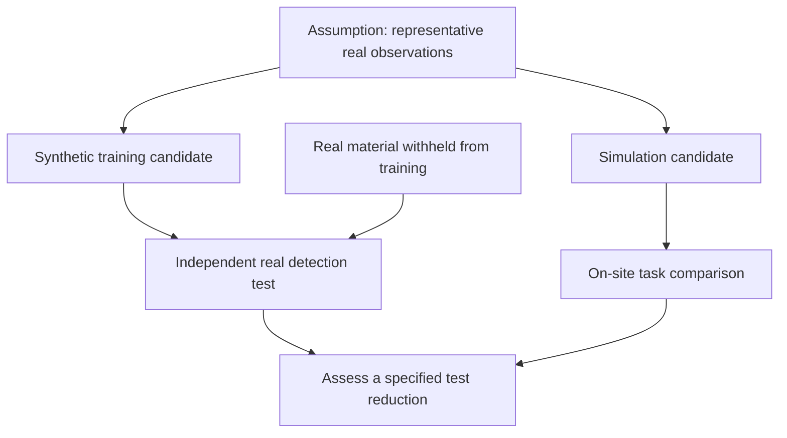
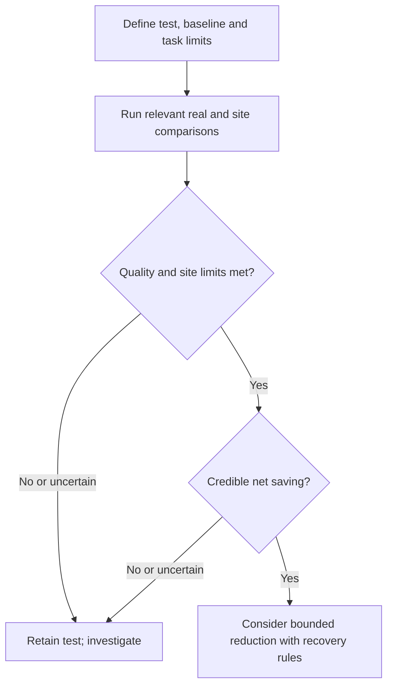

## Who bears the cost of a missed physical test?

Before reducing a physical test, an engineering team needs to explain what it protects against. If a replacement misses a critical defect or recommends an unsuitable operating configuration, who detects the error, and what triggers restoration of the previous safeguards? These questions concern a proposed decision. They describe no recorded incident and provide no basis for assigning all responsibility to the factory.

Two NVIDIA reports frame the discussion. Its [Cosmos report](https://blogs.nvidia.com/blog/cosmos-open-train-evaluate-deploy-world-models/) describes ANYbotics generating synthetic videos to train industrial-inspection robots. Its [European report](https://blogs.nvidia.com/blog/european-retail-open-models-robotics/) describes Otto Group advancing a human-supervised autonomous warehouse initiative, with capabilities to test operations in simulation before physical implementation. The cases concern different decisions and cannot share an unverified savings conclusion.

Both snapshots were retrieved on October 23, 2026. Their source records carry October 22 dates, while embedded related-article listings label both articles October 21. These fields do not establish successive project milestones. Both reports are publisher accounts, with no independent evaluation supplied, and cannot establish deployment status beyond the snapshots. [Cosmos](https://blogs.nvidia.com/blog/cosmos-open-train-evaluate-deploy-world-models/) · [Europe](https://blogs.nvidia.com/blog/european-retail-open-models-robotics/)

What evidence would allow inspection and logistics teams to use synthetic data or simulation to reduce a particular physical test? The evaluation must distinguish training coverage, simulation capability and sustained site benefits. It must specify the proposed substitution, required quality, remaining uncertainty and cost of checking it.

## What the four cases establish

Each case concerns a different object or stage. The reported result needs to be read alongside its limits.

| Case | What NVIDIA reports | Boundary for a testing decision |
| :--- | :--- | :--- |
| ANYbotics | Generated over 1,500 synthetic video clips using Cosmos Data Factory blueprints, curating real data and validating outputs with Encord, to train inspection robots to recognize liquid spills and other changes between visits. [Source](https://blogs.nvidia.com/blog/cosmos-open-train-evaluate-deploy-world-models/) | Clip count measures generated inputs; the passage supplies no real-world detection benchmark establishing coverage or accuracy. |
| Ultralytics | Retrained YOLO using real images and targeted synthetic defects, with improved defect localization and recall reported. [Source](https://blogs.nvidia.com/blog/cosmos-open-train-evaluate-deploy-world-models/) | The report gives no numerical improvement, evaluation split or false-alarm comparison. |
| ALLSIDES | Launched its 3D Digital Twin Factory, an automated pipeline that transforms physical objects into SimReady 3D twins in minutes, with reported sub-millimeter geometry, measured physical properties and fully relightable materials. [Source](https://blogs.nvidia.com/blog/european-retail-open-models-robotics/) | A reported pipeline launch and asset specifications do not establish validated dynamic warehouse performance. |
| Otto Group | Advanced its human-supervised autonomous warehouse initiative to the Haldensleben fulfillment center, built with Reply on Omniverse libraries and running on Google Cloud. [Source](https://blogs.nvidia.com/blog/european-retail-open-models-robotics/) | Project advancement and simulation capabilities do not establish completed commissioning, reduced commissioning tests or quantified operational benefits. |

The [Cosmos report](https://blogs.nvidia.com/blog/cosmos-open-train-evaluate-deploy-world-models/) lists PCB, metal and glass defect generation as blueprint capabilities. It does not say Ultralytics used every category. Likewise, validating generated outputs in the ANYbotics workflow does not independently measure robot performance on unfamiliar real anomalies. The reported improvements and asset specifications remain supplier claims.

NVIDIA describes store-layout simulation and product tracking as applications of ALLSIDES' twins. It separately attributes capabilities to design, test and optimize warehouse operations entirely in simulation before physical implementation to Otto Group's initiative. The [European report](https://blogs.nvidia.com/blog/european-retail-open-models-robotics/) does not connect ALLSIDES' assets to that warehouse implementation. Shared vocabulary or components cannot establish identical implementations or equivalent delivered capabilities.

These cases support investigation of sample augmentation, asset creation and operational simulation. Their number provides no basis for inferring an industry adoption trend. The launch of an asset pipeline and the advancement of a warehouse initiative to a site are also different maturity claims; neither can be rewritten into the other's status.

## Training coverage and simulation address different gaps

For sample generation, the question has a condition attached: if labels and visual variation match the intended task, does adding targeted synthetic material improve performance on independent real examples? The [Ultralytics account](https://blogs.nvidia.com/blog/cosmos-open-train-evaluate-deploy-world-models/) reports a retraining improvement without a disclosed quantitative benchmark that fully answers this question.

An evaluation should check whether an apparent improvement depends on generated visual patterns rather than relevant physical features. This is a hypothesis to investigate; the cases do not demonstrate such a failure. Breaking down errors by condition and defect type would help reveal whether overall improvement conceals deterioration in a critical subgroup. Clip count alone cannot answer this. Usefulness depends on what the clips represent and how performance is tested.

Simulation requires a different comparison. If geometry, physical properties and operating constraints adequately represent the site, can simulated comparisons identify a candidate that also performs acceptably there? Visual similarity and geometric accuracy alone cannot establish correct physical behavior or task outcomes. ALLSIDES' reported asset properties and Otto Group's reported warehouse capabilities offer separate starting points; neither supplies a measured error bound for the other. [Source](https://blogs.nvidia.com/blog/european-retail-open-models-robotics/)

The diagram proposes evidence dependencies, assuming that the inputs adequately represent the task. Its arrows show what should inform a judgment, without describing the chronology of a customer's project.

Holdout evidence addresses detection performance; a site comparison addresses operational behavior. Neither replaces the other. A change involving routing or interactions needs site evidence of acceptable behavior. Rare-anomaly detection needs real examples capable of exposing weaknesses. Each decision therefore calls for evidence suited to its task.

The comparison must identify what remains outside its scope. A successful check under specified operating conditions supports a judgment within those conditions, without establishing coverage of every defect, lighting condition or warehouse interaction. These mechanisms remain conditional analysis; they have not been demonstrated across all sites.

## Validation may cost more than retaining the test

Could establishing and maintaining sufficient confidence cost more than keeping the physical test? Generated material and simulations may miss site changes, while validation adds expenditure. The [Cosmos](https://blogs.nvidia.com/blog/cosmos-open-train-evaluate-deploy-world-models/) and [European reports](https://blogs.nvidia.com/blog/european-retail-open-models-robotics/) provide neither independent comparative results that rule out this explanation nor complete comparative lifecycle accounts for these four cases. That gap does not establish customer failures or overspending.

A simplified model makes the accounting explicit. Let baseline physical-testing expenditure be <math xmlns="http://www.w3.org/1998/Math/MathML"><mi>B</mi></math>, and let <math xmlns="http://www.w3.org/1998/Math/MathML"><mi>α</mi></math> be the fraction of that expenditure avoided, not the fraction of test events removed. Let <math xmlns="http://www.w3.org/1998/Math/MathML"><mi>S</mi></math> represent incremental synthesis and simulation expenditure, <math xmlns="http://www.w3.org/1998/Math/MathML"><mi>V</mi></math> incremental validation and maintenance expenditure, and <math xmlns="http://www.w3.org/1998/Math/MathML"><mi>R</mi></math> the change in expected loss relative to the baseline. Modeled incremental net saving is:

<math xmlns="http://www.w3.org/1998/Math/MathML" display="block"><mrow><mi>G</mi><mo>=</mo><mi>α</mi><mi>B</mi><mo>−</mo><mo>(</mo><mi>S</mi><mo>+</mo><mi>V</mi><mo>+</mo><mi>R</mi><mo>)</mo></mrow></math>

A deliberately narrow approximation of escaped-defect losses could use:

<math xmlns="http://www.w3.org/1998/Math/MathML" display="block"><mrow><mi>R</mi><mo>=</mo><mi>N</mi><mo>×</mo><mo>(</mo><msub><mi>p</mi><mn>1</mn></msub><mo>−</mo><msub><mi>p</mi><mn>0</mn></msub><mo>)</mo><mo>×</mo><mi>L</mi></mrow></math>

This assumes comparable exposure <math xmlns="http://www.w3.org/1998/Math/MathML"><mi>N</mi></math>, candidate and baseline escape probabilities indexed one and zero respectively, and a common average monetary loss per escaped defect <math xmlns="http://www.w3.org/1998/Math/MathML"><mi>L</mi></math>. All monetary terms must use the same currency and comparison period. Risk is incremental throughout and must not be counted again as a second change. The sources provide no customer values to insert.

This proposed accounting aid provides neither a complete safety valuation nor a measured result. Differences in loss severity, correlated failures and operational disruption require separate treatment. Positive modeled savings would still not authorize bypassing applicable safety, legal or contractual obligations.

Withdrawal rules should cover quality, site performance and economics. Reject the proposed reduction if critical errors breach pre-agreed task limits, site constraints are not met or credible assumptions yield no positive savings. <u>Absence of statistically significant deterioration alone must not authorize removal of a safeguard.</u> Even with quality maintained, the team cannot claim an economic benefit if modeling, labeling, validation and maintenance costs offset the savings.

## Make the purchase decision a comparable pilot

A bounded pilot should specify the physical test proposed for reduction and the conditions that would restore it. The designs below are evaluation suggestions, with no claim that customers used these procedures. They prescribe no universal sample size, observation period or proportion of tests to remove.

For inspection, compare a baseline trained on real material with a candidate receiving targeted synthetic additions. Keep independent real evaluation material outside both generation and training. Hold other settings constant where possible; otherwise disclose changes that prevent attribution to synthetic data alone. Sample size and observation duration should reflect task risk and uncertainty.

For warehouse operations, compare the existing approach with a simulation-derived candidate within an explicit site scope. Agree on supervision, intervention and stop conditions before testing. Record interventions and human recovery work alongside task outcomes so that candidate performance can be distinguished from the work needed to rescue it. This comparison implies no particular routing or scheduling architecture at Otto Group.

| Proposed evaluation | Evidence to request | Decision question |
| :--- | :--- | :--- |
| Defect detection | Real test-set provenance, separation from training, errors by critical defect and condition | Does augmentation preserve the quality required for the specific check? |
| Inspection robotics | Unseen real anomalies, missed-event review and intervention records | Does output validation translate into acceptable task performance? |
| Warehouse operations | Simulation predictions paired with site outcomes and deviations | Does the candidate meet site constraints without uncounted recovery work? |
| Economics | Incremental compute, curation, validation, maintenance and residual-loss estimates | Do credible savings remain after the full comparison? |

The sequence below concerns a proposed future pilot. Its gates express decision conditions, without representing reported customer milestones. It assumes the comparison covers the specified task and operating conditions.

Approval should apply to a specified test under specified conditions. The proposal should state which evidence needs renewal if operating conditions change. Published benchmarks or external recognition may help particular decisions, but neither universally replaces relevant real-world evidence or applicable approval requirements. The framework supplies no return estimate, savings percentage or procurement ranking.

## Which physical tests can be reduced?

The cited [Cosmos](https://blogs.nvidia.com/blog/cosmos-open-train-evaluate-deploy-world-models/) and [European](https://blogs.nvidia.com/blog/european-retail-open-models-robotics/) passages identify no sustained, validated reduction in physical testing across these four cases. They also provide no measured amount of such a reduction and no controlled comparison identifying which physical checks became unnecessary or whether savings persisted.

Evidence that could change this assessment would identify the test removed, independent comparison groups, critical-error distributions, site deviations, intervention requirements and complete incremental costs, including maintenance. Operating records after the reduction would help establish whether the result persisted. Their absence from the reports does not establish that customers performed no validation.

A supplier should specify which test could be reduced, the real evidence supporting that change, its operating conditions and the trigger for restoration. Until those answers are available, these capability and project reports support investigation and a controlled pilot, with the physical check retained.

## References

1. NVIDIA Newsroom. [NVIDIA Cosmos Opens New Tools to Train, Evaluate and Deploy World Models | NVIDIA Blog](https://blogs.nvidia.com/blog/cosmos-open-train-evaluate-deploy-world-models/).
2. NVIDIA Newsroom. [NVIDIA Transforms European Retail, From Digital Discovery to Physical Operations | NVIDIA Blog](https://blogs.nvidia.com/blog/european-retail-open-models-robotics/).
