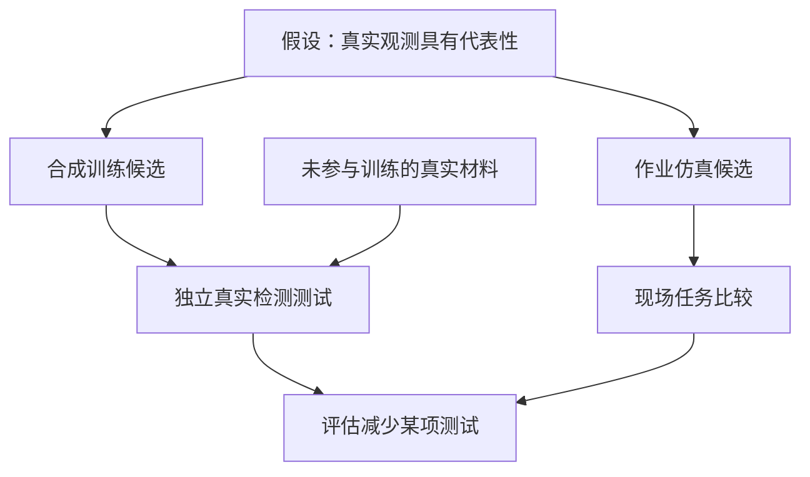
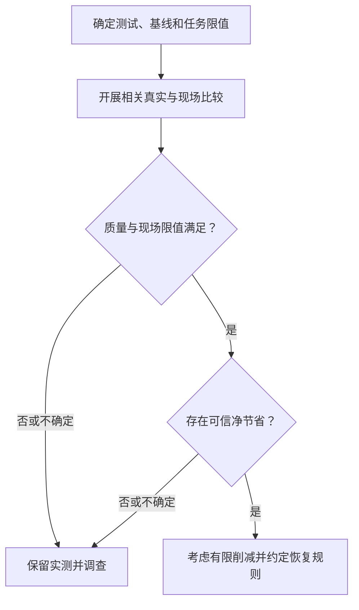

## 少做一次实体测试，谁承担遗漏的代价？

减少实体测试之前，工程团队需要说明它原本防范什么。如果替代方案遗漏关键缺陷，或推荐了不适合现场的作业配置，谁发现问题，什么条件触发恢复原有防线？这些问题针对待作出的决策，没有描述已发生的事故，也不能据此把责任全部归于工厂。

两篇NVIDIA报道提供讨论起点。[Cosmos报道](https://blogs.nvidia.com/blog/cosmos-open-train-evaluate-deploy-world-models/)介绍ANYbotics生成合成视频训练工业巡检机器人；[欧洲报道](https://blogs.nvidia.com/blog/european-retail-open-models-robotics/)介绍Otto Group推进受人工监督的自主仓库计划，以及物理实施前的作业仿真能力。二者对应不同决策，不能共享未经验证的节省结论。

两份快照均抓取于2026年10月23日，来源记录日期为10月22日，页面内相关文章列表则将两篇文章标为10月21日。这些日期字段不能解释为项目先后里程碑。两篇均为发布方叙述，未附独立评估，也不足以核验快照之后的部署状态。[Cosmos](https://blogs.nvidia.com/blog/cosmos-open-train-evaluate-deploy-world-models/) · [欧洲](https://blogs.nvidia.com/blog/european-retail-open-models-robotics/)

检测与物流团队需要什么证据，才能用合成数据或仿真减少某项实体测试？评估须区分训练覆盖、仿真能力与持续现场收益，明确替代对象、质量要求、剩余不确定性及核验成本。

## 四个案例分别提供什么证据

各案例的对象和阶段不同，报告结果须与判断边界一起看。

| 案例 | NVIDIA报告的内容 | 减少实测的判断边界 |
| :--- | :--- | :--- |
| ANYbotics | 用Cosmos Data Factory蓝图生成超1,500段视频，整理真实数据并借助Encord验证输出，训练工业巡检机器人识别液体泄漏和巡检间其他变化。[来源](https://blogs.nvidia.com/blog/cosmos-open-train-evaluate-deploy-world-models/) | 数量是生成输入规模，未提供可证明覆盖范围或准确率的真实检测基准。 |
| Ultralytics | 用真实图像与定向合成缺陷重训YOLO，报告定位与召回改善。[来源](https://blogs.nvidia.com/blog/cosmos-open-train-evaluate-deploy-world-models/) | 未给出改善幅度、评估分组和误报对照。 |
| ALLSIDES | 推出3D Digital Twin Factory自动化管线，可在数分钟内将实体对象转为SimReady 3D孪生，报告亚毫米几何精度、实测物性及完全可重新布光的材质。[来源](https://blogs.nvidia.com/blog/european-retail-open-models-robotics/) | 管线推出与资产规格不能证明动态仓储性能已经验证。 |
| Otto Group | 将与Reply合作、基于Omniverse库并运行于Google Cloud的受人工监督自主仓库计划，推进至Haldensleben履约中心。[来源](https://blogs.nvidia.com/blog/european-retail-open-models-robotics/) | 项目推进与仿真能力不证明已完成现场调试、削减调试测试或实现可量化运营收益。 |

[Cosmos报道](https://blogs.nvidia.com/blog/cosmos-open-train-evaluate-deploy-world-models/)列出PCB、金属和玻璃缺陷生成能力，没有说明Ultralytics使用了全部类别。ANYbotics验证生成输出，也不等于独立测量机器人面对未知真实异常的表现。改善与资产规格仍是供应商报告的结果。

[欧洲报道](https://blogs.nvidia.com/blog/european-retail-open-models-robotics/)将门店布局仿真和商品跟踪列为ALLSIDES孪生的用途，另行描述Otto Group在物理实施前完全通过仿真设计、测试和优化仓库作业的能力。报道未将ALLSIDES资产与该仓库实现相连。共享术语或组件，不能证明实现相同或已交付能力等同。

这些案例支持研究样本增强、资产创建和作业仿真，数量不足以推断行业采用趋势。资产管线已经推出，与仓库计划推进至某一现场，也属于不同成熟度陈述，不能互相改写。

## 补充样本与模拟作业需要不同验证

样本生成的问题有明确前提：标签和外观变化符合任务条件时，加入定向合成材料能否改善独立真实样本上的表现？[Ultralytics案例](https://blogs.nvidia.com/blog/cosmos-open-train-evaluate-deploy-world-models/)报告了重训改善，却没有公开量化基准来完整回答。

评估还须检查改善是否依赖生成图像的特征，而非相关物理特征。这是待检验假设，案例没有证明发生了这种失败。按缺陷和环境条件拆分错误，有助于发现总体改善是否掩盖关键子组退化。视频数量本身不能回答这些问题，还须核对样本代表什么、表现如何测量。

仿真需要另一种比较：几何、物性与作业约束足够贴近现场时，虚拟比较选出的方案能否在现场保持可接受表现？视觉相似和几何精度都不能单独证明物理行为或任务结果正确。ALLSIDES的资产属性与Otto Group的仓库能力是不同起点，均未给出可用于另一方的实测误差界限。[来源](https://blogs.nvidia.com/blog/european-retail-open-models-robotics/)

下图提出证据依赖关系，假设真实输入足以代表任务。箭头表示哪些材料应支持判断，不代表客户项目的事件顺序。

留出材料回答检测表现问题，现场比较回答作业行为问题，两者不能替代。调整路线或交互，需要现场行为证据；调整罕见异常识别，需要能暴露弱点的真实样本。证据须适合具体决策。

比较还应写明范围之外的条件。某组运行条件下通过验证，只支持该范围内的判断，不能覆盖全部缺陷、光照或仓库交互。这些机制仍是有条件的分析，未在所有现场得到验证。

## 验证可能比保留实测更贵

建立并维持足够信心，会不会比保留原实测更贵？生成材料和仿真可能遗漏现场变化，验证又增加支出。[Cosmos报道](https://blogs.nvidia.com/blog/cosmos-open-train-evaluate-deploy-world-models/)与[欧洲报道](https://blogs.nvidia.com/blog/european-retail-open-models-robotics/)既没有排除此解释的独立对照，也没有四个案例的完整全周期成本比较。这不证明客户已经失败或超支。

简化模型可明确核算口径。原实测支出为<math xmlns="http://www.w3.org/1998/Math/MathML"><mi>B</mi></math>，避免的支出比例为<math xmlns="http://www.w3.org/1998/Math/MathML"><mi>α</mi></math>，它不是测试次数削减比例。新增合成与仿真支出为<math xmlns="http://www.w3.org/1998/Math/MathML"><mi>S</mi></math>，新增验证与维护支出为<math xmlns="http://www.w3.org/1998/Math/MathML"><mi>V</mi></math>，相对基线的预期损失变化为<math xmlns="http://www.w3.org/1998/Math/MathML"><mi>R</mi></math>。模型中的增量净节省为：

<math xmlns="http://www.w3.org/1998/Math/MathML" display="block"><mrow><mi>G</mi><mo>=</mo><mi>α</mi><mi>B</mi><mo>−</mo><mo>(</mo><mi>S</mi><mo>+</mo><mi>V</mi><mo>+</mo><mi>R</mi><mo>)</mo></mrow></math>

若仅近似估算缺陷逃逸损失，可写为：

<math xmlns="http://www.w3.org/1998/Math/MathML" display="block"><mrow><mi>R</mi><mo>=</mo><mi>N</mi><mo>×</mo><mo>(</mo><msub><mi>p</mi><mn>1</mn></msub><mo>−</mo><msub><mi>p</mi><mn>0</mn></msub><mo>)</mo><mo>×</mo><mi>L</mi></mrow></math>

这里假设暴露数量<math xmlns="http://www.w3.org/1998/Math/MathML"><mi>N</mi></math>可比，候选与基线逃逸概率分别对应下标一和零，单次逃逸平均货币损失<math xmlns="http://www.w3.org/1998/Math/MathML"><mi>L</mi></math>相同。全部货币项须使用相同币种和比较期间。风险始终按增量计算，不可再次取变化而重复扣除。来源没有可代入的客户数据。

这个核算建议不提供完整安全估值，也不是实测结果。损失严重程度不同、故障相关或存在作业中断时，需要另行处理。即使模型净节省为正，也不能绕过适用的安全、法规与合同要求。

撤回规则应覆盖质量、现场表现和经济性：关键错误突破预先约定的任务限值、现场约束不能满足，或可信假设下没有正净节省，均应拒绝削减。<u>未观察到统计显著恶化，不能单独成为撤去防线的许可。</u>即使质量保持，建模、标注、验证和维护成本抵消节省后，也不能宣称经济收益。

## 把采购判断缩小为可比较的试点

试点应写明准备减少哪项实体测试，以及什么条件触发恢复。以下是评估建议，不是客户已披露的程序，也不规定通用样本量、观察期或免测比例。

检测试点可比较真实材料训练基线与加入定向合成材料的候选，保留未进入生成和训练的独立真实评估材料。尽量固定其他设置；无法固定时，披露哪些变化妨碍把结果单独归因于合成数据。样本规模与观察期应取决于任务风险和不确定性。

仓库试点可在明确现场范围内比较现有方案与仿真候选，事先约定监督、介入和停止条件。任务结果须与介入及人工恢复记录一起查看，以区分候选表现与补救工作。这不意味着Otto Group采用了某种特定路线或调度架构。

| 建议评估对象 | 待索取材料 | 决策问题 |
| :--- | :--- | :--- |
| 缺陷检测 | 真实测试集来源、训练隔离、关键缺陷及条件分组错误 | 增强训练能否保持该项检查要求的质量？ |
| 机器人巡检 | 未见真实异常、漏报复核及人工介入记录 | 输出验证能否转化为可接受的任务表现？ |
| 仓库作业 | 配对的仿真预测、现场结果与偏差记录 | 不依赖漏计补救工作，候选能否满足现场约束？ |
| 经济核算 | 新增算力、整理、验证、维护和残余损失估计 | 完整比较后是否仍有可信净节省？ |

下图表示未来试点的建议顺序，关卡不是客户已达到的里程碑。其前提是比较覆盖指定任务和运行条件。

批准范围须绑定具体测试及适用条件，并说明运行条件变化后哪些证据需要更新。公开基准或外部认可可能帮助特定决策，但不能普遍替代相关真实证据或适用审批要求。框架不提供回报率、节省比例或采购排名。

## 哪些实测可以少做，仍待回答

[Cosmos报道](https://blogs.nvidia.com/blog/cosmos-open-train-evaluate-deploy-world-models/)与[欧洲报道](https://blogs.nvidia.com/blog/european-retail-open-models-robotics/)的相关段落，没有确认四个案例已持续实现经过验证的实测削减，也没有给出削减的实测幅度。报道缺少对照结果，无法说明哪些实体检查因此不再需要、节省是否持续。

能改变判断的材料包括：撤掉哪项测试、独立比较分组、关键错误分布、现场偏差、介入要求，以及包含维护的完整增量成本。削减后的运行记录有助于检验效果是否持续。报道没有披露这些材料，不等于客户没有开展验证。

供应商须说明可减少的测试、支持变更的真实证据、适用条件和恢复触发条件。答案明确之前，这些能力与项目报道支持调查和受控试点，待评估的实体检查应予保留。

## 参考资料

1. NVIDIA Newsroom. [NVIDIA Cosmos Opens New Tools to Train, Evaluate and Deploy World Models | NVIDIA Blog](https://blogs.nvidia.com/blog/cosmos-open-train-evaluate-deploy-world-models/).
2. NVIDIA Newsroom. [NVIDIA Transforms European Retail, From Digital Discovery to Physical Operations | NVIDIA Blog](https://blogs.nvidia.com/blog/european-retail-open-models-robotics/).
