# 每日研究博客

任务定义：[daily-blog-agy-codex.json](../config/tasks/daily-blog-agy-codex.json)。执行程序：[workflows/daily_blog.py](../workflows/daily_blog.py)。由 Go 调度，不创建新的 systemd timer。

| 配置 | 当前值 |
| --- | --- |
| 任务 ID / 类型 | daily-blog-agy-codex / workflow |
| 频率 | 每日北京时间 07:30，随机延迟 0–420 秒 |
| 候选题与大纲 | Codex，gpt-6.1-sol；最多 3 个候选，自动选择一题并生成 6–9 节大纲 |
| 阅读目标 | 中英文各约 20 分钟；默认允许约 17–23 分钟的篇幅区间 |
| 写稿 | agy，gemini-3.8-flash-high（Gemini 3.8 Flash High） |
| 事实复核、修订、最终复核 | Codex，gpt-6.1-sol |
| Codex 推理与速度 | planner/reviewer 的 reasoning_effort=null，沿用模型默认；service_tier=fast |
| 修订规则 | /root/.codex/skills/humanizer/SKILL.md；保留实质信息，合并重复结尾；保存完整副本与 SHA256 |
| 输入 | 近两天 SQLite 文档与 normalized 文件、已有公司研究快照、新闻标题线索、通过校验的 Gemini 主题整理及其原始证据 |
| 发布位置 | /mnt/quant-state/quant-web/blog；网站代码在 /mnt/quant/strategies/stocks-quant |
| 模型调用 | 通常 5 次；各允许一次事实纠错、篇幅修订和终稿纠错，最多 10 次；串行，相邻调用完成后至少间隔 10 秒 |
| 超时与互斥 | 整轮 75 分钟；agy 1200 秒、Codex 写作修订各 900 秒、规划与复核各 300 秒；model-cli 与本地新闻分析互斥 |

```mermaid
flowchart LR
    A[本地材料与近期文章] --> T[Codex 候选选题]
    T --> P[选中一题，生成约20分钟大纲]
    P --> Q[校验证据定位与章节篇幅]
    Q --> B[agy Gemini 按大纲起草中英文]
    B --> C[Codex 事实复核]
    C -->|通过| D[Codex 按 humanizer 修订]
    C -->|拒稿且未纠错| R[Codex 一次纠错]
    R --> V[Codex 再复核]
    V -->|通过| D
    V -->|拒稿| S[保存稿件与问题，停止发布]
    D --> E[Codex 最终复核]
    E -->|通过| F[结构与哈希校验]
    E -->|拒稿且未终稿纠错| U[一次终稿纠错]
    U --> W[独立最终再复核]
    W -->|通过| F
    W -->|拒稿| S
    F --> G[原子写入网站清单]
    G --> H[网站博客、Feed 与 Sitemap]
```



## 内容与发布规则

### 先选题与大纲，再写稿

选题编辑使用完整 research-blog-editor skill 和本轮资料包，参考最近十篇文章。候选题写出核心问题、读者价值、时效、可用来源和证据缺口；按证据深度、具体机制和与近期文章的差异选择一题。最多三题，材料不足时可以少生成候选，不能为了数量制造选题。

选题阶段还读取近两天、最多五个主题的 [Gemini 整理与 Codex 校验](topic-summaries.md) 产物。整理、校验证明与原证据包均核验哈希，作为次级选题参考；写稿与复核阶段移除整理结果，只保留选中题目的原来源和证据。材料缺失或被修改时跳过对应产物。

选中题目的大纲包含中英文标题、核心问题、暂定论点、讨论范围和读者能带走的判断。六至九个章节分别说明用途、论点、引用定位、证据边界和中英文篇幅预算，覆盖开篇利害、证据案例、机制、最强反论证与证伪条件、判断影响及未决问题。题目至少有两个不同来源 URL，纯标题线索不能独立支撑长文。

在 Gemini 启动前写入 `topic-candidates.json`、`blog-outline.json` 和方便 Review 的 `blog-outline.md`。逐章引用必须指向本轮资料包的真实 source_id 和 locator；大纲绑定资料包 SHA256。只有通过结构、引用和篇幅预算校验才开始写稿。选题阶段缺少证据则停止该轮。

选题后，写稿、篇幅修订、事实复核、纠错和 humanizer 都只收到所选候选题的来源与证据子集。运行目录 `draft-source.schema.json` 将 `used_source_ids` 和事实核验 `source_id` 限定为这些 ID。审核发现超出范围的文字时，应要求删除或改为条件分析；不能要求引入其他候选题或资料包中的新来源。复核哈希仍绑定归档的完整资料包与实际稿件。

### 约 20 分钟的正文

每种语言目标约二十分钟，默认预算为中文约 6000 阅读单位、英文约 4000 词。中文按汉字加独立拉丁词汇/数字粗估，每分钟 300 单位；英文按每分钟 200 词粗估。正文校验按页面向上取整的 17–23 分钟口径，允许中文 4801–6900 单位、英文 3201–4600 词。阅读速度和内容难度因人而异，这个范围是篇幅估算。

统计排除链接 URL 和代码块。网站的 reading_time 从实际正文计算，忽略模型自行填的标签。初稿、纠错稿和 humanizer 后的终稿均需达标，并至少有六个二级章节。不能依靠重复或无关背景凑篇幅；若现有资料支撑不了这个深度，应报告材料不足。

Gemini 按所选大纲写稿，来源限于该题列出的 source_ids。后续 Codex 检查是否展开章节论点、保留反论证和边界，防止长文偏离大纲。使用已有网站署名、标签词表、中英双语格式和内容寻址 Markdown。正文面向读者讨论问题和证据；模型、skill 与执行过程保存在内部复核记录中。

网页采集由现有 crawl 任务负责，本工作流不主动下载来源网页。RSS 标题与摘要标为待核验线索；已有公司研究快照标明快照截止日和原披露口径，不能宣称已重新验证一手原文或把未来计划写成完成结果。写稿和复核使用同一份资料包；文档内容哈希须与 SQLite 一致，未来日期和过期研究快照不用于供稿。已有机构研究内容不进入本流程。

Codex 复核结果必须绑定文章和资料包的 SHA256；humanizer 修订不能改变来源 ID、标签或事实核验记录。最终复核再次检查两种语言、事实边界、引用和 humanizer 的应用。存在复核问题、错误引用、错误哈希或过期发布日期时，停止发布并保存错误与候选稿。

初稿事实复核拒稿时，Codex 可以根据具体问题纠错一次，再由独立调用重新复核。纠错时可以缩小题目、删去没有证据的细节；复核仍未通过就结束本轮。

初稿或事实纠错稿篇幅未达标时，max_length_repairs 默认允许整轮一次篇幅修订。程序保存中英文实际字数与目标区间，再交给 Codex 按原资料和大纲修订；来源 ID、标签、事实核验记录必须完全保持，修订后的正文仍需通过字数、引用和独立事实复核。缺少材料时可以返回 insufficient_evidence，不能用新事实或重复文字补足篇幅。再次不达标则停止，humanizer 后的篇幅不达标也停止。

正文不附加“编写与复核”等内部流程说明，也不声称文章经过了并未发生的人工批准。这些内容修订步骤有次数上限，不会重试失败或遭拒的模型 API 请求。max_length_repairs、修订阶段超时和最大 CLI 调用次数均在任务 JSON 中配置。

最终复核拒稿时，`max_final_revisions: 1` 允许一次终稿纠错，再独立复核一次。终稿纠错沿用 humanizer，可合并重复的结论、修正已有事实的定位，或将复合事实拆成多个真实证据记录；来源 ID 与标签保持不变，不增加新事实、日期或出处。再次拒稿则停止。humanizer 本身保留每个独特的事实和证据边界，同时删除空泛重复，篇幅仍受原检查约束。

这项任务采用用户授权的模型复核发布方式，复核证明保存在 blog/automation-reviews/。原市场文章任务 stocks-quant-blog-compose、stocks-quant-blog-daily-publish 已停用，配置和历史保留；原人工批准函数及 approvals 文件格式保留。新流程的模型证明使用 approval_kind=model_review，不生成带人工 reviewed_by 的批准文件。

发布与原发布器使用相同 publish.lock，检查当天运行时文章和 slug 冲突，先保存内容与复核证明，再原子替换 manifest.json。新文件按网站目录所属账号设置 owner 和 0640 权限，网站进程可以读取。无需修改网站主题、重启网站或每轮部署代码。

网站公开页面由 Nginx 转发至 `quant-next-web.service` 中的 Next.js，Python 内容/API 服务继续运行于 `quant-web.service`。`workflow.website_runtime` 和 `website_delivery` 明确博客发布只更新运行时正文与清单，Next.js 每次请求通过本机认证桥接读取新内容，无需重启或构建。内容服务、前端代码和 Nginx 配置变更使用各自的[维护与发布流程](website-workflow.md#网站检查与分别维护)。

## 状态与迭代

每轮 task_runs 的 metadata_json.result.business_status 记录业务结果：

| 状态 | 含义 |
| --- | --- |
| published | 本轮已写入网站清单 |
| already_published | 当天已有运行时文章，本轮未调用模型 |
| insufficient_evidence | 缺少材料，或写稿模型判断材料不足；任务失败并标记需要关注 |
| previous_attempt_failed | 当天已有失败或中断的模型尝试，保持停止 |
| already_attempted | 当天已完成一次尝试，本轮未调用模型 |
| failed | 模型、内容复核、结构或权限校验失败 |
| preview | 离线检查完成，未调用模型或发布 |

每日最多保留一次自动模型写稿尝试和一篇运行时文章。模型供应方返回拒绝、鉴权或限流信号后持久熔断，不自动重试；修复原因后由操作者显式复位。输入不足或审核不通过时不会为凑每日数量编造文章。

### 审核失败文章的人工补发

来源校验、初稿复核或最终复核失败后，可以在原运行目录保存修正稿，再临时给任务的 `workflow` 增加：

```json
"manual_recovery": {
  "day": "2026-10-13",
  "run_id": "6809c48d397c0ae13bb8d39b9841f1b8",
  "draft_filename": "recovery-corrected-draft.json"
}
```

执行 `make init` 后，通过 Go 的 `enqueue --task daily-blog-agy-codex` 手动入队；队列保存配置快照后删除临时字段，再次 `make init`。定时触发会忽略人工补发配置，按当天正常运行。手动补发可以处理历史日期，但必须属于本任务的失败记录，日期必须匹配原始资料包且不能是未来。

补发继续使用原始资料包和选题，以及操作者修正后的双语稿。修正文稿后重新进行事实复核、humanizer 编辑和最终复核，审核哈希必须绑定修正后的正文和原资料包。若仅因篇幅校验停在 humanizer 之后，且保存的正文、资料包和初审哈希均未变化，可以从终稿审核继续；任何哈希变化仍会停止发布。所有祖先运行实际启动的模型调用合计计入原归档日十次调用上限（包括失败、超时和截断；以 call.json 为准，兼容旧 response.json，同一阶段不重复计数），重放缓存不重复计数；剩余额度不足时停止。补发不清除供应方熔断，也不删除失败历史或当日防重记录。

阅读时长按 `ceil(字数或词数 / 每分钟速度)` 计算，篇幅下限与页面显示保持一致。例如目标 20 分钟、容差 3 分钟时，显示 17–23 分钟的正文符合约定，不因舍入口径不同退回，也不为凑字数补重复段落。

跨日补发保留原归档日期，`updated_at` 使用实际补发日期；中英文正文开头明确显示归档日、补发日和历史资料边界。原失败运行保持不变，新运行写入 `recovery-audit.json`、`recovered_from` 和新的发布证明。相同归档日已有文章时直接返回 `already_published`。

运行目录 data/runs/&lt;run_id&gt;/ 保存资料包、两个 skill 副本、候选题、完整大纲、各阶段提示词与响应、原稿、终稿和发布结果。task_runs 的 result 保存所选题目、阅读目标、大纲哈希以及 JSON/Markdown 路径；写稿或复核失败时仍记录已生成的大纲，方便调整。CLI 日志保持在忽略目录。

发布证明绑定完整 editorial_plan。将发布后的简短索引写入 data/knowledge/topics/daily-research-blog/summaries/YYYY-MM-DD.json，并登记到现有 artifacts 表；索引包含选题摘要、大纲哈希、实际阅读估算和文章路径；经审核的中英文 Markdown 归档到 `data/knowledge/topics/daily-research-blog/articles/<topic-date>/`，便于版本管理。文章修订会更新同一天的索引和 artifacts 记录，保留其 ID。数据库仍为六张表。

## 运维

运行环境需安装本机 agy 和 Codex，沿用各 CLI 已登录的账号。按用户明确要求，agy 使用 --dangerously-skip-permissions，Codex 使用 --dangerously-bypass-approvals-and-sandbox，均为 full 权限且不进入交互授权。模型阶段不再增加 bubblewrap 或文件系统沙箱；发布仍需完整内容复核、哈希和结构校验。部署见 [deployment/README.md](../deployment/README.md)。

```bash
make init
make test-blog
/mnt/quant/strategies/stocks-quant/web/.venv/bin/python -m workflows.daily_blog --check
bin/news-claw runs --limit 10
```

需要提前运行时，通过 Go 队列启动，保留同一天的防重规则：

```bash
bin/news-claw enqueue --task daily-blog-agy-codex
```

修复供应方拒绝的原因后，可显式复位对应熔断状态；当天已尝试记录保持保留：

```bash
/mnt/quant/strategies/stocks-quant/web/.venv/bin/python -m workflows.daily_blog --reset-provider agy
/mnt/quant/strategies/stocks-quant/web/.venv/bin/python -m workflows.daily_blog --reset-provider codex
```

频率、素材窗口、模型、planning、reading、阶段超时和输入路径都在 JSON 中调整。make init 后常驻 engine 自动重读。每日博客在北京时间 07:30 开始，保留最多七分钟随机延迟；整轮超时为 75 分钟。每日工作流模板见 [daily-blog.json](../config/templates/daily-blog.json)，默认关闭。

CLI 参数已在本机 --help 核对；Codex 结构化响应方式参考 [非交互模式](https://learn.chatgpt.com/docs/non-interactive-mode)，模型标识参考 [GPT-6.1 Sol 文档](https://developers.openai.com/api/docs/models/gpt-6.1-sol)，推理与速度字段参考 [OpenAI 配置说明](https://learn.chatgpt.com/docs/config-file/config-reference)。


## 文章呈现与主题地址

实际任务和模板的 `workflow.presentation` 显式设置：

| 字段 | 默认值 | 用途 |
| --- | --- | --- |
| `slug_style` / `max_topic_words` | `topic-date` / `8` | 所选英文主题压缩成短地址，后接发布日期 |
| `preferred_tables` / `preferred_diagrams` | `2` / `2` | 提示写稿模型制作有解释作用的表格和 Mermaid 图 |
| `emphasis` | `restrained_bold_italic_underline` | 少量加粗、斜体与下划线标出判断依据 |
| `public_process_notes` | `false` | 正文省略模型与工具流程说明；内部审计保留 |
| `references` | `source_based_appendix` | 终稿末尾按实际来源生成参考资料 |
| `media_catalog` | `config/media/approved-assets.json` | 已核验的本地图片、作者、出处、许可和文件哈希 |

图片只从许可清单选择与所选主题匹配的素材，须通过网站静态路径和 SHA256 校验。图片旁说明创作者、原始来源、许可、是否修改及历史照片的时间；不把历史照片当作本期经营证据。清单目前包含 Electron 的 CAPSTONE 发射照片（2022，Yourong F. Wang，CC BY-SA 4.0）。其他主题需先补充经核验的相关素材，不自动复制搜索图片。图库对应网站 `web/static/images/blog/` 的素材与许可记录。

Mermaid 只接受限定长度的流程图，不允许交互链接和配置指令；网站使用已有的本地 Mermaid 库并在严格模式下渲染。图注须说明箭头是分析关联、假设还是真实时间顺序。表格可在手机上独立横向滚动；正文中的表格、图、强调和引用在 humanizer 与最终复核中保留。

### 已发布文章的显式修订

用户要求更新文章时，将双语稿和短主题名保存为 `{"model_draft": <daily-blog-draft>, "topic_slug": "topic-name"}`。沿用已有文章的资料包、选题和发布日期，加入经核验的图库。临时将任务执行命令设置为：

```json
["/mnt/quant/strategies/stocks-quant/web/.venv/bin/python", "-m", "workflows.revise_blog", "--slug", "existing-slug", "--draft", "/absolute/staged-revision.json"]
```

`make init` 后通过 Go `enqueue` 显式入队，配置快照保存后恢复原执行命令并再次 `make init`。修订命令要求正在运行的 Go 手动任务记录；这次用户请求独立限定一次 Codex 最终复核，不重新调用 Gemini，不清除每日防重记录或供应方熔断。复核失败就停止。

复核通过后先写入不可变正文与新证明，再锁定并原子替换已有文章。等待复核期间若旧文章已变化则拒绝覆盖。旧元数据与证明保存到运行时 `revisions/`，旧地址保存在 `aliases`：Next.js 网页使用 308，Python 的 Markdown 兼容路由使用指向公开完整地址的 301，均保留英文参数；首页、RSS 与 sitemap 使用新规范地址。文章总数不增加。

### 正文证据与显式补证

`daily-blog-primary-evidence` 每周一北京时间 07:05 使用现有有界采集器缓存明确列出的官方财报正文。当前为 Alphabet 与 Amazon 的 Q2 2026 公司披露。采集遵守 robots，缓存优先，最多 6 次请求、间隔至少 10 秒，不跟进页面链接；拒绝或限流保持熔断。固定报告不是实时新闻，后续季度应在核对官方地址后更新清单。

博客 `inputs.primary_source_urls` 可固定最多 6 个已缓存披露 URL，避免原始财报因为超出两天新闻窗口或被 RSS 标题挤出而失去上下文。每个正文按 `primary_max_text_chars` 有界读取（最高 24,000 字符，当前 20,000）；仍核对缓存内容哈希，保留来源日期，未缓存的 URL 不会由写稿流程联网下载。普通新闻仍使用原有窗口与短文本上限。

此前因资料不足停止、且操作者已补充新证据时，可临时使用 `workflow.manual_replan = {"day":"YYYY-MM-DD","run_id":"<insufficient-evidence-run>"}`，通过 Go 手动入队。只接受本任务对应日期的资料不足结果；来源与证据哈希必须变化，单纯新增图片不能触发重写。所有祖先运行的实际模型调用共同计入十次上限。定时触发忽略该配置，不自动循环重试。

模型有时把文件定位写成 `已有定位；text：段落说明`。只有前半部分与资料包中同一 source_id 的定位完全一致时，才移除段落说明；未知定位仍拒绝，原模型输出保留审计。针对这种已发生的选题校验失败，可以使用 `manual_recovery` 的 `resume_stage: "plan"` 继续已有选题，不重新调用选题模型。事实审核仍独立进行。

### 每日封面

2026-10-13 起的文章由网站共享 `ArticleCover` 组件自动显示原创 SVG 主题示意封面，同时出现在列表与正文页。主题由稳定英文 slug 识别，新主题有研究插图兜底，中英文使用同一画面并标注“主题示意”。封面属于网站呈现，不写入审核过的正文、不作为证据，也不会给文章插入无关历史照片。无需每日单独上传图片；博客首页桌面三列、平板两列、手机单列。

### 操作者已完成语言编辑后的续跑

手动恢复可提供 `humanizer_audit_filename`，指向失败运行目录中的 JSON。仅适用于操作者已按完整 humanizer 技能编辑双语稿的情况；它不代表审核通过。审计须包含 `mode: operator_applied_skill`、`editor`、`changes`、目录内的 `original_filename`，以及 `original_draft_sha256`、`edited_draft_sha256`、`humanizer_skill_sha256`。稿件哈希使用工作流的规范 JSON 编码，技能哈希使用文件原始字节。原稿、编辑稿、技能和来源元数据不匹配即停止。

这种续跑仍需两个新的独立模型判定：事实审核，以及对照编辑前稿和技能的最终审核。只有两个判定都绑定精确稿件和资料包、全部通过时才原子发布；它不会伪造 humanizer 模型调用。语言编辑记录单独保存，已完成模型调用沿祖先链计入原每日上限，不清除失败历史或熔断状态。此模式关闭额外改写重试，任一审核失败即停止。正常定时任务仍执行完整自动 humanizer 阶段。

### 2026-10-14 缺文修复记录

当天定时选题因资料不足停止。補入官方完整正文后，定位校验识别到模型附加的段落说明；修复严格匹配的定位规范化后继续原选题。后续审核要求修正企业用量量词、补齐引用、压缩重复段落、准确归因增长陈述和恢复独立核实边界，均保留失败记录并按意见修改。

最终发布运行 `31982db485d3d2f2c9248b861d57829d`，文章 `much-ai-cloud-growth-figures-tell-us-about-2026-10-14`，中英文分别约 18 与 17 分钟。两份独立判定均通过；最终稿 SHA256 为 `4cd866318a6e273adc7d35427f8c6e51657e91036c4016cedecdb3b721ee294c`，资料包 SHA256 为 `1de362a8b5c856c0b4725bccf1c3b47418c6a33d344715f85288a9001c9280f8`。

本次交互修复的队列快照明确记录一次性审核额度扩展：原十次额度外增加四次审核，总计十四次，包含所有祖先运行。没有重置调用历史或供应方熔断。正常任务配置和后续定时运行仍为每日最多十次；手动恢复配置在入队后立即恢复，不随定时任务重试。原始任务快照、每轮审稿、人工应用技能的编辑记录和发布证明均存于运行目录。


### 2026-10-14 任务健康修复

证据不足仍然停止发布，但现在返回 `success: false`、`needs_attention: true` 和明确错误；Go 引擎会记录失败，避免出现任务成功而当天无文。重复运行不会重试同日模型调用；原有 `insufficient_evidence` 日标记也视为失败。人工补充证据后的 replan 同时兼容旧成功记录和新失败记录，仍须验证任务、业务状态与证据变化。

模型阶段在进程启动后写入 `call.json`，记录结束状态和供应方报告的使用量，包含非零退出时的用量。ERROR 或截断响应不会进入知识库。一次成功调用同时有 call.json 与 response.json 时只计一次；复用缓存不新增调用。

每日博客的官方全文缓存任务补齐生产运行环境与交付元数据；采集范围、节奏和网络限制不变。博客原有独立审核、每日防重复发布及访问拒绝熔断继续生效。


### 2026-10-15：每日官方正文供给

原每周更新的两篇固定财报已不足以持续提供新选题。正文缓存任务改为每日06:55，
从已缓存的官方RSS发现最多6篇正文（每主机最多2篇），使用既有robots、限流、
拒绝熔断和原始响应归档；没有新文章时复用已有缓存，不递归抓取。
07:30选题包读取最近14天最多8篇完整正文，保留原发布日期，以正文替换同URL摘要。
详细规则、根因和验证见[10月15日缺文排查](blog-incident-2026-10-15.md)。
