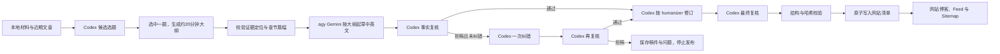

# 每日研究博客

任务定义：[daily-blog-agy-codex.json](../config/tasks/daily-blog-agy-codex.json)。执行程序：[workflows/daily_blog.py](../workflows/daily_blog.py)。由 Go 调度，不创建新的 systemd timer。

| 配置 | 当前值 |
| --- | --- |
| 任务 ID / 类型 | daily-blog-agy-codex / workflow |
| 频率 | 每日上海时间 22:30，随机延迟 0–420 秒 |
| 候选题与大纲 | Codex，gpt-6.1-sol；最多 3 个候选，自动选择一题并生成 6–9 节大纲 |
| 阅读目标 | 中英文各约 20 分钟；默认允许约 17–23 分钟的篇幅区间 |
| 写稿 | agy，gemini-3.8-flash-high（Gemini 3.8 Flash High） |
| 事实复核、修订、最终复核 | Codex，gpt-6.1-sol |
| 修订规则 | /root/.codex/skills/humanizer/SKILL.md；每轮保存完整副本与 SHA256 |
| 输入 | 近两天 SQLite 文档与 normalized 文件、已有公司研究快照、新闻标题线索 |
| 发布位置 | /mnt/quant-state/quant-web/blog；网站代码在 /mnt/quant/strategies/stocks-quant |
| 模型调用 | 通常 5 次，初稿被拒时允许一次纠错和再复核，最多 7 次；串行，相邻调用完成后至少间隔 10 秒 |
| 超时与互斥 | 整轮 75 分钟；agy 1200 秒、Codex 写作修订各 900 秒、规划与复核各 300 秒；model-cli 与本地新闻分析互斥 |



## 内容与发布规则

### 先选题与大纲，再写稿

选题编辑使用完整 research-blog-editor skill 和本轮资料包，参考最近十篇文章。候选题写出核心问题、读者价值、时效、可用来源和证据缺口；按证据深度、具体机制和与近期文章的差异选择一题。最多三题，材料不足时可以少生成候选，不能为了数量制造选题。

选中题目的大纲包含中英文标题、核心问题、暂定论点、讨论范围和读者能带走的判断。六至九个章节分别说明用途、论点、引用定位、证据边界和中英文篇幅预算，覆盖开篇利害、证据案例、机制、最强反论证与证伪条件、判断影响及未决问题。题目至少有两个不同来源 URL，纯标题线索不能独立支撑长文。

在 Gemini 启动前写入 `topic-candidates.json`、`blog-outline.json` 和方便 Review 的 `blog-outline.md`。逐章引用必须指向本轮资料包的真实 source_id 和 locator；大纲绑定资料包 SHA256。只有通过结构、引用和篇幅预算校验才开始写稿。选题阶段缺少证据则停止该轮。

### 约 20 分钟的正文

每种语言目标约二十分钟，默认预算为中文约 6000 阅读单位、英文约 4000 词。中文按汉字加独立拉丁词汇/数字粗估，每分钟 300 单位；英文按每分钟 200 词粗估。正文校验允许中文 5100–6900 单位、英文 3400–4600 词。阅读速度和内容难度因人而异，这个范围是篇幅估算。

统计排除链接 URL 和代码块。网站的 reading_time 从实际正文计算，忽略模型自行填的标签。初稿、纠错稿和 humanizer 后的终稿均需达标，并至少有六个二级章节。不能依靠重复或无关背景凑篇幅；若现有资料支撑不了这个深度，应报告材料不足。

Gemini 按所选大纲写稿，来源限于该题列出的 source_ids。后续 Codex 检查是否展开章节论点、保留反论证和边界，防止长文偏离大纲。使用已有网站署名、标签词表、中英双语格式和内容寻址 Markdown。正文说明模型辅助编写与复核的方式。

网页采集由现有 crawl 任务负责，本工作流不主动下载来源网页。RSS 标题与摘要标为待核验线索；已有公司研究快照标明快照截止日和原披露口径，不能宣称已重新验证一手原文或把未来计划写成完成结果。写稿和复核使用同一份资料包；文档内容哈希须与 SQLite 一致，未来日期和过期研究快照不用于供稿。已有机构研究内容不进入本流程。

Codex 复核结果必须绑定文章和资料包的 SHA256；humanizer 修订不能改变来源 ID、标签或事实核验记录。最终复核再次检查两种语言、事实边界、引用和 humanizer 的应用。存在复核问题、错误引用、错误哈希或过期发布日期时，停止发布并保存错误与候选稿。

初稿事实复核拒稿时，Codex 可以根据具体问题纠错一次，再由独立调用重新复核。纠错时可以缩小题目、删去没有证据的细节；复核仍未通过就结束本轮。只有经过 humanizer 的终稿才附加对应编写与复核说明。这个内容修订步骤有次数上限，不会重试失败或遭拒的模型 API 请求。

这项任务采用用户授权的模型复核发布方式，复核证明保存在 blog/automation-reviews/。原市场文章任务 stocks-quant-blog-compose、stocks-quant-blog-daily-publish 已停用，配置和历史保留；原人工批准函数及 approvals 文件格式保留。新流程的模型证明使用 approval_kind=model_review，不生成带人工 reviewed_by 的批准文件。

发布与原发布器使用相同 publish.lock，检查当天运行时文章和 slug 冲突，先保存内容与复核证明，再原子替换 manifest.json。新文件按网站目录所属账号设置 owner 和 0640 权限，网站进程可以读取。无需修改网站主题、重启网站或每轮部署代码。

## 状态与迭代

每轮 task_runs 的 metadata_json.result.business_status 记录业务结果：

| 状态 | 含义 |
| --- | --- |
| published | 本轮已写入网站清单 |
| already_published | 当天已有运行时文章，本轮未调用模型 |
| insufficient_evidence | 缺少材料，或写稿模型判断材料不足 |
| previous_attempt_failed | 当天已有失败或中断的模型尝试，保持停止 |
| already_attempted | 当天已完成一次尝试，本轮未调用模型 |
| failed | 模型、内容复核、结构或权限校验失败 |
| preview | 离线检查完成，未调用模型或发布 |

每日最多保留一次自动模型写稿尝试和一篇运行时文章。模型供应方返回拒绝、鉴权或限流信号后持久熔断，不自动重试；修复原因后由操作者显式复位。输入不足或审核不通过时不会为凑每日数量编造文章。

运行目录 data/runs/&lt;run_id&gt;/ 保存资料包、两个 skill 副本、候选题、完整大纲、各阶段提示词与响应、原稿、终稿和发布结果。task_runs 的 result 保存所选题目、阅读目标、大纲哈希以及 JSON/Markdown 路径；写稿或复核失败时仍记录已生成的大纲，方便调整。CLI 日志保持在忽略目录。

发布证明绑定完整 editorial_plan。只将发布后的简短索引写入 data/knowledge/topics/daily-research-blog/summaries/YYYY-MM-DD.json，并登记到现有 artifacts 表；索引增加选题摘要、大纲哈希和实际阅读估算。数据库仍为六张表。

## 运维

运行环境需安装本机 agy 和 Codex，沿用各 CLI 已登录的账号。按用户明确要求，agy 使用 --dangerously-skip-permissions，Codex 使用 --dangerously-bypass-approvals-and-sandbox，均为 full 权限且不进入交互授权。模型阶段不再增加 bubblewrap 或文件系统沙箱；发布仍需完整内容复核、哈希和结构校验。部署见 [deployment/README.md](../deployment/README.md)。

```bash
make init
make test-blog
/mnt/quant/strategies/stocks-quant/web/.venv/bin/python -m workflows.daily_blog --check
bin/news-claw runs --limit 10
```

需要提前运行时，通过 Go 队列启动，保留同一天的防重规则：

```bash
bin/news-claw enqueue --task daily-blog-agy-codex
```

修复供应方拒绝的原因后，可显式复位对应熔断状态；当天已尝试记录保持保留：

```bash
/mnt/quant/strategies/stocks-quant/web/.venv/bin/python -m workflows.daily_blog --reset-provider agy
/mnt/quant/strategies/stocks-quant/web/.venv/bin/python -m workflows.daily_blog --reset-provider codex
```

频率、素材窗口、模型、planning、reading、阶段超时和输入路径都在 JSON 中调整。make init 后常驻 engine 自动重读。长文任务提前到 22:30，给新增规划和长文修订留出时间；最大随机延迟加整轮超时仍在当天结束前。每日工作流模板见 [daily-blog.json](../config/templates/daily-blog.json)，默认关闭。

CLI 参数已在本机 --help 核对；Codex 结构化响应方式参考 [非交互模式](https://learn.chatgpt.com/docs/non-interactive-mode)，模型标识参考 [GPT-6.1 Sol 文档](https://developers.openai.com/api/docs/models/gpt-6.1-sol)。
