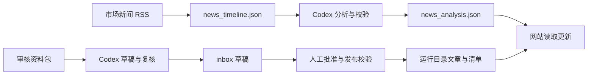

# 网站供稿与任务协议

最终目标：采集、核验和吸收信息，生成可追溯的主题材料，再同步发布到 `/mnt/quant/strategies/stocks-quant` 网站。这个目标同时写入 README 和任务的 workflow 配置。

## 当前已有的两条链路



| 阶段 | 任务 ID | 入口 / 输出 |
| --- | --- | --- |
| 采集网站市场新闻 | stocks-quant-market-news-refresh | `web.news_collector` → `/mnt/quant-state/quant-web/news_timeline.json` |
| Codex 分析并更新网站数据 | stocks-quant-market-news-analysis | `web.news_analysis` → `news_analysis.json`、历史快照和审计 |
| Codex 撰写和复核长文草稿 | stocks-quant-blog-compose | `blog/source-packets/YYYY-MM-DD.json` → `blog/inbox/YYYY-MM-DD.json` |
| 校验并发布长文 | stocks-quant-blog-daily-publish | `web.blog_daily` → `blog/articles/`、`blog/manifest.json` |

网站依照现有运行路径读取数据和文章，无需每轮修改主题代码或重新部署网站。供应链、公司脉冲、科技史和 OFR 任务也保留原网站数据输出路径。

资料包、草稿和发布仍使用 stocks-quant 的校验器。资料包必须符合已有来源、使用权和当天复核规则；文章批准文件必须与草稿哈希对应。缺少资料包、草稿或批准时记录跳过/等待，不能生成假批准。Codex 任务可以调用现有 Python 包装程序，由包装程序维护模型参数、证据、结构校验和发布幂等性。

## 统一任务协议

每项任务由 `config/tasks/<task_id>.json` 定义；当前只支持 JSON，尚未实现 YAML 解析。

- `task_type`：`crawl` / `codex` / `publish`，用于查询和展示。
- `schedule`、`schedule_format`、`timezone`、`enabled`：管理何时运行。
- `execution.command`、`working_dir`、`env`、`user`：运行任意前台程序。
- `timeout_seconds`、`stop_grace_seconds`、`lock_group`：管理超时、收尾和互斥。
- `recovery_command`、`recovery_timeout_seconds`：适配器清理中断的外部工作，成功后才释放旧 running 记录。
- `workflow`：记录网站目录、输入输出、阶段和上下游 ID；是说明元数据。执行程序检查输入是否可用，Go 当前没有 DAG 依赖调度。

Go 注入 `NEWS_CLAW_ROOT`、`NEWS_CLAW_DB`、`NEWS_CLAW_TASK_ID`、`NEWS_CLAW_RUN_ID`、`NEWS_CLAW_TASK_CONFIG_PATH` 和 `NEWS_CLAW_RESULT_PATH`。执行程序读取本轮 task.json 快照，向 result.json 写 JSON，退出时提供退出码。恢复命令以 engine 账号执行，继承配置中的环境和工作目录。所有任务都写入同一 `task_runs`，无需增加 Codex 或发布专用表。

```json
{
  "success": true,
  "business_status": "awaiting_editor_approval",
  "business_result": {"day": "2026-10-10", "slug": "example"}
}
```

上述结果表示检查程序正常完成，文章等待批准。`task_runs.status=succeeded` 表示程序执行成功；实际业务结果保存在 `metadata_json.result.business_status`。博客适配器从 service 的本轮日志提取该字段；模型供应方熔断或上次失败会将本轮标为 failed。只有 `published` 才表示本轮完成发布。

## 平替范围与后续连接

11 项任务的时间调度已统一迁移到 Go，旧 8 个 timer 停用。旧任务通过配置中的命令调用 service 适配器，保留实际安装的执行账号、Codex 环境、文件沙箱和发布任务的网络隔离。systemd 目前用于托管 engine 和隔离旧任务执行，时间调度由 Go 完成。

Go 核心没有 systemd 或网站专用分支。后续可将某项 `execution.command` 换成直接执行的脚本或其他容器适配器，配置相应恢复命令；切换前需重现该任务实际使用的权限、Codex 凭据环境、网络限制和校验规则。

三个新主题目前只完成 RSS 线索发现，输出到本 repo 的 raw、normalized 和 documents。它们尚未自动形成知识摘要或网站资料包。后续应补充：官方与社区证据 → Codex 主题整理 → 有来源与输入指纹的 knowledge 产物 → 适配网站数据/草稿格式 → 发布校验。现有市场长文资料包有特定内容规则，新政策或 AI 产品内容应使用适合该栏目的校验与发布适配器。

任务先保持文件接口和脚本输入校验。需要自动串联时再增加以成功产物和输入指纹为依据的触发机制，不能仅凭上游到过计划时间就发布。
