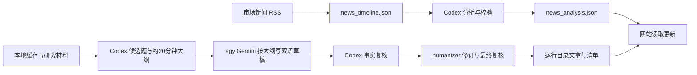

# 网站供稿与任务协议

最终目标：采集、核验和吸收信息，生成可追溯的主题材料，再同步发布到 `/mnt/quant/strategies/stocks-quant` 网站。这个目标同时写入 README 和任务的 workflow 配置。

## 当前供稿链路



| 阶段 | 任务 ID | 入口 / 输出 |
| --- | --- | --- |
| 采集网站市场新闻 | stocks-quant-market-news-refresh | `web.news_collector` → `/mnt/quant-state/quant-web/news_timeline.json` |
| Codex 分析并更新网站数据 | stocks-quant-market-news-analysis | `web.news_analysis` → `news_analysis.json`、历史快照和审计 |
| 候选题与长文大纲、Gemini 写稿、Codex 复核、humanizer 与发布 | daily-blog-agy-codex | 本地证据 → `workflows.daily_blog` → `blog/articles/`、`blog/manifest.json` |
| 原 Codex 市场草稿（停用并保留） | stocks-quant-blog-compose | `blog/source-packets/YYYY-MM-DD.json` → `blog/inbox/YYYY-MM-DD.json` |
| 原人工批准发布（停用并保留） | stocks-quant-blog-daily-publish | `web.blog_daily` → `blog/articles/`、`blog/manifest.json` |

网站依照现有运行路径读取数据和文章，无需每轮修改主题代码或重新部署网站。供应链、公司脉冲、科技史和 OFR 任务也保留原网站数据输出路径。

每日博客使用用户授权的模型复核发布方式，两个版本均在最终哈希绑定的复核通过后发布，记录为 model_review；详见 [每日博客](daily-blog.md)。原市场资料包和人工批准校验器保留，原批准文件仍需由人工提供，不能生成假批准。

## 统一任务协议

每项任务由 `config/tasks/<task_id>.json` 定义；当前只支持 JSON，尚未实现 YAML 解析。

- `task_type`：`crawl` / `codex` / `agy` / `publish` / `workflow`，用于查询和展示；不同模型 CLI 继续使用同一执行协议。
- `schedule`、`schedule_format`、`timezone`、`enabled`：管理何时运行。
- `execution.command`、`working_dir`、`env`、`user`：运行任意前台程序。
- `timeout_seconds`、`stop_grace_seconds`、`lock_group`：管理超时、收尾和互斥。
- `recovery_command`、`recovery_timeout_seconds`：适配器清理中断的外部工作，成功后才释放旧 running 记录。
- `workflow`：执行程序自己的配置与说明。每日博客脚本读取其中的模型、输入和阶段参数；Go 当前没有 DAG 依赖调度。

Go 注入 `NEWS_CLAW_ROOT`、`NEWS_CLAW_DB`、`NEWS_CLAW_TASK_ID`、`NEWS_CLAW_RUN_ID`、`NEWS_CLAW_TASK_CONFIG_PATH` 和 `NEWS_CLAW_RESULT_PATH`。执行程序读取本轮 task.json 快照，向 result.json 写 JSON，退出时提供退出码。恢复命令以 engine 账号执行，继承配置中的环境和工作目录。所有任务都写入同一 `task_runs`，无需增加 Codex 或发布专用表。

```json
{
  "success": true,
  "business_status": "awaiting_editor_approval",
  "business_result": {"day": "2026-10-10", "slug": "example"}
}
```

上述结果表示检查程序正常完成，文章等待批准。`task_runs.status=succeeded` 表示程序执行成功；实际业务结果保存在 `metadata_json.result.business_status`。博客适配器从 service 的本轮日志提取该字段；模型供应方熔断或上次失败会将本轮标为 failed。只有 `published` 才表示本轮完成发布。

agy / Gemini 可使用 [agy 模板](../config/templates/agy.json) 处理本地材料并辅助复核。直接 CLI 响应保存在运行日志中；进入正式 knowledge 或网站内容前，由包装脚本校验并登记产物，沿用后续发布规则。模型选择和登录由 CLI 环境提供。本机模型任务已按用户要求使用 full CLI 权限，并通过 service drop-in 移除文件系统限制；安装与离线检查见 [部署说明](../deployment/README.md)。

## 平替范围与后续连接

当前 12 项任务定义、10 项启用，时间调度由 Go 管理，旧 8 个 timer 停用。每日博客直接运行多阶段脚本，不调用旧博客 service；原两项博客任务停用并保留历史。其余旧任务通过命令调用 service 适配器。systemd 目前用于托管 engine 和隔离旧任务执行。

Go 核心没有 systemd 或网站专用分支。后续可将某项 `execution.command` 换成直接执行的脚本或其他容器适配器，配置相应恢复命令；切换前需重现该任务实际使用的权限、Codex 凭据环境、网络限制和校验规则。

三个新主题的采集输出到 raw、normalized 和 documents。每日博客已读取这些缓存，并结合现有网站公司研究材料生成候选分析和发布后的 knowledge 索引。RSS 线索保持待核验属性；后续可增加官方与社区原文、主题时间线和关系整理，提高文章证据质量。原市场长文资料包的特定规则保留在旧流程。

任务先保持文件接口和脚本输入校验。需要自动串联时再增加以成功产物和输入指纹为依据的触发机制，不能仅凭上游到过计划时间就发布。
